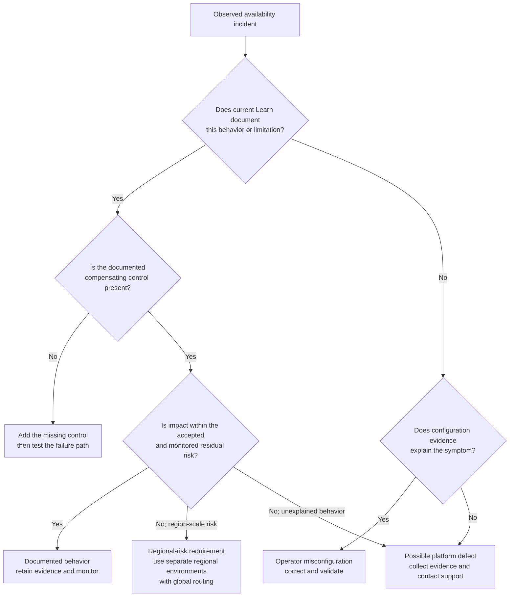

---
content_sources:
  diagrams:
    - id: is-this-a-bug-or-a-non-guarantee-or-a-misconfig
      type: flowchart
      source: self-generated
      justification: "No single MS Learn article presents an operator-facing decision tree that distinguishes a platform bug from a documented platform non-guarantee from operator misconfiguration. Synthesized from the reliability, revisions, zone-redundancy, planned-maintenance, and scaling articles plus the two published falsifiable claim labs (zone-redundancy-best-effort for Claims 2 and 3; startup-degraded-transient-failure for Claim 4). The Claim 1 backing lab is tracked separately under issue #202 and is not yet published; Claim 5 is a MSLearn-only non-guarantee with no falsifiable reproduction needed."
      based_on:
        - https://learn.microsoft.com/en-us/azure/reliability/reliability-container-apps
        - https://learn.microsoft.com/en-us/azure/container-apps/revisions
        - https://learn.microsoft.com/en-us/azure/container-apps/how-to-zone-redundancy
        - https://learn.microsoft.com/en-us/azure/container-apps/planned-maintenance
        - https://learn.microsoft.com/en-us/azure/container-apps/scale-app
content_validation:
  status: verified
  last_reviewed: 2026-11-08
  reviewer: agent
  core_claims:
    - claim: Microsoft Learn does not document a per-replica physical-host placement contract or an operator-facing control for pinning Container Apps replicas to distinct physical hosts.
      source: https://learn.microsoft.com/en-us/azure/reliability/reliability-container-apps
      verified: true
    - claim: In a zone-redundant environment, Container Apps automatically schedules app replicas across availability zones, Microsoft recommends at least two minimum replicas to ensure distribution across multiple zones, and platform maintenance uses rolling updates across fault domains and availability zones to reduce disruption.
      source: https://learn.microsoft.com/en-us/azure/reliability/reliability-container-apps
      verified: true
    - claim: Planned maintenance windows control when noncritical updates can start but remain optional and best-effort.
      source: https://learn.microsoft.com/en-us/azure/container-apps/planned-maintenance
      verified: true
    - claim: A new revision is considered ready only after it provisions successfully, scales to match the previous revision's replica count, and all replicas pass startup and readiness probes; rolling rollout depends on correctly-configured probes to mask client-visible transients.
      source: https://learn.microsoft.com/en-us/azure/container-apps/revisions
      verified: true
    - claim: Container Apps is a single-region service; regional resilience requires separate environments in multiple regions plus customer-configured load balancing and failover policies such as Azure Front Door or Traffic Manager.
      source: https://learn.microsoft.com/en-us/azure/reliability/reliability-container-apps
      verified: true
---
# Availability and Non-Guarantees

Use this page to align operator expectations with the exact availability behaviors and limits that Azure Container Apps documents. It distinguishes automatic platform behavior from customer-owned configuration and regional-resilience responsibilities, and points to a falsifiable lab when one exists.

## Why This Matters

Container Apps is a managed platform that abstracts away physical-host placement, replica scheduling, maintenance sequencing, and rolling-rollout transitions. These contracts differ: current Microsoft Learn explicitly says zone-redundant environments automatically schedule app replicas across zones, while planned-maintenance windows are an optional best-effort feature and cross-region failover remains the customer's responsibility. Treat each incident against the exact published contract instead of applying one blanket “best-effort” label.

When an operator's mental model exceeds the documented contract, the failure mode is predictable:

- "My zone-redundant app had dropped requests during an AZ fault — Container Apps must be broken." (Claim 2: automatic zone distribution does not prevent every in-flight request from timing out.)
- "I set `minReplicas=3` so I should always have 3 replicas running across 3 nodes." (Claim 1: node spread is not guaranteed.)
- "Several replicas restarted close together — was this maintenance or an unexplained incident?" (Claim 3: Learn does not publish per-app restart-spreading behavior, so correlate and investigate.)
- "I have probes configured, so my rolling rollout should produce zero 5xx." (Claim 4: probe correctness gates transients, not the rollout mechanism alone.)
- "Microsoft sells this as enterprise-grade — that means 99.99% on a single region." (Claim 5: Microsoft Learn explicitly directs higher SLO targets to multi-region.)

The remediation in every case is the same shape: **add a compensating control at a layer the platform does not own** (multi-region failover, client-side retries with jitter, sub-minute bucketed alerting, etc.). This page documents the contracts, names the failure modes, and lists the compensating controls. Operators should treat "no observed failures yet" as distinct from "the platform guarantees no failures" — many of the failure modes below are rare in normal operation but documented as possible, and the operator-side compensating control is what bounds the worst-case blast radius.

<!-- diagram-id: is-this-a-bug-or-a-non-guarantee-or-a-misconfig -->

*Figure: Classify the symptom against current Learn first, then use configuration and control evidence before escalating an unexplained result.*

## Recommended Practices

Each subsection follows the pattern **Practice → Non-guarantee disclosure → Remediation pattern → Lab evidence**. The non-guarantee disclosure quotes (or paraphrases with a direct link) the Microsoft Learn statement that disclaims the assumption. The remediation pattern is the operator-side control that compensates.

### Claim 1: Replica node spread is best-effort, not guaranteed

**Practice**: Size the replica floor for the capacity and load that must remain available during failures, retain the documented minimum of two replicas for distribution across multiple zones in a zone-redundant environment, and design the workload to tolerate individual replica loss. If the requirement is hard physical separation, use a platform offering explicit placement controls rather than inferring separation from replica count.

**Non-guarantee disclosure**: Container Apps places replicas on physical hosts using a platform scheduler. The Microsoft Learn article on [reliability in Container Apps](https://learn.microsoft.com/en-us/azure/reliability/reliability-container-apps) documents that the scheduler distributes replicas across physical hosts; the article on [scaling in Container Apps](https://learn.microsoft.com/en-us/azure/container-apps/scale-app) is the source for `minReplicas` / `maxReplicas` semantics. Neither article documents a per-replica node-placement contract or an operator-facing control that pins specific replicas to specific physical hosts. The absence-of-documentation framing is the binding one: an operator cannot point at a Microsoft Learn page that promises `N` replicas will land on `N` distinct nodes, so a production design that depends on that assumption is unsupported by the public platform contract. Explicit resource requests and limits give the scheduler more information for placement decisions, but they do not introduce a published placement guarantee.

**Remediation pattern**:

1. Set CPU and memory `requests` and `limits` explicitly on every container (do not rely on defaults). Explicit resource shape helps the scheduler make placement decisions, but Microsoft Learn does not describe it as a precondition for zone redundancy.
2. In a zone-redundant environment, retain `minReplicas >= 2` for the documented multi-zone distribution recommendation, then increase the floor according to measured surviving-capacity and peak-load requirements. Pair this design with a client-side retry layer (SDK retry policy, API gateway retry, or CDN-level retry).
3. If the workload genuinely requires hard physical separation, choose a platform offering explicit placement controls. Container Apps does not expose a documented control that can prove this requirement from replica count alone.
4. Add an alert on the [`Replicas` metric](../reference/metrics/container-app-metrics.md#replicas-replica-count) for the app dropping below `minReplicas` for more than one bucket. This is a **count-based secondary symptom alert**: the metric does not directly observe physical-host placement, so it cannot detect hidden host co-tenancy when the replica count stays at or above the floor. Use it to catch the subset of scheduler-driven re-placement events that take the count below `minReplicas`, not as proof of node spread.

**Lab evidence**: A focused lab for Claim 1 is tracked separately in [issue #202](https://github.com/yeongseon/azure-container-apps-practical-guide/issues/202) and is not yet published. The planned lab uses `boot_id` and uptime monotonicity as proxy signals to compare Consumption-profile and Dedicated-D8-profile replica distribution at scale. When the lab ships, this cross-link will land here and the page-level `content_sources` justification will be updated to list it.

### Claim 2: Zone redundancy distributes replicas, but does not eliminate transient impact

**Practice**: Set `zoneRedundant=true` when creating the Container Apps environment, use at least two minimum replicas as Microsoft recommends, set resource requests and limits explicitly, and design clients to tolerate transient failures during a zone event.

**Documented contract and limit**: Current Microsoft Learn says Container Apps automatically schedules app replicas across zones when zone redundancy is enabled. It also says in-flight requests to the failed zone might be dropped, time out, or return connection errors; rerouting typically occurs in about 30 seconds depending on probe configuration. “Typically” is not a maximum-time guarantee. This current wording supersedes the older best-effort interpretation retained in the historical lab title and playbook name.

**Remediation pattern**:

1. Set `minReplicas` to at least 2, the documented minimum recommendation for distribution across multiple zones. Increase it when peak load, simultaneous-zone resilience, or replacement headroom requires more capacity; do not infer a one-replica-per-zone placement API.
2. Set CPU and memory `requests` and `limits` explicitly. Microsoft Learn says this information helps the scheduler make optimal placement decisions across zones and that underspecified requirements can lead to uneven distribution or placement failures under high load; it does not make explicit requests a precondition for zone redundancy.
3. Implement client-side retry with jitter for all calls into the Container App. A transient zone-level outage during a planned maintenance event is invisible to the app code but visible to the client.
4. Configure bucketed alerting on `err_pct` at 10-second granularity (see the [Startup-Degraded Bucketed 5xx KQL Pack](../troubleshooting/kql/scaling-and-replicas/startup-degraded-bucketed-5xx.md) for the bucket-aggregation pattern). Minute-granularity alerting is too coarse to detect sub-minute zone-level transients.
5. If your availability target exceeds what a single zone-redundant environment provides (see Claim 5), promote to a multi-region design.

**Lab evidence**: [Zone Redundancy Best-Effort Lab](../troubleshooting/lab-guides/zone-redundancy-best-effort.md) uses operator-driven perturbations (revision restart, sustained load) against a `zoneRedundant=true` environment to exercise the scheduler's replacement behavior. Across the lab's 24h baseline, the audit sampler did NOT observe platform-initiated clustered replica replacement, so the lab cannot definitively refute the absolute-zone-redundancy assumption from natural platform behavior alone. Per the lab's evidence-integrity ceiling — and the absence of per-replica AZ identity in the public Container Apps API — Claim 2 is held at `[Strongly Suggested]`, never `[Observed]`. The companion playbook [Zone Redundancy Is Best-Effort](../troubleshooting/playbooks/platform-features/zone-redundancy-best-effort.md) lists the four-layer mitigation flow.

### Claim 3: Microsoft Learn does not publish a restart-spreading guarantee for planned maintenance

**Practice**: Treat the timing distribution of replica restarts during maintenance as undocumented at the per-app level. Build resilience for restart events, but treat clustered restarts as evidence to correlate with maintenance history and investigate rather than as documented normal behavior.

**Documented behavior and evidence limit**: The Microsoft Learn article on [reliability in Container Apps](https://learn.microsoft.com/en-us/azure/reliability/reliability-container-apps#resilience-to-service-maintenance) says platform maintenance uses rolling updates across fault domains and availability zones to reduce disruption. The [planned maintenance](https://learn.microsoft.com/en-us/azure/container-apps/planned-maintenance) article documents maintenance windows and says the update system is designed to minimize application impact. Neither source publishes a per-app restart timeline. A hypothesis that one maintenance event clustered multiple replica restarts is therefore `[Not Proven]` until the event is correlated with maintenance history and platform evidence; it must not be inferred from an operator-driven restart.

**Remediation pattern**:

1. Configure `terminationGracePeriodSeconds` to bracket the application's drain time, and ensure the application drains in-flight work before the grace period expires. In-flight requests that have not completed by the end of the grace period surface as client-visible failures. Container Apps follows the standard container-runtime lifecycle for graceful shutdown; the exact signal semantics are a runtime detail and are not the subject of a public contract specific to Container Apps.
2. Configure `minReplicas` so the replicas expected to remain available during a documented failure scenario can carry the required load with measured headroom. Do not use an assumed number of replicas per physical host in this calculation because Container Apps does not expose or guarantee that placement.
3. Implement client-side retry with jitter for calls whose failure has user-visible impact. Correlate restart timestamps with maintenance history, application changes, and platform health; escalate when impact is unexplained or exceeds documented behavior.
4. Configure an alert on the [`Replicas` metric](../reference/metrics/container-app-metrics.md#replicas-replica-count) dropping below `minReplicas` for more than 60 seconds. This is a **count-based secondary symptom alert**: the metric does not directly observe physical-host placement, so it can only catch a clustered restart that takes the replica count below the floor. A clustered restart that stays at or above `minReplicas` (because the platform replaces replicas as fast as it restarts them) will not trigger this alert.

**Lab evidence**: The [Zone Redundancy Best-Effort Lab](../troubleshooting/lab-guides/zone-redundancy-best-effort.md) did not observe a platform maintenance event during its 24-hour baseline. Its operator-driven `revision restart` exercises a different control path and is not evidence for planned-maintenance sequencing. Claim 3's platform-maintenance clustering hypothesis is `[Not Proven]`. If replicas restart close together, retain the timestamps, correlate them with scheduled-maintenance history, revision changes, application logs, and Azure Service Health, then investigate or escalate when the cause remains unexplained or the impact exceeds documented behavior.

### Claim 4: Rolling rollout transient masking depends on probe correctness, not on the rollout mechanism alone

**Practice**: Give startup, readiness, and liveness probes purpose-specific semantics. Use separate endpoints when they answer different questions; sharing one endpoint is acceptable only when its semantics are intentionally correct for every probe type. Validate probe correctness with a perturbation-tolerance load harness, not with single-shot health checks.

**Non-guarantee disclosure**: The Microsoft Learn article on [revisions](https://learn.microsoft.com/en-us/azure/container-apps/revisions) states that a new revision is considered ready only after it provisions successfully, scales to match the previous revision's replica count, and **all replicas pass startup and readiness probes**. The article does NOT say that the rolling-rollout mechanism alone masks client-visible 5xx. The masking is a consequence of correctly-configured probes gating traffic. If probes return 200 before the application is actually ready to serve the workload path, the platform will route traffic to a not-yet-warm replica regardless of the rollout strategy, and client-visible 5xx will result.

**Remediation pattern**:

1. The readiness path must return success only when the replica can serve incoming requests. Startup and liveness paths should separately represent successful initialization and continued process health unless one shared endpoint intentionally satisfies all three meanings.
2. Size the startup-probe retry window from `initialDelaySeconds` plus the repeated attempts governed by `periodSeconds` and `failureThreshold`. Do not require `initialDelaySeconds` alone to cover the full cold start.
3. Test the rollout with a constant-arrival-rate load harness (k6 or equivalent), at a target RPS that consumes nontrivial headroom on the replica. A single-shot `curl` after deploy does not exercise the load path; the rollout could produce a 5-second 5xx burst that the single-shot check misses entirely.
4. Bucket alerting on `err_pct` at 10-second granularity. Default platform alerting is at minute granularity; sub-minute rollout transients are invisible at that resolution. The KQL pack's falsification query (Q5 in the [Startup-Degraded Bucketed 5xx KQL Pack](../troubleshooting/kql/scaling-and-replicas/startup-degraded-bucketed-5xx.md)) is the canonical bucket-level alerting pattern.

**Lab evidence**: [Startup-Degraded Transient Failure Lab](../troubleshooting/lab-guides/startup-degraded-transient-failure.md) reproduces the failure-mode envelope using a deterministic 25-second cold-start subject app, a constant-arrival-rate k6 loadgen at 200 RPS, a rolling-rollout perturbation managed by Container Apps, and a 5-second-cadence revision-state sampler. The falsification rule (any sustained 3-consecutive-10s-bucket window above 0.5% err_pct during a rollout) is binding. The companion KQL pack lists the seven queries used to reach the verdict.

### Claim 5: Single-region availability target exceeded — promote to multi-region

**Practice**: When the application's availability SLO exceeds what a single zone-redundant Container Apps environment can deliver, deploy the application to a second region and front it with Azure Front Door (or an equivalent global load balancer with health-based failover).

**Non-guarantee disclosure**: The Microsoft Learn article on [reliability in Container Apps](https://learn.microsoft.com/en-us/azure/reliability/reliability-container-apps) is explicit that for higher availability targets than a single zone-redundant environment provides, operators are directed to multi-region designs fronted by Azure Front Door. The article does not publish a numeric SLO for the single-region zone-redundant configuration. The operator MUST assume that "single region, zone-redundant" tops out short of any availability target that requires regional-scale failure tolerance.

**Remediation pattern**:

1. Deploy the application to two regions. The secondary region can be lower-capacity (warm-standby pattern) or equal-capacity (active-active pattern) depending on the recovery time objective (RTO) and recovery point objective (RPO).
2. Front both regions with [Azure Front Door](https://learn.microsoft.com/en-us/azure/frontdoor/front-door-overview) using a health-probe-based routing rule. Front Door's regional failover is the operator-side control that compensates for any single-region availability ceiling.
3. Ensure stateful dependencies (databases, queues, caches) are also configured for cross-region replication or failover. Microsoft Learn does not publish one universal cross-region failover duration for this customer-built topology; measure the complete routing, application, and data recovery path against your RTO.
4. Test the failover regularly with a chaos exercise. An untested DR path is not a DR path. See the [multi-region failover playbook](../troubleshooting/playbooks/platform-features/multi-region-failover.md) for the operational pattern.

**Lab evidence**: This claim is a Microsoft Learn explicit non-guarantee statement (no falsifiable reproduction is needed — the documentation itself caps single-region availability). The corroborating cross-link is the [multi-region failover playbook](../troubleshooting/playbooks/platform-features/multi-region-failover.md), which describes the failover topology that compensates for the cap.

## Common Mistakes / Anti-Patterns

Each anti-pattern below maps to one of the five claims above. The pattern is **assumption → consequence → fix**.

### Mistake 1: Assuming `minReplicas=N` guarantees `N` distinct physical nodes

**Assumption**: Setting `minReplicas=3` on a zone-redundant environment will always result in 3 replicas across 3 distinct physical hosts.

**Consequence**: A single physical-host fault takes out more than one replica simultaneously; surviving replicas absorb a load spike they were not capacity-planned for, and may themselves fail.

**Fix**: Set `requests` and `limits` explicitly, retain at least two minimum replicas for documented multi-zone distribution in a zone-redundant environment, and increase the floor based on surviving-capacity and peak-load tests. Add a client-side retry layer, and use a platform with explicit placement controls when hard physical separation is required.

### Mistake 2: Treating zone redundancy as zero-impact failover

**Assumption**: `zoneRedundant=true` means an AZ-level fault has zero customer impact.

**Consequence**: An AZ-level event correlates with measurable customer 5xx even though replicas were distributed across zones, because in-flight requests can fail before health-probe-driven rerouting completes.

**Fix**: Rely on automatic zone distribution, but plan for dropped in-flight requests and probe-dependent rerouting. Add client retries, sufficient healthy-zone capacity, and monitoring that can reveal the transient impact.

### Mistake 3: Conflating clustered replica restart with platform outage

**Assumption**: Multiple replicas restarting within a short window proves either planned maintenance or a platform incident.

**Consequence**: The event is prematurely normalized or escalated without correlating maintenance history, revision changes, application logs, and Azure Service Health.

**Fix**: Correlate timestamps with the environment's maintenance history and other evidence. Even when timing overlaps a maintenance event, investigate customer impact; contact support when the cause remains unexplained or the impact exceeds documented behavior.

### Mistake 4: Using the workload path `/` as the health probe path

**Assumption**: A 200 response from `/` means the application is ready to serve traffic.

**Consequence**: The probe returns 200 as soon as the HTTP listener binds (before warm-up completes), the platform marks the replica as ready, traffic is routed in, and the workload path returns 5xx because the app is not actually warm yet. The 5xx burst lasts seconds and is invisible at minute-granularity alerting.

**Fix**: Implement purpose-specific probe endpoints, such as `/health/startup`, `/health/ready`, and `/health/live`, when their checks differ. Reuse one endpoint only when the same success semantics are deliberately valid for startup, readiness, and liveness. Test with a perturbation-tolerance load harness.

### Mistake 5: Assuming a single-region zone-redundant deployment hits four-nines availability

**Assumption**: Container Apps zone redundancy delivers the same availability target as a multi-region Front Door topology.

**Consequence**: The application's published SLO exceeds what the platform can deliver; an SLO breach is treated as a platform failure rather than as a topology design failure.

**Fix**: Read the [reliability in Container Apps](https://learn.microsoft.com/en-us/azure/reliability/reliability-container-apps) article carefully and align the published SLO with the topology. If the SLO requires regional-scale failure tolerance, the topology must be multi-region.

## Validation Checklist

Run this checklist before depending on any of the five contracts in production.

### For Claim 1 (node spread):

- [ ] CPU and memory `requests` are set explicitly on every container (not relying on platform defaults).
- [ ] CPU and memory `limits` are set explicitly on every container.
- [ ] In a zone-redundant environment, `minReplicas` is at least 2, with any higher floor justified by surviving-capacity and peak-load tests rather than an assumed host count.
- [ ] A secondary count-based alert is configured on the `Replicas` metric dropping below `minReplicas` (acknowledged: this alert cannot detect hidden host co-tenancy when the replica count stays at or above the floor).
- [ ] A client-side retry layer (SDK retry, API gateway retry, or CDN retry) is in place.

### For Claim 2 (zone redundancy):

- [ ] Environment is created with `zoneRedundant=true`.
- [ ] `minReplicas` is at least 2, with a higher value justified by load and failure-tolerance requirements.
- [ ] Bucket-level (10-second) alerting on `err_pct` is configured.
- [ ] The application's SLO accounts for possible in-flight request failures and probe-dependent rerouting during a zone event.
- [ ] The corresponding playbook [Zone Redundancy Is Best-Effort](../troubleshooting/playbooks/platform-features/zone-redundancy-best-effort.md) has been reviewed.

### For Claim 3 (clustered restart):

- [ ] Application drains in-flight work in response to container-termination signals before the grace period expires.
- [ ] `terminationGracePeriodSeconds` is set to bracket the application's drain time.
- [ ] `minReplicas` is sized from the required surviving capacity and measured load for documented failure scenarios, without assuming a physical-host co-tenancy pattern.
- [ ] A secondary count-based alert is configured on the `Replicas` metric for any sustained drop below `minReplicas` (acknowledged: this alert only catches clustered restarts that take the count below the floor; the metric does not directly observe physical-host placement).
- [ ] The platform maintenance schedule is checked when investigating clustered restart events.

### For Claim 4 (rolling rollout):

- [ ] Each probe endpoint implements the purpose of its probe type; shared endpoints are used only when their semantics are intentionally identical.
- [ ] The readiness endpoint returns success only when the replica can serve incoming requests.
- [ ] The startup retry window accounts for `initialDelaySeconds`, `periodSeconds`, and `failureThreshold`.
- [ ] Rolling rollout is tested with a constant-arrival-rate load harness at a target RPS that consumes nontrivial headroom on the replica.
- [ ] Bucket-level (10-second) alerting on `err_pct` is configured during rollout windows.
- [ ] The [Startup-Degraded Transient Failure Lab](../troubleshooting/lab-guides/startup-degraded-transient-failure.md) and its [companion KQL pack](../troubleshooting/kql/scaling-and-replicas/startup-degraded-bucketed-5xx.md) have been reviewed.

### For Claim 5 (single-region cap):

- [ ] The application's published SLO is consistent with what a single zone-redundant environment can deliver.
- [ ] If the SLO requires regional-scale failure tolerance, the application is deployed to a second region.
- [ ] Azure Front Door (or equivalent global load balancer) is configured with health-probe-based regional failover.
- [ ] Stateful dependencies (databases, queues, caches) are configured for cross-region replication or failover.
- [ ] A regular chaos exercise validates the regional failover path.
- [ ] The [multi-region failover playbook](../troubleshooting/playbooks/platform-features/multi-region-failover.md) has been reviewed.

## See Also

- [Reliability](reliability.md) — production patterns for probes, graceful termination, and revision rollback.
- [Revision Strategy](revision-strategy.md) — choosing revision mode, traffic split, and rollback approach.
- [Anti-Patterns](anti-patterns.md) — broader catalog of Container Apps design mistakes.
- [Platform / Reliability / Health and Recovery](../platform/reliability/health-recovery.md) — underlying platform behavior for health and recovery.
- [Zone Redundancy Best-Effort Lab](../troubleshooting/lab-guides/zone-redundancy-best-effort.md) — operator-driven perturbation lab for Claim 2; it does not validate planned-maintenance sequencing for Claim 3.
- [Startup-Degraded Transient Failure Lab](../troubleshooting/lab-guides/startup-degraded-transient-failure.md) — falsifiable reproduction for Claim 4.
- [Startup-Degraded Bucketed 5xx KQL Pack](../troubleshooting/kql/scaling-and-replicas/startup-degraded-bucketed-5xx.md) — the bucket-aggregation pattern used by Claims 2 and 4.
- [Zone Redundancy Is Best-Effort playbook](../troubleshooting/playbooks/platform-features/zone-redundancy-best-effort.md) — operator-side mitigation flow for Claims 1, 2, and 3.
- [Multi-Region Failover playbook](../troubleshooting/playbooks/platform-features/multi-region-failover.md) — operator-side topology for Claim 5.

## Sources

- [Reliability in Azure Container Apps](https://learn.microsoft.com/en-us/azure/reliability/reliability-container-apps) — primary source for Claims 1, 2, 3, and 5, including rolling maintenance across fault domains and availability zones.
- [How to configure zone redundancy in Container Apps](https://learn.microsoft.com/en-us/azure/container-apps/how-to-zone-redundancy) — corroborating source for Claim 2.
- [Container Apps planned maintenance](https://learn.microsoft.com/en-us/azure/container-apps/planned-maintenance) — primary source for Claim 3.
- [Container Apps revisions](https://learn.microsoft.com/en-us/azure/container-apps/revisions) — primary source for Claim 4.
- [Set scaling rules in Container Apps](https://learn.microsoft.com/en-us/azure/container-apps/scale-app) — corroborating source for Claim 1 (`minReplicas` and `maxReplicas` semantics).
- [Health probes in Container Apps](https://learn.microsoft.com/en-us/azure/container-apps/health-probes) — corroborating source for Claim 4.
- [Azure Front Door overview](https://learn.microsoft.com/en-us/azure/frontdoor/front-door-overview) — corroborating source for Claim 5.
