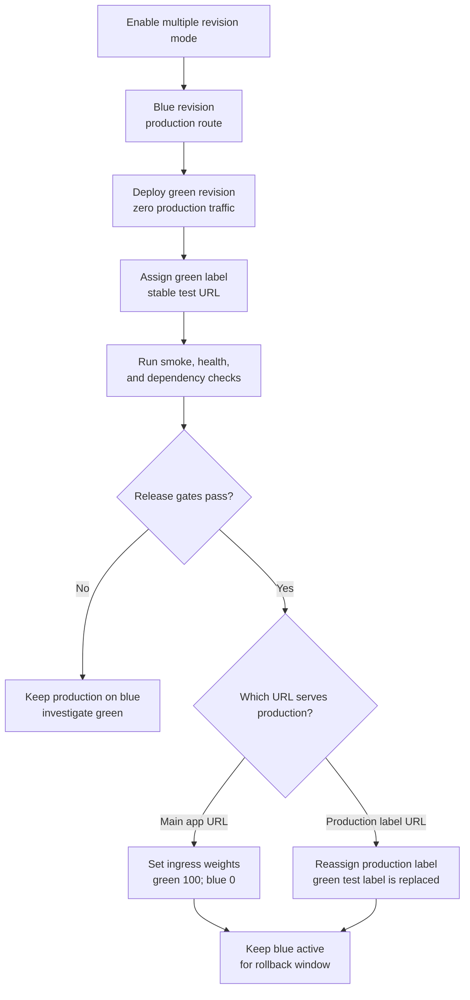

---
content_sources:
  diagrams:
    - id: blue-green-label-swap
      type: flowchart
      source: self-generated
      justification: Synthesized from Microsoft Learn guidance on revisions, revision labels in multiple revision mode, and blue/green deployment.
      based_on:
        - https://learn.microsoft.com/en-us/azure/container-apps/blue-green-deployment
        - https://learn.microsoft.com/en-us/azure/container-apps/revisions
content_validation:
  status: verified
  last_reviewed: 2026-09-11
  reviewer: ai-agent
  core_claims:
    - claim: Blue/green deployment in Azure Container Apps can use revisions, traffic weights, and revision labels in multiple revision mode.
      source: https://learn.microsoft.com/en-us/azure/container-apps/blue-green-deployment
      verified: true
    - claim: A revision label provides a stable URL that can be moved between revisions in multiple revision mode.
      source: https://learn.microsoft.com/en-us/azure/container-apps/revisions
      verified: true
    - claim: Multiple revision mode allows multiple active revisions and traffic management between them.
      source: https://learn.microsoft.com/en-us/azure/container-apps/revisions
      verified: true
---
# Blue/Green Deployment for Azure Container Apps

Blue/green deployment in Azure Container Apps keeps the current production revision and the candidate revision active at the same time, then changes routing when validation passes. Use multiple revision mode; use a label URL to validate green, and choose the cutover mechanism that matches the production URL.

## Why This Matters

Blue/green is the right pattern when you need:

- deterministic pre-cutover validation
- instant rollback without rebuilding artifacts
- a stable validation endpoint that does not disturb production users

<!-- diagram-id: blue-green-label-swap -->


*Figure: The green revision-label URL targets green independently of the main app URL's traffic weights until that label is replaced. A revision can have only one label, so reassigning the production label to green removes the green test-label URL. This stable multiple-revision workflow is distinct from the preview deployment-labels mode (`--revisions-mode labels`).*

## Recommended Practices

### 1. Use multiple revision mode first

```bash
az containerapp revision set-mode \
  --name "$APP_NAME" \
  --resource-group "$RG" \
  --mode multiple
```

| Command / Parameter | Purpose |
|---|---|
| `az containerapp revision set-mode` | Sets the Container App revision mode. |
| `--mode` | Selects the revision mode. |
| `--name` | Selects the named Azure resource. |
| `--resource-group` | Selects the resource group. |

### 2. Keep production traffic on blue while green is created

```bash
az containerapp ingress traffic set \
  --name "$APP_NAME" \
  --resource-group "$RG" \
  --label-weight "blue=100"
```

| Command / Parameter | Purpose |
|---|---|
| `az containerapp ingress traffic set` | Sets revision or label traffic weights. |
| `--label-weight` | Assigns traffic percentages by revision label. |
| `--name` | Selects the named Azure resource. |
| `--resource-group` | Selects the resource group. |

### 3. Attach a stable label to the green revision

```bash
az containerapp revision label add \
  --name "$APP_NAME" \
  --resource-group "$RG" \
  --revision "$APP_NAME--20260425-1" \
  --label "green"
```

| Command / Parameter | Purpose |
|---|---|
| `az containerapp revision label add` | Assigns a revision label to a specific revision. |
| `--label` | Sets the revision label name. |
| `--name` | Selects the named Azure resource. |
| `--resource-group` | Selects the resource group. |
| `--revision` | Selects a specific revision. |

This gives you a deterministic revision-specific URL before production cutover.

### 4. Verify green before swap

Recommended verification gates:

- readiness and startup success
- core smoke tests against the green label URL
- request success rate and latency
- downstream dependency checks

For operational commands and telemetry checks, reuse the release validation flow in the revision and monitoring docs rather than duplicating it here.

### 5. Cut over with a weight change or production-label reassignment

Use a 100/0 weight change when production uses the main app FQDN:

```bash
az containerapp ingress traffic set \
  --name "$APP_NAME" \
  --resource-group "$RG" \
  --label-weight "green=100" "blue=0"
```

| Command / Parameter | Purpose |
|---|---|
| `az containerapp ingress traffic set` | Sets revision or label traffic weights. |
| `--label-weight` | Assigns traffic percentages by revision label. |
| `--name` | Selects the named Azure resource. |
| `--resource-group` | Selects the resource group. |

If production uses a revision-label URL instead, reassign the `production` label to green. The command replaces green's existing label because each revision can have only one label:

```bash
az containerapp revision label add \
  --name "$APP_NAME" \
  --resource-group "$RG" \
  --revision "$APP_NAME--20260425-1" \
  --label "production"
```

| Command / Parameter | Purpose |
|---|---|
| `az containerapp revision label add` | Reassigns the production revision label to the green revision. |
| `--label` | Selects the production label whose stable URL moves to green. |
| `--name` | Selects the Container App. |
| `--resource-group` | Selects the resource group. |
| `--revision` | Selects the validated green revision. |

After this reassignment, the former green test-label URL no longer exists. Keep using the main app FQDN or capture evidence before cutover if post-cutover validation must not depend on the production-label URL.

### 6. Keep blue warm for a short rollback window

Do not deactivate blue immediately. Give on-call and release automation a short confidence window.

### Bicep baseline for blue/green-ready apps

Use Bicep to set the app into multiple revision mode and define a traffic block that production automation can later update.

```bicep
resource app 'Microsoft.App/containerApps@2026-01-01' = {
  name: appName
  location: location
  properties: {
    configuration: {
      activeRevisionsMode: 'Multiple'
      ingress: {
        external: true
        targetPort: 8080
        traffic: [
          {
            latestRevision: true
            weight: 100
          }
        ]
      }
    }
  }
}
```

### Verify blue/green surfaces in Azure Portal


**[Observed]** `ca-sample-d38538 | Revisions and replicas` `Container App` `Create new revision` `Save` `Refresh` `Deployment mode` `Active revisions` `Inactive revisions` `Replicas` `Name` `Date created` `Running status` `View Logs` `Label` `Traffic` `Replicas` `ca-sample-d38538--0uzoi59` `6/3/2026, 10:34:26 PM` `Running` `View details` `Show Logs` `100 %` `1 (Show replicas)`.

**[Inferred]** The `Deployment mode` setting appears to map to the multiple-revisions prerequisite called out in [1. Use multiple revision mode first](#1-use-multiple-revision-mode-first), which is consistent with treating multiple revision mode as the baseline for blue/green. The `Active revisions` and `Inactive revisions` grouping is consistent with the blue-warm-during-green guidance in [6. Keep blue warm for a short rollback window](#6-keep-blue-warm-for-a-short-rollback-window), which keeps the prior revision available for rollback. The `Label` column appears to map to the stable-label guidance in [3. Attach a stable label to the green revision](#3-attach-a-stable-label-to-the-green-revision), which uses a label to identify the green revision. The `Traffic` column with the displayed `100 %` value is consistent with the cutover operations described in [5. Cut over with a weight change or production-label reassignment](#5-cut-over-with-a-weight-change-or-production-label-reassignment), which shifts traffic between revisions.

**[Not Proven]** Additional rollout binding detail, traffic detail, and validation detail are not visible on this view.

## Common Mistakes / Anti-Patterns

- **Using DNS cutover instead of revision labels**
    DNS adds cache delay and hides which revision you are actually testing.
- **Destroying blue immediately after swap**
    Keep a short rollback window unless the release is trivial and fully validated.
- **Testing green only through the shared production route**
    That defeats the purpose of side-by-side validation.
- **Turning blue/green into permanent dual production**
    Blue is a rollback path, not a long-term second primary.

!!! warning "Do not treat label URLs as a replacement for production readiness checks"
    Labels make validation deterministic, but they do not guarantee production safety. Still evaluate telemetry and dependency health before the swap.

## Validation Checklist

- Multiple revision mode enabled
- Blue still serves production before cutover
- Green has its own label URL
- Smoke and health checks passed on green
- Rollback command prepared before swap
- Blue retained for the agreed confidence window

## See Also

- [Canary Deployment](canary-deployment.md)
- [Revision Strategy Best Practices](revision-strategy.md)
- [Traffic Split](../platform/revisions/traffic-split.md)
- [Revision Modes](../platform/revisions/revision-modes.md)
- [Revision Operations](../operations/revision-management/index.md)

## Sources

- [Blue-Green Deployment in Azure Container Apps (Microsoft Learn)](https://learn.microsoft.com/en-us/azure/container-apps/blue-green-deployment)
- [Revisions in Azure Container Apps (Microsoft Learn)](https://learn.microsoft.com/en-us/azure/container-apps/revisions)
- [Microsoft.App/containerApps template reference (Microsoft Learn)](https://learn.microsoft.com/en-us/azure/templates/microsoft.app/2026-01-01/containerapps)
