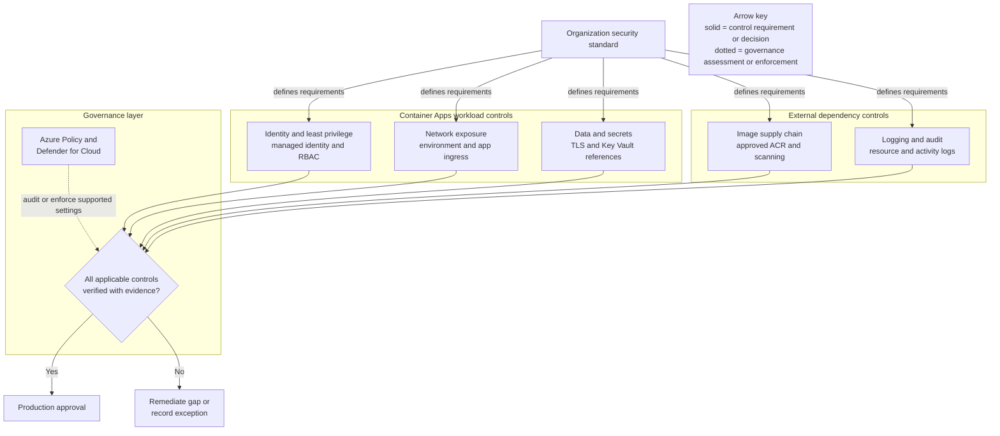
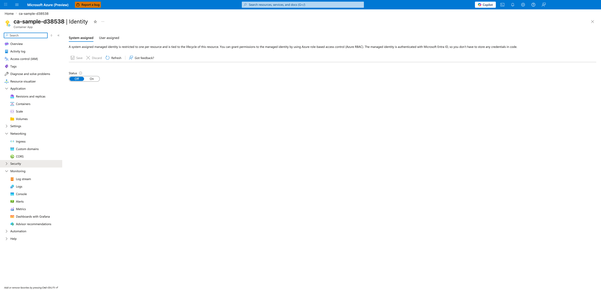

---
content_sources:
  diagrams:
    - id: production-security-baseline-control-stack
      type: flowchart
      source: self-generated
      justification: Layered control and governance decision view synthesized from current Microsoft Learn security guidance; it separates workload configuration, external dependency controls, monitoring, and Azure Policy rather than implying that one Container Apps setting enforces the complete baseline.
      based_on:
        - https://learn.microsoft.com/en-us/security/benchmark/azure/baselines/azure-container-apps-security-baseline
        - https://learn.microsoft.com/en-us/azure/container-apps/secure-deployment
        - https://learn.microsoft.com/en-us/azure/container-apps/security
        - https://learn.microsoft.com/en-us/azure/container-apps/networking
        - https://learn.microsoft.com/en-us/azure/container-apps/manage-secrets
        - https://learn.microsoft.com/en-us/azure/container-apps/managed-identity-image-pull
        - https://learn.microsoft.com/en-us/azure/container-apps/policy-reference
content_validation:
  status: verified
  last_reviewed: 2026-11-07
  reviewer: agent
  core_claims:
    - claim: Microsoft publishes a version 1.0 cloud security benchmark baseline for Azure Container Apps and directs readers to Secure your Azure Container Apps deployment for current guidance.
      source: https://learn.microsoft.com/en-us/security/benchmark/azure/baselines/azure-container-apps-security-baseline
      verified: true
    - claim: Azure Container Apps supports Key Vault secret references that authenticate with a managed identity assigned to the app.
      source: https://learn.microsoft.com/en-us/azure/container-apps/manage-secrets
      verified: true
    - claim: Container Apps networking documentation supports internal environments, custom VNets, private endpoints, and supported egress control patterns.
      source: https://learn.microsoft.com/en-us/azure/container-apps/networking
      verified: true
    - claim: Container Apps policy reference documents built-in Azure Policy coverage for the service.
      source: https://learn.microsoft.com/en-us/azure/container-apps/policy-reference
      verified: true
---
# Azure Container Apps Compliance Baseline

This baseline turns Microsoft Learn security guidance into a practical production checklist for Azure Container Apps. Use it to validate a workload before promotion, while keeping a clear distinction between verified service features and governance controls that must be enforced outside the app resource.

## Why This Matters

Compliance reviews usually fail because teams mix together supported service controls, optional governance controls, and undocumented assumptions. Azure Container Apps works best when you validate each control category explicitly and record where the enforcement actually lives.

## Recommended Practices

### Start from the Microsoft baseline, then map to your platform standard

Microsoft publishes an Azure security baseline for Azure Container Apps based on Microsoft cloud security benchmark version 1.0. Microsoft now directs readers to **Secure your Azure Container Apps deployment** for current guidance. Use both as source material, then convert the applicable controls into a deployment checklist for your own environment; do not treat the older baseline as a current all-in-one standard.

Common benchmark areas you can verify directly on Microsoft Learn include:

- **IM**: identity management
- **NS**: network security
- **DP**: data protection
- **PV**: posture and vulnerability management
- **LT**: logging and threat detection
- **AM**: asset management and governance

<!-- diagram-id: production-security-baseline-control-stack -->


*Figure: Control layers converge on an evidence-based approval decision. Azure Policy and Defender for Cloud are governance surfaces; they do not carry application traffic or substitute for app authorization, registry permissions, or dependency configuration.*

### Production baseline checklist by category

#### Identity

Mapped benchmark themes: **IM-1**, **IM-3**, **IM-8**

- Enable **managed identity** on every production container app.
- Prefer **Key Vault references** over inline secrets for sensitive values.
- Avoid embedding registry or service credentials where managed identity is supported.

Validation examples:

```bash
az containerapp identity show \
  --name "$APP_NAME" \
  --resource-group "$RG" \
  --output json

az role assignment list \
  --assignee-object-id "<principal-id>" \
  --output table
```

| Command | Why it is used |
|---|---|
| `az containerapp identity show` | Inspects managed identity configuration for the Container App. |
| `az role assignment list` | Lists role assignments for the selected principal. |
| `--name` | Selects the Container App. |
| `--resource-group` | Selects the resource group containing the app. |
| `--assignee-object-id` | Filters assignments to the managed identity principal. |
| `--output` | Selects JSON or table output for review. |

#### Network

Mapped benchmark themes: **NS-1**, **NS-2**

- Use an **internal environment** for private-only workloads.
- Use **private endpoints** for private inbound exposure or downstream Azure PaaS access where required.
- Use **internal ingress** or **no ingress** for non-edge services.
- Use **egress lockdown** only with supported environment networking features and validated dependency allow-lists.

Validation examples:

```bash
az containerapp env show \
  --name "$ACA_ENV_NAME" \
  --resource-group "$RG" \
  --query "properties.vnetConfiguration.internal" \
  --output tsv

az containerapp show \
  --name "$APP_NAME" \
  --resource-group "$RG" \
  --query "properties.configuration.ingress.external" \
  --output tsv
```

| Command | Why it is used |
|---|---|
| `az containerapp env show` | Reads the managed environment networking configuration. |
| `az containerapp show` | Reads the Container App ingress configuration. |
| `--name` | Selects the environment or app. |
| `--resource-group` | Selects the resource group containing the resource. |
| `--query` | Extracts the environment-internal or app-ingress setting. |
| `--output` | Emits the selected value as TSV. |

#### Data and secrets

Mapped benchmark themes: **DP-3**, **DP-4**, **DP-6**, **DP-7**

- Use **TLS in transit** for exposed application paths.
- Use **Key Vault-backed secrets** for centralized lifecycle and auditability.
- Store and rotate application-managed certificates through your approved PKI or Key Vault workflow, while recording that the cited Container Apps baseline does not document native Key Vault certificate integration for this control.

!!! warning "Do not assume Azure Container Apps environment CMK support"
    Microsoft Learn currently documents Key Vault-backed secrets and certificate integration, but not customer-managed keys for Container Apps environment encryption at rest. If your control framework requires environment-level CMK, record this as a gap or platform selection constraint.

Validation examples:

```bash
az containerapp secret list \
  --name "$APP_NAME" \
  --resource-group "$RG" \
  --output table

az containerapp show \
  --name "$APP_NAME" \
  --resource-group "$RG" \
  --query "properties.configuration.ingress.transport" \
  --output tsv
```

| Command | Why it is used |
|---|---|
| `az containerapp secret list` | Lists secret metadata without returning secret values. |
| `az containerapp show` | Reads the Container App ingress transport configuration. |
| `--name` | Selects the Container App. |
| `--resource-group` | Selects the resource group containing the app. |
| `--query` | Extracts the configured ingress transport. |
| `--output` | Selects table or TSV output for review. |

#### Image

Mapped benchmark themes: **PV-3**

- Use **ACR + managed identity** for production image pulls.
- Prefer immutable tags or **digests**.
- Enable **Defender for Containers** for ACR vulnerability assessment.
- Restrict image sources with **Azure Policy** and CI/CD governance.

Validation examples:

```bash
az containerapp registry show \
  --name "$APP_NAME" \
  --resource-group "$RG" \
  --server "$ACR_NAME.azurecr.io" \
  --output json

az containerapp show \
  --name "$APP_NAME" \
  --resource-group "$RG" \
  --query "properties.template.containers[].image" \
  --output table
```

| Command | Why it is used |
|---|---|
| `az containerapp registry show` | Reads the app's configuration for the selected registry server. |
| `az containerapp show` | Reads image references from the app template. |
| `--name` | Selects the Container App. |
| `--resource-group` | Selects the resource group containing the app. |
| `--server` | Selects the ACR login server in the app registry configuration. |
| `--query` | Extracts configured container image references. |
| `--output` | Selects JSON or table output for review. |

#### Logging and audit

Mapped benchmark themes: **LT-4**

- Send diagnostic data to **Log Analytics**.
- Retain **Azure Activity Log** data according to policy.
- Review authentication failures, revision failures, and system logs.

Validation examples:

```bash
az monitor diagnostic-settings list \
  --resource "/subscriptions/<subscription-id>/resourceGroups/$RG/providers/Microsoft.App/managedEnvironments/$ACA_ENV_NAME" \
  --output json
```

| Command | Purpose |
|---|---|
| `az monitor diagnostic-settings list` | Lists the diagnostic-settings configured on the Container Apps environment so logging/audit destinations can be verified. |
| `--resource` | Selects the managed environment resource whose diagnostic settings are listed. |
| `--output` | Emits the complete result as JSON. |

```kusto
ContainerAppSystemLogs_CL
| where TimeGenerated > ago(24h)
| summarize Count=count() by Reason_s
| order by Count desc
```

#### Encryption and service-to-service security

Mapped benchmark themes: **DP-3**, **DP-4**

- Use standard TLS for ingress and private dependency calls.
- Use **peer-to-peer TLS encryption** for direct environment traffic where its latency and throughput trade-offs are acceptable; this control does not provide app-to-app authorization.
- Record that **environment-level CMK** is not a documented Container Apps feature surface today.

### Verify compliance baseline surfaces in Azure Portal



**[Observed]** `ca-sample-d38538 | Identity` `Container App` `System assigned` `User assigned` `Save` `Discard` `Refresh` `Got feedback?` `Status` `Off` `On`.

**[Inferred]** The `System assigned` and `User assigned` tabs appear to map to the managed-identity expectation in the [Identity](#identity) baseline checklist, which is consistent with treating managed identity as the required authentication surface. The `Status` `Off` and `On` toggle is consistent with the explicit-activation posture documented in [Start from the Microsoft baseline, then map to your platform standard](#start-from-the-microsoft-baseline-then-map-to-your-platform-standard), which treats security defaults as deliberate baseline decisions. The `Refresh` toolbar control is consistent with the periodic-attestation expectation in the [Logging and audit](#logging-and-audit) baseline checklist, which treats current-state inspection as a recurring baseline activity. The `User assigned` tab appears to map to the shared-credential scoping discussed in the [Image](#image) baseline checklist, which is consistent with binding registry pulls to a managed identity rather than admin credentials.

**[Not Proven]** Additional identity configuration detail, secret binding detail, and policy detail are not visible on this view.

## Common Mistakes / Anti-Patterns

| Anti-pattern | Compliance risk | Better approach |
|---|---|---|
| Treating undocumented features as approved controls | Audit finding and architecture drift | Cite only what Microsoft Learn documents |
| External ingress on every app | Excessive attack surface | Edge-only public exposure |
| Secrets stored directly in environment variables without lifecycle control | Weak secret governance | Key Vault references |
| Registry passwords used where managed identity is available | Credential management risk | Managed identity plus `Container Registry Repository Reader` for ABAC-enabled ACR, or `AcrPull` for RBAC-only ACR |
| No diagnostic settings on environments | Weak investigation trail | Log Analytics + retention policy |
| Assuming CMK is available for Container Apps environment encryption | Incorrect compliance assertion | Record as unsupported/not documented |

## Validation Checklist

- [ ] Managed identity enabled on each production app.
- [ ] Role assignments scoped to least privilege.
- [ ] Internal environment used where public access is not required.
- [ ] Internal ingress or no ingress used for non-edge apps.
- [ ] Private endpoints configured for sensitive Azure dependencies where required.
- [ ] Key Vault references used for sensitive secrets.
- [ ] TLS enforced on exposed endpoints.
- [ ] ACR image pulls use managed identity.
- [ ] Defender for Containers enabled for ACR image scanning.
- [ ] Diagnostic settings stream logs to Log Analytics.
- [ ] Azure Policy coverage reviewed for Container Apps.
- [ ] CMK requirement assessed explicitly and documented as unsupported/not documented for Container Apps environment encryption at rest.

## See Also

- [Security Overview (Platform)](../platform/security/index.md)
- [Image Security (Platform)](../platform/security/image-security.md)
- [Secrets (Platform)](../platform/security/secrets.md)
- [Network Isolation (Platform)](../platform/security/network-isolation.md)
- [Customer-Managed Keys (Platform)](../platform/security/customer-managed-keys.md)
- [Security Best Practices](security.md)
- [Landing Zone Accelerator](landing-zone-accelerator.md)

## Sources

- [Azure security baseline for Azure Container Apps (Microsoft Learn)](https://learn.microsoft.com/en-us/security/benchmark/azure/baselines/azure-container-apps-security-baseline)
- [Secure your Azure Container Apps deployment (Microsoft Learn)](https://learn.microsoft.com/en-us/azure/container-apps/secure-deployment)
- [Security in Azure Container Apps (Microsoft Learn)](https://learn.microsoft.com/en-us/azure/container-apps/security)
- [Networking in Azure Container Apps (Microsoft Learn)](https://learn.microsoft.com/en-us/azure/container-apps/networking)
- [Manage secrets in Azure Container Apps (Microsoft Learn)](https://learn.microsoft.com/en-us/azure/container-apps/manage-secrets)
- [Pull images from Azure Container Registry with managed identity in Azure Container Apps (Microsoft Learn)](https://learn.microsoft.com/en-us/azure/container-apps/managed-identity-image-pull)
- [Policy reference for Azure Container Apps (Microsoft Learn)](https://learn.microsoft.com/en-us/azure/container-apps/policy-reference)
