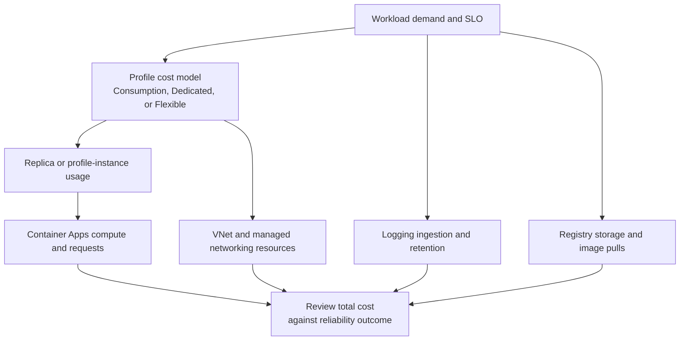
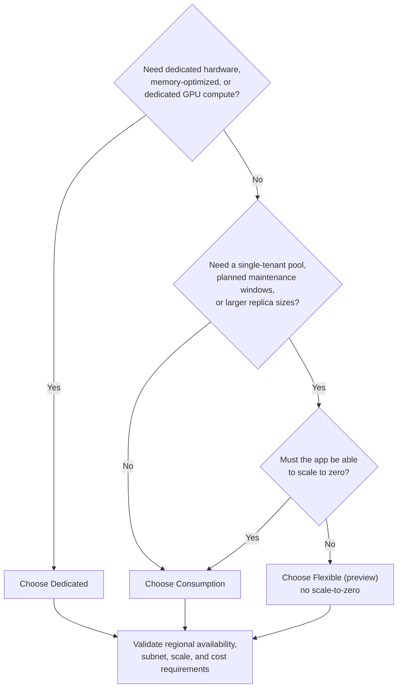

---
content_sources:
  diagrams:
    - id: if-you-optimize-only-one-meter
      type: flowchart
      source: mslearn-adapted
      based_on:
        - https://learn.microsoft.com/en-us/azure/container-apps/billing
        - https://learn.microsoft.com/en-us/azure/container-apps/workload-profiles-overview
    - id: choose-profile-type-by-workload-shape
      type: flowchart
      source: mslearn-adapted
      based_on:
        - https://learn.microsoft.com/en-us/azure/container-apps/billing
        - https://learn.microsoft.com/en-us/azure/container-apps/workload-profiles-overview
content_validation:
  status: verified
  last_reviewed: 2026-11-08
  reviewer: agent
  core_claims:
    - claim: When a Consumption-plan revision scales to zero replicas, no resource-consumption charges are incurred.
      source: https://learn.microsoft.com/en-us/azure/container-apps/billing
      verified: true
    - claim: Eligible Consumption-plan replicas at the minimum replica count can be billed at reduced idle rates only when all documented request, CPU, network, and running-container conditions are met.
      source: https://learn.microsoft.com/en-us/azure/container-apps/billing
      verified: true
    - claim: Azure Container Apps supports Consumption, Dedicated, and Flexible workload profile types.
      source: https://learn.microsoft.com/en-us/azure/container-apps/workload-profiles-overview
      verified: true
    - claim: Apps on the Flexible profile cannot scale to zero and are billed like Consumption plus the Dedicated plan management fee.
      source: https://learn.microsoft.com/en-us/azure/container-apps/workload-profiles-overview
      verified: true
---
# Cost-Aware Best Practices

Cost optimization in Azure Container Apps is an operational design activity, not a one-time tuning task. This guide explains how to reduce spend without sacrificing reliability by using the platform's scaling, profile, registry, and observability features intentionally.

## Why This Matters

Production Container Apps behavior depends on explicit platform choices for ingress, scale, identity, observability, and release safety. This page turns the cited Microsoft Learn guidance into reviewable practices that can be checked before promotion.

## Prerequisites

- Existing Azure Container Apps environment
- At least one running Container App
- Access to Cost Management and Log Analytics
- Azure CLI with Container Apps extension

```bash
export RG="rg-aca-prod"
export APP_NAME="app-orders-api"
export ACA_ENV_NAME="cae-prod-shared"
export ACR_NAME="acrsharedprod"
export LOCATION="koreacentral"

az extension add --name "containerapp" --upgrade
az account show --output table
```

| Command / Parameter | Purpose |
|---|---|
| `az extension add` | Installs or upgrades the Container Apps extension used by the examples. |
| `--name` | Selects the named Azure resource. |
| `--upgrade` | Upgrades the extension if an older version is installed. |
| `az account show` | Shows the active subscription and tenant before the review commands run. |
| `--output` | Chooses the output format for review or scripting. |

## Recommended Practices

### Understand the billing model before tuning

Azure Container Apps costs come from multiple meters that interact:

- Compute/runtime usage (CPU and memory)
- Workload profile capacity (when using dedicated profiles)
- Registry costs (Azure Container Registry SKU and data transfer)
- Log ingestion and retention (Log Analytics)
- Environment-level resources and optional networking features

If you optimize only one meter (for example, CPU), your total cost can still increase due to logs, always-on replicas, or over-frequent job schedules.

<!-- diagram-id: if-you-optimize-only-one-meter -->


*Figure: Optimize the complete workload cost path; compute tuning alone does not account for logging, registry, or networking charges.*

!!! note "Optimization sequence"
    Start with architecture-level choices (profile, environment boundary, image strategy), then tune per-app resources and scale rules. Reversing this order usually creates local optimizations but higher total spend.

### Choose among Consumption, Dedicated, and Flexible profiles

Choose profile type by workload shape, not team preference:

| Factor | Consumption | Dedicated | Flexible (preview) |
|---|---|---|---|
| Billing model | Per-replica resource use and external HTTP requests | Per workload-profile instance plus a management fee when Dedicated profiles are used | Consumption-style billing plus the Dedicated plan management fee |
| Scale-to-zero | Supported | Profile instances scale within configured bounds; billing follows running instances | Not supported for apps |
| Isolation | Serverless multitenant compute | Dedicated compute pool | Single-tenant compute pool |
| Best fit | Bursty or unpredictable demand | Steady workloads, larger compute, memory-optimized, or dedicated GPU needs | Consumption-like sizing with dedicated characteristics and planned maintenance windows |

<!-- diagram-id: choose-profile-type-by-workload-shape -->


*Figure: Profile selection follows documented capability requirements; measure the deployed workload before changing profiles rather than relying on a universal utilization threshold.*

Inspect current environment profile configuration:

```bash
az containerapp env show \
  --name "$ACA_ENV_NAME" \
  --resource-group "$RG" \
  --query "properties.workloadProfiles" \
  --output json
```

| Command / Parameter | Purpose |
|---|---|
| `az containerapp env show` | Reads the selected Container Apps environment configuration. |
| `--name` | Selects the named Azure resource. |
| `--output` | Chooses the output format for review or scripting. |
| `--query` | Projects the fields needed for the documented verification. |
| `--resource-group` | Selects the resource group that contains the resource. |

Inspect an app's active profile and requested resources:

```bash
az containerapp show \
  --name "$APP_NAME" \
  --resource-group "$RG" \
  --query "{workloadProfile:properties.workloadProfileName,cpu:properties.template.containers[0].resources.cpu,memory:properties.template.containers[0].resources.memory,minReplicas:properties.template.scale.minReplicas,maxReplicas:properties.template.scale.maxReplicas}" \
  --output json
```

| Command / Parameter | Purpose |
|---|---|
| `az containerapp show` | Reads the selected Container App configuration. |
| `--name` | Selects the named Azure resource. |
| `--output` | Chooses the output format for review or scripting. |
| `--query` | Projects the fields needed for the documented verification. |
| `--resource-group` | Selects the resource group that contains the resource. |

Practical decision pattern:

1. Start with Consumption when demand is bursty or unpredictable and no dedicated capability is required.
2. Measure replica usage, latency, and cost over a representative business cycle.
3. Evaluate Dedicated when steady demand can use reserved profile instances efficiently or hardware requirements demand it.
4. Evaluate Flexible only when its preview status, regional availability, `/25` subnet minimum, no-scale-to-zero behavior, and management fee fit the workload.

### Scale-to-zero and billing impact

Scale-to-zero is the strongest cost control for non-critical or sporadic workloads.

```bash
az containerapp update \
  --name "$APP_NAME" \
  --resource-group "$RG" \
  --min-replicas 0 \
  --max-replicas 5
```

| Command / Parameter | Purpose |
|---|---|
| `az containerapp update` | Updates the existing Container App configuration. |
| `--max-replicas` | Caps scale-out at the selected replica count. |
| `--min-replicas` | Sets the minimum replica count and therefore the warm baseline. |
| `--name` | Selects the named Azure resource. |
| `--resource-group` | Selects the resource group that contains the resource. |

When min replicas are zero:

- You avoid always-on runtime cost during idle periods.
- You may increase cold-start latency.
- You must validate startup probes and initialization time.

For user-facing APIs where latency SLO is strict, use a non-zero baseline:

```bash
az containerapp update \
  --name "$APP_NAME" \
  --resource-group "$RG" \
  --min-replicas 1 \
  --max-replicas 10
```

| Command / Parameter | Purpose |
|---|---|
| `az containerapp update` | Updates the existing Container App configuration. |
| `--max-replicas` | Caps scale-out at the selected replica count. |
| `--min-replicas` | Sets the minimum replica count and therefore the warm baseline. |
| `--name` | Selects the named Azure resource. |
| `--resource-group` | Selects the resource group that contains the resource. |

!!! warning "Do not optimize cost by breaking SLO"
    If your API has hard latency objectives, forcing `--min-replicas 0` can make tail latency unacceptable. Optimize elsewhere first (resource sizing, image startup, scaling thresholds).

### Min replica costs and always-on design

`minReplicas` is effectively an explicit "always-on" commitment.

Use min replicas when you need:

- Consistent p95 latency without cold starts
- Warm caches or preloaded models
- Immediate queue processing for low-lag pipelines

Use zero min replicas when you have:

- Batch-style traffic
- Background APIs for admin tooling
- Internal endpoints with no strict latency target

Quick baseline cost check for min replica usage:

```bash
az containerapp show \
  --name "$APP_NAME" \
  --resource-group "$RG" \
  --query "properties.template.scale.minReplicas" \
  --output tsv
```

| Command / Parameter | Purpose |
|---|---|
| `az containerapp show` | Reads the selected Container App configuration. |
| `--name` | Selects the named Azure resource. |
| `--output` | Chooses the output format for review or scripting. |
| `--query` | Projects the fields needed for the documented verification. |
| `--resource-group` | Selects the resource group that contains the resource. |

### Right-size CPU and memory intentionally

Over-provisioned resources are one of the most common sources of Container Apps waste.

Start with measured targets:

- CPU: sustained usage under expected p95 load
- Memory: steady-state plus burst headroom, not arbitrary large buffers
- OOM event count: should be zero in normal operation

Review configured resources:

```bash
az containerapp show \
  --name "$APP_NAME" \
  --resource-group "$RG" \
  --query "properties.template.containers[0].resources" \
  --output json
```

| Command / Parameter | Purpose |
|---|---|
| `az containerapp show` | Reads the selected Container App configuration. |
| `--name` | Selects the named Azure resource. |
| `--output` | Chooses the output format for review or scripting. |
| `--query` | Projects the fields needed for the documented verification. |
| `--resource-group` | Selects the resource group that contains the resource. |

Apply a smaller footprint safely:

```bash
az containerapp update \
  --name "$APP_NAME" \
  --resource-group "$RG" \
  --cpu 0.5 \
  --memory "1Gi"
```

| Command / Parameter | Purpose |
|---|---|
| `az containerapp update` | Updates the existing Container App configuration. |
| `--cpu` | Sets the CPU allocated to each replica. |
| `--memory` | Sets the memory allocated to each replica. |
| `--name` | Selects the named Azure resource. |
| `--resource-group` | Selects the resource group that contains the resource. |

Then validate health and throughput before further reduction.

### Registry SKU and image pull economics (ACR Basic vs Standard vs Premium)

ACR selection affects both direct registry pricing and indirect runtime behavior:

| ACR SKU | Storage | Throughput | Geo-Replication | Best For |
|---|---|---|---|---|
| **Basic** | 10 GiB | Low | ❌ | Small teams, dev/test |
| **Standard** | 100 GiB | Medium | ❌ | Growing production workloads |
| **Premium** | 500 GiB | High | ✅ | Multi-region, enterprise scale |

Check registry SKU:

```bash
az acr show \
  --name "$ACR_NAME" \
  --resource-group "$RG" \
  --query "{name:name,sku:sku.name,loginServer:loginServer}" \
  --output json
```

| Command / Parameter | Purpose |
|---|---|
| `az acr show` | Reads the selected Azure Container Registry configuration. |
| `--name` | Selects the named Azure resource. |
| `--output` | Chooses the output format for review or scripting. |
| `--query` | Projects the fields needed for the documented verification. |
| `--resource-group` | Selects the resource group that contains the resource. |

Operational implications:

- Large images + frequent revision deployments increase pull and startup overhead.
- Geo-distributed workloads can benefit from lower image pull latency with higher SKU features.
- Excessively retaining old tags increases storage cost and operational confusion.

List recent repository tags to review cleanup candidates:

```bash
az acr repository show-tags \
  --name "$ACR_NAME" \
  --repository "orders-api" \
  --orderby "time_desc" \
  --top 20 \
  --output table
```

| Command / Parameter | Purpose |
|---|---|
| `az acr repository show-tags` | Lists image tags in the selected registry repository. |
| `--name` | Selects the named Azure resource. |
| `--orderby` | Sorts the returned tags by the selected field and direction. |
| `--output` | Chooses the output format for review or scripting. |
| `--repository` | Selects the registry repository whose tags are listed. |
| `--top` | Limits the number of records returned. |

### Reduce log ingestion cost without losing diagnostic value

Log Analytics can become a dominant cost driver if you emit verbose logs at high request volume.

Tactics specific to Container Apps:

- Keep structured logs, but avoid duplicate payload dumps.
- Log business events once, not at each internal layer.
- Use `Info` for lifecycle milestones, `Warning/Error` for action-worthy signals.
- Restrict high-cardinality fields that explode ingestion size.

Inspect workspace linkage:

```bash
az containerapp env show \
  --name "$ACA_ENV_NAME" \
  --resource-group "$RG" \
  --query "properties.appLogsConfiguration" \
  --output json
```

| Command / Parameter | Purpose |
|---|---|
| `az containerapp env show` | Reads the selected Container Apps environment configuration. |
| `--name` | Selects the named Azure resource. |
| `--output` | Chooses the output format for review or scripting. |
| `--query` | Projects the fields needed for the documented verification. |
| `--resource-group` | Selects the resource group that contains the resource. |

Example KQL to estimate noisy categories:

```kusto
ContainerAppConsoleLogs_CL
| where TimeGenerated > ago(24h)
| summarize LogLines=count(), ApproxBytes=sum(_BilledSize) by ContainerAppName_s, LogLevel=tostring(parse_json(Log_s).level)
| order by ApproxBytes desc
```

Use results to cap noisy logs in application and sidecar settings.

### Share environments strategically to reduce overhead

Environment sharing can reduce duplicated operational overhead, but only when boundaries are compatible.

Share an environment when workloads have similar:

- Compliance and data boundary requirements
- Network topology (public/private ingress patterns)
- Operational ownership and release cadence

Separate environments when you need:

- Strict isolation across teams or trust zones
- Distinct networking policies (for example private-only ingress)
- Independent lifecycle and change windows

List apps in an environment to evaluate consolidation:

```bash
az containerapp list \
  --resource-group "$RG" \
  --query "[?contains(properties.managedEnvironmentId, '$ACA_ENV_NAME')].{name:name,ingress:properties.configuration.ingress.external,minReplicas:properties.template.scale.minReplicas}" \
  --output table
```

| Command / Parameter | Purpose |
|---|---|
| `az containerapp list` | Lists Container Apps in the selected resource-group scope. |
| `--output` | Chooses the output format for review or scripting. |
| `--query` | Projects the fields needed for the documented verification. |
| `--resource-group` | Selects the resource group that contains the resource. |

### Understand idle environment cost

A common misconception is that "no running app" equals "zero platform cost".

Even with minimal workload activity, environment-related services and connected resources may continue to incur charges, including:

- Log Analytics workspace retention/ingestion
- Registry storage
- Networking resources used by the environment topology

Review environment state regularly:

```bash
az containerapp env show \
  --name "$ACA_ENV_NAME" \
  --resource-group "$RG" \
  --query "{name:name,location:location,provisioningState:properties.provisioningState,zoneRedundant:properties.zoneRedundant}" \
  --output json
```

| Command / Parameter | Purpose |
|---|---|
| `az containerapp env show` | Reads the selected Container Apps environment configuration. |
| `--name` | Selects the named Azure resource. |
| `--output` | Chooses the output format for review or scripting. |
| `--query` | Projects the fields needed for the documented verification. |
| `--resource-group` | Selects the resource group that contains the resource. |

### Budget guardrails with Azure Cost Management

Create budget and anomaly review routines for Container Apps estates:

- Budget per environment (dev, staging, prod)
- Budget per shared platform resource group
- Alert thresholds (for example 50%, 80%, 100%)

Quick cost snapshot by service name:

```bash
az consumption usage list \
  --top 50 \
  --output table
```

| Command / Parameter | Purpose |
|---|---|
| `az consumption usage list` | Lists recent subscription usage records for an initial cost review. |
| `--output` | Chooses the output format for review or scripting. |
| `--top` | Limits the number of records returned. |

Export cost data regularly and tag resources for cost allocation:

```bash
az group update \
  --name "$RG" \
  --set "tags.CostCenter=platform" "tags.Environment=prod"
```

| Command / Parameter | Purpose |
|---|---|
| `az group update` | Updates resource-group metadata such as cost-allocation tags. |
| `--name` | Selects the named Azure resource. |
| `--set` | Updates the specified resource properties or tags. |

!!! tip "Governance pattern"
    Pair technical guardrails (`--max-replicas`, right-sized resources, log controls) with financial guardrails (budgets, alerts, owner review cadence). Either one without the other is incomplete.

### Cost-aware deployment checklist

Use this checklist before production rollout:

| Area | Check | Target |
|---|---|---|
| Scaling | `minReplicas` aligned to latency need | `0` for async, `1+` for latency-critical |
| Resources | CPU/memory based on measured load | No speculative over-allocation |
| Registry | ACR SKU and retention reviewed | Throughput and storage aligned |
| Logs | High-volume noise reduced | Actionable logs with bounded volume |
| Environment | Sharing/isolation decision documented | No accidental sprawl |
| Budget | Alerts configured | 50/80/100 percent notifications |

### Example: end-to-end cost tuning workflow

1. Baseline current app scale and resources.
2. Set `minReplicas` based on SLO, not habit.
3. Reduce CPU/memory one step and observe error budget.
4. Cut log verbosity where `_BilledSize` dominates.
5. Review image size and tag retention.
6. Validate monthly trend with Cost Management export.

Baseline command group:

```bash
az containerapp show \
  --name "$APP_NAME" \
  --resource-group "$RG" \
  --query "{profile:properties.workloadProfileName,minReplicas:properties.template.scale.minReplicas,maxReplicas:properties.template.scale.maxReplicas,cpu:properties.template.containers[0].resources.cpu,memory:properties.template.containers[0].resources.memory}" \
  --output json
```

| Command / Parameter | Purpose |
|---|---|
| `az containerapp show` | Reads the selected Container App configuration. |
| `--name` | Selects the named Azure resource. |
| `--output` | Chooses the output format for review or scripting. |
| `--query` | Projects the fields needed for the documented verification. |
| `--resource-group` | Selects the resource group that contains the resource. |

### Cost anti-patterns to avoid during optimization

- Forcing scale-to-zero on user-facing critical APIs
- Increasing `maxReplicas` without downstream capacity planning
- Enabling highly verbose logs in production by default
- Retaining oversized base images and rebuilding frequently
- Creating many small environments without ownership boundaries

### Verify cost-relevant surfaces in Azure Portal

![cae-basics-d38538 | Container Apps Environment | Refresh | Delete | Essentials | View Cost | JSON View | Resource group (move) | rg-aca-basics-d38538 | Status | Succeeded | Location (move) | Korea Central | Subscription (move) | Visual Studio Enterprise Subscription | Subscription ID | 00000000-0000-0000-0000-000000000000 | Aspire Dashboard | Not yet active (set up) | Tags (edit) | Add tags | Environment type | Workload profiles | Static IP | 4.230.156.3 | Applications | 1 | KEDA version | 2.18.1 | Dapr version | 1.16.4-msft.7 | Applications | Get started | Monitoring | Tutorials | Name | App Type | Resource Group | ca-sample-d38538 | Container App | rg-aca-basics-d38538](../assets/best-practices/cost-environment-overview.png)

**[Observed]** `cae-basics-d38538` `Container Apps Environment` `Refresh` `Delete` `Essentials` `View Cost` `JSON View` `Resource group (move)` `rg-aca-basics-d38538` `Status` `Succeeded` `Location (move)` `Korea Central` `Subscription (move)` `Visual Studio Enterprise Subscription` `Subscription ID` `00000000-0000-0000-0000-000000000000` `Aspire Dashboard` `Not yet active (set up)` `Tags (edit)` `Add tags` `Environment type` `Workload profiles` `Static IP` `4.230.156.3` `Applications` `1` `KEDA version` `2.18.1` `Dapr version` `1.16.4-msft.7` `Applications` `Get started` `Monitoring` `Tutorials` `Name` `App Type` `Resource Group` `ca-sample-d38538` `Container App` `rg-aca-basics-d38538`.

**[Inferred]** The `Environment type` value `Workload profiles` appears to map to the profile-selection decision discussed in [Choose among Consumption, Dedicated, and Flexible profiles](#choose-among-consumption-dedicated-and-flexible-profiles). The `Applications` count `1` on this environment is consistent with the consolidation-vs-isolation question in [Share environments strategically to reduce overhead](#share-environments-strategically-to-reduce-overhead), which evaluates how many workloads should sit behind one environment boundary. The `KEDA version` `2.18.1`, `Dapr version` `1.16.4-msft.7`, and `Static IP` `4.230.156.3` are consistent with the environment-managed components discussed in [Understand idle environment cost](#understand-idle-environment-cost), which warns that environment-related services continue to incur charges even with minimal workload activity. The `Resource group (move)` value `rg-aca-basics-d38538` and `Subscription (move)` value `Visual Studio Enterprise Subscription` are consistent with the cost-allocation scope discussed in [Budget guardrails with Azure Cost Management](#budget-guardrails-with-azure-cost-management), which sets budgets per environment and tags resources for cost allocation.

**[Not Proven]** Additional workload sizing detail, workspace cost detail, registry cost detail, and budget detail are not visible on this view.

## Advanced Topics

- Model monthly cost per workload class (interactive API, internal service, scheduled jobs) and assign explicit SLO-to-cost envelopes.
- Combine workload profiles for baseline traffic and consumption profiles for burst edges in the same architecture.
- Build automated policy checks for `minReplicas`, image tag format, and maximum resource requests before deployment.
- Use KQL-based spend proxies (for example billed log volume and replica-hours approximations) as early warning signals between official billing cycles.

## Common Mistakes / Anti-Patterns

- Treating sample defaults as production-ready without checking ingress, scale, identity, and monitoring requirements.
- Applying a configuration change without verifying the resulting revision, logs, and metrics.
- Leaving ownership for certificates, private DNS, secrets, or rollout decisions undocumented.

## Validation Checklist

- [ ] Required Container Apps settings are represented in infrastructure as code.
- [ ] The active revision, ingress, scale, identity, and monitoring state match the intended design.
- [ ] Rollback or cleanup commands have been tested in a non-production environment.

## See Also

- [Best Practices - Scaling](scaling.md)
- [Best Practices - Reliability](reliability.md)
- [Best Practices - Identity and Secrets](identity-and-secrets.md)
- [Platform - Reliability Cost Optimization](../platform/reliability/cost-optimization.md)
- [Operations - Monitoring](../operations/monitoring/index.md)

## Sources

- [Microsoft Learn source 1](https://learn.microsoft.com/en-us/azure/container-apps/billing)
- [Microsoft Learn source 2](https://learn.microsoft.com/en-us/azure/container-apps/environment)
- [Microsoft Learn source 3](https://learn.microsoft.com/en-us/azure/reliability/reliability-container-apps)
- [Microsoft Learn source 4](https://learn.microsoft.com/en-us/azure/container-apps/scale-app)
- [Workload profiles in Azure Container Apps](https://learn.microsoft.com/en-us/azure/container-apps/workload-profiles-overview)
