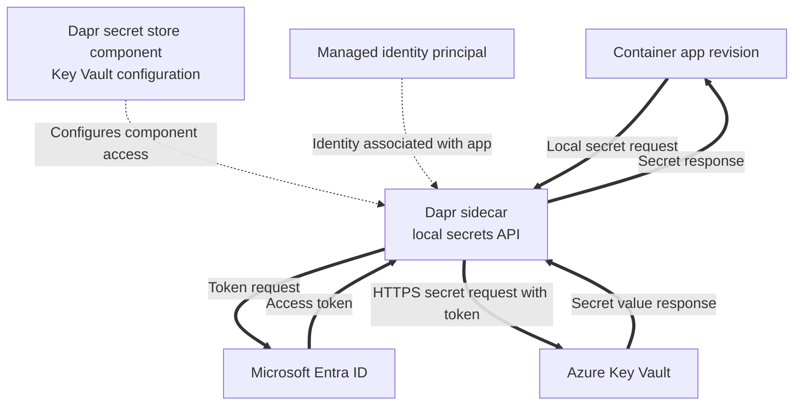
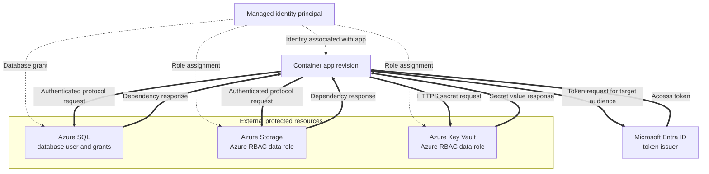
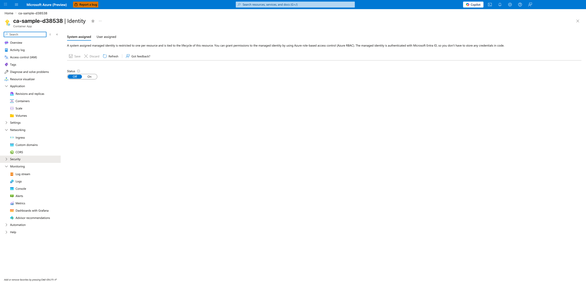

---
content_sources:
  diagrams:
    - id: if-you-use-dapr-centralize-runtime
      type: flowchart
      source: mslearn-adapted
      based_on:
        - https://learn.microsoft.com/en-us/azure/container-apps/managed-identity
        - https://learn.microsoft.com/en-us/azure/container-apps/manage-secrets
        - https://learn.microsoft.com/en-us/azure/container-apps/authentication
        - https://learn.microsoft.com/en-us/azure/container-apps/dapr-overview
    - id: use-managed-identity-entra-authentication
      type: flowchart
      source: mslearn-adapted
      based_on:
        - https://learn.microsoft.com/en-us/azure/container-apps/managed-identity
        - https://learn.microsoft.com/en-us/azure/container-apps/manage-secrets
        - https://learn.microsoft.com/en-us/azure/container-apps/authentication
        - https://learn.microsoft.com/en-us/azure/role-based-access-control/role-assignments
        - https://learn.microsoft.com/en-us/azure/container-registry/container-registry-authentication-managed-identity
content_validation:
  status: verified
  last_reviewed: 2026-09-11
  reviewer: ai-agent
  core_claims:
    - claim: A system-assigned identity is tied to the container app and is deleted when the container app is deleted.
      source: https://learn.microsoft.com/en-us/azure/container-apps/managed-identity
      verified: true
    - claim: A user-assigned identity is a standalone Azure resource that you can assign to a container app and other resources.
      source: https://learn.microsoft.com/en-us/azure/container-apps/managed-identity
      verified: true
    - claim: A container app can have multiple user-assigned identities.
      source: https://learn.microsoft.com/en-us/azure/container-apps/managed-identity
      verified: true
    - claim: Managed identities let a container app authenticate to Microsoft Entra protected resources without managing credentials in the app.
      source: https://learn.microsoft.com/en-us/azure/container-apps/managed-identity
      verified: true
    - claim: You can use managed identity to authenticate with a private Azure Container Registry without a username and password.
      source: https://learn.microsoft.com/en-us/azure/container-apps/managed-identity
      verified: true
---
# Azure Container Apps Identity and Secret Management Best Practices

This guide explains how to run Azure Container Apps with passwordless access, least privilege, and controlled secret lifecycle operations. It focuses on practical decisions for production, not conceptual identity internals.

## Why This Matters

Production Container Apps behavior depends on explicit platform choices for ingress, scale, identity, observability, and release safety. This page turns the cited Microsoft Learn guidance into reviewable practices that can be checked before promotion.

## Prerequisites

- You reviewed concept docs first:
  - [Managed Identity (Platform)](../platform/identity-and-secrets/managed-identity.md)
  - [Key Vault (Platform)](../platform/identity-and-secrets/key-vault.md)
  - [Networking (Platform)](../platform/networking/index.md)
- Azure CLI is installed and authenticated.
- You can create role assignments in the target subscription/resource group.

Set standard variables:

```bash
export RG="rg-myapp"
export APP_NAME="ca-myapp"
export ACA_ENV_NAME="cae-myapp"
export ACR_NAME="<acr-name>"
export LOCATION="koreacentral"
```

## Recommended Practices

### Use a managed identity decision matrix first

Choose identity type per operational ownership model.

| Requirement | System-assigned identity | User-assigned identity |
|---|---|---|
| Lifecycle tightly coupled to one app | Best fit | Possible but unnecessary |
| Shared identity across multiple apps | Poor fit | Best fit |
| Isolated blast radius | Strong | Depends on sharing pattern |
| Rotation / replacement procedure | Recreate with app lifecycle | Managed independently |

Rule of thumb:

- Start with **system-assigned** for single-app ownership.
- Use **user-assigned** only when shared identity or centralized governance is required.

!!! warning "Avoid defaulting to shared identities"
    Shared user-assigned identities reduce credential sprawl but increase blast radius. Prefer per-app identities unless there is a clear governance reason to share.

### Enable system-assigned identity as the baseline pattern

```bash
az containerapp identity assign \
  --name "$APP_NAME" \
  --resource-group "$RG" \
  --system-assigned
```

| Command / Parameter | Purpose |
|---|---|
| `az containerapp identity assign` | Runs `az containerapp identity assign` for this documented operation. |
| `--name` | Selects the named resource for this operation. |
| `--resource-group` | Selects the resource group containing the resource. |
| `--system-assigned` | Enables the system-assigned managed identity. |

Verify principal creation:

```bash
az containerapp show \
  --name "$APP_NAME" \
  --resource-group "$RG" \
  --query "identity.principalId" \
  --output tsv
```

| Command / Parameter | Purpose |
|---|---|
| `az containerapp show` | Runs `az containerapp show` for this documented operation. |
| `--name` | Selects the named resource for this operation. |
| `--output` | Chooses the response format for operator inspection. |
| `--query` | Projects the relevant property from the command response. |
| `--resource-group` | Selects the resource group containing the resource. |

Expected output format:

```text
xxxxxxxx-xxxx-xxxx-xxxx-xxxxxxxxxxxx
```

### Use user-assigned identity intentionally for shared operations

Create user-assigned identity:

```bash
az identity create \
  --name "id-aca-shared-pull" \
  --resource-group "$RG" \
  --location "$LOCATION"
```

| Command / Parameter | Purpose |
|---|---|
| `az identity create` | Runs `az identity create` for this documented operation. |
| `--location` | Selects the Azure region for the resource. |
| `--name` | Selects the named resource for this operation. |
| `--resource-group` | Selects the resource group containing the resource. |

Attach to app:

```bash
az containerapp identity assign \
  --name "$APP_NAME" \
  --resource-group "$RG" \
  --user-assigned "/subscriptions/<subscription-id>/resourceGroups/$RG/providers/Microsoft.ManagedIdentity/userAssignedIdentities/id-aca-shared-pull"
```

| Command / Parameter | Purpose |
|---|---|
| `az containerapp identity assign` | Runs `az containerapp identity assign` for this documented operation. |
| `--name` | Selects the named resource for this operation. |
| `--resource-group` | Selects the resource group containing the resource. |
| `--user-assigned` | Assigns the specified user-assigned managed identity. |

Governance pattern:

1. Use one shared identity for a narrow function (for example, image pull).
2. Keep data-plane identities app-specific where possible.
3. Document ownership and emergency revoke procedure.

### Managed identity for ACR pull (never admin credentials)

Disable the ACR admin account in production and grant the identity the pull role that matches the registry's role-assignment mode. Use `AcrPull` for a registry that uses RBAC Registry Permissions. An ABAC-enabled registry does not honor `AcrPull`; use `Container Registry Repository Reader` and, when repository-level restriction is required, an ABAC condition.

Get principal ID:

```bash
export PRINCIPAL_ID=$(az containerapp show \
  --name "$APP_NAME" \
  --resource-group "$RG" \
  --query "identity.principalId" \
  --output tsv)
```

| Command / Parameter | Purpose |
|---|---|
| `az containerapp show` | Runs `az containerapp show` for this documented operation. |
| `--name` | Selects the named resource for this operation. |
| `--output` | Chooses the response format for operator inspection. |
| `--query` | Projects the relevant property from the command response. |
| `--resource-group` | Selects the resource group containing the resource. |

Get ACR resource ID:

```bash
export ACR_ID=$(az acr show \
  --name "$ACR_NAME" \
  --resource-group "$RG" \
  --query "id" \
  --output tsv)
```

| Command / Parameter | Purpose |
|---|---|
| `az acr show` | Runs `az acr show` for this documented operation. |
| `--name` | Selects the named resource for this operation. |
| `--output` | Chooses the response format for operator inspection. |
| `--query` | Projects the relevant property from the command response. |
| `--resource-group` | Selects the resource group containing the resource. |

Assign the pull role for an RBAC-only registry:

```bash
az role assignment create \
  --assignee-object-id "$PRINCIPAL_ID" \
  --assignee-principal-type "ServicePrincipal" \
  --role "AcrPull" \
  --scope "$ACR_ID"
```

| Command / Parameter | Purpose |
|---|---|
| `az role assignment create` | Runs `az role assignment create` for this documented operation. |
| `--assignee-object-id` | Selects the managed identity principal receiving the role. |
| `--assignee-principal-type` | Declares the assignee principal type. |
| `--role` | Selects the Azure RBAC role to assign. |
| `--scope` | Restricts the operation to the named Azure resource scope. |

For an ABAC-enabled registry, replace `AcrPull` with `Container Registry Repository Reader` and define the repository condition separately. Do not assign both roles as a generic workaround.

Update app registry auth mode:

```bash
az containerapp registry set \
  --name "$APP_NAME" \
  --resource-group "$RG" \
  --server "$ACR_NAME.azurecr.io" \
  --identity "system"
```

| Command / Parameter | Purpose |
|---|---|
| `az containerapp registry set` | Switches the app's image-pull configuration from secret-based registry auth to managed identity-based auth. |
| `--identity` | Selects the managed identity used for authentication. |
| `--name` | Selects the named resource for this operation. |
| `--resource-group` | Selects the resource group containing the resource. |
| `--server` | Selects the Azure Container Registry login server. |

Validate repositories in the registry (PII scrubbed):

```bash
az acr repository list \
  --name "$ACR_NAME" \
  --output json
```

| Command / Parameter | Purpose |
|---|---|
| `az acr repository list` | Runs `az acr repository list` for this documented operation. |
| `--name` | Selects the named resource for this operation. |
| `--output` | Chooses the response format for operator inspection. |

```json
[
  "myapp",
  "myapp-job"
]
```

!!! note "Why this matters operationally"
    Password-based registry auth usually leaks into scripts and pipelines. Identity-based pull removes secret rotation burden and reduces incident response scope.

### Key Vault reference vs Container Apps secret store

Use the right source for each secret lifecycle.

| Secret Pattern | Recommended Location | Reason |
|---|---|---|
| Frequently rotated enterprise secret | Azure Key Vault reference | Centralized rotation and policy |
| Small app-local operational secret | Container Apps secret | Fast, local deployment simplicity |
| High-value shared credential | Key Vault | Access audit and strong controls |

Guidance:

- Use Key Vault when rotation cadence or compliance pressure is high.
- Use Container Apps secrets for local, low-sharing operational values.
- Never put secrets in environment variables directly via plain text commands in shared shells.

Set secret from Key Vault reference:

```bash
az containerapp secret set \
  --name "$APP_NAME" \
  --resource-group "$RG" \
  --secrets "db-password=keyvaultref:https://<key-vault-name>.vault.azure.net/secrets/sql-admin-password,identityref:system"
```

| Command / Parameter | Purpose |
|---|---|
| `az containerapp secret set` | Runs `az containerapp secret set` for this documented operation. |
| `--name` | Selects the named resource for this operation. |
| `--resource-group` | Selects the resource group containing the resource. |
| `--secrets` | Defines or updates the named app-level secret. |

Map secret to environment variable:

```bash
az containerapp update \
  --name "$APP_NAME" \
  --resource-group "$RG" \
  --set-env-vars "DB_PASSWORD=secretref:db-password"
```

| Command / Parameter | Purpose |
|---|---|
| `az containerapp update` | Runs `az containerapp update` for this documented operation. |
| `--name` | Selects the named resource for this operation. |
| `--resource-group` | Selects the resource group containing the resource. |
| `--set-env-vars` | Adds or updates revision-scope environment variables. |

### Separate secret and config data clearly

Classify configuration before deployment:

- **Secret**: password, token, connection credential, signing key.
- **Config**: endpoint URL, timeout, feature flag, retry count.

Good pattern:

- Put non-sensitive config in plain environment variables.
- Put sensitive values in secrets, then reference them.

Bad pattern:

- Treating every variable as a secret, causing unnecessary operational friction.
- Treating secrets as config, exposing them in logs or deployment pipelines.

Example mixed configuration update:

```bash
az containerapp update \
  --name "$APP_NAME" \
  --resource-group "$RG" \
  --set-env-vars \
  "APP_MODE=production" \
  "REQUEST_TIMEOUT_SECONDS=10" \
  "STORAGE_ACCOUNT_URL=https://<storage-account>.blob.core.windows.net" \
  "STORAGE_TOKEN=secretref:storage-token"
```

| Command / Parameter | Purpose |
|---|---|
| `az containerapp update` | Runs `az containerapp update` for this documented operation. |
| `--name` | Selects the named resource for this operation. |
| `--resource-group` | Selects the resource group containing the resource. |
| `--set-env-vars` | Adds or updates revision-scope environment variables. |

### Scope identities per app unless sharing is required

Per-app identity advantages:

- Least privilege assignments are easier.
- Revoking one app does not break others.
- Access review and audit mapping is straightforward.

Shared identity acceptable cases:

- Centralized pull-only access to one ACR.
- Transitional migration where app decomposition is in progress.

!!! warning "Do not share data-plane identity broadly"
    A shared identity with SQL and Storage write permissions across multiple apps is a high-blast-radius anti-pattern.

### Dapr secret store component pattern

If you use Dapr, centralize runtime secret retrieval with a secret store component. The component configuration tells the Dapr sidecar how to reach Key Vault; it is not another runtime proxy. The application calls the local Dapr secrets API, and the sidecar obtains an identity token before it requests the secret from Key Vault.

<!-- diagram-id: if-you-use-dapr-centralize-runtime -->


*Figure: Runtime secret-retrieval flow. Thick arrows are request or response transport; dotted arrows are configuration or identity associations. Key Vault, Microsoft Entra ID, and the managed identity are separate Azure resources or identity objects, not components inside the Container Apps runtime. Dapr service invocation between two Dapr-enabled apps uses sidecar mTLS; this secrets-API flow does not claim that every direct application call is Dapr-protected.*

Operational benefits:

- Keeps secret retrieval path consistent across services.
- Supports policy-driven component configurations.
- Reduces duplicated secret access logic in app code.

### Rotate secrets with an explicit refresh or rollout action

Choose the path that matches the secret reference:

- **Versionless Key Vault reference:** Add the new Key Vault version. Container Apps retrieves the latest value within 30 minutes and automatically restarts active revisions that consume the secret through environment variables. Validate those restarted revisions; no `secret set` command or canary revision is required for the platform refresh path.
- **Inline value or version-pinned Key Vault reference:** Update the app-level secret, then restart every active revision that must consume the new value. The secret update itself creates no revision.
- **Optional canary rollout:** First enable multiple-revision mode and pin 100% of ingress traffic to the current revision. After an inline or version-pinned update, explicitly copy that revision with a unique suffix, smoke test the copy through its revision-specific endpoint, shift traffic gradually, and deactivate the old revision after the soak period. A canary is an operator-selected rollout strategy, not an automatic consequence of `secret set`.

The following example updates a version-pinned reference and explicitly creates a canary revision. It assumes ingress is enabled and `SQL_PASSWORD=secretref:sql-password` is already present in the revision template. Capture the current active revision before changing modes, enable multiple-revision mode, and pin traffic to that named revision so copying it cannot move application traffic automatically:

```bash
export OLD_REVISION=$(az containerapp revision list \
  --name "$APP_NAME" \
  --resource-group "$RG" \
  --query "[?properties.active].name | [0]" \
  --output tsv)

az containerapp revision set-mode \
  --name "$APP_NAME" \
  --resource-group "$RG" \
  --mode multiple

az containerapp ingress traffic set \
  --name "$APP_NAME" \
  --resource-group "$RG" \
  --revision-weight "$OLD_REVISION=100"

az containerapp secret set \
  --name "$APP_NAME" \
  --resource-group "$RG" \
  --secrets "sql-password=keyvaultref:https://<key-vault-name>.vault.azure.net/secrets/sql-password/<version>,identityref:system"

export ROTATION_SUFFIX="secret-$(date -u +%Y%m%d%H%M%S)"

az containerapp revision copy \
  --name "$APP_NAME" \
  --resource-group "$RG" \
  --from-revision "$OLD_REVISION" \
  --revision-suffix "$ROTATION_SUFFIX"
```

| Command / Parameter | Purpose |
|---|---|
| `az containerapp ingress traffic set` | Pins application traffic to the captured known-good revision before the canary is created. |
| `az containerapp revision list` | Captures the active revision name used as the known-good traffic target. |
| `az containerapp revision copy` | Explicitly creates a canary from the latest revision after the secret update. |
| `az containerapp revision set-mode` | Enables multiple active revisions so the known-good and canary revisions can run concurrently. |
| `az containerapp secret set` | Updates the app-level secret to the selected Key Vault version; this command does not create a revision. |
| `--from-revision` | Copies the captured known-good revision rather than whichever revision happens to be latest. |
| `--mode` | Selects multiple-revision mode for controlled traffic allocation. |
| `--name` | Selects the Container App whose app-level secret is updated. |
| `--output` | Returns the captured revision name as plain text. |
| `--query` | Selects the current active revision name before the mode change. |
| `--resource-group` | Selects the resource group containing the app. |
| `--revision-suffix` | Assigns a unique suffix to the canary revision used for validation and traffic shifting. |
| `--revision-weight` | Pins 100% of application traffic to the captured known-good revision. |
| `--secrets` | Sets the version-pinned Key Vault URI and the identity used to resolve it. |

After the copied revision is healthy, smoke test its revision-specific endpoint. Then route a controlled share of application traffic to its actual revision name:

```bash
az containerapp ingress traffic set \
  --name "$APP_NAME" \
  --resource-group "$RG" \
  --revision-weight "${APP_NAME}--${ROTATION_SUFFIX}=20" "$OLD_REVISION=80"
```

| Command / Parameter | Purpose |
|---|---|
| `az containerapp ingress traffic set` | Shifts only a controlled percentage of requests to the revision using the rotated secret, which lowers blast radius while you validate the new credential. |
| `--name` | Selects the named resource for this operation. |
| `--resource-group` | Selects the resource group containing the resource. |
| `--revision-weight` | Sets the traffic percentage for each named revision. |

### Apply Azure RBAC least privilege for managed identity

Role assignment principles:

1. Assign the narrowest role that works.
2. Scope at resource level before resource group level.
3. Avoid Owner/Contributor unless control-plane management is required.

Common role examples:

| Resource | Typical Role | Notes |
|---|---|---|
| Azure Storage | Storage Blob Data Reader/Contributor | Use data-plane role by need |
| Azure SQL | SQL DB role mapping + Entra auth | Prefer DB-scoped grants |
| Key Vault | Key Vault Secrets User | Read-only secret retrieval |
| Service Bus | Azure Service Bus Data Sender/Receiver | Separate send vs receive roles |

Example Key Vault scope assignment:

```bash
az role assignment create \
  --assignee-object-id "$PRINCIPAL_ID" \
  --assignee-principal-type "ServicePrincipal" \
  --role "Key Vault Secrets User" \
  --scope "/subscriptions/<subscription-id>/resourceGroups/$RG/providers/Microsoft.KeyVault/vaults/<key-vault-name>"
```

| Command / Parameter | Purpose |
|---|---|
| `az role assignment create` | Grants the Container App identity the minimum Azure RBAC permission it needs to read secrets from Key Vault. |
| `--assignee-object-id` | Selects the managed identity principal receiving the role. |
| `--assignee-principal-type` | Declares the assignee principal type. |
| `--role` | Selects the Azure RBAC role to assign. |
| `--scope` | Restricts the operation to the named Azure resource scope. |

### Cross-resource authentication patterns (SQL, Storage, Key Vault)

Use managed identity and Microsoft Entra authentication end to end. Token issuance and target authorization are separate decisions: Microsoft Entra ID issues a token for the requested resource audience, while each dependency evaluates that token and the principal's data-plane grant. Azure SQL database permissions are not Azure RBAC data roles.

<!-- diagram-id: use-managed-identity-entra-authentication -->


*Figure: Managed-identity authentication separates token transport from authorization. Thick arrows carry token or dependency requests and responses; dotted arrows show identity and authorization associations. The protected resources remain external to the Container Apps runtime, and every response originates from the resource that serves it.*

Practical pattern by dependency:

- **SQL**: Configure Entra auth, create database users for identity principal, grant minimal DB roles.
- **Storage**: Use account URL + token credential in SDK; grant blob/table/queue data role as needed.
- **Key Vault**: Grant secret read role; resolve secrets at startup and on refresh boundaries.

### Identity and secret operational checklist

Use this checklist before release:

- Identity type decision recorded per app.
- ACR pull uses managed identity, not username/password, with `AcrPull` for RBAC-only registries or `Container Registry Repository Reader` plus an optional repository condition for ABAC-enabled registries.
- Secret inventory exists with owner and rotation cadence.
- Key Vault references used for high-value rotated secrets.
- RBAC scope is resource-level wherever possible.
- No secrets in plain-text pipeline variables or shell history.
- Revision-based secret rollout tested and rollback documented.

### Incident response playbook snippets

When a credential leak is suspected:

1. Rotate secret at source (Key Vault or backing service).
2. For a versionless Key Vault reference, verify the documented refresh and automatic restart; for an inline or pinned update, restart active revisions or explicitly copy a canary revision.
3. If using a canary, validate it and shift traffic to the clean revision.
4. Revoke old role assignments if identity compromise is suspected.

List current role assignments for principal:

```bash
az role assignment list \
  --assignee "$PRINCIPAL_ID" \
  --all \
  --output table
```

| Command / Parameter | Purpose |
|---|---|
| `az role assignment list` | Runs `az role assignment list` for this documented operation. |
| `--all` | Includes all matching resources rather than the default subset. |
| `--assignee` | Selects the principal whose role assignments are listed. |
| `--output` | Chooses the response format for operator inspection. |

List app secrets metadata (names only):

```bash
az containerapp secret list \
  --name "$APP_NAME" \
  --resource-group "$RG" \
  --output table
```

| Command / Parameter | Purpose |
|---|---|
| `az containerapp secret list` | Runs `az containerapp secret list` for this documented operation. |
| `--name` | Selects the named resource for this operation. |
| `--output` | Chooses the response format for operator inspection. |
| `--resource-group` | Selects the resource group containing the resource. |

### Anti-patterns to avoid

- Using ACR admin credentials in CI/CD scripts.
- Assigning broad Contributor roles for data access scenarios.
- Sharing one identity for all microservices and all data stores.
- Embedding secrets directly in YAML committed to source control.
- Updating an inline or version-pinned secret without restarting consuming revisions or explicitly deploying a canary when an independently testable rollout is required.

## Advanced Topics

For mature environments, add these patterns:

- Federated workload identity for pipeline-to-Azure authentication without static credentials.
- Policy-as-code checks that block deployment when unsupported secret patterns are detected.
- Scheduled RBAC access reviews for managed identities by app owner.
- Emergency break-glass identity paths with strict approval and audit logging.
- Dapr component versioning strategy coordinated with secret rotation windows.

Validation commands for ongoing governance:

```bash
az containerapp show \
  --name "$APP_NAME" \
  --resource-group "$RG" \
  --query "identity" \
  --output json

az role assignment list \
  --scope "/subscriptions/<subscription-id>/resourceGroups/$RG" \
  --output table
```

| Command / Parameter | Purpose |
|---|---|
| `az containerapp show` | Runs `az containerapp show` for this documented operation. |
| `az role assignment list` | Runs `az role assignment list` for this documented operation. |
| `--name` | Selects the named resource for this operation. |
| `--output` | Chooses the response format for operator inspection. |
| `--query` | Projects the relevant property from the command response. |
| `--resource-group` | Selects the resource group containing the resource. |
| `--scope` | Restricts the operation to the named Azure resource scope. |

### Verify managed identity surfaces in Azure Portal



**[Observed]** `ca-sample-d38538 | Identity` `Container App` `System assigned` `User assigned` `Save` `Discard` `Refresh` `Got feedback?` `Status` `Off` `On`.

**[Inferred]** The `System assigned` tab appears to map to the baseline pattern described in [Enable system-assigned identity as the baseline pattern](#enable-system-assigned-identity-as-the-baseline-pattern), which is consistent with treating the per-resource system identity as the default starting point. The `User assigned` tab is consistent with the shared-operations scope discussed in [Use user-assigned identity intentionally for shared operations](#use-user-assigned-identity-intentionally-for-shared-operations), where a user-assigned identity is reused across resources. The `Status` `Off` and `On` toggle appears to map to the decision-matrix step in [Use a managed identity decision matrix first](#use-a-managed-identity-decision-matrix-first), which is consistent with treating identity activation as a deliberate choice rather than a default. The `Save` and `Discard` controls are consistent with the per-app scoping guidance in [Scope identities per app unless sharing is required](#scope-identities-per-app-unless-sharing-is-required), which keeps identity changes bounded to this app.

**[Not Proven]** Additional identity configuration detail, association detail, and directory detail are not visible on this view.

## Common Mistakes / Anti-Patterns

- Treating sample defaults as production-ready without checking ingress, scale, identity, and monitoring requirements.
- Applying a configuration change without verifying the resulting revision, logs, and metrics.
- Leaving ownership for certificates, private DNS, secrets, or rollout decisions undocumented.

## Validation Checklist

- [ ] Required Container Apps settings are represented in infrastructure as code.
- [ ] The active revision, ingress, scale, identity, and monitoring state match the intended design.
- [ ] Rollback or cleanup commands have been tested in a non-production environment.

## See Also

- [Managed Identity (Platform)](../platform/identity-and-secrets/managed-identity.md)
- [Key Vault (Platform)](../platform/identity-and-secrets/key-vault.md)
- [Networking (Platform)](../platform/networking/index.md)
- [Operations: Secret Rotation](../operations/secret-rotation/index.md)
- [Operations: Image Pull and Registry](../operations/image-pull-and-registry/index.md)
- [Reliability Best Practices](./reliability.md)

## Sources

- [Microsoft Learn source 1](https://learn.microsoft.com/en-us/azure/container-apps/managed-identity)
- [Microsoft Learn source 2](https://learn.microsoft.com/en-us/azure/container-apps/manage-secrets)
- [Microsoft Learn source 3](https://learn.microsoft.com/en-us/azure/container-apps/authentication)
- [Microsoft Learn source 4](https://learn.microsoft.com/en-us/azure/container-apps/managed-identity)
- [Authenticate to ACR with managed identity](https://learn.microsoft.com/en-us/azure/container-registry/container-registry-authentication-managed-identity)
- [Azure role assignments](https://learn.microsoft.com/en-us/azure/role-based-access-control/role-assignments)
- [Dapr integration in Azure Container Apps](https://learn.microsoft.com/en-us/azure/container-apps/dapr-overview)
