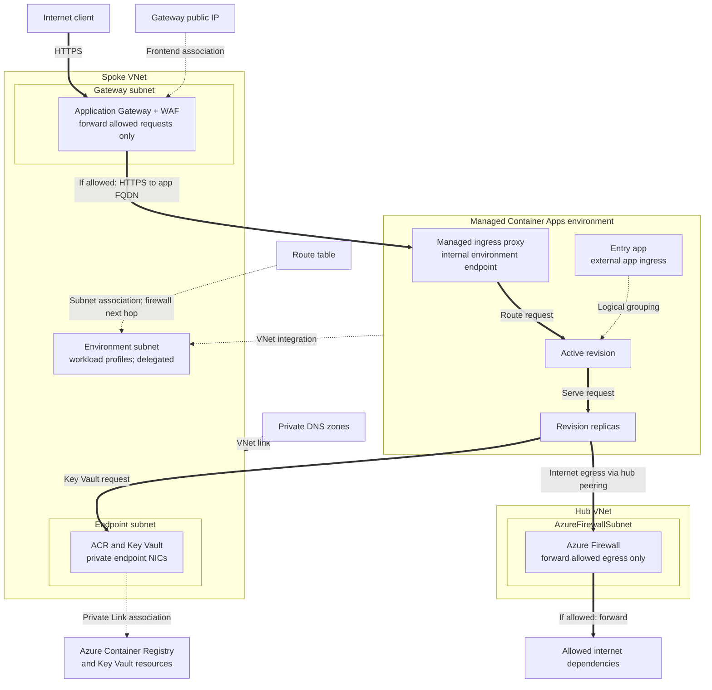

---
content_sources:
  diagrams:
    - id: aca-lza-reference-architecture
      type: flowchart
      source: mslearn-adapted
      based_on:
        - https://learn.microsoft.com/en-us/azure/cloud-adoption-framework/scenarios/app-platform/container-apps/landing-zone-accelerator
        - https://learn.microsoft.com/en-us/azure/architecture/example-scenario/serverless/microservices-with-container-apps
        - https://github.com/Azure/aca-landing-zone-accelerator
        - https://learn.microsoft.com/en-us/azure/container-apps/networking
        - https://learn.microsoft.com/en-us/azure/container-apps/ingress-overview
        - https://learn.microsoft.com/en-us/azure/container-apps/vnet-custom
        - https://learn.microsoft.com/en-us/azure/container-apps/use-azure-firewall
        - https://learn.microsoft.com/en-us/azure/container-apps/waf-app-gateway
content_validation:
  status: verified
  last_reviewed: '2026-11-07'
  reviewer: agent
  core_claims:
    - claim: Internal Container Apps environments have no public endpoint and use an internal load balancer.
      source: https://learn.microsoft.com/en-us/azure/container-apps/networking
      verified: true
    - claim: Application Gateway with WAF can front an internal Container Apps environment using the app FQDN as its backend target.
      source: https://learn.microsoft.com/en-us/azure/container-apps/waf-app-gateway
      verified: true
    - claim: "A custom virtual network lets you apply network security groups and user-defined routing through Azure Firewall, which the automatically generated Microsoft-managed virtual network does not allow"
      source: https://learn.microsoft.com/en-us/azure/architecture/example-scenario/serverless/microservices-with-container-apps
      verified: true
    - claim: UDR-based controlled egress is supported only in workload-profile environments.
      source: https://learn.microsoft.com/en-us/azure/container-apps/use-azure-firewall
      verified: true
---
# Container Apps Landing Zone Accelerator

The Azure Container Apps landing zone accelerator (LZA) is a historical open-source reference implementation for deploying Container Apps inside an Azure landing zone. Microsoft has deprecated the former Cloud Adoption Framework LZA article and directs readers to current Azure Architecture Center and Well-Architected guidance. Use this page to assess the repository's internal-environment baseline, not as a promise that its defaults remain current or supported.

For general Azure landing zone theory (management groups, subscription topology, platform vs application landing zones), see the [Cloud Adoption Framework](https://learn.microsoft.com/en-us/azure/cloud-adoption-framework/ready/landing-zone/) and the sibling [Azure Architecture Practical Guide](https://github.com/yeongseon/azure-architecture-practical-guide). This page stays Container Apps-specific.

## Why This Matters

Enterprise adopters rarely deploy a Container App in isolation. They onboard it into an existing landing zone with centralized networking (hub-spoke), shared identity, policy-driven governance, and centralized observability. Without a cohesive reference, teams stitch these concerns together ad hoc and produce inconsistent, hard-to-audit environments.

The LZA reduces that fragmentation by providing:

- A **secure-baseline reference architecture** for a Container Apps workload deployed into a private virtual network with no public endpoint.
- **Infrastructure-as-code** (Bicep and Terraform) that provisions the whole topology, so environments are reproducible and reviewable.
- **Design-area guidance** that aligns each cross-cutting concern with the centralized platform services an enterprise already runs.

The repository can still inform a greenfield design or a brownfield assessment, but review every component and default against current product documentation before adoption.

## Reference Architecture

This view adapts the accelerator's internal-environment baseline: a custom VNet integration, private environment entry through Application Gateway with WAF, and UDR-controlled outbound traffic through Azure Firewall. It is a selected baseline, not the topology of every Container Apps deployment. The historical LZA Learn URL now redirects to the Architecture Center microservices migration article, whose initial example uses a Microsoft-managed network; its recommended network hardening is distinct from that initial example.

<!-- diagram-id: aca-lza-reference-architecture -->

*Figure: Network-focused extension of the [architecture base](../platform/architecture/index.md#managed-environment-ingress-revisions-and-scaling). Thick arrows carry requests; dotted arrows are resource associations or logical grouping. The environment is a logical Azure-managed boundary, not a hidden customer-managed cluster. Hub/spoke connectivity and effective routes must be configured; Private Link requests do not automatically traverse the firewall. The runtime private request shown is to Key Vault; ACR's endpoint is included as a dependency association only, not a claim that running replicas pull their own images.*

The accelerator also includes management and governance components such as Azure Bastion, Log Analytics, and Azure Policy assignments; these are omitted from this network view. Firewall Policy, NSGs, route tables, DNS zones, and public IPs are independent Azure resources, not VNet-contained workloads. Private DNS must resolve service names to private endpoint addresses, and managed-identity permissions must separately authorize access. Review the current accelerator implementation rather than assuming all optional resources or SKU defaults are deployed in every scenario.

## Recommended Practices

### Review the four operational concerns

Use this guide's four concern groups to review the baseline. The table is a local navigation aid, not a claim that the redirected Learn article still publishes the former four-area LZA taxonomy.

| Design area | What it covers | Related guidance |
|---|---|---|
| Identity and access management | Managed identities for workload and registry access, RBAC, secretless auth | [Identity and Secrets](identity-and-secrets.md), [mTLS](mtls.md) |
| Network topology and connectivity | Custom VNet, hub-spoke, private ingress, egress firewall, private endpoints | [Networking](networking.md), [Environment Design](environment-design.md) |
| Security, governance, and compliance | WAF, Azure Policy, Key Vault, image scanning | [Security](security.md), [Image Security](image-security.md), [Compliance Baseline](compliance-baseline.md) |
| Management and monitoring | Centralized Log Analytics, Application Insights, alerting | [Reliability](reliability.md), [Operations - Monitoring](../operations/monitoring/index.md) |

### Deploy into a custom virtual network

Provide a custom virtual network when you create the environment. The Microsoft-managed network cannot be customized with your NSGs or egress firewall routes. UDR-based egress requires a workload-profile environment. Its exclusive subnet must be `/27` or larger and delegated to `Microsoft.App/environments`; legacy Consumption-only requires `/23` or larger without delegation and does not support UDR egress. Size for infrastructure reservations, expected scale and revision overlap rather than treating a minimum as production capacity.

### Front public ingress with a WAF

Managed ingress alone is not a WAF. For this baseline, use an internal environment and front the entry app with [Application Gateway](https://learn.microsoft.com/en-us/azure/container-apps/waf-app-gateway). Set that entry app to **external app ingress** so the gateway can reach its private environment endpoint. Keep downstream services on internal app ingress and exclude them from environment-level HTTP route targets. [Azure Front Door with Private Link](https://learn.microsoft.com/en-us/azure/container-apps/how-to-integrate-with-azure-front-door) is a separate design option; review its environment private endpoint prerequisites instead of treating it as the same App Gateway path.

### Prefer managed identities over secrets

Use Microsoft Entra managed identities so apps authenticate to Key Vault, Container Registry, and other dependencies without stored credentials. Use a dedicated user-assigned identity for registry access, and system-assigned identities for workload components so identity lifecycle tracks component lifecycle. Fall back to Key Vault-stored secrets only for dependencies that don't support Entra authentication.

### Govern with Azure Policy and IaC

Apply Azure Policy (built-in and custom) to the workload's resource group to enforce baseline governance. Deploy the whole topology with infrastructure as code (Bicep or Terraform), and separate infrastructure pipelines from application deployment pipelines because they have different lifecycles.

### Design for availability zones

Enable zone redundancy on supported resources where the region and SKU allow it, and set a nonzero minimum replica count for latency-sensitive apps. Do not infer one replica per zone from `minReplicas`: Container Apps does not expose replica-to-zone placement as a customer scheduling contract.

## Common Mistakes / Anti-Patterns

- **Relying on the Microsoft-managed VNet when enterprise controls require NSGs or custom routes.** Supply a custom VNet for this landing-zone baseline.
- **Exposing an internet-facing app without a reviewed layer-7 protection design.** Use an appropriate WAF-capable edge where the threat model requires it; assess DDoS protection separately.
- **Sharing one Container Apps environment across unrelated workloads.** Any app or job in an environment can reach any internal-ingress service in it. Segment workloads into separate environments.
- **Storing long-lived secrets in code or config instead of using managed identities.** It increases credential-leak risk and operational toil.
- **Undersizing the environment subnet.** Running out of IP addresses blocks scale-out of replicas and jobs.
- **Copying the LZA defaults straight to production without review.** For example, the reference implementation uses Azure Firewall Basic for cost reasons; enterprise workloads may need a higher SKU.

## Validation Checklist

- [ ] Container Apps environment is deployed into a **custom virtual network** (not the Microsoft-managed VNet).
- [ ] Public ingress is fronted by **Application Gateway or Azure Front Door with a WAF**; back-end services use internal ingress.
- [ ] **Managed identities** are used for registry and Key Vault access; no long-lived secrets in code.
- [ ] **Azure Policy** assignments are applied to the workload resource group.
- [ ] Egress is routed through **Azure Firewall** via user-defined routes.
- [ ] Private endpoints and private DNS zones are configured for **ACR and Key Vault**.
- [ ] Zone redundancy is enabled where supported, and replica minimums are based on availability and cold-start requirements without assuming per-zone placement.
- [ ] The environment subnet is **over-provisioned** for future replica and job growth.
- [ ] The whole topology is deployed via **infrastructure as code**, with infra and app pipelines separated.
- [ ] Logs and metrics flow to a **centralized Log Analytics workspace**.

## See Also

- [Environment Design](environment-design.md)
- [Networking](networking.md)
- [Security](security.md)
- [Identity and Secrets](identity-and-secrets.md)
- [Compliance Baseline](compliance-baseline.md)
- [Reliability](reliability.md)

## Sources

- [Azure Container Apps landing zone accelerator - Cloud Adoption Framework (Microsoft Learn)](https://learn.microsoft.com/en-us/azure/cloud-adoption-framework/scenarios/app-platform/container-apps/landing-zone-accelerator)
- [Identity and access management design area (Microsoft Learn)](https://learn.microsoft.com/en-us/azure/cloud-adoption-framework/scenarios/app-platform/container-apps/identity)
- [Network topology and connectivity design area (Microsoft Learn)](https://learn.microsoft.com/en-us/azure/cloud-adoption-framework/scenarios/app-platform/container-apps/networking)
- [Security, governance, and compliance design area (Microsoft Learn)](https://learn.microsoft.com/en-us/azure/cloud-adoption-framework/scenarios/app-platform/container-apps/security)
- [Management and monitoring design area (Microsoft Learn)](https://learn.microsoft.com/en-us/azure/cloud-adoption-framework/scenarios/app-platform/container-apps/management)
- [Deploy Microservices to Azure Container Apps (Azure Architecture Center)](https://learn.microsoft.com/en-us/azure/architecture/example-scenario/serverless/microservices-with-container-apps)
- [Protect Azure Container Apps with Application Gateway and Web Application Firewall (Microsoft Learn)](https://learn.microsoft.com/en-us/azure/container-apps/waf-app-gateway)
- [Integrate Azure Container Apps with Azure Front Door (Microsoft Learn)](https://learn.microsoft.com/en-us/azure/container-apps/how-to-integrate-with-azure-front-door)
- [Azure Container Apps landing zone accelerator reference implementation (GitHub)](https://github.com/Azure/aca-landing-zone-accelerator)
- [Networking (Microsoft Learn)](https://learn.microsoft.com/en-us/azure/container-apps/networking)
- [Ingress overview (Microsoft Learn)](https://learn.microsoft.com/en-us/azure/container-apps/ingress-overview)
- [Vnet custom (Microsoft Learn)](https://learn.microsoft.com/en-us/azure/container-apps/vnet-custom)
- [Use azure firewall (Microsoft Learn)](https://learn.microsoft.com/en-us/azure/container-apps/use-azure-firewall)
