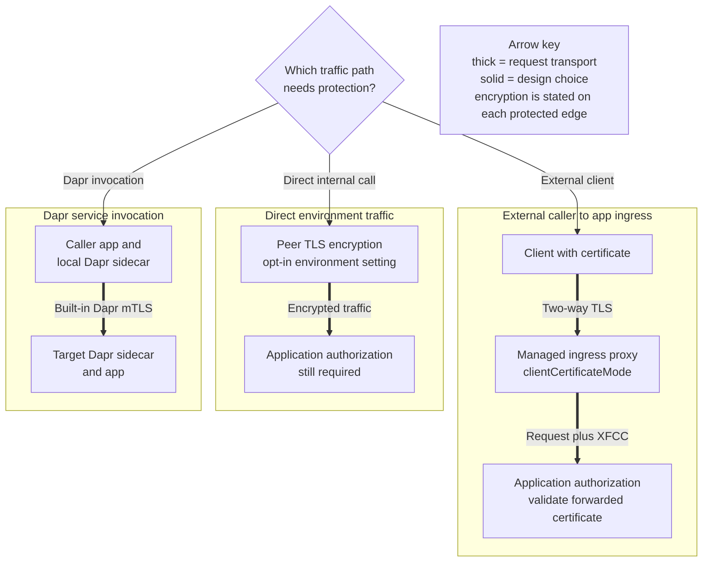

---
content_sources:
  diagrams:
    - id: aca-mtls-best-practice-pattern
      type: flowchart
      source: self-generated
      justification: Three-path security decision view synthesized from Microsoft Learn to keep environment peer encryption, ingress client certificate handling, and Dapr service invocation mTLS distinct from application authorization.
      based_on:
        - https://learn.microsoft.com/en-us/azure/container-apps/ingress-environment-configuration
        - https://learn.microsoft.com/en-us/azure/container-apps/client-certificate-authorization
        - https://learn.microsoft.com/en-us/azure/container-apps/connect-apps
        - https://learn.microsoft.com/en-us/azure/container-apps/dapr-overview
content_validation:
  status: verified
  last_reviewed: 2026-11-07
  reviewer: agent
  core_claims:
    - claim: Azure Container Apps supports opt-in peer-to-peer TLS encryption within the environment, but the built-in feature does not provide app-to-app authorization.
      source: https://learn.microsoft.com/en-us/azure/container-apps/ingress-environment-configuration
      verified: true
    - claim: Ingress passes the client certificate to the app when clientCertificateMode is set to require or accept.
      source: https://learn.microsoft.com/en-us/azure/container-apps/client-certificate-authorization
      verified: true
    - claim: Dapr service invocation in Azure Container Apps provides built-in mutual TLS.
      source: https://learn.microsoft.com/en-us/azure/container-apps/connect-apps
      verified: true
---
# mTLS Best Practices

Use the Container Apps mTLS-related features as layered controls: ingress client certificate handling for external callers, peer TLS encryption for environment traffic, and Dapr sidecar mTLS for service invocation. None of these transport controls replaces application authorization.

## Why This Matters

mTLS helps you answer three different trust questions:

- Is this external caller allowed to reach my app?
- Is east-west traffic inside the environment encrypted?
- Should this internal service call use a platform-managed service identity path instead of custom TLS code?

<!-- diagram-id: aca-mtls-best-practice-pattern -->

*Figure: The three paths are complementary, not interchangeable. Ingress certificate handling and peer encryption protect transport, while the application still decides whether an identified caller may perform an operation.*

## Recommended Practices

### Enable peer encryption for production environments

Use environment peer encryption when services communicate inside the same managed environment and you want the platform to encrypt environment traffic. The feature is disabled by default, can increase latency and reduce maximum throughput at high load, and does not provide authorization between applications.

### Terminate external mTLS at ingress

Use `clientCertificateMode=require` when every request must present a certificate. Use `accept` only when certificates are optional and the application explicitly enforces certificate presence where needed. Container Apps passes certificate details to the app for `require` or `accept`; application code must validate and authorize the caller.

Why:

- The platform already terminates TLS at Envoy.
- Your app receives a normalized `X-Forwarded-Client-Cert` header.
- App code remains responsible for certificate validation and authorization policy rather than the TLS exchange itself.

### Prefer Dapr for same-environment service-to-service calls

When both apps live in the same environment and Dapr already fits your architecture, use Dapr service invocation for:

- Built-in mTLS
- Service discovery through Dapr App IDs
- Automatic retries and observability alongside transport security

### Rotate and store certificates deliberately

- Keep external client certificates in Azure Key Vault or your enterprise PKI workflow.
- Track expiration dates for partner or device certificates.
- Treat thumbprint allowlists as configuration, not hardcoded source values.
- Let Dapr and the platform manage their own mTLS certificates rather than exporting internal private keys into app code.

### Validate the forwarded certificate in the app

Even when ingress accepts the certificate, your app should still validate the forwarded leaf certificate against:

- Expected issuer
- Expected subject or SAN
- Expected thumbprint
- Optional chain or revocation policy if your compliance model requires it

### Verify mTLS ingress surfaces in Azure Portal

![ca-sample-d38538 | Ingress | Container App | Refresh | Send us your feedback | Ingress | Ingress traffic | Limited to Container Apps Environment | Accepting traffic from anywhere | Ingress type | HTTP | TCP | Client certificate mode | Ignore | Accept | Require | Transport | Auto | Insecure connections | Target port | 80 | Endpoint(s) | https://<app-name>.<unique-id>.<region>.azurecontainerapps.io | Session affinity | Additional TCP ports | IP Restrictions | IP Security Restrictions Mode | Allow all traffic (default) | Save | Discard](../assets/best-practices/mtls-ingress-blade.png)

**[Observed]** `ca-sample-d38538 | Ingress` `Container App` `Refresh` `Send us your feedback` `Ingress` `Ingress traffic` `Limited to Container Apps Environment` `Accepting traffic from anywhere` `Ingress type` `HTTP` `TCP` `Client certificate mode` `Ignore` `Accept` `Require` `Transport` `Auto` `Insecure connections` `Target port` `80` `Endpoint(s)` `https://<app-name>.<unique-id>.<region>.azurecontainerapps.io` `Session affinity` `Additional TCP ports` `IP Restrictions` `IP Security Restrictions Mode` `Allow all traffic (default)` `Save` `Discard`.

**[Inferred]** The `Client certificate mode` selector with `Ignore`, `Accept`, and `Require` options appears to map to the ingress-side client-certificate handling discussed in [Terminate external mTLS at ingress](#terminate-external-mtls-at-ingress), where the platform negotiates the client certificate before the app sees the request. The `Accepting traffic from anywhere` radio paired with the external `Endpoint(s)` value is consistent with [Terminate external mTLS at ingress](#terminate-external-mtls-at-ingress) treating the external ingress edge as the mTLS termination point. The `Limited to Container Apps Environment` radio option appears to map to the same-environment service-to-service scope described in [Prefer Dapr for same-environment service-to-service calls](#prefer-dapr-for-same-environment-service-to-service-calls), which keeps service-to-service traffic inside the environment. The `Client certificate mode` field is consistent with [Validate the forwarded certificate in the app](#validate-the-forwarded-certificate-in-the-app), which assumes the application validates the forwarded client certificate after ingress handling.

**[Not Proven]** Additional ingress certificate detail, validation detail, downstream handling detail, and environment encryption detail are not visible on this view.

## Common Mistakes / Anti-Patterns

### Re-implementing east-west mTLS in every service

If direct environment peer encryption or Dapr already covers the traffic path, adding custom app-level mTLS for every internal hop often adds complexity without improving trust boundaries.

### Using `accept` mode and assuming authentication happened

`accept` means the request is still allowed without a certificate. Use it only when your app explicitly enforces certificate presence on selected routes or callers.

### Trusting `X-Forwarded-Client-Cert` as an opaque string

Always parse and validate the leaf certificate. Do not treat the raw header value as proof of authorization.

### Mixing CORS and mTLS decisions

CORS controls browser behavior. It does not authenticate callers and does not replace certificate validation.

### Ignoring performance impact of peer encryption

Microsoft Learn explicitly notes that enabling environment peer encryption can increase response latency and reduce throughput under high load. Measure before broad rollout.

## Validation Checklist

- `peerTrafficConfiguration.encryption.enabled` is documented for production environments that use direct internal traffic.
- External APIs use `clientCertificateMode=require` unless there is a documented reason to accept non-certificate callers.
- Application code parses `X-Forwarded-Client-Cert` and validates issuer, subject, or thumbprint.
- Dapr-enabled services use Dapr App IDs consistently and avoid bypassing the sidecar by accident.
- External certificate material is stored outside source code, ideally in Key Vault or enterprise PKI tooling.
- Load testing covers the latency impact of peer encryption or edge certificate validation.

## Review Matrix

| Review area | Page-specific check |
|---|---|
| Scope | Confirm the guidance applies to mTLS Best Practices. |
| Source basis | Validate the recommendation against the Microsoft Learn sources in this page. |
| Evidence | Capture command output, portal state, metrics, logs, or screenshots before treating the result as proven. |

## See Also

- [mTLS Architecture in Azure Container Apps](../platform/security/mtls.md)
- [Ingress Client Certificates](../platform/security/ingress-client-certificates.md)
- [Azure Container Apps Security Best Practices](security.md)
- [Service-to-Service Communication](../platform/networking/service-to-service.md)

## Sources

- [Ingress environment configuration in Azure Container Apps (Microsoft Learn)](https://learn.microsoft.com/en-us/azure/container-apps/ingress-environment-configuration)
- [Configure client certificate authentication in Azure Container Apps (Microsoft Learn)](https://learn.microsoft.com/en-us/azure/container-apps/client-certificate-authorization)
- [Communicate between container apps in Azure Container Apps (Microsoft Learn)](https://learn.microsoft.com/en-us/azure/container-apps/connect-apps)
- [Dapr overview in Azure Container Apps (Microsoft Learn)](https://learn.microsoft.com/en-us/azure/container-apps/dapr-overview)
