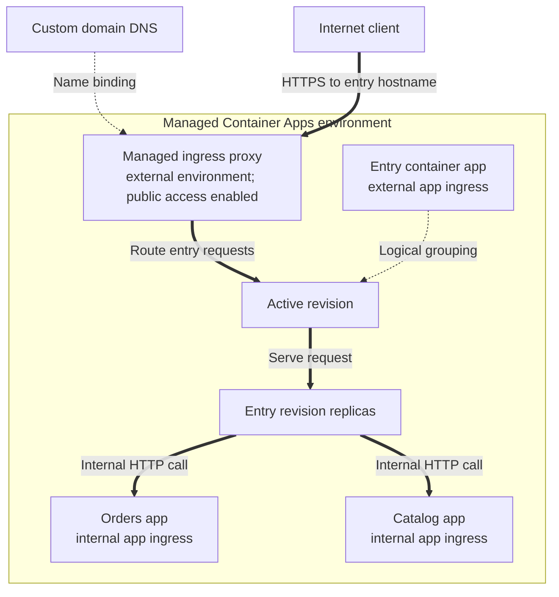
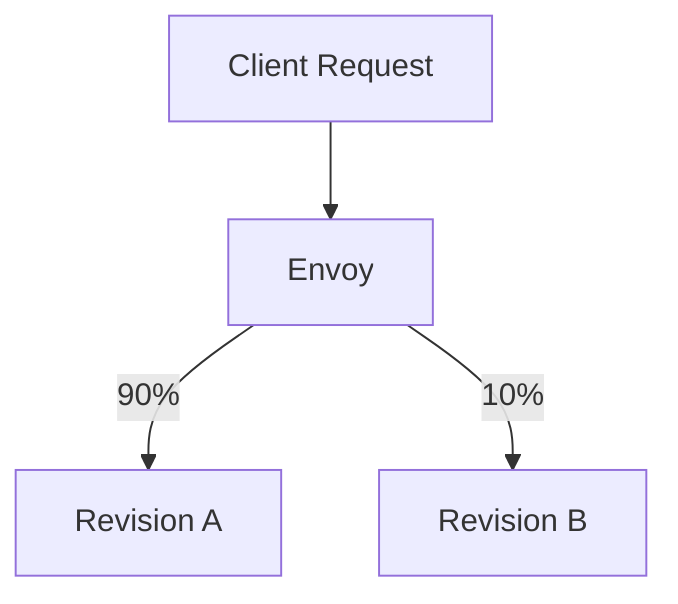
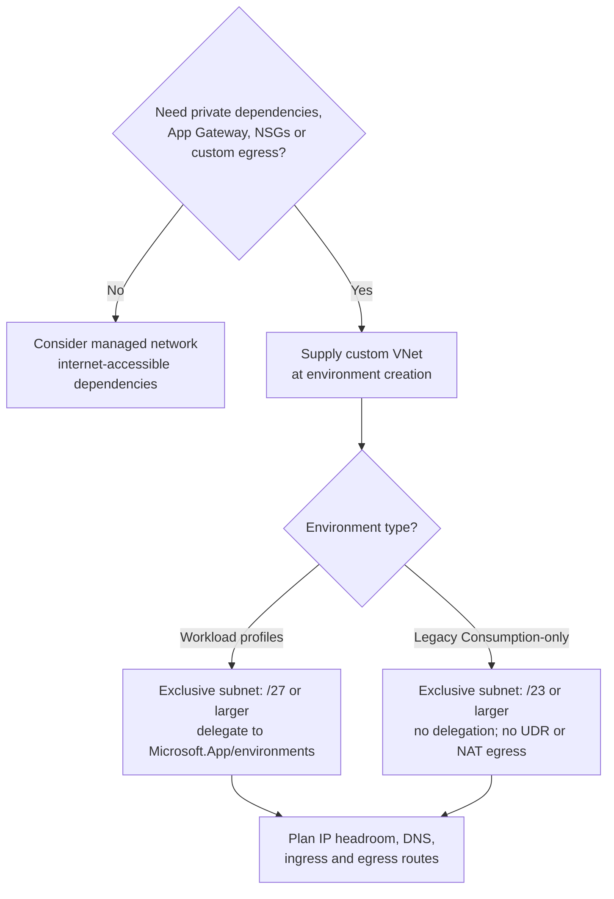
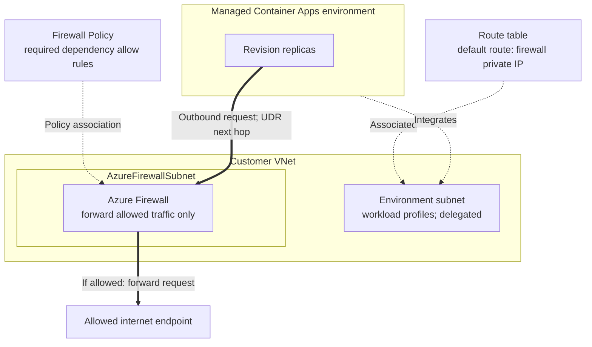

---
content_sources:
  diagrams:
    - id: use-one-entry-app-for-public
      type: flowchart
      source: mslearn-adapted
      based_on:
        - https://learn.microsoft.com/en-us/azure/container-apps/networking
        - https://learn.microsoft.com/en-us/azure/container-apps/ingress-overview
        - https://learn.microsoft.com/en-us/azure/container-apps/private-endpoints-with-dns
        - https://learn.microsoft.com/en-us/azure/container-apps/firewall-integration
        - https://learn.microsoft.com/en-us/azure/container-apps/use-azure-firewall
        - https://learn.microsoft.com/en-us/azure/container-apps/sticky-sessions
        - https://learn.microsoft.com/en-us/azure/container-apps/cors
        - https://learn.microsoft.com/en-us/azure/container-apps/dapr-overview
        - https://learn.microsoft.com/en-us/azure/container-apps/custom-domains-certificates
        - https://learn.microsoft.com/en-us/azure/container-apps/custom-domains-managed-certificates
        - https://learn.microsoft.com/en-us/azure/container-apps/ingress-how-to
    - id: traffic-weights-are-applied-at-ingress
      type: flowchart
      source: mslearn-adapted
      based_on:
        - https://learn.microsoft.com/en-us/azure/container-apps/networking
        - https://learn.microsoft.com/en-us/azure/container-apps/ingress-overview
        - https://learn.microsoft.com/en-us/azure/container-apps/private-endpoints-with-dns
    - id: choose-vnet-integration-when-private-networking
      type: flowchart
      source: mslearn-adapted
      based_on:
        - https://learn.microsoft.com/en-us/azure/container-apps/networking
        - https://learn.microsoft.com/en-us/azure/container-apps/ingress-overview
        - https://learn.microsoft.com/en-us/azure/container-apps/private-endpoints-with-dns
        - https://learn.microsoft.com/en-us/azure/container-apps/firewall-integration
        - https://learn.microsoft.com/en-us/azure/container-apps/use-azure-firewall
        - https://learn.microsoft.com/en-us/azure/container-apps/sticky-sessions
        - https://learn.microsoft.com/en-us/azure/container-apps/cors
        - https://learn.microsoft.com/en-us/azure/container-apps/dapr-overview
        - https://learn.microsoft.com/en-us/azure/container-apps/custom-domains-certificates
        - https://learn.microsoft.com/en-us/azure/container-apps/custom-domains-managed-certificates
        - https://learn.microsoft.com/en-us/azure/container-apps/ingress-how-to
    - id: a-common-enterprise-pattern-is-controlled
      type: flowchart
      source: mslearn-adapted
      based_on:
        - https://learn.microsoft.com/en-us/azure/container-apps/networking
        - https://learn.microsoft.com/en-us/azure/container-apps/ingress-overview
        - https://learn.microsoft.com/en-us/azure/container-apps/private-endpoints-with-dns
        - https://learn.microsoft.com/en-us/azure/container-apps/firewall-integration
        - https://learn.microsoft.com/en-us/azure/container-apps/use-azure-firewall
        - https://learn.microsoft.com/en-us/azure/container-apps/sticky-sessions
        - https://learn.microsoft.com/en-us/azure/container-apps/cors
        - https://learn.microsoft.com/en-us/azure/container-apps/dapr-overview
        - https://learn.microsoft.com/en-us/azure/container-apps/custom-domains-certificates
        - https://learn.microsoft.com/en-us/azure/container-apps/custom-domains-managed-certificates
        - https://learn.microsoft.com/en-us/azure/container-apps/ingress-how-to
content_validation:
  status: verified
  last_reviewed: '2026-11-07'
  reviewer: agent
  core_claims:
    - claim: The network type of a Container Apps environment can't be changed after the environment is created.
      source: https://learn.microsoft.com/en-us/azure/container-apps/networking
      verified: true
    - claim: Internal environments have no public endpoints and are deployed with a virtual IP mapped to an internal IP address.
      source: https://learn.microsoft.com/en-us/azure/container-apps/networking
      verified: true
    - claim: In workload profiles environments, the minimum required subnet size is /27.
      source: https://learn.microsoft.com/en-us/azure/container-apps/networking
      verified: true
    - claim: In consumption-only environments, the minimum required subnet size is /23.
      source: https://learn.microsoft.com/en-us/azure/container-apps/networking
      verified: true
    - claim: Traffic splitting rules can define how incoming traffic is split between different revisions of an application.
      source: https://learn.microsoft.com/en-us/azure/container-apps/networking
      verified: true
---
# Azure Container Apps Networking Best Practices

This guide focuses on operating Azure Container Apps networking safely and predictably in production. Read this after the platform networking concepts so you can apply concrete patterns, guardrails, and rollout steps.

## Why This Matters

Production Container Apps behavior depends on explicit platform choices for ingress, scale, identity, observability, and release safety. This page turns the cited Microsoft Learn guidance into reviewable practices that can be checked before promotion.

## Prerequisites

- You understand environment, ingress, revision, and service-to-service basics.
- You reviewed the conceptual networking docs first:
  - [Platform Networking Overview](../platform/networking/index.md)
  - [VNet Integration](../platform/networking/vnet-integration.md)
  - [Private Endpoints](../platform/networking/private-endpoints.md)
- Azure CLI is installed and authenticated.
- You have Contributor (or equivalent) permissions on your resource group.

Set reusable variables:

```bash
export RG="rg-aca-prod"
export APP_NAME="ca-api-prod"
export ACA_ENV_NAME="cae-prod"
export ACR_NAME="acrprodshared"
export LOCATION="koreacentral"
```

## Recommended Practices

### Start with an ingress posture decision, not a command

Treat ingress as an application contract:

- **External app ingress**: publishes the app at the environment's inbound endpoint. Internet access also requires an external environment with public network access enabled; in an internal environment this endpoint is private.
- **Internal app ingress**: the app's own FQDN is directly reachable only within the same environment, not from arbitrary VNet clients. An environment-level HTTP route can still expose an internal app as a route target; exclude it from those routes when isolation is required.
- **No ingress**: disables the app's ingress endpoint; suitable for workers that consume queues or events. Dapr invocation is a separate opt-in path, not an ingress setting.

Use this table before creating or updating an app:

| Workload Type | Recommended Ingress | Why |
|---|---|---|
| Public API | External | Publish at managed ingress; choose the environment boundary separately |
| Internal API | Internal | Keep direct app ingress environment-scoped |
| Queue processor | None | Reduces attack surface and accidental exposure |
| Admin tooling endpoint | Internal + access-controlled path | Avoid exposing privileged operations |

!!! warning "Do not use external ingress as a default"
    External app ingress is not synonymous with public internet exposure. Where the environment permits public access, review TLS, WAF posture, abuse protection, and certificate lifecycle ownership.

### External ingress pattern for controlled public entry

Use one entry app for public traffic, and keep downstream services internal.

<!-- diagram-id: use-one-entry-app-for-public -->


*Figure: Public-entry extension of the [architecture base](../platform/architecture/index.md#managed-environment-ingress-revisions-and-scaling). Thick arrows carry requests; dotted arrows show DNS configuration or logical grouping. Backend ingress routing is collapsed into the app nodes, not bypassed. Custom DNS is not a packet-forwarding service. Exclude the backends from environment-level HTTP routes if they must remain environment-scoped; private data-service access additionally needs its own DNS, route, and authorization design.*

Create or update with explicit ingress controls:

```bash
az containerapp create \
  --name "$APP_NAME" \
  --resource-group "$RG" \
  --environment "$ACA_ENV_NAME" \
  --image "$ACR_NAME.azurecr.io/api:2026-04-04" \
  --target-port 8000 \
  --ingress external \
  --min-replicas 2 \
  --max-replicas 10
```

| Command / Parameter | Purpose |
|---|---|
| `az containerapp create` | Creates an app with explicit ingress, image and scaling settings. |
| `--name` | Selects the named resource for this operation. |
| `--resource-group` | Selects the resource group containing the resource. |
| `--environment` | Selects the existing Container Apps environment. |
| `--image` | Uses the explicitly versioned container image. |
| `--target-port` | Sets the port on which the application listens. |
| `--ingress` | Selects app ingress visibility relative to the environment. |
| `--min-replicas` | Keeps the specified minimum number of replicas running. |
| `--max-replicas` | Caps the number of replicas for scale-out. |

Operational notes:

1. Keep public app stateless and narrow in scope.
2. Put authN/authZ checks at the edge app before internal fan-out.
3. Avoid making every microservice external; route internally instead.

### Internal ingress pattern for service APIs

Use internal ingress for service-to-service APIs that should not be internet-addressable.

```bash
az containerapp create \
  --name "ca-orders-internal" \
  --resource-group "$RG" \
  --environment "$ACA_ENV_NAME" \
  --image "$ACR_NAME.azurecr.io/orders:2026-04-04" \
  --target-port 8080 \
  --ingress internal \
  --min-replicas 2 \
  --max-replicas 20
```

| Command / Parameter | Purpose |
|---|---|
| `az containerapp create` | Creates an app with explicit ingress, image and scaling settings. |
| `--name` | Selects the named resource for this operation. |
| `--resource-group` | Selects the resource group containing the resource. |
| `--environment` | Selects the existing Container Apps environment. |
| `--image` | Uses the explicitly versioned container image. |
| `--target-port` | Sets the port on which the application listens. |
| `--ingress` | Selects app ingress visibility relative to the environment. |
| `--min-replicas` | Keeps the specified minimum number of replicas running. |
| `--max-replicas` | Caps the number of replicas for scale-out. |

Validate ingress exposure:

```bash
az containerapp show \
  --name "ca-orders-internal" \
  --resource-group "$RG" \
  --query "properties.configuration.ingress.external" \
  --output tsv
```

| Command / Parameter | Purpose |
|---|---|
| `az containerapp show` | Runs this resource-specific configuration or inspection step. |
| `--name` | Selects the named resource for this operation. |
| `--resource-group` | Selects the resource group containing the resource. |
| `--query` | Projects the relevant property from the command response. |
| `--output` | Chooses the response format for operator inspection. |

Expected output:

```text
false
```

### How traffic split really behaves with Envoy

Traffic weights are applied at ingress and route requests to active revisions.

<!-- diagram-id: traffic-weights-are-applied-at-ingress -->


Operational implications:

- Weight is probabilistic over many requests, not strict per minute.
- During low traffic, observed percentages can be noisy.
- Session affinity is replica-level stickiness for HTTP ingress in **single revision mode only**. It is not a control for multiple-revision weighted traffic splitting or canary routing.

Set weighted traffic intentionally:

```bash
az containerapp ingress traffic set \
  --name "$APP_NAME" \
  --resource-group "$RG" \
  --revision-weight "${APP_NAME}--rev-a=90" "${APP_NAME}--rev-b=10"
```

| Command / Parameter | Purpose |
|---|---|
| `az containerapp ingress traffic set` | Runs this resource-specific configuration or inspection step. |
| `--name` | Selects the named resource for this operation. |
| `--resource-group` | Selects the resource group containing the resource. |
| `--revision-weight` | Assigns traffic percentages to the named revisions. |

Best practice rollout sequence:

1. Deploy new revision with zero traffic.
2. Run smoke tests against revision URL.
3. Shift to 5-10% and monitor latency/error trends.
4. Increase gradually if health remains stable.
5. Keep immediate rollback command prepared.

### VNet integration decision tree for real environments

Choose VNet integration when private networking requirements are explicit.

<!-- diagram-id: choose-vnet-integration-when-private-networking -->


*Figure: A decision flow, not a packet trace. Thin arrows mean planning choices. Minimum sizes are environment-type-specific floors, not recommended production capacity; the Consumption profile in a workload-profile environment is not the legacy Consumption-only environment.*

Use VNet integration when any of the following is true:

- You must access Azure SQL/Storage/Key Vault through private endpoints.
- Corporate policy requires outbound filtering and audit trails.
- Your downstream systems are reachable only via private IP paths.

Avoid premature VNet integration when:

- You do not have private dependency requirements.
- Networking operations ownership is unclear.
- You cannot maintain DNS and route governance.

### Internal-only environment pattern for microservices

For highly private architectures, create an **internal environment**. This is separate from each app's ingress visibility.

Pattern:

- Set the gateway-facing app to **external app ingress**, so the gateway can reach it through the environment's internal load balancer.
- Keep downstream services on internal app ingress and out of environment-level HTTP route targets.
- Expose the system through a network-connected API Management instance, Application Gateway, or a separate edge app with a private path to the entry app.
- Keep direct internet traffic away from service workloads.

Reference check command:

```bash
az containerapp env show \
  --name "$ACA_ENV_NAME" \
  --resource-group "$RG" \
  --query "properties.vnetConfiguration.internal" \
  --output tsv
```

| Command / Parameter | Purpose |
|---|---|
| `az containerapp env show` | Runs this resource-specific configuration or inspection step. |
| `--name` | Selects the named resource for this operation. |
| `--resource-group` | Selects the resource group containing the resource. |
| `--query` | Projects the relevant property from the command response. |
| `--output` | Chooses the response format for operator inspection. |

### AppGW to Internal CAE NSG design pattern

When an internal Container Apps environment is fronted by Application Gateway, the NSG on the workload profile subnet is a frequent cause of "backend Unhealthy" symptoms that surface at the gateway with no matching Container Apps ingress or system log entry.

Use the documented subnet-based NSG rules rather than assuming the environment's `staticIp` covers every required destination. That value is the internal load balancer frontend VIP used in private DNS A records. Configure the Application Gateway backend with the app FQDN and the documented HTTPS host-name override. This separates DNS and TLS settings from subnet-level filtering, without assuming undocumented replica NIC or load-balancer translation behavior.

Correct destination pattern:

- **Destination = workload profile subnet range**, using the range actually assigned to the environment subnet.
- **Source = Application Gateway subnet range**.
- **Destination ports = 443 and 31443** for HTTPS ingress, or **80 and 31080** for HTTP. The `31443` and `31080` ports are the edge proxy ports behind the internal load balancer and must be reachable from the AppGW subnet.
- **Separate rule for Azure LB health probes**: Source = service tag `AzureLoadBalancer`, Destination ports = `30000-32767`.

Reference check for the environment's static IP (which is the value in the private DNS A record and the address the container app FQDN resolves to — the AppGW backend pool should target the FQDN, not `staticIp` directly):

```bash
az containerapp env show \
  --name "$ACA_ENV_NAME" \
  --resource-group "$RG" \
  --query "properties.staticIp" \
  --output tsv
```

| Command / Parameter | Purpose |
|---|---|
| `az containerapp env show` | Runs this resource-specific configuration or inspection step. |
| `--name` | Selects the named resource for this operation. |
| `--resource-group` | Selects the resource group containing the resource. |
| `--query` | Projects the relevant property from the command response. |
| `--output` | Chooses the response format for operator inspection. |

See [Application Gateway Integration](../platform/networking/application-gateway-integration.md) for the full VNet layout and NSG rule set, and the [AppGW to Internal Azure Container Apps NSG Destination playbook](../troubleshooting/playbooks/ingress-and-networking/appgw-to-internal-aca-nsg-destination.md) for the diagnosis and fix flow.

### Egress control with UDR and firewall patterns

A common enterprise pattern is controlled outbound internet access through Azure Firewall or an NVA. UDR-based egress requires a **workload-profile environment** with custom VNet integration; legacy Consumption-only environments do not support it.

<!-- diagram-id: a-common-enterprise-pattern-is-controlled -->


*Figure: Outbound extension of the environment/replica vocabulary. Thick arrows carry requests; dotted arrows are configuration associations. A route table does not forward packets, and Firewall Policy is not inside a VNet. Denied traffic stops at the firewall. A default internet route does not prove that more-specific private-endpoint traffic traverses the firewall; validate those effective routes separately.*

Operational checklist:

1. Attach route table to the Container Apps delegated subnet.
2. Define default route to firewall where required.
3. Allow required service tags/FQDNs for platform dependencies.
4. Validate image pull, startup, and runtime connectivity after changes.

!!! note "Platform dependency allow-list"
    Restrictive egress often breaks image pulls, telemetry, or control-plane communication first. Validate with a canary app before broad rollout.

### Private endpoint exposure patterns

There are two separate goals teams often confuse:

1. **App consumes private endpoints** (outbound to private services).
2. **App is exposed privately** (inbound reachability over private network).

For outbound private access:

- Configure private endpoints on target services.
- Link private DNS zones correctly.
- Ensure environment subnet can resolve and route to private IPs.

For private inbound exposure:

- Choose an internal environment with external app ingress for VNet callers, or a supported environment private endpoint with public network access disabled. Internal app ingress alone does not publish the app to VNet clients.
- Front with private-capable gateway if centralized ingress is required.

Quick DNS validation from operations workstation:

```bash
az network private-dns record-set a list \
  --resource-group "$RG" \
  --zone-name "privatelink.database.windows.net" \
  --output table
```

| Command / Parameter | Purpose |
|---|---|
| `az network private-dns record-set a list` | Runs this resource-specific configuration or inspection step. |
| `--resource-group` | Selects the resource group containing the resource. |
| `--zone-name` | Selects the private DNS zone to inspect. |
| `--output` | Chooses the response format for operator inspection. |

### Service-to-service communication: Dapr vs direct HTTP

Use this rule:

- Choose **direct HTTP/gRPC** when communication is simple and tightly bounded.
- Choose **Dapr service invocation** when you need cross-cutting resiliency, mTLS abstraction, or sidecar-driven patterns.

| Criteria | Direct Calls | Dapr Invocation |
|---|---|---|
| Setup complexity | Lower | Moderate |
| Retries/timeouts policy | App code | Dapr policy/component |
| Service discovery abstraction | Basic | Strong |
| Portability of resilience policy | Lower | Higher |

Direct call environment variable pattern:

```bash
az containerapp update \
  --name "$APP_NAME" \
  --resource-group "$RG" \
  --set-env-vars "ORDERS_BASE_URL=http://ca-orders-internal"
```

| Command / Parameter | Purpose |
|---|---|
| `az containerapp update` | Runs this resource-specific configuration or inspection step. |
| `--name` | Selects the named resource for this operation. |
| `--resource-group` | Selects the resource group containing the resource. |
| `--set-env-vars` | Adds or updates the peer service URL in application configuration. |

Dapr-enabled app update pattern:

```bash
az containerapp update \
  --name "$APP_NAME" \
  --resource-group "$RG" \
  --enable-dapr true \
  --dapr-app-id "api-gateway" \
  --dapr-app-port 8000
```

| Command / Parameter | Purpose |
|---|---|
| `az containerapp update` | Runs this resource-specific configuration or inspection step. |
| `--name` | Selects the named resource for this operation. |
| `--resource-group` | Selects the resource group containing the resource. |
| `--enable-dapr` | Enables the Dapr sidecar for this app. |
| `--dapr-app-id` | Sets the Dapr service invocation identifier. |
| `--dapr-app-port` | Sets the port the Dapr sidecar uses to reach the app. |

### CORS configuration without accidental overexposure

CORS should be restrictive and environment-specific.

Minimum safe pattern:

- Explicit origin allow-list.
- Explicit methods and headers.
- No wildcard origins with credentials.

Apply CORS at ingress configuration level:

```bash
az containerapp ingress cors enable \
  --name "$APP_NAME" \
  --resource-group "$RG" \
  --allowed-origins "https://portal.contoso.com" "https://admin.contoso.com" \
  --allowed-methods "GET" "POST" "PUT" "DELETE" \
  --allowed-headers "authorization" "content-type" \
  --allow-credentials true
```

| Command / Parameter | Purpose |
|---|---|
| `az containerapp ingress cors enable` | Runs this resource-specific configuration or inspection step. |
| `--name` | Selects the named resource for this operation. |
| `--resource-group` | Selects the resource group containing the resource. |
| `--allowed-origins` | Restricts browser cross-origin access to these origins. |
| `--allowed-methods` | Lists the HTTP methods permitted by the CORS policy. |
| `--allowed-headers` | Lists request headers permitted by the CORS policy. |
| `--allow-credentials` | Permits credentials for the explicitly allowed origins. |

!!! warning "CORS is not authentication"
    CORS controls browser behavior, not API authorization. Keep identity checks in the app or gateway.

### Custom domain and TLS certificate operations

Custom domains improve trust and routing hygiene, but must be operationalized.

Recommended sequence:

1. Validate DNS ownership requirements.
2. Bind custom domain to app ingress.
3. Attach managed certificate.
4. Enforce HTTPS-only behavior.
5. Monitor certificate expiry and binding drift.

Bind custom hostname:

```bash
az containerapp hostname add \
  --name "$APP_NAME" \
  --resource-group "$RG" \
  --hostname "api.contoso.com"
```

| Command / Parameter | Purpose |
|---|---|
| `az containerapp hostname add` | Runs this resource-specific configuration or inspection step. |
| `--name` | Selects the named resource for this operation. |
| `--resource-group` | Selects the resource group containing the resource. |
| `--hostname` | Selects the custom hostname to add or validate. |

Request a managed certificate (this command does not bind it to the hostname):

```bash
az containerapp env certificate create \
  --resource-group "$RG" \
  --name "$ACA_ENV_NAME" \
  --hostname "api.contoso.com" \
  --validation-method "CNAME"
```

| Command / Parameter | Purpose |
|---|---|
| `az containerapp env certificate create` | Requests a managed certificate; a separate hostname bind is still required. |
| `--resource-group` | Selects the resource group containing the resource. |
| `--name` | Selects the named resource for this operation. |
| `--hostname` | Selects the custom hostname to add or validate. |
| `--validation-method` | Uses CNAME-based domain ownership validation. |

After issuance, use the [managed certificate workflow](https://learn.microsoft.com/en-us/azure/container-apps/custom-domains-managed-certificates) to bind the certificate with `az containerapp hostname bind`. A hostname entry or a certificate-create request alone does not establish a working HTTPS binding.

Verify hostname binding state:

```bash
az containerapp hostname list \
  --name "$APP_NAME" \
  --resource-group "$RG" \
  --output table
```

| Command / Parameter | Purpose |
|---|---|
| `az containerapp hostname list` | Runs this resource-specific configuration or inspection step. |
| `--name` | Selects the named resource for this operation. |
| `--resource-group` | Selects the resource group containing the resource. |
| `--output` | Chooses the response format for operator inspection. |

### Session affinity considerations with revisions and scaling

Sticky sessions can simplify legacy behavior, but they reduce load distribution quality.

Use session affinity only when all are true:

- Client workflow cannot be made stateless quickly.
- You understand skew impact on autoscaling and canary analysis.
- You plan a migration away from stickiness.

Operational risks:

- Session affinity is supported only in single revision mode with HTTP ingress; do not combine it with a multiple-revision weighted canary.
- Uneven replica utilization increases tail latency.
- Failover can disrupt sticky clients abruptly.

### Ingress configuration guardrails

Use the conceptual guidance in [Ingress in Azure Container Apps](../platform/networking/ingress.md) to make the initial platform choice, then enforce these production guardrails:

- Choose `http2` explicitly for gRPC workloads instead of relying on later guesswork.
- Prefer `affinity: none` unless you have a documented stateful dependency that requires sticky sessions.
- Apply IP restrictions at ingress for coarse network filtering, but keep application authorization separate.
- Treat additional TCP ports as scarce shared environment resources because external ports must be unique across the environment.

### Production networking guardrails checklist

Adopt this as a release gate before promoting revisions:

- Ingress mode explicitly declared and justified.
- Public endpoints mapped to approved threat model.
- CORS policy tested in browser and API clients.
- Private DNS resolution validated for all private dependencies.
- Outbound routes validated for image pull and telemetry.
- Domain and certificate status monitored.
- Rollback command prepared for current and previous revision.

### Anti-patterns to avoid

- Making all apps external because it is convenient during early testing.
- Mixing public and private exposure rules without documented ownership.
- Relying on wildcard CORS origins in production.
- Turning on session affinity to hide shared-state bugs.
- Applying strict UDR egress policies without canary validation.

### Verify ingress configuration in Azure Portal

![ca-sample-d38538 | Ingress | Container App | Refresh | Send us your feedback | Ingress | Ingress traffic | Limited to Container Apps Environment | Accepting traffic from anywhere | Ingress type | HTTP | TCP | Client certificate mode | Ignore | Accept | Require | Transport | Auto | Insecure connections | Target port | 80 | Endpoint(s) | https://<app-name>.<unique-id>.<region>.azurecontainerapps.io | Session affinity | Additional TCP ports | IP Restrictions | IP Security Restrictions Mode | Allow all traffic (default) | Save | Discard](../assets/best-practices/networking-ingress-blade.png)

**[Observed]** `ca-sample-d38538 | Ingress` `Container App` `Refresh` `Send us your feedback` `Ingress` `Ingress traffic` `Limited to Container Apps Environment` `Accepting traffic from anywhere` `Ingress type` `HTTP` `TCP` `Client certificate mode` `Ignore` `Accept` `Require` `Transport` `Auto` `Insecure connections` `Target port` `80` `Endpoint(s)` `https://<app-name>.<unique-id>.<region>.azurecontainerapps.io` `Session affinity` `Additional TCP ports` `IP Restrictions` `IP Security Restrictions Mode` `Allow all traffic (default)` `Save` `Discard` `Overview` `Activity log` `Access control (IAM)` `Tags` `Application` `Revisions and replicas` `Containers` `Scale` `Volumes` `Settings` `Networking` `Ingress` `Custom domains` `CORS` `Security` `Monitoring` `Log stream` `Logs` `Console` `Alerts` `Metrics`.

**[Inferred]** The selected `Accepting traffic from anywhere` radio option paired with `Target port` `80` appears to map to the `--ingress external` and `--target-port` flags shown in the `az containerapp create` example in [External ingress pattern for controlled public entry](#external-ingress-pattern-for-controlled-public-entry). The alternative `Limited to Container Apps Environment` radio option is consistent with the `--ingress internal` flag documented in [Internal ingress pattern for service APIs](#internal-ingress-pattern-for-service-apis). The `IP Security Restrictions Mode` value `Allow all traffic (default)` is consistent with the explicit allow/deny baseline discussed in [Ingress configuration guardrails](#ingress-configuration-guardrails). The unchecked `Session affinity` field is consistent with the guidance in [Session affinity considerations with revisions and scaling](#session-affinity-considerations-with-revisions-and-scaling) that recommends using session affinity only when necessary because it reduces load-distribution quality.

**[Not Proven]** Additional ingress configuration detail, binding detail, restriction detail, and provisioning detail are not visible on this view.

## Advanced Topics

Explore these when baseline operations are stable:

- Blue/green environment networking across separate Container Apps Environments.
- Private ingress hub-and-spoke topologies with centralized edge services.
- mTLS and policy enforcement strategies with Dapr sidecars.
- Cross-region DNS failover for external ingress endpoints.
- Automated network conformance tests in CI/CD using CLI validation scripts.

Example network validation script fragment:

```bash
az containerapp show \
  --name "$APP_NAME" \
  --resource-group "$RG" \
  --query "properties.configuration.ingress" \
  --output json

az containerapp revision list \
  --name "$APP_NAME" \
  --resource-group "$RG" \
  --output table
```

| Command / Parameter | Purpose |
|---|---|
| `az containerapp show` | Runs this resource-specific configuration or inspection step. |
| `az containerapp revision list` | Runs this resource-specific configuration or inspection step. |
| `--name` | Selects the named resource for this operation. |
| `--resource-group` | Selects the resource group containing the resource. |
| `--query` | Projects the relevant property from the command response. |
| `--output` | Chooses the response format for operator inspection. |

!!! tip "Pattern: Use Custom Internal Domains for On-Premises DNS Integration"
    When on-premises DNS policy prohibits Conditional Forwarders for external domains (e.g., `*.azurecontainerapps.io`), bind a custom internal domain (e.g., `app.nhinvest.local`) to your Container Apps app and create the corresponding Private DNS Zone A record pointing to the Container Apps environment's static IP. This lets on-prem DNS forward only internal domains to Azure Private DNS Resolver.

    **Requirements:**

    - Container Apps ingress must be `external: true` (in Internal Environment, this means VNet-accessible, not internet-exposed)
    - Private DNS Resolver Inbound Endpoint reachable from on-prem via VPN/ExpressRoute
    - BYO certificate for HTTPS (managed certificates require public DNS validation)

    See: [On-Premises DNS to Container Apps Internal Environment](../operations/deployment/internal-ingress-on-prem-dns.md)

## Common Mistakes / Anti-Patterns

- Treating sample defaults as production-ready without checking ingress, scale, identity, and monitoring requirements.
- Applying a configuration change without verifying the resulting revision, logs, and metrics.
- Leaving ownership for certificates, private DNS, secrets, or rollout decisions undocumented.

## Validation Checklist

- [ ] Required Container Apps settings are represented in infrastructure as code.
- [ ] The active revision, ingress, scale, identity, and monitoring state match the intended design.
- [ ] Rollback or cleanup commands have been tested in a non-production environment.

## See Also

- [Environment Design](environment-design.md)
- [Landing Zone Accelerator](landing-zone-accelerator.md)
- [Platform Networking Overview](../platform/networking/index.md)
- [VNet Integration](../platform/networking/vnet-integration.md)
- [Private Endpoints](../platform/networking/private-endpoints.md)
- [Application Gateway Integration](../platform/networking/application-gateway-integration.md)
- [Managed Identity](../platform/identity-and-secrets/managed-identity.md)
- [Health and Recovery](../platform/reliability/health-recovery.md)
- [Operations Monitoring](../operations/monitoring/index.md)
- [AppGW to Internal Container Apps NSG Destination playbook](../troubleshooting/playbooks/ingress-and-networking/appgw-to-internal-aca-nsg-destination.md)

## Sources

- [Microsoft Learn source 1](https://learn.microsoft.com/en-us/azure/container-apps/networking)
- [Microsoft Learn source 2](https://learn.microsoft.com/en-us/azure/container-apps/ingress-overview)
- [Microsoft Learn source 3](https://learn.microsoft.com/en-us/azure/container-apps/private-endpoints-with-dns)
- [Firewall integration (Microsoft Learn)](https://learn.microsoft.com/en-us/azure/container-apps/firewall-integration)
- [Use azure firewall (Microsoft Learn)](https://learn.microsoft.com/en-us/azure/container-apps/use-azure-firewall)
- [Sticky sessions (Microsoft Learn)](https://learn.microsoft.com/en-us/azure/container-apps/sticky-sessions)
- [Cors (Microsoft Learn)](https://learn.microsoft.com/en-us/azure/container-apps/cors)
- [Dapr overview (Microsoft Learn)](https://learn.microsoft.com/en-us/azure/container-apps/dapr-overview)
- [Custom domains certificates (Microsoft Learn)](https://learn.microsoft.com/en-us/azure/container-apps/custom-domains-certificates)
- [Custom domains managed certificates (Microsoft Learn)](https://learn.microsoft.com/en-us/azure/container-apps/custom-domains-managed-certificates)
- [Ingress how to (Microsoft Learn)](https://learn.microsoft.com/en-us/azure/container-apps/ingress-how-to)
