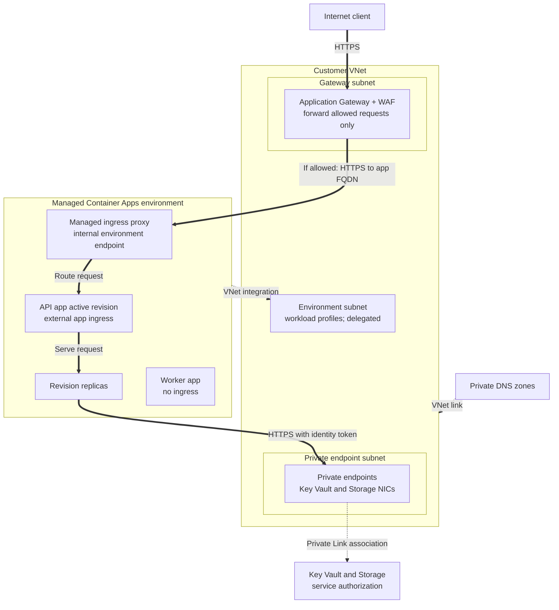
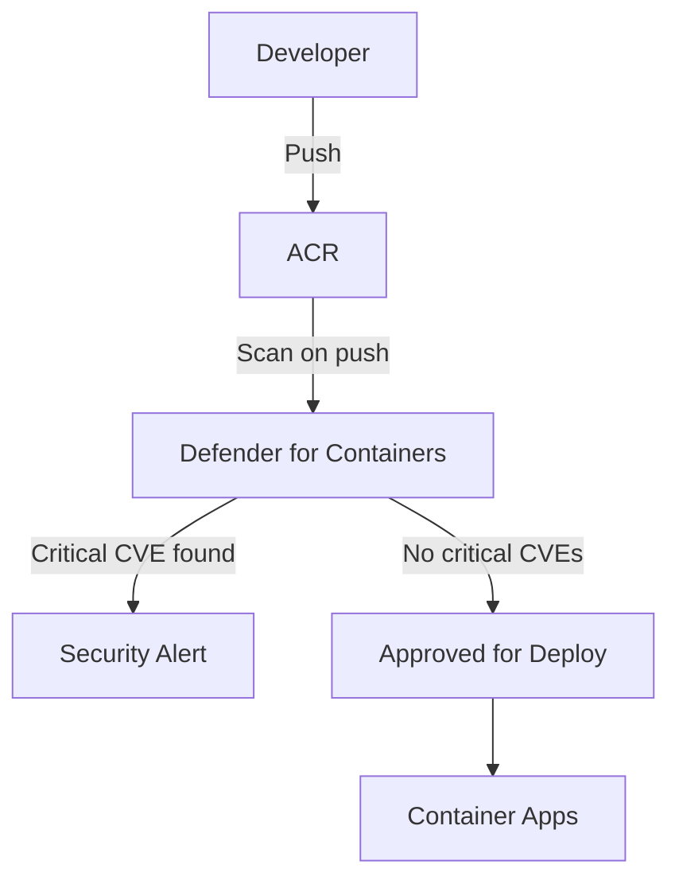
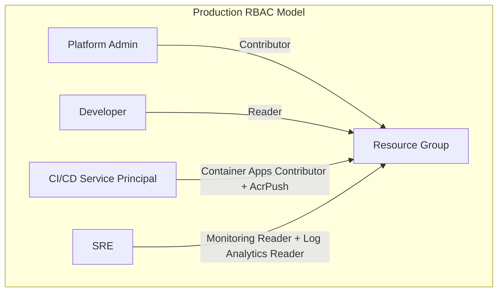

---
content_sources:
  diagrams:
    - id: create-environments-with-no-public-endpoint
      type: flowchart
      source: mslearn-adapted
      based_on:
        - https://learn.microsoft.com/en-us/azure/container-apps/security
        - https://learn.microsoft.com/en-us/azure/container-apps/authentication
        - https://learn.microsoft.com/en-us/azure/container-apps/managed-identity
        - https://learn.microsoft.com/en-us/azure/container-apps/networking
        - https://learn.microsoft.com/en-us/azure/defender-for-cloud/defender-for-containers-introduction
        - https://learn.microsoft.com/en-us/azure/role-based-access-control/overview
        - https://learn.microsoft.com/en-us/azure/container-apps/policy-reference
        - https://learn.microsoft.com/en-us/azure/container-apps/manage-secrets
        - https://learn.microsoft.com/en-us/azure/container-apps/ingress-overview
        - https://learn.microsoft.com/en-us/azure/container-apps/waf-app-gateway
        - https://learn.microsoft.com/en-us/azure/container-apps/use-azure-firewall
        - https://learn.microsoft.com/en-us/azure/container-apps/log-monitoring
        - https://learn.microsoft.com/en-us/azure/container-apps/dapr-overview
        - https://learn.microsoft.com/en-us/azure/container-apps/mtls
    - id: enable-vulnerability-scanning
      type: flowchart
      source: mslearn-adapted
      based_on:
        - https://learn.microsoft.com/en-us/azure/container-apps/security
        - https://learn.microsoft.com/en-us/azure/container-apps/authentication
        - https://learn.microsoft.com/en-us/azure/container-apps/managed-identity
        - https://learn.microsoft.com/en-us/azure/container-apps/networking
        - https://learn.microsoft.com/en-us/azure/defender-for-cloud/defender-for-containers-introduction
        - https://learn.microsoft.com/en-us/azure/role-based-access-control/overview
        - https://learn.microsoft.com/en-us/azure/container-apps/policy-reference
        - https://learn.microsoft.com/en-us/azure/container-apps/manage-secrets
    - id: apply-least-privilege-role-assignments
      type: flowchart
      source: mslearn-adapted
      based_on:
        - https://learn.microsoft.com/en-us/azure/container-apps/security
        - https://learn.microsoft.com/en-us/azure/container-apps/authentication
        - https://learn.microsoft.com/en-us/azure/container-apps/managed-identity
        - https://learn.microsoft.com/en-us/azure/container-apps/networking
        - https://learn.microsoft.com/en-us/azure/defender-for-cloud/defender-for-containers-introduction
        - https://learn.microsoft.com/en-us/azure/role-based-access-control/overview
        - https://learn.microsoft.com/en-us/azure/container-apps/policy-reference
        - https://learn.microsoft.com/en-us/azure/container-apps/manage-secrets
content_validation:
  status: verified
  last_reviewed: '2026-11-07'
  reviewer: agent
  core_claims:
    - claim: Internal environments have no public endpoints and are deployed with a virtual IP mapped to an internal IP address.
      source: https://learn.microsoft.com/en-us/azure/container-apps/networking
      verified: true
    - claim: To create private endpoints on an Azure Container Apps environment, public network access must be set to Disabled.
      source: https://learn.microsoft.com/en-us/azure/container-apps/networking
      verified: true
    - claim: A managed identity allows a container app to access other Microsoft Entra protected resources.
      source: https://learn.microsoft.com/en-us/azure/container-apps/managed-identity
      verified: true
    - claim: You can use managed identity to authenticate with a private Azure Container Registry without a username and password.
      source: https://learn.microsoft.com/en-us/azure/container-apps/managed-identity
      verified: true
    - claim: You can use role-based access control to grant specific permissions to a managed identity.
      source: https://learn.microsoft.com/en-us/azure/container-apps/managed-identity
      verified: true
---
# Azure Container Apps Security Best Practices

This guide provides actionable security hardening patterns for Azure Container Apps production workloads. It consolidates network, identity, image, and access control practices into a single operational checklist with CLI commands.

## Prerequisites

- You reviewed the security architecture concepts:
    - [Security Overview (Platform)](../platform/security/index.md)
    - [Managed Identity (Platform)](../platform/identity-and-secrets/managed-identity.md)
    - [Networking (Platform)](../platform/networking/index.md)
- Azure CLI is installed and authenticated.
- You have Contributor (or equivalent) permissions on your resource group.

Set reusable variables:

```bash
export RG="rg-aca-prod"
export APP_NAME="ca-api-prod"
export ACA_ENV_NAME="cae-prod"
export ACR_NAME="acrprodshared"
export LOCATION="koreacentral"
```

## Why This Matters

Security misconfigurations in Container Apps often result from convenience defaults carried into production:

- External ingress left open on internal services.
- Admin credentials used for ACR image pulls.
- Secrets stored in environment variables instead of Key Vault.
- No egress filtering — unrestricted outbound access.
- Overly broad RBAC assignments at the subscription level.

Each of these creates an exploitable surface. The patterns below address them systematically.

## Recommended Practices

### Network Hardening

#### Use internal environments for sensitive workloads

Create internal environments with no public endpoint. For controlled entry, use Application Gateway with WAF (shown below), or API Management with a suitable private network path. The gateway-facing app needs **external app ingress** to be published at the environment's internal load balancer; that does not expose it to the internet.

<!-- diagram-id: create-environments-with-no-public-endpoint -->


*Figure: Private-entry extension of the [architecture base](../platform/architecture/index.md#managed-environment-ingress-revisions-and-scaling). Thick arrows carry requests; dotted arrows are configuration or logical relationships. The environment boundary is logical, not a customer-managed cluster inside the subnet. Resolve dependency names to their private endpoint IPs before connecting; the target service independently validates the managed-identity token and permissions. A private endpoint does not grant authorization. The worker has no inbound request path in this view.*

Verify environment is internal:

```bash
az containerapp env show \
  --name "$ACA_ENV_NAME" \
  --resource-group "$RG" \
  --query "properties.vnetConfiguration.internal" \
  --output tsv
```

| Command / Parameter | Purpose |
|---|---|
| `az containerapp env show` | Runs this resource-specific configuration or inspection step. |
| `--name` | Selects the named resource for this operation. |
| `--resource-group` | Selects the resource group containing the resource. |
| `--query` | Projects the relevant property from the command response. |
| `--output` | Chooses the response format for operator inspection. |

Expected output:

```text
true
```

#### Restrict ingress to internal for backend services

```bash
az containerapp ingress enable \
  --name "ca-orders-internal" \
  --resource-group "$RG" \
  --target-port 8080 \
  --type internal
```

| Command / Parameter | Purpose |
|---|---|
| `az containerapp ingress enable` | Enables ingress with explicit app visibility and target port. |
| `--name` | Selects the named resource for this operation. |
| `--resource-group` | Selects the resource group containing the resource. |
| `--target-port` | Sets the port on which the application listens. |
| `--type` | Sets ingress visibility to internal or external. |

Verify ingress mode:

```bash
az containerapp show \
  --name "ca-orders-internal" \
  --resource-group "$RG" \
  --query "properties.configuration.ingress.external" \
  --output tsv
```

| Command / Parameter | Purpose |
|---|---|
| `az containerapp show` | Runs this resource-specific configuration or inspection step. |
| `--name` | Selects the named resource for this operation. |
| `--resource-group` | Selects the resource group containing the resource. |
| `--query` | Projects the relevant property from the command response. |
| `--output` | Chooses the response format for operator inspection. |

Expected output:

```text
false
```

Internal app ingress restricts direct FQDN access to the same environment. Also exclude the backend from environment-level HTTP routes, which can otherwise expose it outside that boundary.

#### Enable private endpoints for supported Azure dependencies

For dependencies that support Private Link, create the endpoint in a separate subnet, approve its connection, and configure private DNS and routing. This command creates only the endpoint; it does not grant the app data access or disable the service's public endpoint. Validate SKU and service-specific support rather than assuming every dependency supports private endpoints.

```bash
# Create private endpoint for Key Vault
az network private-endpoint create \
  --name "pe-keyvault" \
  --resource-group "$RG" \
  --vnet-name "vnet-aca" \
  --subnet "snet-pe" \
  --private-connection-resource-id "/subscriptions/<subscription-id>/resourceGroups/$RG/providers/Microsoft.KeyVault/vaults/<keyvault-name>" \
  --group-id "vault" \
  --connection-name "kv-connection"
```

| Command / Parameter | Purpose |
|---|---|
| `az network private-endpoint create` | Runs this resource-specific configuration or inspection step. |
| `--name` | Selects the named resource for this operation. |
| `--resource-group` | Selects the resource group containing the resource. |
| `--vnet-name` | Selects the customer virtual network. |
| `--subnet` | Selects the separate private-endpoint subnet. |
| `--private-connection-resource-id` | Identifies the target service resource for Private Link. |
| `--group-id` | Selects the target service subresource. |
| `--connection-name` | Names the private endpoint connection. |

#### Configure egress filtering

For a custom-VNet **workload-profile environment**, configure a UDR with Azure Firewall as next hop and allow the required platform and application dependencies. A route-table association alone does not create its routes or firewall allow rules. Legacy Consumption-only environments do not support UDR egress.

```bash
# Attach route table to Container Apps subnet
az network vnet subnet update \
  --name "snet-cae" \
  --vnet-name "vnet-aca" \
  --resource-group "$RG" \
  --route-table "rt-cae-egress"
```

| Command / Parameter | Purpose |
|---|---|
| `az network vnet subnet update` | Runs this resource-specific configuration or inspection step. |
| `--name` | Selects the named resource for this operation. |
| `--vnet-name` | Selects the customer virtual network. |
| `--resource-group` | Selects the resource group containing the resource. |
| `--route-table` | Associates the existing route table with the subnet. |

!!! warning "Validate platform dependencies before enforcing egress rules"
    Overly restrictive egress breaks image pulls, telemetry, and control-plane communication. Test with a canary app first.

### Identity Hardening

#### Use managed identity for all service access

Eliminate passwords and connection strings from application configuration:

```bash
# Enable system-assigned managed identity
az containerapp identity assign \
  --name "$APP_NAME" \
  --resource-group "$RG" \
  --system-assigned
```

| Command / Parameter | Purpose |
|---|---|
| `az containerapp identity assign` | Runs this resource-specific configuration or inspection step. |
| `--name` | Selects the named resource for this operation. |
| `--resource-group` | Selects the resource group containing the resource. |
| `--system-assigned` | Enables a system-assigned managed identity. |

#### Grant least-privilege role assignments

```bash
# Get the managed identity principal ID
PRINCIPAL_ID=$(az containerapp identity show \
  --name "$APP_NAME" \
  --resource-group "$RG" \
  --query "principalId" \
  --output tsv)

# Assign narrow role at resource scope
az role assignment create \
  --assignee-object-id "$PRINCIPAL_ID" \
  --assignee-principal-type ServicePrincipal \
  --role "Key Vault Secrets User" \
  --scope "/subscriptions/<subscription-id>/resourceGroups/$RG/providers/Microsoft.KeyVault/vaults/<keyvault-name>"
```

| Command / Parameter | Purpose |
|---|---|
| `az containerapp identity show` | Runs this resource-specific configuration or inspection step. |
| `az role assignment create` | Runs this resource-specific configuration or inspection step. |
| `--name` | Selects the named resource for this operation. |
| `--resource-group` | Selects the resource group containing the resource. |
| `--query` | Projects the relevant property from the command response. |
| `--output` | Chooses the response format for operator inspection. |
| `--assignee-object-id` | Selects the managed identity principal receiving the role. |
| `--assignee-principal-type` | Declares the assignee as a service principal. |
| `--role` | Selects the Azure RBAC role to assign. |
| `--scope` | Restricts the role assignment to the named resource. |

!!! tip "Avoid Contributor role for managed identities"
    Managed identities should have the narrowest role possible. Use data-plane roles like "Key Vault Secrets User" or "Storage Blob Data Reader". Azure SQL data access needs database permissions; "Azure SQL Database Contributor" is a management role, not permission to read application data.

#### Use managed identity for ACR image pulls

```bash
# Enable managed identity pull from ACR
az containerapp registry set \
  --name "$APP_NAME" \
  --resource-group "$RG" \
  --server "$ACR_NAME.azurecr.io" \
  --identity system
```

| Command / Parameter | Purpose |
|---|---|
| `az containerapp registry set` | Runs this resource-specific configuration or inspection step. |
| `--name` | Selects the named resource for this operation. |
| `--resource-group` | Selects the resource group containing the resource. |
| `--server` | Selects the Azure Container Registry login server. |
| `--identity` | Uses the configured managed identity for registry authentication. |

Verify ACR authentication method:

```bash
az containerapp registry show \
  --name "$APP_NAME" \
  --resource-group "$RG" \
  --server "$ACR_NAME.azurecr.io" \
  --query "identity" \
  --output tsv
```

| Command / Parameter | Purpose |
|---|---|
| `az containerapp registry show` | Runs this resource-specific configuration or inspection step. |
| `--name` | Selects the named resource for this operation. |
| `--resource-group` | Selects the resource group containing the resource. |
| `--server` | Selects the Azure Container Registry login server. |
| `--query` | Projects the relevant property from the command response. |
| `--output` | Chooses the response format for operator inspection. |

Expected output:

```text
system
```

### Image Hardening

#### Use specific image tags or digests

Never deploy with `:latest` in production. Pin to a specific version or use a digest:

```bash
az containerapp update \
  --name "$APP_NAME" \
  --resource-group "$RG" \
  --image "$ACR_NAME.azurecr.io/api:2026-04-09-sha-abc1234"
```

| Command / Parameter | Purpose |
|---|---|
| `az containerapp update` | Runs this resource-specific configuration or inspection step. |
| `--name` | Selects the named resource for this operation. |
| `--resource-group` | Selects the resource group containing the resource. |
| `--image` | Uses the explicitly versioned container image. |

#### Enable vulnerability scanning

<!-- diagram-id: enable-vulnerability-scanning -->


Enable Defender for Containers at the subscription level:

The diagram above expresses a desired release policy, not an automatic Defender deployment gate. Configure pipeline checks separately. Registry vulnerability assessment does not provide Container Apps runtime threat protection.

```bash
az security pricing create \
  --name Containers \
  --tier Standard
```

| Command / Parameter | Purpose |
|---|---|
| `az security pricing create` | Runs this resource-specific configuration or inspection step. |
| `--name` | Selects the named resource for this operation. |
| `--tier` | Sets the Defender plan pricing tier. |

#### Restrict ACR network access

```bash
# Disable public access to ACR
az acr update \
  --name "$ACR_NAME" \
  --resource-group "$RG" \
  --public-network-enabled false
```

| Command / Parameter | Purpose |
|---|---|
| `az acr update` | Runs this resource-specific configuration or inspection step. |
| `--name` | Selects the named resource for this operation. |
| `--resource-group` | Selects the resource group containing the resource. |
| `--public-network-enabled` | Controls the registry public network endpoint. |

### Authentication Hardening

#### Enable Easy Auth to require authentication

Configure an identity provider first, keep insecure ingress disabled, then require authentication. The settings below do not register or configure the provider for you.

```bash
az containerapp auth update \
  --name "$APP_NAME" \
  --resource-group "$RG" \
  --enabled true \
  --set globalValidation.requireAuthentication=true \
  --unauthenticated-client-action Return401
```

| Command / Parameter | Purpose |
|---|---|
| `az containerapp auth update` | Runs this resource-specific configuration or inspection step. |
| `--name` | Selects the named resource for this operation. |
| `--resource-group` | Selects the resource group containing the resource. |
| `--enabled` | Enables the built-in authentication middleware. |
| `--set` | Sets `globalValidation.requireAuthentication=true` so the rejection action applies to unauthenticated requests. |
| `--unauthenticated-client-action` | Selects the response for unauthenticated requests. |

Verify auth configuration:

```bash
az containerapp auth show \
  --name "$APP_NAME" \
  --resource-group "$RG" \
  --query "{enabled:platform.enabled,unauthenticatedAction:globalValidation.unauthenticatedClientAction}" \
  --output json
```

| Command / Parameter | Purpose |
|---|---|
| `az containerapp auth show` | Runs this resource-specific configuration or inspection step. |
| `--name` | Selects the named resource for this operation. |
| `--resource-group` | Selects the resource group containing the resource. |
| `--query` | Projects the relevant property from the command response. |
| `--output` | Chooses the response format for operator inspection. |

Expected output:

```json
{
  "enabled": true,
  "unauthenticatedAction": "Return401"
}
```

#### Enable Dapr mTLS for service-to-service encryption

```bash
az containerapp update \
  --name "$APP_NAME" \
  --resource-group "$RG" \
  --enable-dapr true \
  --dapr-app-id "api-service" \
  --dapr-app-port 8000
```

| Command / Parameter | Purpose |
|---|---|
| `az containerapp update` | Runs this resource-specific configuration or inspection step. |
| `--name` | Selects the named resource for this operation. |
| `--resource-group` | Selects the resource group containing the resource. |
| `--enable-dapr` | Enables the Dapr sidecar for this app. |
| `--dapr-app-id` | Sets the Dapr service invocation identifier. |
| `--dapr-app-port` | Sets the port the Dapr sidecar uses to reach the app. |

!!! note "mTLS requires Dapr on both sides"
    Both the caller and callee apps must have Dapr enabled for mTLS to be effective. Direct HTTP calls bypass Dapr encryption.

### RBAC Hardening

#### Apply least-privilege role assignments

<!-- diagram-id: apply-least-privilege-role-assignments -->


The following is a resource-group-scoped Contributor example, **not** the minimal role set shown above. Replace it with narrower deployment and registry role assignments after reviewing their full permissions; do not assume an `AcrPush` assignment on the app resource group covers a registry elsewhere.

```bash
# WARNING: Contributor is broad; this is not the minimal-role production pattern
az ad sp create-for-rbac \
  --name "sp-cicd-aca" \
  --role "Contributor" \
  --scopes "/subscriptions/<subscription-id>/resourceGroups/$RG" \
  --output json
```

| Command / Parameter | Purpose |
|---|---|
| `az ad sp create-for-rbac` | Runs this resource-specific configuration or inspection step. |
| `--name` | Selects the named resource for this operation. |
| `--role` | Selects the Azure RBAC role to assign. |
| `--scopes` | Limits the service principal role assignment to these scopes. |
| `--output` | Chooses the response format for operator inspection. |

!!! warning "Rotate service principal credentials"
    If using service principal for CI/CD, rotate credentials on a regular schedule (90 days recommended). Prefer workload identity federation (OIDC) with GitHub Actions to eliminate credential management entirely.

#### Audit role assignments regularly

```bash
az role assignment list \
  --resource-group "$RG" \
  --output table
```

| Command / Parameter | Purpose |
|---|---|
| `az role assignment list` | Runs this resource-specific configuration or inspection step. |
| `--resource-group` | Selects the resource group containing the resource. |
| `--output` | Chooses the response format for operator inspection. |

Review for:

- Assignments at broader scope than necessary.
- Unused or orphaned service principal assignments.
- Direct user assignments that should be group-based.

### Secret Management Hardening

#### Use Key Vault references instead of platform secrets

```bash
# Set Key Vault reference as a secret
az containerapp secret set \
  --name "$APP_NAME" \
  --resource-group "$RG" \
  --secrets "db-password=keyvaultref:https://<keyvault-name>.vault.azure.net/secrets/db-password,identityref:/subscriptions/<subscription-id>/resourceGroups/$RG/providers/Microsoft.ManagedIdentity/userAssignedIdentities/<identity-name>"
```

| Command / Parameter | Purpose |
|---|---|
| `az containerapp secret set` | Runs this resource-specific configuration or inspection step. |
| `--name` | Selects the named resource for this operation. |
| `--resource-group` | Selects the resource group containing the resource. |
| `--secrets` | Configures the Key Vault secret URI and retrieval identity. |

#### Enable Key Vault audit logging

```bash
az monitor diagnostic-settings create \
  --name "kv-audit" \
  --resource "/subscriptions/<subscription-id>/resourceGroups/$RG/providers/Microsoft.KeyVault/vaults/<keyvault-name>" \
  --workspace "/subscriptions/<subscription-id>/resourceGroups/$RG/providers/Microsoft.OperationalInsights/workspaces/<workspace-name>" \
  --logs '[{"category":"AuditEvent","enabled":true}]'
```

| Command / Parameter | Purpose |
|---|---|
| `az monitor diagnostic-settings create` | Runs this resource-specific configuration or inspection step. |
| `--name` | Selects the named resource for this operation. |
| `--resource` | Selects the resource that emits diagnostic logs. |
| `--workspace` | Selects the Log Analytics workspace for this command. |
| `--logs` | Enables the named diagnostic log categories. |

### Monitoring for Security Events

#### Enable diagnostic settings on Container Apps environment

```bash
az monitor diagnostic-settings create \
  --name "cae-security-logs" \
  --resource "/subscriptions/<subscription-id>/resourceGroups/$RG/providers/Microsoft.App/managedEnvironments/$ACA_ENV_NAME" \
  --workspace "/subscriptions/<subscription-id>/resourceGroups/$RG/providers/Microsoft.OperationalInsights/workspaces/<workspace-name>" \
  --logs '[{"category":"ContainerAppSystemLogs","enabled":true},{"category":"ContainerAppConsoleLogs","enabled":true}]'
```

| Command / Parameter | Purpose |
|---|---|
| `az monitor diagnostic-settings create` | Runs this resource-specific configuration or inspection step. |
| `--name` | Selects the named resource for this operation. |
| `--resource` | Selects the resource that emits diagnostic logs. |
| `--workspace` | Selects the Log Analytics workspace for this command. |
| `--logs` | Enables the named diagnostic log categories. |

#### Monitor authentication failures

With environment HTTP logging enabled, inspect 401/403 outcomes and correlate them with authentication-provider diagnostics. An HTTP status alone does not prove Easy Auth generated it; application code can return the same status. This query is not a complete authentication audit:

```bash
az monitor log-analytics query \
  --workspace "<workspace-id>" \
  --analytics-query "ContainerAppHTTPLogs | where StatusCode in (401, 403) | summarize count() by StatusCode, bin(TimeGenerated, 1h)" \
  --output table
```

| Command / Parameter | Purpose |
|---|---|
| `az monitor log-analytics query` | Runs this resource-specific configuration or inspection step. |
| `--workspace` | Selects the Log Analytics workspace for this command. |
| `--analytics-query` | Runs the specified diagnostic query; results depend on collected logs. |
| `--output` | Chooses the response format for operator inspection. |

### Verify security hardening surfaces in Azure Portal

![ca-sample-d38538 | Ingress | Container App | Refresh | Send us your feedback | Ingress | Ingress traffic | Limited to Container Apps Environment | Accepting traffic from anywhere | Ingress type | HTTP | TCP | Client certificate mode | Ignore | Accept | Require | Transport | Auto | Insecure connections | Target port | 80 | Endpoint(s) | https://<app-name>.<unique-id>.<region>.azurecontainerapps.io | Session affinity | Additional TCP ports | IP Restrictions | IP Security Restrictions Mode | Allow all traffic (default) | Save | Discard](../assets/best-practices/security-ingress-blade.png)

**[Observed]** `ca-sample-d38538 | Ingress` `Container App` `Refresh` `Send us your feedback` `Ingress` `Ingress traffic` `Limited to Container Apps Environment` `Accepting traffic from anywhere` `Ingress type` `HTTP` `TCP` `Client certificate mode` `Ignore` `Accept` `Require` `Transport` `Auto` `Insecure connections` `Target port` `80` `Endpoint(s)` `https://<app-name>.<unique-id>.<region>.azurecontainerapps.io` `Session affinity` `Additional TCP ports` `IP Restrictions` `IP Security Restrictions Mode` `Allow all traffic (default)` `Save` `Discard`.

**[Inferred]** The radio options describe app ingress visibility, not environment accessibility. `Accepting traffic from anywhere` can publish the app at a private internal load balancer; the displayed FQDN alone does not prove public reachability. Check environment networking separately as described in [Use internal environments for sensitive workloads](#use-internal-environments-for-sensitive-workloads).

**[Not Proven]** Additional ingress security detail, restriction detail, identity detail, and secret-binding detail are not visible on this view.

## Common Mistakes / Anti-Patterns

| Anti-Pattern | Risk | Fix |
|---|---|---|
| All apps published at the environment boundary | Unnecessary exposure to boundary callers | Use external app ingress only where needed; separately choose an internal or external environment |
| ACR admin credentials in secrets | Shared password, no audit trail | Use managed identity for image pulls |
| `:latest` tag in production | Unpredictable deployments, no rollback target | Pin image tags or use digests |
| Secrets in environment variables | No rotation, no audit, visible in config | Use Key Vault references |
| Subscription-level Contributor for CI/CD | Blast radius across all resources | Scope to resource group, use narrow roles |
| No egress filtering | Unrestricted outbound — data exfiltration risk | Route through firewall with allow-list |
| Disabled diagnostic settings | No security event retention | Enable logs to Log Analytics workspace |
| Assuming all direct calls are Dapr-protected | Direct calls bypass Dapr mTLS | Choose HTTPS or environment peer-to-peer encryption as appropriate; use Dapr invocation when relying on Dapr mTLS |

## Validation Checklist

Use this checklist before promoting to production:

- [ ] Environment uses VNet integration with dedicated subnet.
- [ ] Backend services use internal app ingress and are not environment HTTP route targets; gateway-facing entry apps use external app ingress in an internal environment.
- [ ] Supported private dependencies have approved private endpoints, working DNS, routes, and separate service authorization.
- [ ] Egress filtered through firewall with allow-listed FQDNs.
- [ ] System-assigned or user-assigned managed identity enabled on all apps.
- [ ] ACR image pull uses managed identity (no admin credentials).
- [ ] Role assignments scoped to resource or resource group level (not subscription).
- [ ] Images tagged with specific versions or digests (no `:latest`).
- [ ] Registry vulnerability assessment and an explicit deployment gate are configured where required.
- [ ] Public-facing apps have an explicit authentication and authorization design; Easy Auth is enabled where selected.
- [ ] Service-to-service encryption matches the call path; Dapr mTLS is used only when calls traverse Dapr on both sides.
- [ ] Secrets stored in Key Vault with references (not platform secrets).
- [ ] Key Vault audit logging enabled.
- [ ] Diagnostic settings configured for Container Apps environment.
- [ ] RBAC assignments reviewed within last quarter.

## Advanced Topics

- Workload identity federation for GitHub Actions OIDC — eliminate service principal secrets entirely.
- Azure Policy initiatives for Container Apps security baselines at scale.
- Microsoft Defender for Cloud security posture dashboard integration.
- Automated compliance reporting with Azure Resource Graph queries.
- Network micro-segmentation with multiple environments and separate VNets.
- Evaluate separate runtime security tooling where needed: Defender for Containers does not provide runtime protection for Container Apps.

## See Also

- [Security Overview (Platform)](../platform/security/index.md)
- [Networking Best Practices](networking.md)
- [Identity and Secrets Best Practices](identity-and-secrets.md)
- [Networking Overview (Platform)](../platform/networking/index.md)
- [VNet Integration](../platform/networking/vnet-integration.md)
- [Private Endpoints](../platform/networking/private-endpoints.md)
- [Managed Identity](../platform/identity-and-secrets/managed-identity.md)
- [Security Operations](../platform/identity-and-secrets/security-operations.md)
- [Image Security Best Practices](image-security.md)
- [Compliance Baseline](compliance-baseline.md)
- [Landing Zone Accelerator](landing-zone-accelerator.md)
- [Image Security (Platform)](../platform/security/image-security.md)
- [Secrets (Platform)](../platform/security/secrets.md)
- [Network Isolation (Platform)](../platform/security/network-isolation.md)
- [Customer-Managed Keys (Platform)](../platform/security/customer-managed-keys.md)

## Sources

- [Security in Azure Container Apps (Microsoft Learn)](https://learn.microsoft.com/en-us/azure/container-apps/security)
- [Authentication and Authorization in Azure Container Apps (Microsoft Learn)](https://learn.microsoft.com/en-us/azure/container-apps/authentication)
- [Managed Identity in Azure Container Apps (Microsoft Learn)](https://learn.microsoft.com/en-us/azure/container-apps/managed-identity)
- [Networking in Azure Container Apps (Microsoft Learn)](https://learn.microsoft.com/en-us/azure/container-apps/networking)
- [Microsoft Defender for Containers (Microsoft Learn)](https://learn.microsoft.com/en-us/azure/defender-for-cloud/defender-for-containers-introduction)
- [Azure RBAC Overview (Microsoft Learn)](https://learn.microsoft.com/en-us/azure/role-based-access-control/overview)
- [Azure Policy for Container Apps (Microsoft Learn)](https://learn.microsoft.com/en-us/azure/container-apps/policy-reference)
- [Key Vault References in Container Apps (Microsoft Learn)](https://learn.microsoft.com/en-us/azure/container-apps/manage-secrets)
- [Ingress overview (Microsoft Learn)](https://learn.microsoft.com/en-us/azure/container-apps/ingress-overview)
- [Waf app gateway (Microsoft Learn)](https://learn.microsoft.com/en-us/azure/container-apps/waf-app-gateway)
- [Use azure firewall (Microsoft Learn)](https://learn.microsoft.com/en-us/azure/container-apps/use-azure-firewall)
- [Log monitoring (Microsoft Learn)](https://learn.microsoft.com/en-us/azure/container-apps/log-monitoring)
- [Dapr overview (Microsoft Learn)](https://learn.microsoft.com/en-us/azure/container-apps/dapr-overview)
- [Mtls (Microsoft Learn)](https://learn.microsoft.com/en-us/azure/container-apps/mtls)
