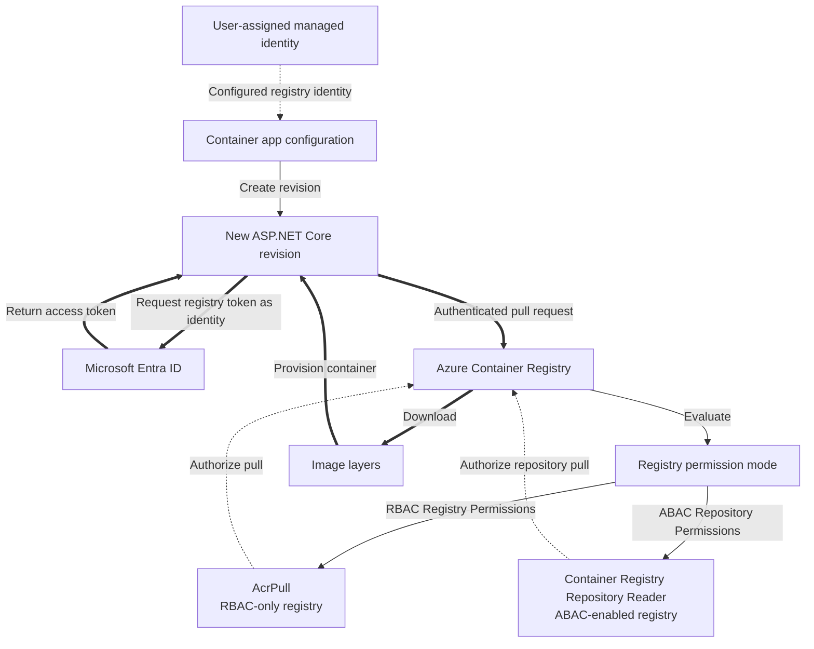

---
content_sources:
  diagrams:
    - id: deploy-asp-net-core-images-from-private
      type: flowchart
      source: mslearn-adapted
      based_on:
        - https://learn.microsoft.com/en-us/azure/container-apps/managed-identity-image-pull
        - https://learn.microsoft.com/en-us/azure/container-registry/container-registry-get-started-azure-cli
        - https://learn.microsoft.com/en-us/azure/container-registry/container-registry-rbac-abac-repository-permissions
---
# Recipe: Container Registry in .NET Apps on Azure Container Apps

Deploy ASP.NET Core images from private ACR using a user-assigned managed identity for image pulls.

<!-- diagram-id: deploy-asp-net-core-images-from-private -->


*Figure: Identity selection, token acquisition, registry authorization, and image transport are distinct. `AcrPull` applies only to RBAC-only registries; ABAC-enabled registries require `Container Registry Repository Reader`, optionally with a repository condition.*

## Prerequisites

- Container Apps environment (`$ACA_ENV_NAME`) and app name (`$APP_NAME`)
- Resource group (`$RG`), region (`$LOCATION`), registry (`$ACR_NAME`)
- Azure CLI with Container Apps extension and Docker

## Create registry and identity for image pull

```bash
az acr create \
  --name "$ACR_NAME" \
  --resource-group "$RG" \
  --location "$LOCATION" \
  --sku Standard

az identity create \
  --name "id-$APP_NAME" \
  --resource-group "$RG" \
  --location "$LOCATION"

export UAMI_ID=$(az identity show --name "id-$APP_NAME" --resource-group "$RG" --query id --output tsv)
export UAMI_PRINCIPAL_ID=$(az identity show --name "id-$APP_NAME" --resource-group "$RG" --query principalId --output tsv)
export ACR_ID=$(az acr show --name "$ACR_NAME" --resource-group "$RG" --query id --output tsv)
export ACR_ROLE_ASSIGNMENT_MODE=$(az acr show --name "$ACR_NAME" --resource-group "$RG" --query roleAssignmentMode --output tsv)

if [[ "$ACR_ROLE_ASSIGNMENT_MODE" == "AbacRepositoryPermissions" ]]; then
  az role assignment create \
    --assignee-object-id "$UAMI_PRINCIPAL_ID" \
    --assignee-principal-type ServicePrincipal \
    --role "Container Registry Repository Reader" \
    --scope "$ACR_ID"
else
  az role assignment create \
    --assignee-object-id "$UAMI_PRINCIPAL_ID" \
    --assignee-principal-type ServicePrincipal \
    --role "AcrPull" \
    --scope "$ACR_ID"
fi
```

| Command / Parameter | Purpose |
|---|---|
| `az acr create` | Creates the registry used to store this recipe's private image. |
| `--location` | Places the new registry or identity in the documented Azure region. |
| `--name` | Selects the app, job, deployment, registry, identity, or service used by this command. |
| `--resource-group` | Selects the resource group containing the resources in this step. |
| `--sku` | Selects the registry SKU used by the image-pull recipe. |
| `az identity create` | Creates the user-assigned identity used for the private image pull. |
| `az identity show` | Reads the managed identity resource or principal ID needed by role assignments. |
| `--output` | Returns the queried value as plain text or displays the verification list as a table. |
| `--query` | Extracts the exact resource property consumed by the next step. |
| `az acr show` | Reads the registry ID or permission mode needed by this procedure. |
| `az role assignment create` | Grants the selected managed identity the role required by this step. |
| `--assignee-object-id` | Targets the managed identity principal without a Microsoft Graph lookup. |
| `--assignee-principal-type` | Declares the managed identity as a service principal for role assignment. |
| `--role` | Selects the data-plane or registry role required by this integration. |
| `--scope` | Sets the Azure or service data-plane scope of this role assignment. |

The branch grants `AcrPull` to an ACR using **RBAC Registry Permissions** and `Container Registry Repository Reader` to an ABAC-enabled registry. Add an ABAC repository condition when you need repository-level scope. ABAC-enabled registries do not honor `AcrPull`.

## Multi-stage Dockerfile for ASP.NET Core 8

```dockerfile
FROM mcr.microsoft.com/dotnet/sdk:8.0 AS build
WORKDIR /src
COPY . .
RUN dotnet restore
RUN dotnet publish --configuration Release --output /app/publish

FROM mcr.microsoft.com/dotnet/aspnet:8.0
WORKDIR /app
COPY --from=build /app/publish .
EXPOSE 8080
ENTRYPOINT ["dotnet", "MyApi.dll"]
```

```bash
az acr login --name "$ACR_NAME"
docker build --file Dockerfile --tag "$ACR_NAME.azurecr.io/dotnet-api:latest" .
docker push "$ACR_NAME.azurecr.io/dotnet-api:latest"
```

| Command / Parameter | Purpose |
|---|---|
| `az acr login` | Authenticates the local Docker client to the recipe's registry. |
| `--name` | Selects the app, job, deployment, registry, identity, or service used by this command. |

## Configure Container Apps to pull from ACR

```bash
az containerapp create \
  --name "$APP_NAME" \
  --resource-group "$RG" \
  --environment "$ACA_ENV_NAME" \
  --image "$ACR_NAME.azurecr.io/dotnet-api:latest" \
  --registry-server "$ACR_NAME.azurecr.io" \
  --registry-identity "$UAMI_ID" \
  --user-assigned "$UAMI_ID" \
  --ingress external \
  --target-port 8080
```

| Command / Parameter | Purpose |
|---|---|
| `az containerapp create` | Creates the Container App with this recipe's image and ingress settings. |
| `--environment` | Selects the Container Apps environment for this app or job. |
| `--image` | Selects the image tag to build or deploy in this step. |
| `--ingress` | Enables the documented external ingress mode. |
| `--name` | Selects the app, job, deployment, registry, identity, or service used by this command. |
| `--registry-identity` | Selects the attached identity used to authenticate the private image pull. |
| `--registry-server` | Supplies the private ACR login server for the job or app. |
| `--resource-group` | Selects the resource group containing the resources in this step. |
| `--target-port` | Routes ingress to the application's documented listening port. |
| `--user-assigned` | Attaches the image-pull identity to the Container App. |

## Advanced Topics

- Use immutable image tags per build and map revisions to release versions.
- Add container vulnerability scanning before push.
- Validate new revisions at 0% traffic before promotion.

## See Also

- [Managed Identity](managed-identity.md)
- [Operations: Image Pull and Registry](../../../operations/image-pull-and-registry/index.md)
- [Revision Management](../../../operations/revision-management/index.md)

## Sources

- [Managed identity image pull for Azure Container Apps](https://learn.microsoft.com/en-us/azure/container-apps/managed-identity-image-pull)
- [Create and manage Azure Container Registry](https://learn.microsoft.com/en-us/azure/container-registry/container-registry-get-started-azure-cli)
- [Azure Container Registry RBAC and ABAC repository permissions](https://learn.microsoft.com/en-us/azure/container-registry/container-registry-rbac-abac-repository-permissions)
