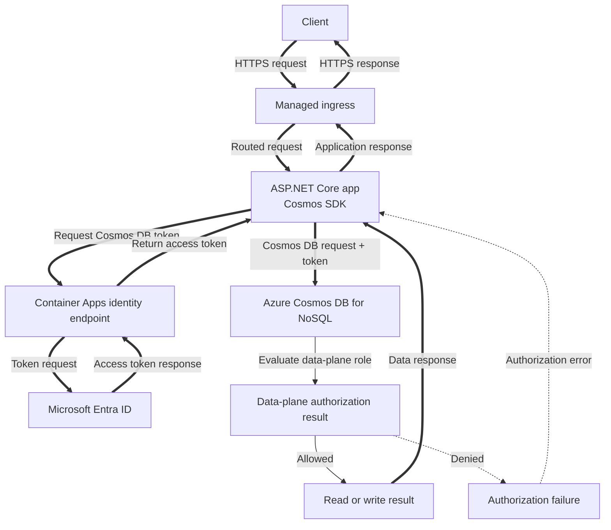

---
content_sources:
  diagrams:
    - id: architecture
      type: flowchart
      source: mslearn-adapted
      based_on:
        - https://learn.microsoft.com/en-us/azure/cosmos-db/nosql/how-to-connect-role-based-access-control
        - https://learn.microsoft.com/en-us/azure/cosmos-db/nosql/quickstart-dotnet
        - https://learn.microsoft.com/en-us/azure/container-apps/managed-identity
---
# Cosmos DB Integration (Managed Identity)

Use this recipe to connect a .NET Container App to Azure Cosmos DB for NoSQL with managed identity first and a connection string fallback only when you cannot use RBAC yet.

## Architecture

<!-- diagram-id: architecture -->


*Figure: Token acquisition, service transport, and Cosmos DB data-plane authorization are separate steps. A management-plane role alone does not grant document access.*

## Prerequisites

- Existing Container App: `$APP_NAME` in resource group `$RG`
- Existing Azure Cosmos DB account, SQL database, and container
- Azure CLI with Container Apps and Cosmos extensions

```bash
az extension add --name containerapp --upgrade
az extension add --name cosmosdb-preview --upgrade
```

| Command / Parameter | Purpose |
|---|---|
| `az extension add` | For Cosmos DB access, installs or upgrades the Container Apps CLI extension used by this procedure. |
| `--name` | Selects the `containerapp` and `cosmosdb-preview` extensions used later in this recipe. |
| `--upgrade` | For Cosmos DB access, upgrades the Container Apps extension when an older release is installed. |

## Step 1: Enable managed identity on the Container App

```bash
az containerapp identity assign \
  --name "$APP_NAME" \
  --resource-group "$RG" \
  --system-assigned

export PRINCIPAL_ID=$(az containerapp show \
  --name "$APP_NAME" \
  --resource-group "$RG" \
  --query "identity.principalId" \
  --output tsv)
```

| Command / Parameter | Purpose |
|---|---|
| `az containerapp identity assign` | For Cosmos DB access, enables the Container App identity that authenticates to the target Azure service. |
| `--name` | Assigns identity to `$APP_NAME` and then reads that same app's principal ID. |
| `--resource-group` | Finds `$APP_NAME` in resource group `$RG`. |
| `--system-assigned` | For Cosmos DB access, enables the system-assigned identity on the selected Container App. |
| `az containerapp show` | Retrieves the system-assigned principal that will receive the Cosmos DB data role. |
| `--output` | Returns the principal ID as unquoted `tsv` for `$PRINCIPAL_ID`. |
| `--query` | For Cosmos DB access, extracts `identity.principalId` from the command response for the next operation. |

## Step 2: Grant Cosmos DB data-plane access

```bash
az cosmosdb sql role assignment create \
  --account-name "$COSMOS_ACCOUNT" \
  --resource-group "$RG" \
  --principal-id "$PRINCIPAL_ID" \
  --role-definition-name "Cosmos DB Built-in Data Contributor" \
  --scope "/"
```

| Command / Parameter | Purpose |
|---|---|
| `az cosmosdb sql role assignment create` | For Cosmos DB access, grants the Container App identity the Cosmos DB SQL data-plane role. |
| `--account-name` | For Cosmos DB access, targets Cosmos DB account `$COSMOS_ACCOUNT`. |
| `--principal-id` | For Cosmos DB access, grants Cosmos DB access to managed-identity principal `$PRINCIPAL_ID`. |
| `--resource-group` | Locates Cosmos DB account `$COSMOS_ACCOUNT` in `$RG`. |
| `--role-definition-name` | For Cosmos DB access, assigns Cosmos DB role `Cosmos DB Built-in Data Contributor`. |
| `--scope` | For Cosmos DB access, restricts the role assignment to `/`. |

## Step 3: Configure non-secret settings in Container Apps

Azure Container Apps does **not** inject Cosmos DB connection settings automatically. Store non-secret values as environment variables, and store fallback secrets in `secrets[]` with `secretref:`.

```bash
az containerapp update \
  --name "$APP_NAME" \
  --resource-group "$RG" \
  --set-env-vars COSMOS_ENDPOINT="https://$COSMOS_ACCOUNT.documents.azure.com:443/" COSMOS_DATABASE="$COSMOS_DATABASE" COSMOS_CONTAINER="$COSMOS_CONTAINER"
```

| Command / Parameter | Purpose |
|---|---|
| `az containerapp update` | Creates a revision with the non-secret Cosmos DB endpoint, database, and container settings. |
| `--name` | Updates Cosmos DB configuration on `$APP_NAME`. |
| `--resource-group` | Finds the app being configured in `$RG`. |
| `--set-env-vars` | Sets `COSMOS_ENDPOINT`, `COSMOS_DATABASE`, and `COSMOS_CONTAINER` for the SDK client. |

## Step 4: .NET code (managed identity)

Add dependencies:

```bash
dotnet add package Microsoft.Azure.Cosmos
dotnet add package Azure.Identity
```

Use `DefaultAzureCredential` when `COSMOS_CONNECTION_STRING` is not present:

```csharp
using Azure.Core;
using Azure.Identity;
using Microsoft.Azure.Cosmos;

record OrderDocument(string id, string partitionKey, string type, string status);

static CosmosClient CreateClient()
{
    var connectionString = Environment.GetEnvironmentVariable("COSMOS_CONNECTION_STRING");
    if (!string.IsNullOrWhiteSpace(connectionString))
    {
        return new CosmosClient(connectionString);
    }

    var endpoint = Environment.GetEnvironmentVariable("COSMOS_ENDPOINT")!;
    TokenCredential credential = new DefaultAzureCredential();
    return new CosmosClient(endpoint, credential);
}

using var client = CreateClient();
var container = client.GetContainer(
    Environment.GetEnvironmentVariable("COSMOS_DATABASE"),
    Environment.GetEnvironmentVariable("COSMOS_CONTAINER"));

var item = new OrderDocument("order-1001", "order-1001", "order", "created");
await container.UpsertItemAsync(item, new PartitionKey(item.partitionKey));
var response = await container.ReadItemAsync<OrderDocument>(item.id, new PartitionKey(item.partitionKey));

Console.WriteLine(response.Resource);
```

## Step 5: Connection string fallback

```bash
az containerapp secret set \
  --name "$APP_NAME" \
  --resource-group "$RG" \
  --secrets cosmos-connection-string="AccountEndpoint=https://$COSMOS_ACCOUNT.documents.azure.com:443/;AccountKey=<cosmos-account-key>;"

az containerapp update \
  --name "$APP_NAME" \
  --resource-group "$RG" \
  --set-env-vars COSMOS_CONNECTION_STRING=secretref:cosmos-connection-string COSMOS_DATABASE="$COSMOS_DATABASE" COSMOS_CONTAINER="$COSMOS_CONTAINER"
```

| Command / Parameter | Purpose |
|---|---|
| `az containerapp secret set` | For Cosmos DB access, creates the Container Apps secret consumed by the application through `secretref:`. |
| `--name` | Stores the fallback connection string and configures its reference on `$APP_NAME`. |
| `--resource-group` | Applies both fallback commands to the app in `$RG`. |
| `--secrets` | For Cosmos DB access, stores the literal `cosmos-connection-string="AccountEndpoint=https://$COSMOS_ACCOUNT.documents.azure.com:443/;AccountKey=<cosmos-account-key>;"` value as a Container Apps secret. |
| `az containerapp update` | Creates a revision that reads the Cosmos DB connection string through `secretref:`. |
| `--set-env-vars` | Maps `COSMOS_CONNECTION_STRING` to the stored secret while retaining database and container names. |

## Verification

1. Confirm identity assignment.
2. Confirm the Cosmos DB role assignment exists.
3. Check app logs for successful upsert and read operations.

## See Also

- [Managed Identity](managed-identity.md)
- [Key Vault Reference](key-vault-reference.md)
- [Private Endpoints](../../../platform/networking/private-endpoints.md)

## Sources

- [Azure Cosmos DB for NoSQL RBAC](https://learn.microsoft.com/en-us/azure/cosmos-db/nosql/how-to-connect-role-based-access-control)
- [Azure Cosmos DB for NoSQL .NET quickstart](https://learn.microsoft.com/en-us/azure/cosmos-db/nosql/quickstart-dotnet)
- [Managed identities in Azure Container Apps](https://learn.microsoft.com/en-us/azure/container-apps/managed-identity)
