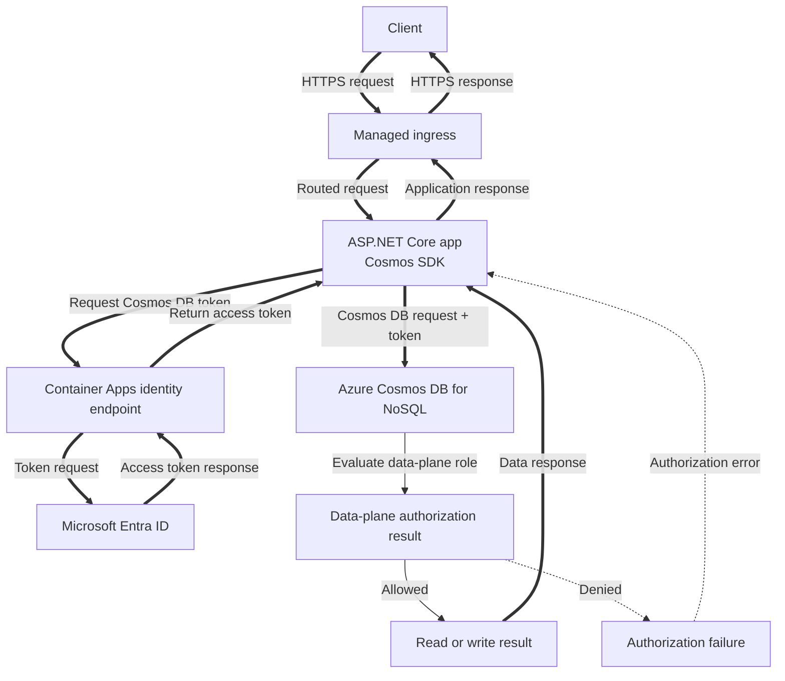

---
content_sources:
  diagrams:
    - id: architecture
      type: flowchart
      source: mslearn-adapted
      based_on:
        - https://learn.microsoft.com/en-us/azure/cosmos-db/nosql/how-to-connect-role-based-access-control
        - https://learn.microsoft.com/en-us/azure/cosmos-db/nosql/quickstart-dotnet
        - https://learn.microsoft.com/en-us/azure/container-apps/managed-identity
---
# Cosmos DB Integration (Managed Identity)

Use this recipe to connect a .NET Container App to Azure Cosmos DB for NoSQL with managed identity first and a connection string fallback only when you cannot use RBAC yet.

## Architecture

<!-- diagram-id: architecture -->


*Figure: Token acquisition, service transport, and Cosmos DB data-plane authorization are separate steps. A management-plane role alone does not grant document access.*

## Prerequisites

- Existing Container App: `$APP_NAME` in resource group `$RG`
- Existing Azure Cosmos DB account, SQL database, and container
- Azure CLI with Container Apps and Cosmos extensions

```bash
az extension add --name containerapp --upgrade
az extension add --name cosmosdb-preview --upgrade
```

| Command / Parameter | Purpose |
|---|---|
| `az extension add` | Installs or upgrades the CLI extension required by this page. |
| `--name` | Selects the app, job, deployment, registry, identity, or service used by this command. |
| `--upgrade` | Upgrades the extension if an older version is installed. |

## Step 1: Enable managed identity on the Container App

```bash
az containerapp identity assign \
  --name "$APP_NAME" \
  --resource-group "$RG" \
  --system-assigned

export PRINCIPAL_ID=$(az containerapp show \
  --name "$APP_NAME" \
  --resource-group "$RG" \
  --query "identity.principalId" \
  --output tsv)
```

| Command / Parameter | Purpose |
|---|---|
| `az containerapp identity assign` | Assigns the managed identity used by this integration. |
| `--name` | Selects the app, job, deployment, registry, identity, or service used by this command. |
| `--resource-group` | Selects the resource group containing the resources in this step. |
| `--system-assigned` | Enables the app's system-assigned managed identity. |
| `az containerapp show` | Reads the app property needed by this procedure. |
| `--output` | Returns the queried value as plain text or displays the verification list as a table. |
| `--query` | Extracts the exact resource property consumed by the next step. |

## Step 2: Grant Cosmos DB data-plane access

```bash
az cosmosdb sql role assignment create \
  --account-name "$COSMOS_ACCOUNT" \
  --resource-group "$RG" \
  --principal-id "$PRINCIPAL_ID" \
  --role-definition-name "Cosmos DB Built-in Data Contributor" \
  --scope "/"
```

| Command / Parameter | Purpose |
|---|---|
| `az cosmosdb sql role assignment create` | Grants the app identity the documented Cosmos DB data-plane role. |
| `--account-name` | Selects the Cosmos DB account used by the app. |
| `--principal-id` | Identifies the managed identity receiving Cosmos DB data access. |
| `--resource-group` | Selects the resource group containing the resources in this step. |
| `--role-definition-name` | Selects the built-in Cosmos DB data contributor role. |
| `--scope` | Sets the Azure or service data-plane scope of this role assignment. |

## Step 3: Configure non-secret settings in Container Apps

Azure Container Apps does **not** inject Cosmos DB connection settings automatically. Store non-secret values as environment variables, and store fallback secrets in `secrets[]` with `secretref:`.

```bash
az containerapp update \
  --name "$APP_NAME" \
  --resource-group "$RG" \
  --set-env-vars COSMOS_ENDPOINT="https://$COSMOS_ACCOUNT.documents.azure.com:443/" COSMOS_DATABASE="$COSMOS_DATABASE" COSMOS_CONTAINER="$COSMOS_CONTAINER"
```

| Command / Parameter | Purpose |
|---|---|
| `az containerapp update` | Updates the selected app with this step's environment or integration settings. |
| `--name` | Selects the app, job, deployment, registry, identity, or service used by this command. |
| `--resource-group` | Selects the resource group containing the resources in this step. |
| `--set-env-vars` | Sets the non-secret service settings or secret references used by the app. |

## Step 4: .NET code (managed identity)

Add dependencies:

```bash
dotnet add package Microsoft.Azure.Cosmos
dotnet add package Azure.Identity
```

Use `DefaultAzureCredential` when `COSMOS_CONNECTION_STRING` is not present:

```csharp
using Azure.Core;
using Azure.Identity;
using Microsoft.Azure.Cosmos;

record OrderDocument(string id, string partitionKey, string type, string status);

static CosmosClient CreateClient()
{
    var connectionString = Environment.GetEnvironmentVariable("COSMOS_CONNECTION_STRING");
    if (!string.IsNullOrWhiteSpace(connectionString))
    {
        return new CosmosClient(connectionString);
    }

    var endpoint = Environment.GetEnvironmentVariable("COSMOS_ENDPOINT")!;
    TokenCredential credential = new DefaultAzureCredential();
    return new CosmosClient(endpoint, credential);
}

using var client = CreateClient();
var container = client.GetContainer(
    Environment.GetEnvironmentVariable("COSMOS_DATABASE"),
    Environment.GetEnvironmentVariable("COSMOS_CONTAINER"));

var item = new OrderDocument("order-1001", "order-1001", "order", "created");
await container.UpsertItemAsync(item, new PartitionKey(item.partitionKey));
var response = await container.ReadItemAsync<OrderDocument>(item.id, new PartitionKey(item.partitionKey));

Console.WriteLine(response.Resource);
```

## Step 5: Connection string fallback

```bash
az containerapp secret set \
  --name "$APP_NAME" \
  --resource-group "$RG" \
  --secrets cosmos-connection-string="AccountEndpoint=https://$COSMOS_ACCOUNT.documents.azure.com:443/;AccountKey=<cosmos-account-key>;"

az containerapp update \
  --name "$APP_NAME" \
  --resource-group "$RG" \
  --set-env-vars COSMOS_CONNECTION_STRING=secretref:cosmos-connection-string COSMOS_DATABASE="$COSMOS_DATABASE" COSMOS_CONTAINER="$COSMOS_CONTAINER"
```

| Command / Parameter | Purpose |
|---|---|
| `az containerapp secret set` | Stores the fallback credential as a Container Apps secret. |
| `--name` | Selects the app, job, deployment, registry, identity, or service used by this command. |
| `--resource-group` | Selects the resource group containing the resources in this step. |
| `--secrets` | Creates the named fallback secret consumed through `secretref:`. |
| `az containerapp update` | Updates the selected app with this step's environment or integration settings. |
| `--set-env-vars` | Sets the non-secret service settings or secret references used by the app. |

## Verification

1. Confirm identity assignment.
2. Confirm the Cosmos DB role assignment exists.
3. Check app logs for successful upsert and read operations.

## See Also

- [Managed Identity](managed-identity.md)
- [Key Vault Reference](key-vault-reference.md)
- [Private Endpoints](../../../platform/networking/private-endpoints.md)

## Sources

- [Azure Cosmos DB for NoSQL RBAC](https://learn.microsoft.com/en-us/azure/cosmos-db/nosql/how-to-connect-role-based-access-control)
- [Azure Cosmos DB for NoSQL .NET quickstart](https://learn.microsoft.com/en-us/azure/cosmos-db/nosql/quickstart-dotnet)
- [Managed identities in Azure Container Apps](https://learn.microsoft.com/en-us/azure/container-apps/managed-identity)
