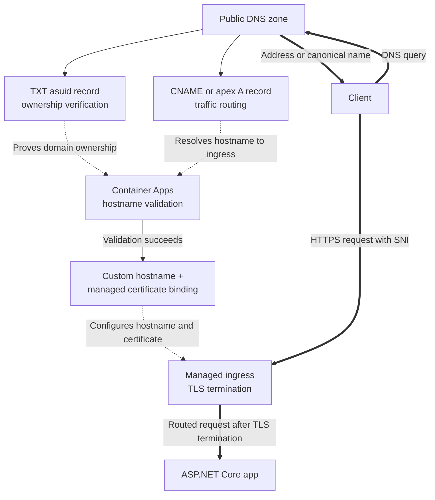

---
content_sources:
  diagrams:
    - id: architecture
      type: flowchart
      source: mslearn-adapted
      based_on:
        - https://learn.microsoft.com/en-us/azure/container-apps/custom-domains-managed-certificates
        - https://learn.microsoft.com/en-us/azure/container-apps/custom-domains-certificates
---
# Custom Domains and Certificates

Azure Container Apps supports custom hostnames and TLS certificates so you can serve ASP.NET Core applications on your own domain instead of the default `azurecontainerapps.io` address.

## Architecture

<!-- diagram-id: architecture -->


*Figure: DNS validation and certificate binding are control-plane prerequisites. Only after the hostname is bound does the runtime HTTPS request flow through managed ingress to the app.*

## Prerequisites

- Existing Container App: `$APP_NAME` in `$RG`
- Existing Container Apps environment: `$ACA_ENV_NAME`
- Public DNS zone you control for the target domain
- Azure CLI with the Container Apps extension

```bash
az extension add --name containerapp --upgrade
```

| Command / Parameter | Purpose |
|---|---|
| `az extension add` | Installs or upgrades the CLI extension required by this page. |
| `--name` | Selects the app, job, deployment, registry, identity, or service used by this command. |
| `--upgrade` | Upgrades the extension if an older version is installed. |

## Step 1: Get the app and environment values

```bash
export ENV_STATIC_IP=$(az containerapp env show \
  --name "$ACA_ENV_NAME" \
  --resource-group "$RG" \
  --query "properties.staticIp" \
  --output tsv)

export APP_FQDN=$(az containerapp show \
  --name "$APP_NAME" \
  --resource-group "$RG" \
  --query "properties.configuration.ingress.fqdn" \
  --output tsv)

export CUSTOM_DOMAIN_VERIFICATION_ID=$(az containerapp show \
  --name "$APP_NAME" \
  --resource-group "$RG" \
  --query "properties.customDomainVerificationId" \
  --output tsv)
```

| Command / Parameter | Purpose |
|---|---|
| `az containerapp env show` | Reads the environment domain or certificate settings needed by this recipe. |
| `--name` | Selects the app, job, deployment, registry, identity, or service used by this command. |
| `--output` | Returns the queried value as plain text or displays the verification list as a table. |
| `--query` | Extracts the exact resource property consumed by the next step. |
| `--resource-group` | Selects the resource group containing the resources in this step. |
| `az containerapp show` | Reads the app property needed by this procedure. |

## Step 2: Create DNS records

```bash
az network dns record-set cname set-record \
  --resource-group "$DNS_RG" \
  --zone-name "contoso.com" \
  --record-set-name "www" \
  --cname "$APP_FQDN"

az network dns record-set txt add-record \
  --resource-group "$DNS_RG" \
  --zone-name "contoso.com" \
  --record-set-name "asuid.www" \
  --value "$CUSTOM_DOMAIN_VERIFICATION_ID"
```

| Command / Parameter | Purpose |
|---|---|
| `az network dns record-set cname set-record` | Points the custom hostname at the Container App endpoint. |
| `--cname` | Sets the DNS CNAME target to the Container App hostname. |
| `--record-set-name` | Selects the DNS record set for the custom hostname. |
| `--resource-group` | Selects the resource group containing the resources in this step. |
| `--zone-name` | Selects the DNS zone that hosts the custom-domain records. |
| `az network dns record-set txt add-record` | Publishes the domain-verification value required by Container Apps. |
| `--value` | Supplies the DNS record value required by this custom-domain step. |

## Step 3: Add the hostname to the Container App

```bash
az containerapp hostname add \
  --name "$APP_NAME" \
  --resource-group "$RG" \
  --hostname "www.contoso.com"
```

| Command / Parameter | Purpose |
|---|---|
| `az containerapp hostname add` | Adds the verified custom hostname to the Container App. |
| `--hostname` | Selects the custom hostname being added, bound, or verified. |
| `--name` | Selects the app, job, deployment, registry, identity, or service used by this command. |
| `--resource-group` | Selects the resource group containing the resources in this step. |

## Step 4: Bind a certificate

```bash
az containerapp hostname bind \
  --name "$APP_NAME" \
  --resource-group "$RG" \
  --hostname "www.contoso.com" \
  --environment "$ACA_ENV_NAME" \
  --validation-method CNAME
```

| Command / Parameter | Purpose |
|---|---|
| `az containerapp hostname bind` | Binds the selected certificate to the verified hostname. |
| `--environment` | Selects the Container Apps environment for this app or job. |
| `--hostname` | Selects the custom hostname being added, bound, or verified. |
| `--name` | Selects the app, job, deployment, registry, identity, or service used by this command. |
| `--resource-group` | Selects the resource group containing the resources in this step. |
| `--validation-method` | Selects the DNS validation method for the hostname binding. |

## Step 5: Configure ASP.NET Core for forwarded headers

Container Apps terminates TLS before traffic reaches ASP.NET Core. Honor forwarded headers so redirects, links, and scheme detection stay correct.

```csharp
using Microsoft.AspNetCore.HttpOverrides;

var builder = WebApplication.CreateBuilder(args);
var app = builder.Build();

app.UseForwardedHeaders(new ForwardedHeadersOptions
{
    ForwardedHeaders = ForwardedHeaders.XForwardedFor | ForwardedHeaders.XForwardedProto | ForwardedHeaders.XForwardedHost
});

app.MapGet("/debug/host", (HttpContext context) => Results.Ok(new
{
    scheme = context.Request.Scheme,
    host = context.Request.Host.Value,
    forwardedProto = context.Request.Headers["X-Forwarded-Proto"].ToString()
}));
```

## Verification

```bash
az containerapp hostname list \
  --name "$APP_NAME" \
  --resource-group "$RG" \
  --output table

az containerapp env certificate list \
  --name "$ACA_ENV_NAME" \
  --resource-group "$RG" \
  --output table

curl --verbose https://www.contoso.com/
```

| Command / Parameter | Purpose |
|---|---|
| `az containerapp hostname list` | Lists the app's hostname bindings for verification. |
| `--name` | Selects the app, job, deployment, registry, identity, or service used by this command. |
| `--output` | Returns the queried value as plain text or displays the verification list as a table. |
| `--resource-group` | Selects the resource group containing the resources in this step. |
| `az containerapp env certificate list` | Lists environment certificates while verifying the custom-domain binding. |

## See Also

- [Easy Auth](easy-auth.md)
- [Networking](../../../platform/networking/vnet-integration.md)
- [Private Endpoints](../../../platform/networking/private-endpoints.md)

## Sources

- [Custom domains and managed certificates in Azure Container Apps](https://learn.microsoft.com/en-us/azure/container-apps/custom-domains-managed-certificates)
- [Custom domains and certificates in Azure Container Apps](https://learn.microsoft.com/en-us/azure/container-apps/custom-domains-certificates)
