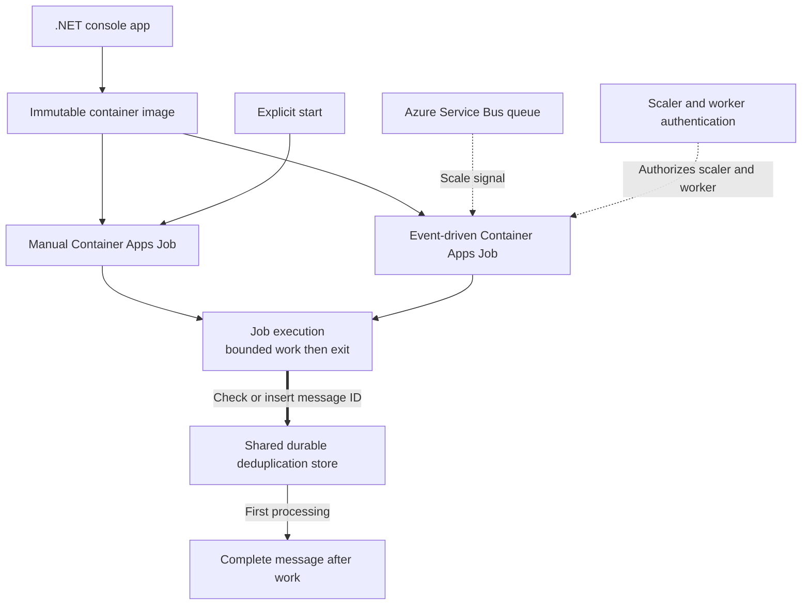

---
content_sources:
  diagrams:
    - id: dotnet-jobs-recipe-flow
      type: flowchart
      source: self-generated
      justification: Language recipe flow synthesized from Microsoft Learn Jobs guidance and .NET SDK usage patterns.
      based_on:
        - https://learn.microsoft.com/en-us/azure/container-apps/jobs
        - https://learn.microsoft.com/en-us/dotnet/api/overview/azure/identity-readme
        - https://learn.microsoft.com/en-us/dotnet/api/overview/azure/messaging.servicebus-readme
---
# Recipe: Jobs in .NET on Azure Container Apps

Use this recipe to build a .NET console Job, adapt it to process one Service Bus message, and add a dedup-table pattern for safe replay.

## Prerequisites

- Azure Container Apps environment and registry
- Azure Service Bus namespace and queue for the event-driven example
- .NET 8 SDK, Docker, and Azure CLI

```bash
export RG="rg-aca-dotnet-prod"
export ACA_ENV_NAME="aca-env-dotnet-prod"
export ACR_NAME="acrdotnetprod"
export JOB_NAME="job-dotnet-manual"
export EVENT_JOB_NAME="job-dotnet-servicebus"
export SERVICEBUS_NAMESPACE="sb-aca-prod"
export SERVICEBUS_QUEUE="orders"
export JOB_IDENTITY_ID="<user-assigned-identity-resource-id>"
```

Grant the user-assigned identity permission to pull from the existing registry. The branch selects the role supported by the registry's permission mode:

```bash
export JOB_IDENTITY_PRINCIPAL_ID=$(az identity show \
  --ids "$JOB_IDENTITY_ID" \
  --query principalId \
  --output tsv)
export ACR_ID=$(az acr show \
  --name "$ACR_NAME" \
  --resource-group "$RG" \
  --query id \
  --output tsv)
export ACR_ROLE_ASSIGNMENT_MODE=$(az acr show \
  --name "$ACR_NAME" \
  --resource-group "$RG" \
  --query roleAssignmentMode \
  --output tsv)

if [[ "$ACR_ROLE_ASSIGNMENT_MODE" == "AbacRepositoryPermissions" ]]; then
  export ACR_PULL_ROLE="Container Registry Repository Reader"
else
  export ACR_PULL_ROLE="AcrPull"
fi

az role assignment create \
  --assignee-object-id "$JOB_IDENTITY_PRINCIPAL_ID" \
  --assignee-principal-type ServicePrincipal \
  --role "$ACR_PULL_ROLE" \
  --scope "$ACR_ID"

export SERVICEBUS_NAMESPACE_ID=$(az servicebus namespace show \
  --name "$SERVICEBUS_NAMESPACE" \
  --resource-group "$RG" \
  --query id \
  --output tsv)

az role assignment create \
  --assignee-object-id "$JOB_IDENTITY_PRINCIPAL_ID" \
  --assignee-principal-type ServicePrincipal \
  --role "Azure Service Bus Data Receiver" \
  --scope "$SERVICEBUS_NAMESPACE_ID"
```

| Command / Parameter | Purpose |
|---|---|
| `az identity show` | Reads the managed identity resource or principal ID needed by role assignments. |
| `--ids` | Selects the user-assigned identity by its full resource ID. |
| `--output` | Returns the queried value as plain text or displays the verification list as a table. |
| `--query` | Extracts the exact resource property consumed by the next step. |
| `az acr show` | Reads the registry ID or permission mode needed by this procedure. |
| `--name` | Selects the app, job, deployment, registry, identity, or service used by this command. |
| `--resource-group` | Selects the resource group containing the resources in this step. |
| `az role assignment create` | Grants the selected managed identity the role required by this step. |
| `--assignee-object-id` | Targets the managed identity principal without a Microsoft Graph lookup. |
| `--assignee-principal-type` | Declares the managed identity as a service principal for role assignment. |
| `--role` | Selects the data-plane or registry role required by this integration. |
| `--scope` | Sets the Azure or service data-plane scope of this role assignment. |
| `az servicebus namespace show` | Reads the Service Bus namespace ID used as the receiver-role scope. |

## What You'll Build

- a manual .NET Job using a console entrypoint
- an event-driven Service Bus consumer that processes one message and exits
- a dedup-table example that you can later move to Azure SQL or PostgreSQL

## Steps

<!-- diagram-id: dotnet-jobs-recipe-flow -->


*Figure: Manual and event-driven jobs reuse the image but have different triggers. The event-driven scaler and the worker both need an authenticated Service Bus path, and production deduplication must use shared durable storage rather than replica-local `/tmp`.*

### 1. Create a manual .NET Job

`aca-dotnet-job.csproj`:

```xml
<Project Sdk="Microsoft.NET.Sdk">
  <PropertyGroup>
    <OutputType>Exe</OutputType>
    <TargetFramework>net8.0</TargetFramework>
    <ImplicitUsings>enable</ImplicitUsings>
    <Nullable>enable</Nullable>
  </PropertyGroup>
  <ItemGroup>
    <PackageReference Include="Azure.Identity" Version="1.12.0" />
    <PackageReference Include="Azure.Messaging.ServiceBus" Version="7.18.0" />
    <PackageReference Include="Microsoft.Data.Sqlite" Version="8.0.7" />
  </ItemGroup>
</Project>
```

`Program.cs`:

```csharp
var execution = Environment.GetEnvironmentVariable("CONTAINER_APP_JOB_EXECUTION_NAME") ?? "local";
Console.WriteLine($"{{\"event\":\"job-start\",\"execution\":\"{execution}\"}}");
Console.WriteLine("{\"event\":\"job-work\",\"message\":\"processing batch\"}");
Console.WriteLine("{\"event\":\"job-end\",\"status\":\"Succeeded\"}");
return 0;
```

`Dockerfile`:

```dockerfile
FROM mcr.microsoft.com/dotnet/sdk:8.0 AS build
WORKDIR /src
COPY aca-dotnet-job.csproj .
RUN dotnet restore
COPY Program.cs .
RUN dotnet publish --configuration Release --output /out

FROM mcr.microsoft.com/dotnet/runtime:8.0
WORKDIR /app
COPY --from=build /out .
ENTRYPOINT ["dotnet", "aca-dotnet-job.dll"]
```

Deploy the manual Job:

```bash
az acr build \
  --registry "$ACR_NAME" \
  --image "dotnet-jobs/manual:v1" \
  --file "Dockerfile" \
  "."

az containerapp job create \
  --name "$JOB_NAME" \
  --resource-group "$RG" \
  --environment "$ACA_ENV_NAME" \
  --trigger-type "Manual" \
  --image "$ACR_NAME.azurecr.io/dotnet-jobs/manual:v1" \
  --registry-server "$ACR_NAME.azurecr.io" \
  --registry-identity "$JOB_IDENTITY_ID" \
  --mi-user-assigned "$JOB_IDENTITY_ID" \
  --replica-timeout 600 \
  --replica-retry-limit 1
```

| Command / Parameter | Purpose |
|---|---|
| `az acr build` | Builds the documented image in ACR and pushes the selected tag. |
| `--file` | Selects the Dockerfile used for the ACR build. |
| `--image` | Selects the image tag to build or deploy in this step. |
| `--registry` | Selects the ACR instance that builds and stores the image. |
| `az containerapp job create` | Creates the manual or event-driven job described in this step. |
| `--environment` | Selects the Container Apps environment for this app or job. |
| `--mi-user-assigned` | Attaches the identity used by the job worker and registry pull. |
| `--name` | Selects the app, job, deployment, registry, identity, or service used by this command. |
| `--registry-identity` | Selects the attached identity used to authenticate the private image pull. |
| `--registry-server` | Supplies the private ACR login server for the job or app. |
| `--replica-retry-limit` | Limits retries for a failed job replica. |
| `--replica-timeout` | Limits how long a job replica may run. |
| `--resource-group` | Selects the resource group containing the resources in this step. |
| `--trigger-type` | Selects manual or event-driven execution for the job. |

### 2. Process one Service Bus message and exit

Replace `Program.cs` with:

```csharp
using Azure.Identity;
using Azure.Messaging.ServiceBus;

var namespaceName = Environment.GetEnvironmentVariable("SERVICEBUS_NAMESPACE")!;
var queueName = Environment.GetEnvironmentVariable("SERVICEBUS_QUEUE")!;
var fullyQualifiedNamespace = $"{namespaceName}.servicebus.windows.net";

await using var client = new ServiceBusClient(fullyQualifiedNamespace, new DefaultAzureCredential());
await using var receiver = client.CreateReceiver(queueName);
var messages = await receiver.ReceiveMessagesAsync(maxMessages: 1, maxWaitTime: TimeSpan.FromSeconds(15));

if (messages.Count == 0)
{
    Console.WriteLine("{\"event\":\"empty-queue\"}");
}
else
{
    var message = messages[0];
    Console.WriteLine($"{{\"event\":\"message-received\",\"messageId\":\"{message.MessageId}\"}}");
    await receiver.CompleteMessageAsync(message);
    Console.WriteLine($"{{\"event\":\"message-completed\",\"messageId\":\"{message.MessageId}\"}}");
}
```

Create the event-driven Job:

```bash
az acr build \
  --registry "$ACR_NAME" \
  --image "dotnet-jobs/servicebus:v1" \
  --file "Dockerfile" \
  "."

az containerapp job create \
  --name "$EVENT_JOB_NAME" \
  --resource-group "$RG" \
  --environment "$ACA_ENV_NAME" \
  --trigger-type "Event" \
  --image "$ACR_NAME.azurecr.io/dotnet-jobs/servicebus:v1" \
  --registry-server "$ACR_NAME.azurecr.io" \
  --registry-identity "$JOB_IDENTITY_ID" \
  --scale-rule-name "orders-queue" \
  --scale-rule-type "azure-servicebus" \
  --scale-rule-metadata "queueName=$SERVICEBUS_QUEUE" "messageCount=1" "namespace=$SERVICEBUS_NAMESPACE" \
  --mi-user-assigned "$JOB_IDENTITY_ID" \
  --scale-rule-identity "$JOB_IDENTITY_ID" \
  --env-vars SERVICEBUS_NAMESPACE="$SERVICEBUS_NAMESPACE" SERVICEBUS_QUEUE="$SERVICEBUS_QUEUE"
```

| Command / Parameter | Purpose |
|---|---|
| `az acr build` | Builds the documented image in ACR and pushes the selected tag. |
| `--file` | Selects the Dockerfile used for the ACR build. |
| `--image` | Selects the image tag to build or deploy in this step. |
| `--registry` | Selects the ACR instance that builds and stores the image. |
| `az containerapp job create` | Creates the manual or event-driven job described in this step. |
| `--env-vars` | Supplies the Service Bus settings to the event-driven worker. |
| `--environment` | Selects the Container Apps environment for this app or job. |
| `--mi-user-assigned` | Attaches the identity used by the job worker and registry pull. |
| `--name` | Selects the app, job, deployment, registry, identity, or service used by this command. |
| `--registry-identity` | Selects the attached identity used to authenticate the private image pull. |
| `--registry-server` | Supplies the private ACR login server for the job or app. |
| `--resource-group` | Selects the resource group containing the resources in this step. |
| `--scale-rule-identity` | Uses the attached identity to authenticate Service Bus scaler polling. |
| `--scale-rule-metadata` | Configures the Service Bus namespace, queue, and message threshold. |
| `--scale-rule-name` | Names the event-driven Service Bus scale rule. |
| `--scale-rule-type` | Selects the Azure Service Bus KEDA scaler. |
| `--trigger-type` | Selects manual or event-driven execution for the job. |

The scaler identity authorizes queue polling for scale decisions; the application worker independently uses the same identity through `DefaultAzureCredential` for message receive and completion.

### 3. Add a dedup table

For a runnable demo, use SQLite. In production, keep the same insert-if-absent pattern in a shared durable database.

```csharp
using Microsoft.Data.Sqlite;

static bool ShouldProcess(string messageId)
{
    using var connection = new SqliteConnection("Data Source=/tmp/dedup.db");
    connection.Open();

    using (var create = connection.CreateCommand())
    {
        create.CommandText = "create table if not exists processed_messages (message_id text primary key)";
        create.ExecuteNonQuery();
    }

    using var insert = connection.CreateCommand();
    insert.CommandText = "insert or ignore into processed_messages(message_id) values ($messageId)";
    insert.Parameters.AddWithValue("$messageId", messageId);
    return insert.ExecuteNonQuery() == 1;
}
```

Use it before processing:

```csharp
if (ShouldProcess(message.MessageId))
{
    Console.WriteLine($"{{\"event\":\"process-message\",\"messageId\":\"{message.MessageId}\"}}");
}
else
{
    Console.WriteLine($"{{\"event\":\"duplicate-message\",\"messageId\":\"{message.MessageId}\"}}");
}
```

## Verification

```bash
az containerapp job execution list \
  --name "$JOB_NAME" \
  --resource-group "$RG" \
  --output table

az containerapp job execution list \
  --name "$EVENT_JOB_NAME" \
  --resource-group "$RG" \
  --output table
```

| Command / Parameter | Purpose |
|---|---|
| `az containerapp job execution list` | Lists executions for the selected job during verification. |
| `--name` | Selects the app, job, deployment, registry, identity, or service used by this command. |
| `--output` | Returns the queried value as plain text or displays the verification list as a table. |
| `--resource-group` | Selects the resource group containing the resources in this step. |

## Next Steps / Clean Up

- Move the dedup table to Azure SQL or PostgreSQL.
- Add correlation IDs to all structured log events.
- Review [Jobs Operations](../../../operations/jobs/index.md) before production rollout.

## See Also

- [.NET Recipes Index](index.md)
- [Container Apps Jobs Overview](../../../platform/jobs/index.md)
- [Job Design](../../../best-practices/job-design.md)

## Sources

- [Jobs in Azure Container Apps (Microsoft Learn)](https://learn.microsoft.com/en-us/azure/container-apps/jobs)
- [Azure SDK for .NET identity](https://learn.microsoft.com/en-us/dotnet/api/overview/azure/identity-readme)
- [Azure Service Bus SDK for .NET](https://learn.microsoft.com/en-us/dotnet/api/overview/azure/messaging.servicebus-readme)
