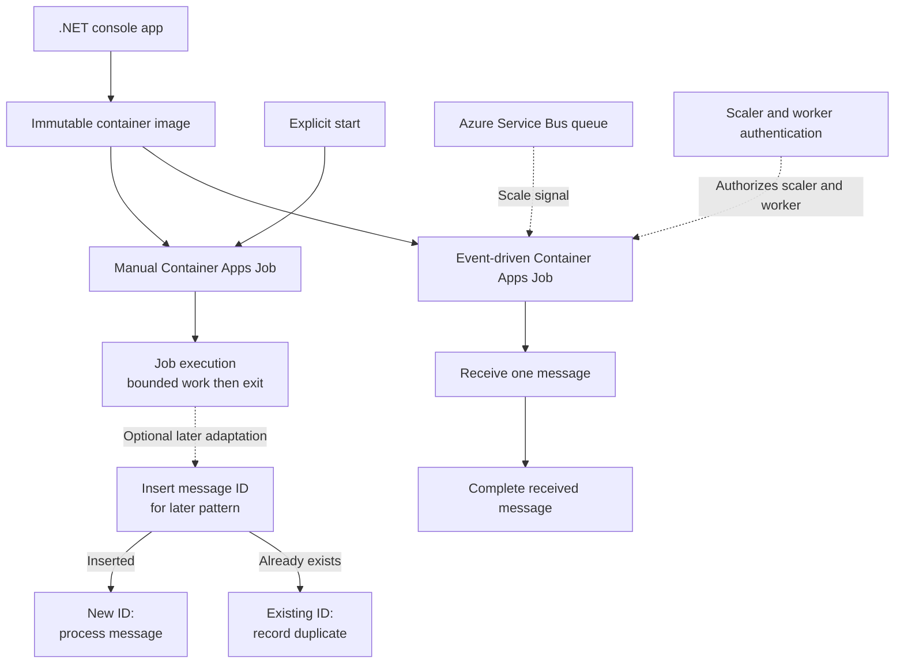

---
content_sources:
  diagrams:
    - id: dotnet-jobs-recipe-flow
      type: flowchart
      source: self-generated
      justification: Language recipe flow synthesized from Microsoft Learn Jobs guidance and .NET SDK usage patterns.
      based_on:
        - https://learn.microsoft.com/en-us/azure/container-apps/jobs
        - https://learn.microsoft.com/en-us/dotnet/api/overview/azure/identity-readme
        - https://learn.microsoft.com/en-us/dotnet/api/overview/azure/messaging.servicebus-readme
---
# Recipe: Jobs in .NET on Azure Container Apps

Use this recipe to build a .NET console Job, adapt it to process one Service Bus message, and add a dedup-table pattern for safe replay.

## Prerequisites

- Azure Container Apps environment and registry
- Azure Service Bus namespace and queue for the event-driven example
- .NET 8 SDK, Docker, and Azure CLI

```bash
export RG="rg-aca-dotnet-prod"
export ACA_ENV_NAME="aca-env-dotnet-prod"
export ACR_NAME="acrdotnetprod"
export JOB_NAME="job-dotnet-manual"
export EVENT_JOB_NAME="job-dotnet-servicebus"
export SERVICEBUS_NAMESPACE="sb-aca-prod"
export SERVICEBUS_QUEUE="orders"
export JOB_IDENTITY_ID="<user-assigned-identity-resource-id>"
```

Grant the user-assigned identity permission to pull from the existing registry. The branch selects the role supported by the registry's permission mode:

```bash
export JOB_IDENTITY_PRINCIPAL_ID=$(az identity show \
  --ids "$JOB_IDENTITY_ID" \
  --query principalId \
  --output tsv)
export JOB_IDENTITY_CLIENT_ID=$(az identity show \
  --ids "$JOB_IDENTITY_ID" \
  --query clientId \
  --output tsv)
export ACR_ID=$(az acr show \
  --name "$ACR_NAME" \
  --resource-group "$RG" \
  --query id \
  --output tsv)
export ACR_ROLE_ASSIGNMENT_MODE=$(az acr show \
  --name "$ACR_NAME" \
  --resource-group "$RG" \
  --query roleAssignmentMode \
  --output tsv)

if [[ "$ACR_ROLE_ASSIGNMENT_MODE" == "AbacRepositoryPermissions" ]]; then
  export ACR_PULL_ROLE="Container Registry Repository Reader"
else
  export ACR_PULL_ROLE="AcrPull"
fi

az role assignment create \
  --assignee-object-id "$JOB_IDENTITY_PRINCIPAL_ID" \
  --assignee-principal-type ServicePrincipal \
  --role "$ACR_PULL_ROLE" \
  --scope "$ACR_ID"

export SERVICEBUS_NAMESPACE_ID=$(az servicebus namespace show \
  --name "$SERVICEBUS_NAMESPACE" \
  --resource-group "$RG" \
  --query id \
  --output tsv)

az role assignment create \
  --assignee-object-id "$JOB_IDENTITY_PRINCIPAL_ID" \
  --assignee-principal-type ServicePrincipal \
  --role "Azure Service Bus Data Receiver" \
  --scope "$SERVICEBUS_NAMESPACE_ID"
```

| Command / Parameter | Purpose |
|---|---|
| `az identity show` | Reads the user-assigned job identity so its principal can receive permissions and its client ID can select the runtime identity. |
| `--ids` | Identifies the job identity by the full resource ID in `$JOB_IDENTITY_ID`. |
| `--output` | Emits each queried principal, resource ID, or permission mode as unquoted `tsv` for assignment to a shell variable. |
| `--query` | Selects `principalId` and `clientId` from the identity, `id` and `roleAssignmentMode` from ACR, or `id` from the Service Bus namespace. |
| `az acr show` | Reads the ACR resource ID for the pull-role scope and its permission mode for choosing an RBAC- or ABAC-compatible role. |
| `--name` | Selects registry `$ACR_NAME` for both ACR lookups and namespace `$SERVICEBUS_NAMESPACE` for the Service Bus lookup. |
| `--resource-group` | Looks up the registry and Service Bus namespace in `$RG`. |
| `az role assignment create` | Creates the registry pull assignment and the Service Bus receiver assignment for the job identity. |
| `--assignee-object-id` | Grants each permission to the managed-identity principal in `$JOB_IDENTITY_PRINCIPAL_ID`. |
| `--assignee-principal-type` | Declares that principal as a `ServicePrincipal`, avoiding an unnecessary Microsoft Graph lookup. |
| `--role` | Uses the permission-mode-compatible `$ACR_PULL_ROLE` for ACR, then `Azure Service Bus Data Receiver` for queue access. |
| `--scope` | Limits the first assignment to registry resource ID `$ACR_ID` and the second to namespace resource ID `$SERVICEBUS_NAMESPACE_ID`. |
| `az servicebus namespace show` | Retrieves the `$SERVICEBUS_NAMESPACE` resource ID used to scope the receiver assignment. |

## What You'll Build

- a manual .NET Job using a console entrypoint
- an event-driven Service Bus consumer that processes one message and exits
- a dedup-table example that you can later move to Azure SQL or PostgreSQL

## Steps

<!-- diagram-id: dotnet-jobs-recipe-flow -->


*Figure: Manual and event-driven jobs reuse the image but have different triggers. The runnable event worker receives and completes one message; the later deduplication snippets separately show both the new-ID and duplicate-ID decisions and must be integrated before message completion for production use.*

### 1. Create a manual .NET Job

`aca-dotnet-job.csproj`:

```xml
<Project Sdk="Microsoft.NET.Sdk">
  <PropertyGroup>
    <OutputType>Exe</OutputType>
    <TargetFramework>net8.0</TargetFramework>
    <ImplicitUsings>enable</ImplicitUsings>
    <Nullable>enable</Nullable>
  </PropertyGroup>
  <ItemGroup>
    <PackageReference Include="Azure.Identity" Version="1.12.0" />
    <PackageReference Include="Azure.Messaging.ServiceBus" Version="7.18.0" />
    <PackageReference Include="Microsoft.Data.Sqlite" Version="8.0.7" />
  </ItemGroup>
</Project>
```

`Program.cs`:

```csharp
var execution = Environment.GetEnvironmentVariable("CONTAINER_APP_JOB_EXECUTION_NAME") ?? "local";
Console.WriteLine($"{{\"event\":\"job-start\",\"execution\":\"{execution}\"}}");
Console.WriteLine("{\"event\":\"job-work\",\"message\":\"processing batch\"}");
Console.WriteLine("{\"event\":\"job-end\",\"status\":\"Succeeded\"}");
return 0;
```

`Dockerfile`:

```dockerfile
FROM mcr.microsoft.com/dotnet/sdk:8.0 AS build
WORKDIR /src
COPY aca-dotnet-job.csproj .
RUN dotnet restore
COPY Program.cs .
RUN dotnet publish --configuration Release --output /out

FROM mcr.microsoft.com/dotnet/runtime:8.0
WORKDIR /app
COPY --from=build /out .
ENTRYPOINT ["dotnet", "aca-dotnet-job.dll"]
```

Deploy the manual Job:

```bash
az acr build \
  --registry "$ACR_NAME" \
  --image "dotnet-jobs/manual:v1" \
  --file "Dockerfile" \
  "."

az containerapp job create \
  --name "$JOB_NAME" \
  --resource-group "$RG" \
  --environment "$ACA_ENV_NAME" \
  --trigger-type "Manual" \
  --image "$ACR_NAME.azurecr.io/dotnet-jobs/manual:v1" \
  --registry-server "$ACR_NAME.azurecr.io" \
  --registry-identity "$JOB_IDENTITY_ID" \
  --mi-user-assigned "$JOB_IDENTITY_ID" \
  --replica-timeout 600 \
  --replica-retry-limit 1
```

| Command / Parameter | Purpose |
|---|---|
| `az acr build` | Builds the manual-job image remotely in Azure Container Registry from the local project. |
| `--file` | Uses the recipe's `Dockerfile` as the build definition. |
| `--image` | Tags the ACR build as `dotnet-jobs/manual:v1` and configures the job to run its fully qualified registry image. |
| `--registry` | Submits the image build to registry `$ACR_NAME`. |
| `az containerapp job create` | Creates the manually triggered .NET job with its image-pull and retry settings. |
| `--environment` | Places the manual job in Container Apps environment `$ACA_ENV_NAME`. |
| `--mi-user-assigned` | Attaches `$JOB_IDENTITY_ID` to the job for runtime token acquisition. |
| `--name` | Names the new manual job `$JOB_NAME`. |
| `--registry-identity` | Uses `$JOB_IDENTITY_ID` to authenticate the pull from ACR. |
| `--registry-server` | Sets `$ACR_NAME.azurecr.io` as the image registry endpoint. |
| `--replica-retry-limit` | Allows one retry after a manual-job replica fails. |
| `--replica-timeout` | Gives each manual-job replica up to 600 seconds to finish. |
| `--resource-group` | Creates `$JOB_NAME` in resource group `$RG`. |
| `--trigger-type` | Makes this job start only through an explicit manual invocation. |

### 2. Process one Service Bus message and exit

Replace `Program.cs` with:

```csharp
using Azure.Identity;
using Azure.Messaging.ServiceBus;

var namespaceName = Environment.GetEnvironmentVariable("SERVICEBUS_NAMESPACE")!;
var queueName = Environment.GetEnvironmentVariable("SERVICEBUS_QUEUE")!;
var fullyQualifiedNamespace = $"{namespaceName}.servicebus.windows.net";

await using var client = new ServiceBusClient(fullyQualifiedNamespace, new DefaultAzureCredential());
await using var receiver = client.CreateReceiver(queueName);
var messages = await receiver.ReceiveMessagesAsync(maxMessages: 1, maxWaitTime: TimeSpan.FromSeconds(15));

if (messages.Count == 0)
{
    Console.WriteLine("{\"event\":\"empty-queue\"}");
}
else
{
    var message = messages[0];
    Console.WriteLine($"{{\"event\":\"message-received\",\"messageId\":\"{message.MessageId}\"}}");
    await receiver.CompleteMessageAsync(message);
    Console.WriteLine($"{{\"event\":\"message-completed\",\"messageId\":\"{message.MessageId}\"}}");
}
```

Create the event-driven Job:

```bash
az acr build \
  --registry "$ACR_NAME" \
  --image "dotnet-jobs/servicebus:v1" \
  --file "Dockerfile" \
  "."

az containerapp job create \
  --name "$EVENT_JOB_NAME" \
  --resource-group "$RG" \
  --environment "$ACA_ENV_NAME" \
  --trigger-type "Event" \
  --image "$ACR_NAME.azurecr.io/dotnet-jobs/servicebus:v1" \
  --registry-server "$ACR_NAME.azurecr.io" \
  --registry-identity "$JOB_IDENTITY_ID" \
  --scale-rule-name "orders-queue" \
  --scale-rule-type "azure-servicebus" \
  --scale-rule-metadata "queueName=$SERVICEBUS_QUEUE" "messageCount=1" "namespace=$SERVICEBUS_NAMESPACE" \
  --mi-user-assigned "$JOB_IDENTITY_ID" \
  --scale-rule-identity "$JOB_IDENTITY_ID" \
  --env-vars AZURE_CLIENT_ID="$JOB_IDENTITY_CLIENT_ID" SERVICEBUS_NAMESPACE="$SERVICEBUS_NAMESPACE" SERVICEBUS_QUEUE="$SERVICEBUS_QUEUE"
```

| Command / Parameter | Purpose |
|---|---|
| `az acr build` | Rebuilds the worker image after replacing `Program.cs` with the Service Bus consumer. |
| `--file` | Builds the Service Bus worker with the local `Dockerfile`. |
| `--image` | Tags the build as `dotnet-jobs/servicebus:v1` and supplies that registry image to the event job. |
| `--registry` | Runs the Service Bus worker build in `$ACR_NAME`. |
| `az containerapp job create` | Creates the event-driven job and its managed-identity-backed Service Bus scale rule. |
| `--env-vars` | Passes `AZURE_CLIENT_ID`, `SERVICEBUS_NAMESPACE`, and `SERVICEBUS_QUEUE` to the .NET worker. `DefaultAzureCredential` uses `AZURE_CLIENT_ID` to select the attached user-assigned identity. |
| `--environment` | Deploys the Service Bus job into `$ACA_ENV_NAME`. |
| `--mi-user-assigned` | Attaches `$JOB_IDENTITY_ID` to the job; attachment alone does not select it for `DefaultAzureCredential`. |
| `--name` | Names the event-driven job `$EVENT_JOB_NAME`. |
| `--registry-identity` | Authenticates the event worker's ACR image pull with `$JOB_IDENTITY_ID`. |
| `--registry-server` | Points the event job at registry endpoint `$ACR_NAME.azurecr.io`. |
| `--resource-group` | Creates `$EVENT_JOB_NAME` in `$RG`. |
| `--scale-rule-identity` | Uses `$JOB_IDENTITY_ID` when the scaler polls Service Bus. |
| `--scale-rule-metadata` | Monitors queue `$SERVICEBUS_QUEUE` in namespace `$SERVICEBUS_NAMESPACE` and targets one message per execution. |
| `--scale-rule-name` | Names this Service Bus scaling rule `orders-queue`. |
| `--scale-rule-type` | Selects the `azure-servicebus` KEDA scaler. |
| `--trigger-type` | Starts executions from events reported by the configured scale rule. |

The scaler identity authorizes queue polling for scale decisions. The application worker independently uses the same identity for message receive and completion because `AZURE_CLIENT_ID` tells `DefaultAzureCredential` which attached user-assigned identity to select.

### 3. Add a dedup table

For a runnable demo, use SQLite. In production, keep the same insert-if-absent pattern in a shared durable database.

```csharp
using Microsoft.Data.Sqlite;

static bool ShouldProcess(string messageId)
{
    using var connection = new SqliteConnection("Data Source=/tmp/dedup.db");
    connection.Open();

    using (var create = connection.CreateCommand())
    {
        create.CommandText = "create table if not exists processed_messages (message_id text primary key)";
        create.ExecuteNonQuery();
    }

    using var insert = connection.CreateCommand();
    insert.CommandText = "insert or ignore into processed_messages(message_id) values ($messageId)";
    insert.Parameters.AddWithValue("$messageId", messageId);
    return insert.ExecuteNonQuery() == 1;
}
```

Use it before processing:

```csharp
if (ShouldProcess(message.MessageId))
{
    Console.WriteLine($"{{\"event\":\"process-message\",\"messageId\":\"{message.MessageId}\"}}");
}
else
{
    Console.WriteLine($"{{\"event\":\"duplicate-message\",\"messageId\":\"{message.MessageId}\"}}");
}
```

## Verification

```bash
az containerapp job execution list \
  --name "$JOB_NAME" \
  --resource-group "$RG" \
  --output table

az containerapp job execution list \
  --name "$EVENT_JOB_NAME" \
  --resource-group "$RG" \
  --output table
```

| Command / Parameter | Purpose |
|---|---|
| `az containerapp job execution list` | Lists executions for the manual and event-driven jobs so their trigger activity can be compared. |
| `--name` | Selects `$JOB_NAME` for the first execution list and `$EVENT_JOB_NAME` for the second. |
| `--output` | Presents each job's execution status and timestamps as a readable table. |
| `--resource-group` | Finds both jobs in resource group `$RG`. |

## Next Steps / Clean Up

- Move the dedup table to Azure SQL or PostgreSQL.
- Add correlation IDs to all structured log events.
- Review [Jobs Operations](../../../operations/jobs/index.md) before production rollout.

## See Also

- [.NET Recipes Index](index.md)
- [Container Apps Jobs Overview](../../../platform/jobs/index.md)
- [Job Design](../../../best-practices/job-design.md)

## Sources

- [Jobs in Azure Container Apps (Microsoft Learn)](https://learn.microsoft.com/en-us/azure/container-apps/jobs)
- [Azure SDK for .NET identity](https://learn.microsoft.com/en-us/dotnet/api/overview/azure/identity-readme)
- [Azure Service Bus SDK for .NET](https://learn.microsoft.com/en-us/dotnet/api/overview/azure/messaging.servicebus-readme)
