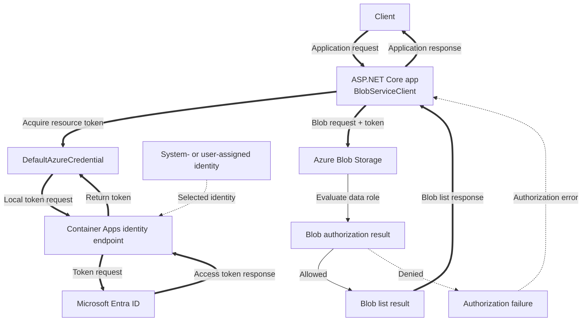

---
content_sources:
  diagrams:
    - id: use-defaultazurecredential-and-asp-net-core-dependency
      type: flowchart
      source: mslearn-adapted
      based_on:
        - https://learn.microsoft.com/en-us/azure/container-apps/managed-identity
        - https://learn.microsoft.com/en-us/dotnet/api/overview/azure/identity-readme
---
# Recipe: Managed Identity in .NET Apps on Azure Container Apps

Use `DefaultAzureCredential` and ASP.NET Core dependency injection to access Azure resources without connection secrets.

<!-- diagram-id: use-defaultazurecredential-and-asp-net-core-dependency -->


*Figure: Managed identity removes application credentials; it does not grant data access by itself. Blob Storage still requires a matching data-plane role assignment at the intended scope.*

## Prerequisites

- Existing Container App (`$APP_NAME`) in resource group (`$RG`)
- Storage account (`$STORAGE_ACCOUNT`) and container (`$STORAGE_CONTAINER`)
- Azure CLI with Container Apps extension

## Enable managed identity and RBAC

```bash
az containerapp identity assign \
  --name "$APP_NAME" \
  --resource-group "$RG" \
  --system-assigned

export PRINCIPAL_ID=$(az containerapp show \
  --name "$APP_NAME" \
  --resource-group "$RG" \
  --query "identity.principalId" \
  --output tsv)

az role assignment create \
  --assignee-object-id "$PRINCIPAL_ID" \
  --assignee-principal-type ServicePrincipal \
  --role "Storage Blob Data Reader" \
  --scope "$(az storage account show --name "$STORAGE_ACCOUNT" --resource-group "$RG" --query id --output tsv)"
```

| Command / Parameter | Purpose |
|---|---|
| `az containerapp identity assign` | For managed-identity Blob access, enables the Container App identity that authenticates to the target Azure service. |
| `--name` | Selects `$APP_NAME` for identity lookup and `$STORAGE_ACCOUNT` for the nested Storage scope lookup. |
| `--resource-group` | For managed-identity Blob access, limits the operations in this block to resource group `$RG`. |
| `--system-assigned` | For managed-identity Blob access, enables the system-assigned identity on the selected Container App. |
| `az containerapp show` | Reads the app's system-assigned principal ID for Blob data authorization. |
| `--output` | Returns the app principal ID and nested Storage resource ID as unquoted `tsv`. |
| `--query` | Selects `identity.principalId` from the app and `id` from the Storage account. |
| `az role assignment create` | Grants the app identity read access to blobs in the selected Storage account. |
| `--assignee-object-id` | For managed-identity Blob access, assigns the role to managed-identity principal `$PRINCIPAL_ID` without a Graph lookup. |
| `--assignee-principal-type` | For managed-identity Blob access, declares the assignee as `ServicePrincipal` for the managed-identity role assignment. |
| `--role` | For managed-identity Blob access, grants role `Storage Blob Data Reader` to the selected identity. |
| `az storage account show` | For managed-identity Blob access, reads the Storage account resource ID used as the Blob data-role scope. |
| `--scope` | Limits `Storage Blob Data Reader` to the Storage account resource ID returned by the nested `az storage account show` command. |

## ASP.NET Core 8 DI pattern

```csharp
using Azure.Identity;
using Azure.Storage.Blobs;

var builder = WebApplication.CreateBuilder(args);

builder.Services.AddSingleton(_ =>
{
    var accountUrl = builder.Configuration["Storage:AccountUrl"]!;
    return new BlobServiceClient(new Uri(accountUrl), new DefaultAzureCredential());
});

var app = builder.Build();

app.MapGet("/blobs", async (BlobServiceClient blobService, IConfiguration config) =>
{
    var containerName = config["Storage:Container"] ?? "app-data";
    var container = blobService.GetBlobContainerClient(containerName);
    var names = new List<string>();
    await foreach (var blob in container.GetBlobsAsync())
    {
        names.Add(blob.Name);
    }
    return Results.Ok(new { blobs = names });
});

app.Run();
```

## Advanced Topics

- Use separate user-assigned identities for read-only and write paths.
- Add readiness checks that validate token acquisition and service authorization.
- Use policy-based authorization for resource-specific routes.

## See Also

- [Key Vault Reference](key-vault-reference.md)
- [Easy Auth](easy-auth.md)
- [Managed Identity Platform Guide](../../../platform/identity-and-secrets/managed-identity.md)

## Sources

- [Managed identities in Azure Container Apps](https://learn.microsoft.com/en-us/azure/container-apps/managed-identity)
- [Azure SDK for .NET identity](https://learn.microsoft.com/en-us/dotnet/api/overview/azure/identity-readme)
