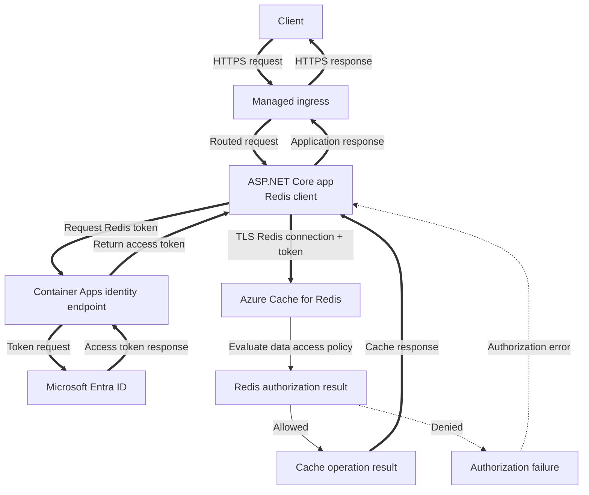

---
content_sources:
  diagrams:
    - id: architecture
      type: flowchart
      source: mslearn-adapted
      based_on:
        - https://learn.microsoft.com/en-us/azure/azure-cache-for-redis/cache-azure-active-directory-for-authentication
        - https://learn.microsoft.com/en-us/azure/azure-cache-for-redis/cache-dotnet-how-to-use-azure-redis-cache
        - https://learn.microsoft.com/en-us/azure/container-apps/managed-identity
---
# Azure Cache for Redis Integration (Microsoft Entra Authentication)

Use this recipe to connect Azure Container Apps to Azure Cache for Redis with Microsoft Entra authentication first and access keys only as a fallback.

## Architecture

<!-- diagram-id: architecture -->


*Figure: Token acquisition, TLS transport, and cache data authorization are separate steps. Confirm that the selected cache tier and client package support Microsoft Entra authentication.*

## Prerequisites

- Existing Container App: `$APP_NAME` in `$RG`
- Existing Azure Cache for Redis instance with Microsoft Entra authentication enabled
- TLS access enabled on port `6380`

## Step 1: Enable managed identity on the Container App

```bash
az containerapp identity assign \
  --name "$APP_NAME" \
  --resource-group "$RG" \
  --system-assigned

export PRINCIPAL_ID=$(az containerapp show \
  --name "$APP_NAME" \
  --resource-group "$RG" \
  --query "identity.principalId" \
  --output tsv)
```

| Command / Parameter | Purpose |
|---|---|
| `az containerapp identity assign` | Assigns the managed identity used by this integration. |
| `--name` | Selects the app, job, deployment, registry, identity, or service used by this command. |
| `--resource-group` | Selects the resource group containing the resources in this step. |
| `--system-assigned` | Enables the app's system-assigned managed identity. |
| `az containerapp show` | Reads the app property needed by this procedure. |
| `--output` | Returns the queried value as plain text or displays the verification list as a table. |
| `--query` | Extracts the exact resource property consumed by the next step. |

## Step 2: Assign Redis data access

```bash
az redis access-policy-assignment create \
  --name "$REDIS_NAME" \
  --resource-group "$RG" \
  --policy-assignment-name "$APP_NAME-data-owner" \
  --access-policy-name "Data Owner" \
  --object-id "$PRINCIPAL_ID" \
  --object-id-alias "$APP_NAME"
```

| Command / Parameter | Purpose |
|---|---|
| `az redis access-policy-assignment create` | Creates the Redis data access assignment for the app identity. |
| `--access-policy-name` | Selects the Redis data access policy granted to the app. |
| `--name` | Selects the app, job, deployment, registry, identity, or service used by this command. |
| `--object-id` | Identifies the managed identity receiving Redis data access. |
| `--object-id-alias` | Sets the Redis username associated with the managed identity. |
| `--policy-assignment-name` | Sets a stable name for the Redis access-policy assignment. |
| `--resource-group` | Selects the resource group containing the resources in this step. |

## Step 3: Configure non-secret Redis settings

```bash
az containerapp update \
  --name "$APP_NAME" \
  --resource-group "$RG" \
  --set-env-vars REDIS_HOST="$REDIS_NAME.redis.cache.windows.net" REDIS_PORT="6380"
```

| Command / Parameter | Purpose |
|---|---|
| `az containerapp update` | Updates the selected app with this step's environment or integration settings. |
| `--name` | Selects the app, job, deployment, registry, identity, or service used by this command. |
| `--resource-group` | Selects the resource group containing the resources in this step. |
| `--set-env-vars` | Sets the non-secret service settings or secret references used by the app. |

## Step 4: .NET code (Microsoft Entra token authentication)

Add dependencies:

```bash
dotnet add package StackExchange.Redis
dotnet add package Microsoft.Azure.StackExchangeRedis
dotnet add package Azure.Identity
```

Use the Azure helper package to configure token-based authentication:

```csharp
using Azure.Identity;
using Microsoft.Azure.StackExchangeRedis;
using StackExchange.Redis;

var options = ConfigurationOptions.Parse($"{Environment.GetEnvironmentVariable("REDIS_HOST")}:{Environment.GetEnvironmentVariable("REDIS_PORT") ?? "6380"}");
options.Ssl = true;
options.AbortOnConnectFail = false;

if (!string.IsNullOrWhiteSpace(Environment.GetEnvironmentVariable("REDIS_ACCESS_KEY")))
{
    options.Password = Environment.GetEnvironmentVariable("REDIS_ACCESS_KEY");
}
else
{
    await options.ConfigureForAzureWithTokenCredentialAsync(new DefaultAzureCredential());
}

await using var connection = await ConnectionMultiplexer.ConnectAsync(options);
var db = connection.GetDatabase();
await db.StringSetAsync("health", "ok", TimeSpan.FromMinutes(1));
Console.WriteLine(await db.StringGetAsync("health"));
```

!!! warning
    If your current Redis tier or package version does not support the token helper pattern above exactly as shown, keep the access-key fallback and verify the Microsoft Learn guidance before standardizing the Entra pattern across all services.

## Step 5: Access key fallback

```bash
az containerapp secret set \
  --name "$APP_NAME" \
  --resource-group "$RG" \
  --secrets redis-access-key="<redis-primary-key>"

az containerapp update \
  --name "$APP_NAME" \
  --resource-group "$RG" \
  --set-env-vars REDIS_HOST="$REDIS_NAME.redis.cache.windows.net" REDIS_PORT="6380" REDIS_ACCESS_KEY=secretref:redis-access-key
```

| Command / Parameter | Purpose |
|---|---|
| `az containerapp secret set` | Stores the fallback credential as a Container Apps secret. |
| `--name` | Selects the app, job, deployment, registry, identity, or service used by this command. |
| `--resource-group` | Selects the resource group containing the resources in this step. |
| `--secrets` | Creates the named fallback secret consumed through `secretref:`. |
| `az containerapp update` | Updates the selected app with this step's environment or integration settings. |
| `--set-env-vars` | Sets the non-secret service settings or secret references used by the app. |

## Verification

1. Confirm the access policy assignment exists.
2. Confirm application logs show successful Redis `SET` and `GET` operations.
3. Confirm clients are using TLS on port `6380`.

## See Also

- [Managed Identity](managed-identity.md)
- [Private Endpoints](../../../platform/networking/private-endpoints.md)
- [Networking](../../../platform/networking/vnet-integration.md)

## Sources

- [Use Microsoft Entra for cache authentication](https://learn.microsoft.com/en-us/azure/azure-cache-for-redis/cache-azure-active-directory-for-authentication)
- [Use Azure Cache for Redis with .NET](https://learn.microsoft.com/en-us/azure/azure-cache-for-redis/cache-dotnet-how-to-use-azure-redis-cache)
- [Managed identities in Azure Container Apps](https://learn.microsoft.com/en-us/azure/container-apps/managed-identity)
