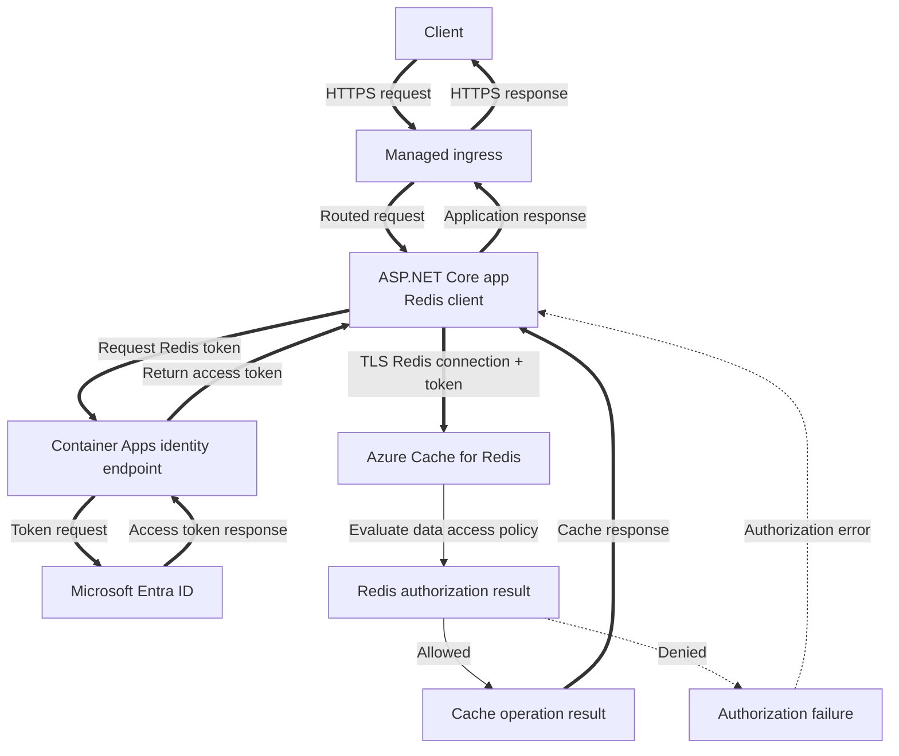

---
content_sources:
  diagrams:
    - id: architecture
      type: flowchart
      source: mslearn-adapted
      based_on:
        - https://learn.microsoft.com/en-us/azure/azure-cache-for-redis/cache-azure-active-directory-for-authentication
        - https://learn.microsoft.com/en-us/azure/azure-cache-for-redis/cache-dotnet-how-to-use-azure-redis-cache
        - https://learn.microsoft.com/en-us/azure/container-apps/managed-identity
---
# Azure Cache for Redis Integration (Microsoft Entra Authentication)

Use this recipe to connect Azure Container Apps to Azure Cache for Redis with Microsoft Entra authentication first and access keys only as a fallback.

## Architecture

<!-- diagram-id: architecture -->


*Figure: Token acquisition, TLS transport, and cache data authorization are separate steps. Confirm that the selected cache tier and client package support Microsoft Entra authentication.*

## Prerequisites

- Existing Container App: `$APP_NAME` in `$RG`
- Existing Azure Cache for Redis instance with Microsoft Entra authentication enabled
- TLS access enabled on port `6380`

## Step 1: Enable managed identity on the Container App

```bash
az containerapp identity assign \
  --name "$APP_NAME" \
  --resource-group "$RG" \
  --system-assigned

export PRINCIPAL_ID=$(az containerapp show \
  --name "$APP_NAME" \
  --resource-group "$RG" \
  --query "identity.principalId" \
  --output tsv)
```

| Command / Parameter | Purpose |
|---|---|
| `az containerapp identity assign` | For managed-identity Azure Cache for Redis access, enables the Container App identity that authenticates to the target Azure service. |
| `--name` | Assigns identity to `$APP_NAME` and reads its resulting principal ID. |
| `--resource-group` | Finds the Redis client app in `$RG`. |
| `--system-assigned` | For managed-identity Azure Cache for Redis access, enables the system-assigned identity on the selected Container App. |
| `az containerapp show` | Retrieves the app principal that will receive the Redis data access policy. |
| `--output` | Returns that principal ID as unquoted `tsv` for shell assignment. |
| `--query` | For managed-identity Azure Cache for Redis access, extracts `identity.principalId` from the command response for the next operation. |

## Step 2: Assign Redis data access

```bash
az redis access-policy-assignment create \
  --name "$REDIS_NAME" \
  --resource-group "$RG" \
  --policy-assignment-name "$APP_NAME-data-owner" \
  --access-policy-name "Data Owner" \
  --object-id "$PRINCIPAL_ID" \
  --object-id-alias "$APP_NAME"
```

| Command / Parameter | Purpose |
|---|---|
| `az redis access-policy-assignment create` | For managed-identity Azure Cache for Redis access, assigns the Redis Data Owner access policy to the Container App identity. |
| `--access-policy-name` | For managed-identity Azure Cache for Redis access, assigns Redis access policy `Data Owner`. |
| `--name` | Targets cache `$REDIS_NAME` for the access-policy assignment. |
| `--object-id` | For managed-identity Azure Cache for Redis access, targets managed-identity object ID `$PRINCIPAL_ID` for Redis authorization. |
| `--object-id-alias` | For managed-identity Azure Cache for Redis access, labels the Redis identity assignment as `$APP_NAME`. |
| `--policy-assignment-name` | For managed-identity Azure Cache for Redis access, names the Redis policy assignment `$APP_NAME-data-owner`. |
| `--resource-group` | Locates `$REDIS_NAME` in `$RG`. |

## Step 3: Configure non-secret Redis settings

```bash
az containerapp update \
  --name "$APP_NAME" \
  --resource-group "$RG" \
  --set-env-vars REDIS_HOST="$REDIS_NAME.redis.cache.windows.net" REDIS_PORT="6380"
```

| Command / Parameter | Purpose |
|---|---|
| `az containerapp update` | Creates a revision with the Redis TLS endpoint used by token authentication. |
| `--name` | Configures Redis connectivity on `$APP_NAME`. |
| `--resource-group` | Finds the app being revised in `$RG`. |
| `--set-env-vars` | Sets `REDIS_HOST` to the cache FQDN and `REDIS_PORT` to TLS port `6380`. |

## Step 4: .NET code (Microsoft Entra token authentication)

Add dependencies:

```bash
dotnet add package StackExchange.Redis
dotnet add package Microsoft.Azure.StackExchangeRedis
dotnet add package Azure.Identity
```

Use the Azure helper package to configure token-based authentication:

```csharp
using Azure.Identity;
using Microsoft.Azure.StackExchangeRedis;
using StackExchange.Redis;

var options = ConfigurationOptions.Parse($"{Environment.GetEnvironmentVariable("REDIS_HOST")}:{Environment.GetEnvironmentVariable("REDIS_PORT") ?? "6380"}");
options.Ssl = true;
options.AbortOnConnectFail = false;

if (!string.IsNullOrWhiteSpace(Environment.GetEnvironmentVariable("REDIS_ACCESS_KEY")))
{
    options.Password = Environment.GetEnvironmentVariable("REDIS_ACCESS_KEY");
}
else
{
    await options.ConfigureForAzureWithTokenCredentialAsync(new DefaultAzureCredential());
}

await using var connection = await ConnectionMultiplexer.ConnectAsync(options);
var db = connection.GetDatabase();
await db.StringSetAsync("health", "ok", TimeSpan.FromMinutes(1));
Console.WriteLine(await db.StringGetAsync("health"));
```

!!! warning
    If your current Redis tier or package version does not support the token helper pattern above exactly as shown, keep the access-key fallback and verify the Microsoft Learn guidance before standardizing the Entra pattern across all services.

## Step 5: Access key fallback

```bash
az containerapp secret set \
  --name "$APP_NAME" \
  --resource-group "$RG" \
  --secrets redis-access-key="<redis-primary-key>"

az containerapp update \
  --name "$APP_NAME" \
  --resource-group "$RG" \
  --set-env-vars REDIS_HOST="$REDIS_NAME.redis.cache.windows.net" REDIS_PORT="6380" REDIS_ACCESS_KEY=secretref:redis-access-key
```

| Command / Parameter | Purpose |
|---|---|
| `az containerapp secret set` | For managed-identity Azure Cache for Redis access, creates the Container Apps secret consumed by the application through `secretref:`. |
| `--name` | Stores the fallback access key and configures its reference on `$APP_NAME`. |
| `--resource-group` | Applies both access-key fallback commands to the app in `$RG`. |
| `--secrets` | For the Azure Cache for Redis fallback, stores the literal `redis-access-key="<redis-primary-key>"` value as a Container Apps secret. |
| `az containerapp update` | Creates a revision that adds the Redis key reference to the existing endpoint settings. |
| `--set-env-vars` | Sets the Redis host, TLS port, and `REDIS_ACCESS_KEY=secretref:redis-access-key`. |

## Verification

1. Confirm the access policy assignment exists.
2. Confirm application logs show successful Redis `SET` and `GET` operations.
3. Confirm clients are using TLS on port `6380`.

## See Also

- [Managed Identity](managed-identity.md)
- [Private Endpoints](../../../platform/networking/private-endpoints.md)
- [Networking](../../../platform/networking/vnet-integration.md)

## Sources

- [Use Microsoft Entra for cache authentication](https://learn.microsoft.com/en-us/azure/azure-cache-for-redis/cache-azure-active-directory-for-authentication)
- [Use Azure Cache for Redis with .NET](https://learn.microsoft.com/en-us/azure/azure-cache-for-redis/cache-dotnet-how-to-use-azure-redis-cache)
- [Managed identities in Azure Container Apps](https://learn.microsoft.com/en-us/azure/container-apps/managed-identity)
