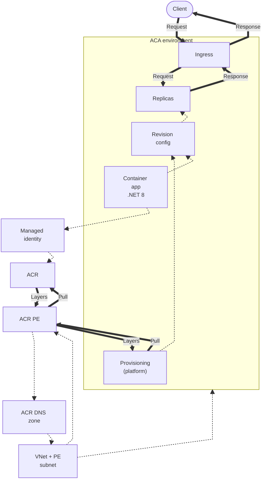
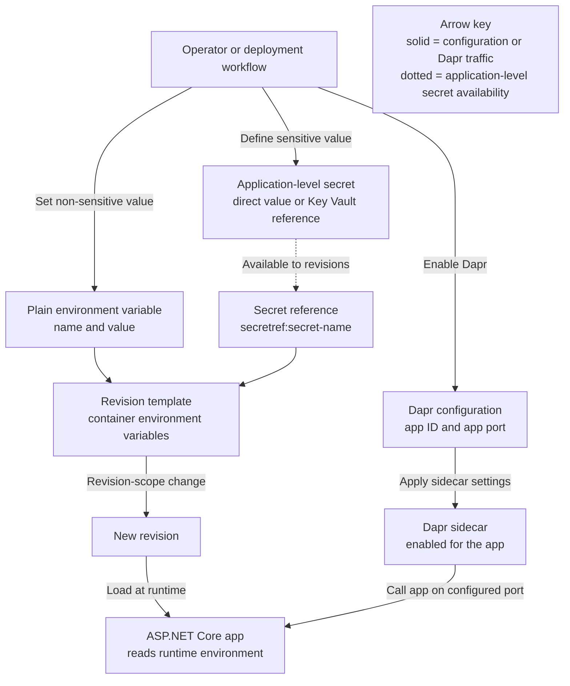

---
content_sources:
  diagrams:
    - id: this-tutorial-assumes-a-production-ready-container
      type: flowchart
      source: mslearn-adapted
      based_on:
        - https://learn.microsoft.com/en-us/azure/container-apps/networking
        - https://learn.microsoft.com/en-us/azure/container-apps/managed-identity-image-pull
        - https://learn.microsoft.com/en-us/azure/container-registry/container-registry-private-link
    - id: configuration-flow
      type: flowchart
      source: mslearn-adapted
      based_on:
        - https://learn.microsoft.com/en-us/aspnet/core/fundamentals/configuration/
        - https://learn.microsoft.com/en-us/azure/container-apps/environment-variables
        - https://learn.microsoft.com/en-us/azure/container-apps/manage-secrets
        - https://learn.microsoft.com/en-us/azure/container-apps/dapr-overview
validation:
  az_cli:
    last_tested:
    cli_version:
    result: not_tested
  bicep:
    last_tested:
    result: not_tested
---
# 03 - Configuration, Secrets, and Dapr

This step configures runtime settings in Azure Container Apps for your .NET application, including environment variables, secrets, KEDA scaling rules, and Dapr sidecar options.

!!! info "Infrastructure Context"
    **Service**: Container Apps (Consumption) | **Network**: VNet integrated | **VNet**: ✅

    This tutorial assumes a production-ready Container Apps deployment with a custom VNet and private ACR access using managed identity.

    <!-- diagram-id: this-tutorial-assumes-a-production-ready-container -->


*Figure: Client traffic crosses managed ingress to .NET replicas. The customer VNet associates with the environment and ACR private endpoint and links the endpoint's private DNS zone. Managed identity is assigned to the app and authorizes registry pulls; platform provisioning sends pull requests and receives image layers through that endpoint.*

## Configuration Flow

<!-- diagram-id: configuration-flow -->


*Figure: Environment-variable changes are revision-scoped, while secrets are application-scoped and become runtime configuration only when referenced. Dapr settings form a separate branch that enables a sidecar and identifies the app port the sidecar calls.*

## Prerequisites

- Completed [02 - First Deploy to Azure Container Apps](02-first-deploy.md)
- A running Container App (deployed in [02 - First Deploy](02-first-deploy.md))

## Step-by-step

1. **Set standard variables (reuse Bicep outputs from Step 02)**

    ```bash
    RG="rg-dotnet-guide"
    DEPLOYMENT_NAME="main"

    APP_NAME=$(az deployment group show \
     --name "$DEPLOYMENT_NAME" \
     --resource-group "$RG" \
     --query "properties.outputs.containerAppName.value" \
     --output tsv)

    ACR_NAME=$(az deployment group show \
     --name "$DEPLOYMENT_NAME" \
     --resource-group "$RG" \
     --query "properties.outputs.containerRegistryName.value" \
     --output tsv)
    ```

    | Command/Parameter | Purpose |
    |---|---|
    | `az deployment group show` | Reads the Step 02 deployment outputs that identify the .NET app and its registry. |
    | `--name` | Selects the `main` deployment that provisioned the .NET tutorial resources. |
    | `--resource-group` | Looks up that deployment in `rg-dotnet-guide`. |
    | `--query` | Selects either the `containerAppName` or `containerRegistryName` output for the current assignment. |
    | `--output` | Emits each selected deployment output as unquoted text for its shell variable. |

2. **Set environment variables**

    ASP.NET Core automatically reads environment variables into its configuration system.

    ```bash
    az containerapp update \
     --name "$APP_NAME" \
     --resource-group "$RG" \
     --set-env-vars "Logging__LogLevel__Default=Information" "FeatureManagement__NewUI=true"
    ```

    | Command/Parameter | Purpose |
    |---|---|
    | `az containerapp update` | Creates a .NET app revision with logging and feature-management settings. |
    | `--name` | Identifies the .NET Container App receiving the two non-sensitive settings. |
    | `--resource-group` | Applies the update to the app discovered in `rg-dotnet-guide`. |
    | `--set-env-vars` | Sets the default log level to `Information` and enables `FeatureManagement__NewUI`. |

    ???+ example "Expected output"
        ```json
        {
          "name": "<your-app-name>",
          "provisioningState": "Succeeded"
        }
        ```

3. **Store and reference a secret**

    ```bash
    az containerapp secret set \
     --name "$APP_NAME" \
     --resource-group "$RG" \
     --secrets "db-connection-string=Server=tcp:sql.database.windows.net;Database=mydb;"
    ```

    | Command/Parameter | Purpose |
    |---|---|
    | `az containerapp secret set` | Stores the sample SQL connection string as an application-level secret. |
    | `--name` | Selects the .NET app that owns `db-connection-string`. |
    | `--resource-group` | Resolves the secret owner within `rg-dotnet-guide`. |
    | `--secrets` | Writes the value under the secret name `db-connection-string`. |

    ???+ example "Expected output"
        ```text
        Containerapp must be restarted in order for secret changes to take effect.
        ```
        ```json
        [
          {
            "name": "db-connection-string"
          }
        ]
        ```

    Map the secret to an environment variable:

    ```bash
    az containerapp update \
     --name "$APP_NAME" \
     --resource-group "$RG" \
     --set-env-vars "ConnectionStrings__DefaultConnection=secretref:db-connection-string"
    ```

    | Command/Parameter | Purpose |
    |---|---|
    | `az containerapp update` | Creates a revision that exposes the stored connection string through .NET configuration. |
    | `--name` | Chooses the .NET app whose container environment receives the secret reference. |
    | `--resource-group` | Scopes the revision update to the app in `rg-dotnet-guide`. |
    | `--set-env-vars` | Maps `ConnectionStrings__DefaultConnection` to `secretref:db-connection-string`. |

4. **Configure KEDA HTTP autoscaling**

    ```bash
    az containerapp update \
     --name "$APP_NAME" \
     --resource-group "$RG" \
     --min-replicas 0 \
     --max-replicas 10 \
     --scale-rule-name "http-scale" \
     --scale-rule-type "http" \
     --scale-rule-http-concurrency 50
    ```

    | Command/Parameter | Purpose |
    |---|---|
    | `az containerapp update` | Configures request-concurrency scaling for the .NET API. |
    | `--name` | Selects the .NET app that will use the HTTP scale rule. |
    | `--resource-group` | Locates the scalable app in `rg-dotnet-guide`. |
    | `--min-replicas` | Permits the .NET API to scale to zero while idle. |
    | `--max-replicas` | Limits burst scale-out to ten replicas. |
    | `--scale-rule-name` | Records this rule as `http-scale` in the app template. |
    | `--scale-rule-type` | Uses the built-in HTTP request scaler. |
    | `--scale-rule-http-concurrency` | Triggers scale decisions at 50 concurrent requests per replica. |

    ???+ example "Expected output"
        ```json
        {
          "name": "<your-app-name>",
          "provisioningState": "Succeeded"
        }
        ```

5. **Enable Dapr sidecar**

    ```bash
    az containerapp dapr enable \
     --name "$APP_NAME" \
     --resource-group "$RG" \
     --dapr-app-id "dotnet-api" \
     --dapr-app-port 8000
    ```

    | Command/Parameter | Purpose |
    |---|---|
    | `az containerapp dapr enable` | Enables a Dapr sidecar for the .NET service. |
    | `--name` | Identifies the .NET Container App that receives the sidecar. |
    | `--resource-group` | Finds the Dapr-enabled app in `rg-dotnet-guide`. |
    | `--dapr-app-id` | Registers the service with Dapr as `dotnet-api`. |
    | `--dapr-app-port` | Directs sidecar-to-app calls to port `8000`. |

    ???+ example "Expected output"
        ```json
        {
          "appId": "dotnet-api",
          "appPort": 8000,
          "appProtocol": "http",
          "enabled": true
        }
        ```

### Verify configuration in Azure Portal

![ca-dotnet-d38538 | Container App | Containers | Refresh | Send us your feedback | Container | Properties | Environment variables | Health probes | Volume mounts | Container details | Name | ca-dotnet-d38538 | Image source | Azure Container Registry | Authentication | Managed identity | Subscription | Visual Studio Enterprise Subscription | Registry | acrbasicsd38538.azurecr.io | Image | dotnet-sample | Image tag | v1 | Command override | Arguments override | Application | Revisions and replicas | Containers | Scale | Volumes | Settings | Networking | Ingress | Custom domains | CORS | Security | Monitoring | Log stream | Logs | Console | Alerts | Metrics](../../../assets/language-guides/dotnet/tutorial/03-containers-blade.png)

**[Observed]** `ca-dotnet-d38538`. `Container App`. `Containers`. `Refresh`. `Send us your feedback`. `Container`. `Properties`. `Environment variables`. `Health probes`. `Volume mounts`. `Container details`. `Name`. `ca-dotnet-d38538`. `Image source`. `Azure Container Registry`. `Docker Hub or other registries`. `Authentication`. `Managed identity`. `Secrets`. `Identity`. `System assigned`. `Subscription`. `Visual Studio Enterprise Subscription`. `Registry`. `acrbasicsd38538.azurecr.io`. `Image`. `dotnet-sample`. `Image tag`. `v1`. `Command override`. `Arguments override`. `Application`. `Revisions and replicas`. `Containers`. `Scale`. `Volumes`. `Settings`. `Networking`. `Ingress`. `Custom domains`. `CORS`. `Security`. `Monitoring`. `Log stream`. `Logs`. `Console`. `Alerts`. `Metrics`.

**[Inferred]** The `Environment variables` tab appears to map to the same `name=value` pairs supplied via `--set-env-vars` in [Step-by-step](#step-by-step). The `Image` field value `dotnet-sample` and `Image tag` value `v1` appear consistent with the `--image` reference set across [Step-by-step](#step-by-step). The `Registry` field value `acrbasicsd38538.azurecr.io` is consistent with the ACR login server referenced throughout [Step-by-step](#step-by-step). The left-navigation entry `Scale` is consistent with the `--scale-rule-*` levers configurable via the operations referenced in [Step-by-step](#step-by-step).

**[Not Proven]** Additional configuration detail and runtime parameter detail are not visible on this view.

## .NET example: read config safely

ASP.NET Core's `IConfiguration` makes it easy to read these values.

```csharp
// In Program.cs or a Controller
var logLevel = configuration["Logging:LogLevel:Default"];
var isNewUIEnabled = configuration.GetValue<bool>("FeatureManagement:NewUI");
var connectionString = configuration.GetConnectionString("DefaultConnection");
```

!!! tip "Environment Variable Naming"
    Use double underscores (`__`) in environment variable names to represent hierarchical configuration keys in .NET (e.g., `Logging__LogLevel__Default` maps to `Logging:LogLevel:Default`).

## Advanced Topics

- **Managed Identity**: Use `DefaultAzureCredential` from the Azure Identity SDK to access Key Vault without managing client secrets.
- **KEDA Scalers**: Explore .NET specific scalers like `azure-servicebus` or `rabbitmq` for background processing.
- **Dapr SDK**: Use the `Dapr.Client` NuGet package for advanced Dapr features like state store and pub/sub.

## See Also

- [04 - Logging, Monitoring, and Observability](04-logging-monitoring.md)
- [.NET Runtime Reference](../dotnet-runtime.md)
- [Recipes Index](../recipes/index.md)

## Sources
- [Networking in an Azure Container Apps environment (Microsoft Learn)](https://learn.microsoft.com/en-us/azure/container-apps/networking)
- [Azure Container Apps image pull from ACR with managed identity (Microsoft Learn)](https://learn.microsoft.com/en-us/azure/container-apps/managed-identity-image-pull)
- [Azure Container Registry private link (Microsoft Learn)](https://learn.microsoft.com/en-us/azure/container-registry/container-registry-private-link)
- [Manage environment variables on Azure Container Apps (Microsoft Learn)](https://learn.microsoft.com/en-us/azure/container-apps/environment-variables)
- [Configuration in ASP.NET Core (Microsoft Learn)](https://learn.microsoft.com/en-us/aspnet/core/fundamentals/configuration/)
- [Manage secrets in Azure Container Apps (Microsoft Learn)](https://learn.microsoft.com/en-us/azure/container-apps/manage-secrets)
- [Dapr integration with Azure Container Apps (Microsoft Learn)](https://learn.microsoft.com/en-us/azure/container-apps/dapr-overview)
