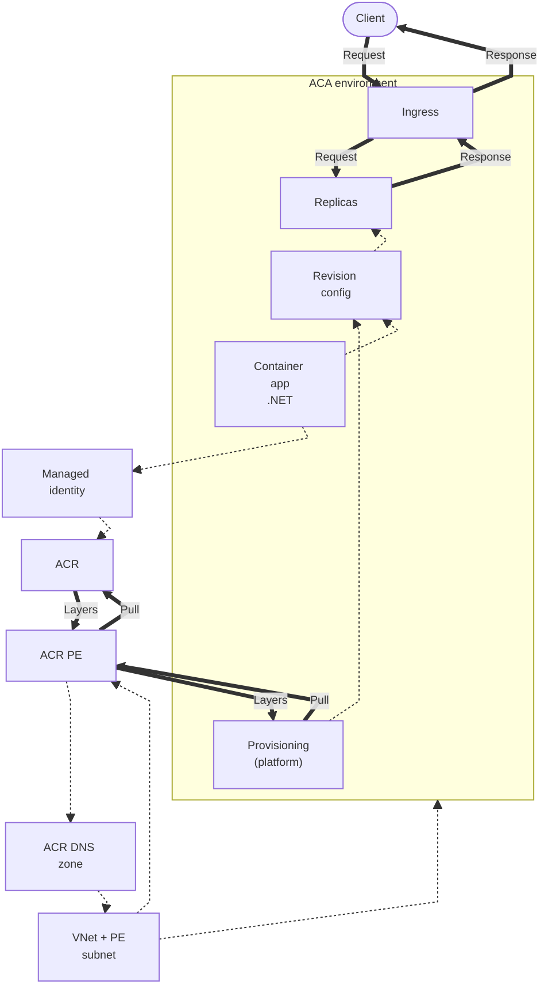
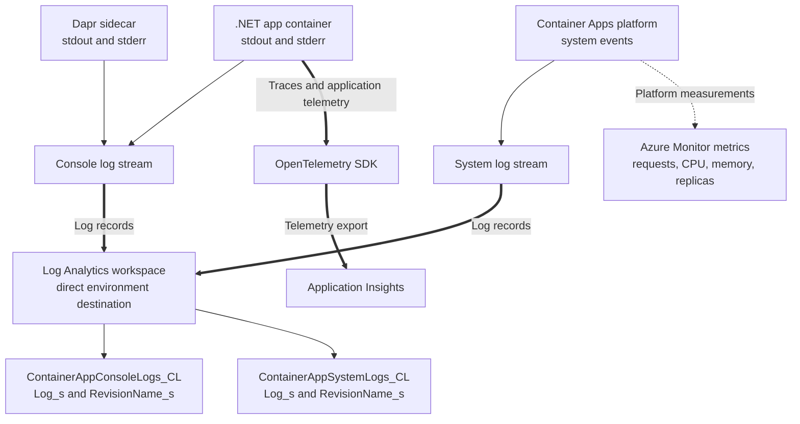
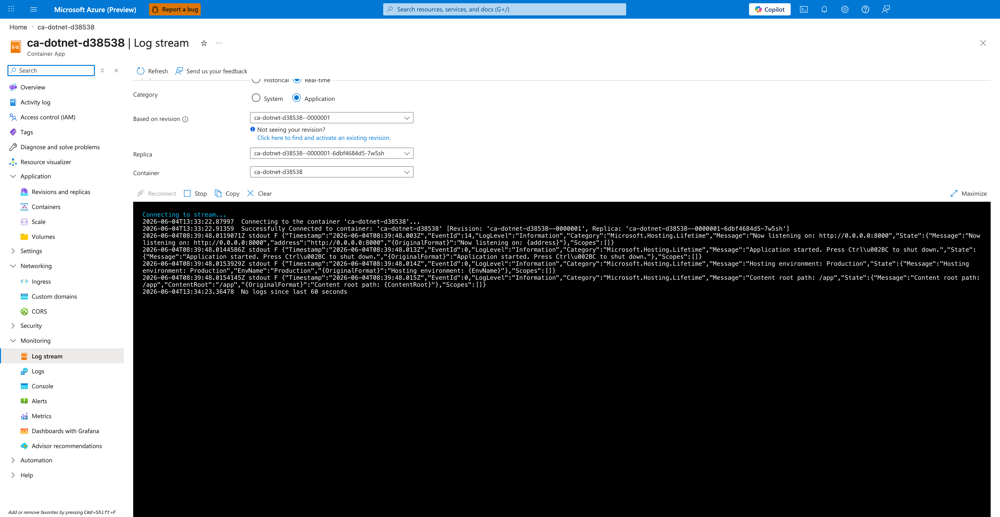

---
content_sources:
  diagrams:
    - id: this-tutorial-assumes-a-production-ready-container
      type: flowchart
      source: mslearn-adapted
      based_on:
        - https://learn.microsoft.com/en-us/azure/container-apps/networking
        - https://learn.microsoft.com/en-us/azure/container-apps/managed-identity-image-pull
        - https://learn.microsoft.com/en-us/azure/container-registry/container-registry-private-link
    - id: how-observability-works-in-container-apps
      type: flowchart
      source: mslearn-adapted
      based_on:
        - https://learn.microsoft.com/en-us/azure/container-apps/log-options
        - https://learn.microsoft.com/en-us/azure/container-apps/log-monitoring
        - https://learn.microsoft.com/en-us/azure/container-apps/monitor
        - https://learn.microsoft.com/en-us/dotnet/core/diagnostics/distributed-tracing
validation:
  az_cli:
    last_tested:
    cli_version:
    result: not_tested
  bicep:
    last_tested:
    result: not_tested
---
# 04 - Logging, Monitoring, and Observability

This tutorial step shows how to inspect console logs, query Log Analytics, and add OpenTelemetry-based observability for production .NET applications on Azure Container Apps.

!!! info "Infrastructure Context"
    **Service**: Container Apps (Consumption) | **Network**: VNet integrated | **VNet**: ✅

    This tutorial assumes a production-ready Container Apps deployment with a custom VNet and private ACR access using managed identity.

    <!-- diagram-id: this-tutorial-assumes-a-production-ready-container -->


*Figure: Client traffic crosses managed ingress to the replicas. The customer VNet and private-endpoint subnet host the ACR private endpoint and link its DNS zone. Managed identity is assigned to the app and authorizes registry pulls through a role assignment; platform provisioning remains the image-pull actor, and both pull requests and layer responses pass through the private endpoint.*

## How Observability Works in Container Apps

<!-- diagram-id: how-observability-works-in-container-apps -->


*Figure: This tutorial uses the direct Log Analytics custom-table destination, so KQL queries target the `*_CL` custom tables and `_s` columns. An environment configured with the Azure Monitor destination instead requires diagnostic settings; resource-specific native tables require `--export-to-resource-specific true`.*

## Prerequisites

- Completed [03 - Configuration, Secrets, and Dapr](03-configuration.md)
- Log Analytics connected to your Container Apps environment
- (Optional) Application Insights resource for distributed tracing

## Step-by-step

1. **Set standard variables**

   ```bash
   RG="rg-dotnet-guide"
   DEPLOYMENT_NAME="main"

   APP_NAME=$(az deployment group show \
     --name "$DEPLOYMENT_NAME" \
     --resource-group "$RG" \
     --query "properties.outputs.containerAppName.value" \
     --output tsv)
   ```

    | Command | Purpose |
    |---|---|
    | `APP_NAME=$(az deployment group show --name "$DEPLOYMENT_NAME" --resource-group "$RG" --query "properties.outputs.containerAppName.value" --output tsv)` | Captures the deployed app name from the Bicep outputs so the logging commands query the correct .NET app. |

2. **Stream console logs**

   ASP.NET Core logs to `stdout` by default. You can stream these directly to your terminal.

   ```bash
   az containerapp logs show \
     --name "$APP_NAME" \
     --resource-group "$RG" \
     --follow
   ```

   | Command | Why it is used |
   |---|---|
   | `az containerapp logs show ...` | Runs the Azure CLI operation required by the documented step. |

   ???+ example "Expected output"
       ```json
       {"TimeStamp":"2026-04-04T16:15:01","Log":"Connecting to the container 'app'..."}
       {"TimeStamp":"2026-04-04T16:15:01","Log":"Successfully Connected to container: 'app'"}
       {"TimeStamp":"2026-04-04T16:15:02Z","Log":"info: Microsoft.Hosting.Lifetime[14]\n      Now listening on: http://0.0.0.0:8000"}
       {"TimeStamp":"2026-04-04T16:15:02Z","Log":"info: Microsoft.Hosting.Lifetime[0]\n      Application started. Press Ctrl+C to shut down."}
       ```

3. **Check system logs for platform events**

   System logs capture events like container crashes, scaling activities, and health probe failures.

   ```bash
   az containerapp logs show \
     --name "$APP_NAME" \
     --resource-group "$RG" \
     --type system
   ```

   | Command | Why it is used |
   |---|---|
   | `az containerapp logs show ...` | Runs the Azure CLI operation required by the documented step. |

   ???+ example "Expected output"
       ```json
       {"TimeStamp":"2026-04-04T16:15:00Z","Type":"Normal","Msg":"Successfully connected to events server","Reason":"ConnectedToEventsServer"}
       ```

4. **Query logs via CLI (recommended for automation)**

   Get your Log Analytics workspace ID and run KQL queries directly from the command line:

   ```bash
   # Get the workspace ID
   WORKSPACE_ID=$(az monitor log-analytics workspace list \
     --resource-group "$RG" \
     --query "[0].customerId" \
     --output tsv)

   # Query console logs (use your actual app name from $APP_NAME)
   az monitor log-analytics query \
     --workspace $WORKSPACE_ID \
     --analytics-query "ContainerAppConsoleLogs_CL | where ContainerAppName_s == '$APP_NAME' | project TimeGenerated, ContainerAppName_s, Log_s | take 5" \
     --output table
   ```

    | Command | Purpose |
    |---|---|
    | `WORKSPACE_ID=$(az monitor log-analytics workspace list --resource-group "$RG" --query "[0].customerId" --output tsv)` | Captures the customer ID of the first Log Analytics workspace returned in the resource group, which is sufficient here because this tutorial provisions a single workspace and then queries it from the CLI. |
    | `az monitor log-analytics query --workspace $WORKSPACE_ID --analytics-query "ContainerAppConsoleLogs_CL | where ContainerAppName_s == '$APP_NAME' | project TimeGenerated, ContainerAppName_s, Log_s | take 5" --output table` | Runs a KQL query for recent console logs so you can verify log ingestion from the deployed .NET app in an automation-friendly way. |

   ???+ example "Expected output"
       ```text
       ContainerAppName_s    Log_s                                                                                           TimeGenerated
       --------------------  ----------------------------------------------------------------------------------------------  ----------------------------
       <your-app-name>       {"LogLevel":"Information","Message":"Now listening on: http://0.0.0.0:8000"...}                  2026-04-04T16:13:17.631Z
       <your-app-name>       {"LogLevel":"Information","Message":"Application started. Press Ctrl+C to shut down."...}        2026-04-04T16:13:17.632Z
       <your-app-name>       {"LogLevel":"Information","Message":"Application is shutting down..."...}                         2026-04-04T16:12:33.373Z
       ```

5. **Query for .NET Exceptions via CLI**

   ```bash
   az monitor log-analytics query \
     --workspace $WORKSPACE_ID \
     --analytics-query "ContainerAppConsoleLogs_CL | where ContainerAppName_s == '$APP_NAME' | where Log_s has 'Exception' or Log_s has 'Error' | project TimeGenerated, Log_s | take 10" \
     --output table
   ```

    | Command | Purpose |
    |---|---|
    | `az monitor log-analytics query --workspace $WORKSPACE_ID --analytics-query "ContainerAppConsoleLogs_CL | where ContainerAppName_s == '$APP_NAME' | where Log_s has 'Exception' or Log_s has 'Error' | project TimeGenerated, Log_s | take 10" --output table` | Filters the Log Analytics stream to exception and error entries so you can quickly inspect .NET failure signatures without opening the portal. |

   ???+ example "Expected output"
       | TimeGenerated | Log_s |
       |---|---|
       | 2026-04-04T16:20:00Z | fail: Microsoft.AspNetCore.Server.Kestrel[13] Connection id "0HN2..." ... |

6. **Enable OpenTelemetry with Azure Monitor**

   The reference app uses the `Azure.Monitor.OpenTelemetry.AspNetCore` NuGet package.

   ```csharp
   // In Program.cs
   if (!string.IsNullOrEmpty(Environment.GetEnvironmentVariable("APPLICATIONINSIGHTS_CONNECTION_STRING")))
   {
       builder.Services.AddOpenTelemetry().UseAzureMonitor();
   }
   ```

   To enable this in your Container App:

   ```bash
   AI_CONNECTION_STRING="InstrumentationKey=...;IngestionEndpoint=..."
   
   az containerapp update \
     --name "$APP_NAME" \
     --resource-group "$RG" \
     --set-env-vars "APPLICATIONINSIGHTS_CONNECTION_STRING=$AI_CONNECTION_STRING"
   ```

   | Command | Why it is used |
   |---|---|
   | `az containerapp update ...` | Updates the existing Container App configuration without recreating the app. |

6. **View Metrics in Azure Monitor**

   Navigate to the **Metrics** tab of your Container App to visualize:
   - **Requests**: Total number of HTTP requests.
   - **CPU/Memory Usage**: Resource consumption per replica.
   - **Replica Count**: Current number of running instances (scaled by KEDA).

## Observability Best Practices for .NET

- **Structured Logging**: Use `ILogger` to emit logs. Container Apps captures the output and indexes it in Log Analytics.
- **Correlation IDs**: ASP.NET Core automatically propagates `TraceId` in HTTP headers, which OpenTelemetry uses to correlate traces across services.
- **Health Checks**: Use the ASP.NET Core Health Checks middleware (`/health`) to provide the platform with accurate liveness/readiness signals.

## Advanced Topics

- **Custom Metrics**: Use `System.Diagnostics.Metrics` to emit custom business metrics like `orders-processed`.
- **Live Metrics**: Use Application Insights Live Metrics Stream for real-time monitoring of your .NET app.
- **Log Scopes**: Use `logger.BeginScope` to add contextual metadata (like `UserId`) to every log entry.

### Verify log stream in Azure Portal



**[Observed]** `Microsoft Azure (Preview)`. `Report a bug`. `Search resources, services, and docs (G+/)`. `Copilot`. `Home`. `ca-dotnet-d38538`. `Container App`. `Log stream`. `Refresh`. `Send us your feedback`. `Display`. `Historical`. `Real-time`. `Category`. `System`. `Application`. `Based on revision`. `ca-dotnet-d38538--0000001`. `Replica`. `ca-dotnet-d38538--0000001-6dbf4684d5-7w5sh`. `Container`. `ca-dotnet-d38538`. `Reconnect`. `Stop`. `Copy`. `Clear`. `Maximize`. `Connecting to the container 'ca-dotnet-d38538'...`. `Successfully Connected`. `Microsoft.Hosting.Lifetime`. `Now listening on: http://0.0.0.0:8000`. `Application started. Press Ctrl+C to shut down.`. `Hosting environment: Production`. `Content root path: /app`. `Overview`. `Activity log`. `Access control (IAM)`. `Tags`. `Diagnose and solve problems`. `Resource visualizer`. `Application`. `Revisions and replicas`. `Containers`. `Scale`. `Volumes`. `Settings`. `Networking`. `Ingress`. `Custom domains`. `CORS`. `Security`. `Monitoring`. `Log stream`. `Logs`. `Console`. `Alerts`. `Metrics`. `Dashboards with Grafana`. `Advisor recommendations`.

**[Inferred]** The `Real-time` radio appears to map to the live tail behavior triggered by `az containerapp logs show --follow` in [Step-by-step](#step-by-step) Step 2. The `Category` toggle value `Application` appears consistent with the default console-log stream from [Step-by-step](#step-by-step) Step 2, and the `System` option appears consistent with the system-log selector exercised in [Step-by-step](#step-by-step) Step 3. The displayed log line `Now listening on: http://0.0.0.0:8000` appears consistent with the `Microsoft.Hosting.Lifetime` startup log shape shown in the expected output of [Step-by-step](#step-by-step) Step 2. The displayed log lines emitted from the `Microsoft.Hosting.Lifetime` category appear consistent with the `ILogger`-emitted console output that the `ContainerAppConsoleLogs_CL` table indexes per the KQL query in [Step-by-step](#step-by-step) Step 4.

**[Not Proven]** Additional log query output and exporter configuration detail are not visible on this view.

## See Also
- [03 - Configuration, Secrets, and Dapr](03-configuration.md)
- [.NET Runtime Reference](../dotnet-runtime.md)
- [Troubleshooting Methodology](../../../troubleshooting/methodology/index.md)

## Sources
- [Container Apps networking (Microsoft Learn)](https://learn.microsoft.com/en-us/azure/container-apps/networking)
- [Managed identity image pull (Microsoft Learn)](https://learn.microsoft.com/en-us/azure/container-apps/managed-identity-image-pull)
- [Azure Container Registry private link (Microsoft Learn)](https://learn.microsoft.com/en-us/azure/container-registry/container-registry-private-link)
- [Log storage and monitoring options (Microsoft Learn)](https://learn.microsoft.com/en-us/azure/container-apps/log-options)
- [Log monitoring with Log Analytics (Microsoft Learn)](https://learn.microsoft.com/en-us/azure/container-apps/log-monitoring)
- [Monitoring Azure Container Apps (Microsoft Learn)](https://learn.microsoft.com/en-us/azure/container-apps/monitor)
- [OpenTelemetry with ASP.NET Core (Microsoft Learn)](https://learn.microsoft.com/en-us/dotnet/core/diagnostics/distributed-tracing)
