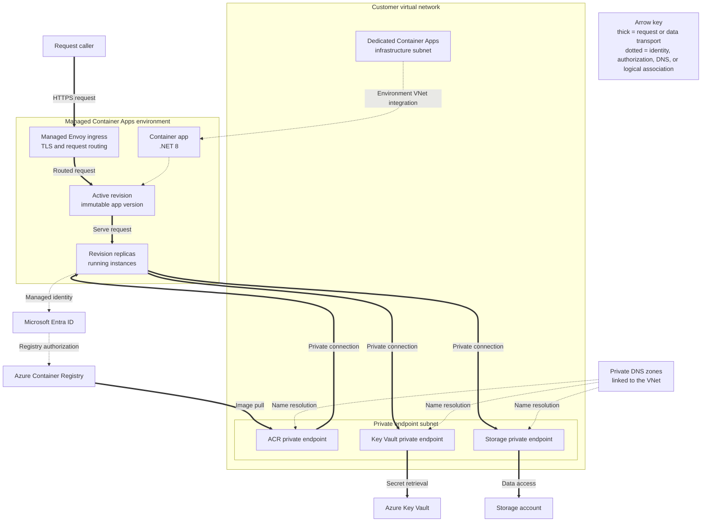
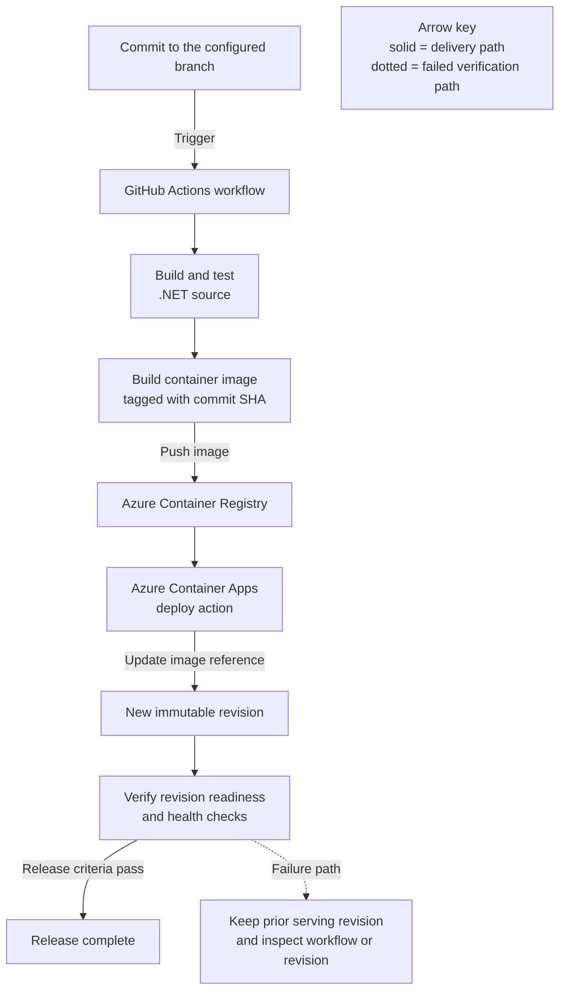

---
content_sources:
  diagrams:
    - id: this-tutorial-assumes-a-production-ready-container
      type: flowchart
      source: mslearn-adapted
      based_on:
        - https://learn.microsoft.com/en-us/azure/container-apps/networking
        - https://learn.microsoft.com/en-us/azure/container-apps/managed-identity-image-pull
        - https://learn.microsoft.com/en-us/azure/container-apps/private-endpoints-with-dns
    - id: ci-cd-pipeline-flow
      type: flowchart
      source: mslearn-adapted
      based_on:
        - https://learn.microsoft.com/en-us/azure/container-apps/github-actions
        - https://learn.microsoft.com/en-us/azure/container-apps/revisions
        - https://learn.microsoft.com/en-us/azure/container-apps/health-probes
validation:
  az_cli:
    last_tested:
    cli_version:
    result: not_tested
  bicep:
    last_tested:
    result: not_tested
---
# 06 - CI/CD with GitHub Actions

Automate the build and deployment of your .NET application so every commit produces a new Container App revision. This tutorial uses GitHub Actions, Azure Container Registry (ACR), and the Azure Container Apps deploy action.

!!! info "Infrastructure Context"
    **Service**: Container Apps (Consumption) | **Network**: VNet integrated | **VNet**: ✅

    This tutorial assumes a production-ready Container Apps deployment with a custom VNet, ACR with managed identity pull, and private endpoints for backend services.

    <!-- diagram-id: this-tutorial-assumes-a-production-ready-container -->


*Figure: The tutorial's shared production context. The Container Apps environment is a managed logical boundary integrated with a dedicated subnet; ACR, Key Vault, Storage, private DNS zones, and Microsoft Entra ID remain separate Azure resources.*

## CI/CD Pipeline Flow

<!-- diagram-id: ci-cd-pipeline-flow -->


*Figure: The runtime-specific test step differs, but every language uses the same commit, image, registry, deploy, revision, and verification semantics.*

## Prerequisites

- Completed [05 - Infrastructure as Code with Bicep](05-infrastructure-as-code.md)
- GitHub repository with your .NET source code
- Azure service principal stored as a GitHub secret

!!! warning "Never expose credentials in workflow logs"
    Keep all credential material in GitHub Secrets and avoid printing secret-derived values in shell steps. Use masked placeholders in documentation and workflow examples.

## Step-by-step

1. **Configure repository variables and secrets**

   - **Variables**: `RESOURCE_GROUP`, `APP_NAME`, `ACR_NAME`
   - **Secrets**: `AZURE_CREDENTIALS`, `REGISTRY_USERNAME`, `REGISTRY_PASSWORD`

   Example `AZURE_CREDENTIALS` JSON (masked):

   ```json
   {
     "clientId": "xxxxxxxx-xxxx-xxxx-xxxx-xxxxxxxxxxxx",
     "clientSecret": "<client-secret>",
     "subscriptionId": "<subscription-id>",
     "tenantId": "<tenant-id>"
   }
   ```

2. **Create the GitHub Actions workflow file**

   Save this as `.github/workflows/deploy.yml`:

   ```yaml
   name: Deploy .NET App to Azure Container Apps

   on:
     push:
       branches: [ main ]
     workflow_dispatch:

   jobs:
     build-and-deploy:
       runs-on: ubuntu-latest
       steps:
         - name: Checkout code
           uses: actions/checkout@v4

         - name: Setup .NET
           uses: actions/setup-dotnet@v4
           with:
             dotnet-version: '8.0.x'

         - name: Azure Login
           uses: azure/login@v2
           with:
             creds: ${{ secrets.AZURE_CREDENTIALS }}

         - name: Build and Push to ACR
           uses: azure/docker-login@v2
           with:
             login-server: ${{ vars.ACR_NAME }}.azurecr.io
             username: ${{ secrets.REGISTRY_USERNAME }}
             password: ${{ secrets.REGISTRY_PASSWORD }}

         - name: Build container image
           run: |
             docker build -t ${{ vars.ACR_NAME }}.azurecr.io/${{ vars.APP_NAME }}:${{ github.sha }} ./apps/dotnet-aspnetcore
             docker push ${{ vars.ACR_NAME }}.azurecr.io/${{ vars.APP_NAME }}:${{ github.sha }}

         - name: Deploy to Container App
           uses: azure/container-apps-deploy-action@v1
           with:
             imageToDeploy: ${{ vars.ACR_NAME }}.azurecr.io/${{ vars.APP_NAME }}:${{ github.sha }}
             resourceGroup: ${{ vars.RESOURCE_GROUP }}
             containerAppName: ${{ vars.APP_NAME }}
   ```

3. **Add unit tests to the pipeline (Recommended)**

   Before building the container, ensure your .NET tests pass:

   ```yaml
         - name: Run Tests
           run: dotnet test ./apps/dotnet-aspnetcore/AzureContainerApps.csproj --configuration Release
   ```

4. **Validate rollout behavior**

     - Trigger the workflow by pushing a change to `main`.
     - Confirm a new revision was created in the Azure Portal or via CLI.
     - Confirm traffic moved to the healthy new revision.

     ```bash
     az containerapp revision list \
       --name "$APP_NAME" \
       --resource-group "$RESOURCE_GROUP" \
       --query "[].{name:name,active:properties.active,trafficWeight:properties.trafficWeight,healthState:properties.healthState}"
     ```

     | Command | Why it is used |
     |---|---|
     | `az containerapp revision list ...` | Lists revisions so rollout state, traffic, and health can be verified. |

     ???+ example "Expected output"
         ```json
         [
           {
             "name": "<your-app-name>--<sha>",
             "active": true,
             "trafficWeight": 100,
             "healthState": "Healthy"
           }
         ]
         ```

## Advanced Topics

- **Environment-based deployments**: Use GitHub Environments with protection rules for manual approval before deploying to production.
- **Bicep integration**: Run `az deployment group create` within the workflow to ensure infrastructure stays in sync with code.
- **Canary releases**: Use the `azure/container-apps-deploy-action` to deploy with 0% traffic initially, then gradually ramp up after verification.

!!! tip "Use immutable image tags"
    Always tag your images with `${{ github.sha }}` or a semantic version. This ensures that every revision in Container Apps can be traced back to a specific commit in your repository.

### Verify deployment activity in Azure Portal


**[Observed]** `Microsoft Azure (Preview)`. `Report a bug`. `Search resources, services, and docs (G+/)`. `Copilot`. `Home`. `ca-dotnet-d38538`. `Container App`. `Activity log`. `Activity`. `Edit columns`. `Refresh`. `Export Activity Logs`. `Download as CSV`. `Insights`. `Feedback`. `Pin current filters`. `Reset filters`. `Looking for Log Analytics?`. `Visit Log Analytics`. `Search`. `Quick Insights`. `Management Group`. `None`. `Subscription`. `Visual Studio Enterprise Subscription`. `Event severity`. `All`. `Timespan`. `Last 6 hours`. `Resource group`. `rg-aca-basics-d38538`. `Resource`. `ca-dotnet-d38538`. `Add Filter`. `3 items.`. `Operation name`. `Status`. `Time`. `Time stamp`. `Subscription`. `Event initiated by`. `Create or Update Container App`. `Accepted`. `5 minutes a...`. `6 minutes a...`. `Fri Jun 05 2...`. `Visual Studio Enterprise Subscription`. `user@example.com`. `Overview`. `Activity log`. `Access control (IAM)`. `Tags`. `Diagnose and solve problems`. `Resource visualizer`. `Application`. `Revisions and replicas`. `Containers`. `Scale`. `Volumes`. `Settings`. `Networking`. `Ingress`. `Custom domains`. `CORS`. `Security`. `Monitoring`. `Log stream`. `Logs`. `Console`. `Alerts`. `Metrics`. `Dashboards with Grafana`. `Advisor recommendations`.

**[Inferred]** The resource-scoped filter chips `Resource group` value `rg-aca-basics-d38538` and `Resource` value `ca-dotnet-d38538` appear to map to the same `${{ vars.RESOURCE_GROUP }}` and `${{ vars.APP_NAME }}` values passed to `resourceGroup` and `containerAppName` by the `azure/container-apps-deploy-action@v1` step in [Step-by-step](#step-by-step) Step 2. The `Create or Update Container App` rows appear consistent with the deployment outcome that the same `azure/container-apps-deploy-action@v1` step in [Step-by-step](#step-by-step) Step 2 is expected to trigger when the workflow runs against the configured `containerAppName`. The `Accepted` `Status` appears consistent with the long-running deployment-acceptance signal that precedes the healthy rollout state that [Step-by-step](#step-by-step) Step 4 looks for via `az containerapp revision list`, where `healthState: "Healthy"` and `trafficWeight: 100` are expected on the active revision after the operation completes. The repeated `Create or Update Container App` rows within the `Last 6 hours` `Timespan` appear consistent with multiple workflow runs invoking the `azure/container-apps-deploy-action@v1` step in [Step-by-step](#step-by-step) Step 2 against the same `containerAppName`. The `Subscription` column value `Visual Studio Enterprise Subscription` is consistent across all three `Create or Update Container App` rows, which appears consistent with the single-subscription target encoded by the `subscriptionId` field of the `AZURE_CREDENTIALS` JSON in [Step-by-step](#step-by-step) Step 1 and inherited by every workflow run that uses that secret.

**[Not Proven]** Additional GitHub Actions workflow output and CLI command output are not visible on this view.

## See Also
- [02 - First Deploy to Azure Container Apps](02-first-deploy.md)
- [05 - Infrastructure as Code with Bicep](05-infrastructure-as-code.md)
- [GitHub Actions for Azure (Microsoft Learn)](https://learn.microsoft.com/en-us/azure/developer/github/github-actions)

## Sources
- [Networking in an Azure Container Apps environment (Microsoft Learn)](https://learn.microsoft.com/en-us/azure/container-apps/networking)
- [Azure Container Apps image pull from ACR with managed identity (Microsoft Learn)](https://learn.microsoft.com/en-us/azure/container-apps/managed-identity-image-pull)
- [Private endpoints and DNS for Container Apps environments (Microsoft Learn)](https://learn.microsoft.com/en-us/azure/container-apps/private-endpoints-with-dns)
- [GitHub Actions for Azure Container Apps (Microsoft Learn)](https://learn.microsoft.com/en-us/azure/container-apps/github-actions)
- [Revisions in Azure Container Apps (Microsoft Learn)](https://learn.microsoft.com/en-us/azure/container-apps/revisions)
- [Health probes in Azure Container Apps (Microsoft Learn)](https://learn.microsoft.com/en-us/azure/container-apps/health-probes)
- [setup-dotnet action (GitHub)](https://github.com/actions/setup-dotnet)
