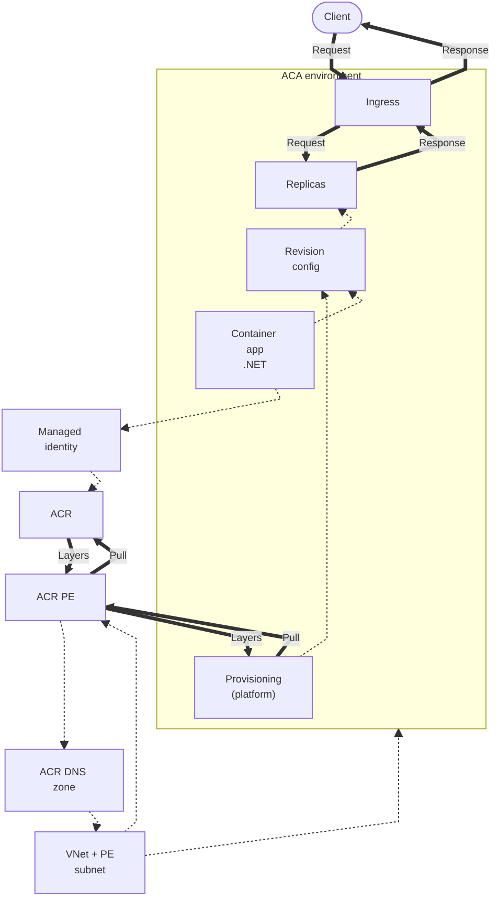
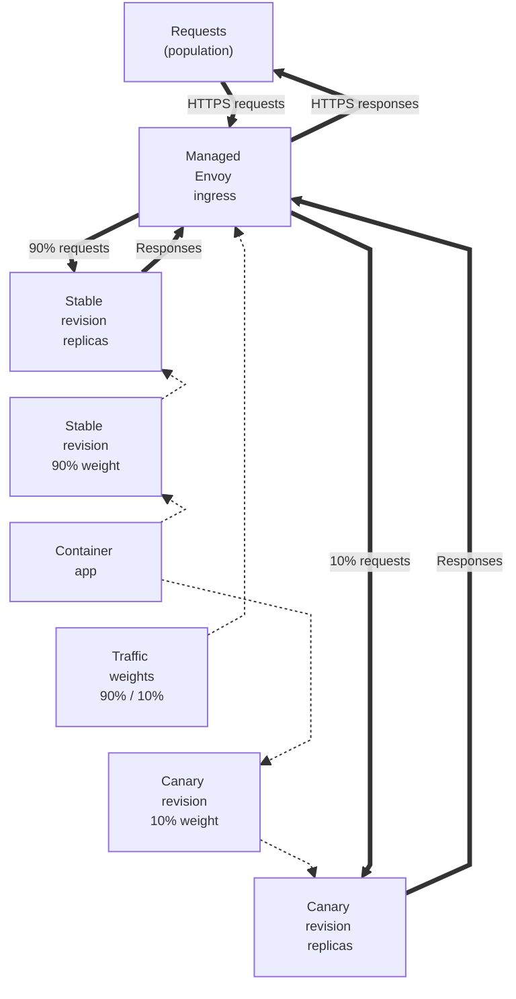

---
content_sources:
  diagrams:
    - id: this-tutorial-assumes-a-production-ready-container
      type: flowchart
      source: mslearn-adapted
      based_on:
        - https://learn.microsoft.com/en-us/azure/container-apps/networking
        - https://learn.microsoft.com/en-us/azure/container-apps/managed-identity-image-pull
        - https://learn.microsoft.com/en-us/azure/container-registry/container-registry-private-link
    - id: revision-traffic-splitting
      type: flowchart
      source: mslearn-adapted
      based_on:
        - https://learn.microsoft.com/en-us/azure/container-apps/revisions
        - https://learn.microsoft.com/en-us/azure/container-apps/traffic-splitting
validation:
  az_cli:
    last_tested:
    cli_version:
    result: not_tested
  bicep:
    last_tested:
    result: not_tested
---
# 07 - Revisions and Traffic Splitting

Azure Container Apps revisions provide immutable deployment snapshots of your .NET application. Use them for safe releases, canary traffic, and quick rollback to a known-good state.

!!! info "Infrastructure Context"
    **Service**: Container Apps (Consumption) | **Network**: VNet integrated | **VNet**: ✅

    This tutorial assumes a production-ready Container Apps deployment with a custom VNet and private ACR access using managed identity.

    <!-- diagram-id: this-tutorial-assumes-a-production-ready-container -->


*Figure: The customer VNet and private-endpoint subnet host the ACR private endpoint and link its DNS zone. Managed identity is assigned to the app and authorizes registry pulls through a role assignment; platform provisioning remains the image-pull actor, and both pull requests and layer responses pass through the private endpoint.*

## Revision Traffic Splitting

<!-- diagram-id: revision-traffic-splitting -->


*Figure: Traffic weights configure managed ingress; ingress sends the population of requests directly to stable and canary replicas at 90% and 10%, and each replica group returns responses through ingress.*

## Prerequisites

- Completed [06 - CI/CD with GitHub Actions](06-ci-cd.md)
- At least two deployed images/tags in your ACR
- Container App currently running in `multiple` revision mode or ready to switch

!!! tip "Define promotion criteria before traffic split"
    Decide in advance which metrics (ASP.NET Core error rates, Kestrel request latency, CPU saturation) must stay within threshold before increasing canary traffic.

## Step-by-step

1. **Set standard variables**

   ```bash
   RG="rg-dotnet-guide"
   DEPLOYMENT_NAME="main"
   BASE_NAME="dotnet-guide"

   APP_NAME=$(az deployment group show \
     --name "$DEPLOYMENT_NAME" \
     --resource-group "$RG" \
     --query "properties.outputs.containerAppName.value" \
     --output tsv)

   ACR_NAME=$(az deployment group show \
     --name "$DEPLOYMENT_NAME" \
     --resource-group "$RG" \
     --query "properties.outputs.containerRegistryName.value" \
     --output tsv)

   ACR_LOGIN_SERVER=$(az deployment group show \
     --name "$DEPLOYMENT_NAME" \
     --resource-group "$RG" \
     --query "properties.outputs.containerRegistryLoginServer.value" \
     --output tsv)
   ```

    | Command | Purpose |
    |---|---|
    | `APP_NAME=$(az deployment group show --name "$DEPLOYMENT_NAME" --resource-group "$RG" --query "properties.outputs.containerAppName.value" --output tsv)` | Captures the deployed app name so revision and traffic commands apply to the correct .NET app. |
    | `ACR_NAME=$(az deployment group show --name "$DEPLOYMENT_NAME" --resource-group "$RG" --query "properties.outputs.containerRegistryName.value" --output tsv)` | Captures the registry name that stores the revision images referenced during promotion steps. |
    | `ACR_LOGIN_SERVER=$(az deployment group show --name "$DEPLOYMENT_NAME" --resource-group "$RG" --query "properties.outputs.containerRegistryLoginServer.value" --output tsv)` | Captures the registry login server used to assemble image tags for new revisions. |

2. **Switch to multiple revision mode**

   By default, Container Apps operate in `single` revision mode (100% traffic to the latest). To split traffic, you must enable `multiple` mode.

   ```bash
   az containerapp revision set-mode \
     --name "$APP_NAME" \
     --resource-group "$RG" \
     --mode multiple
   ```

   | Command | Why it is used |
   |---|---|
   | `az containerapp revision set-mode ...` | Runs the Azure CLI operation required by the documented step. |

   ???+ example "Expected output"
       ```
       "Multiple"
       ```

3. **Deploy a new version to create a new revision**

   ```bash
   az acr build --registry "$ACR_NAME" --image "$BASE_NAME:v3" ./apps/dotnet-aspnetcore

   az containerapp update \
     --name "$APP_NAME" \
     --resource-group "$RG" \
     --image "$ACR_LOGIN_SERVER/$BASE_NAME:v3"
   ```

   | Command | Why it is used |
   |---|---|
   | `az acr build --registry ...` | Builds and pushes the container image to Azure Container Registry. |

   ???+ example "Expected output"
       ```json
       {
         "latestRevision": "<your-app-name>--xxxxxxx",
         "name": "<your-app-name>",
         "provisioningState": "Succeeded"
       }
       ```

4. **List revisions and identify target names**

   ```bash
   az containerapp revision list \
     --name "$APP_NAME" \
     --resource-group "$RG" \
     --query "[].{name:name,active:properties.active,createdTime:properties.createdTime}" \
     --output table
   ```

   | Command | Why it is used |
   |---|---|
   | `az containerapp revision list ...` | Lists revisions so rollout state, traffic, and health can be verified. |

   ???+ example "Expected output"
        ```text
        Name                               Active    CreatedTime
        ---------------------------------  --------  -------------------------
        <your-app-name>--0000001           True      2026-04-04T16:00:00+00:00
        <your-app-name>--0000002           True      2026-04-04T16:30:00+00:00
        ```

5. **Apply canary traffic split (90/10)**

   Capture the revision names from the list above, then apply traffic weights:

   ```bash
   # Replace with your actual revision names from Step 4
   OLD_REV="${APP_NAME}--0000001"
   NEW_REV="${APP_NAME}--0000002"

   az containerapp ingress traffic set \
     --name "$APP_NAME" \
     --resource-group "$RG" \
     --revision-weight "$OLD_REV=90" "$NEW_REV=10"
   ```

   | Command | Why it is used |
   |---|---|
   | `az containerapp ingress traffic ...` | Runs the Azure CLI operation required by the documented step. |

   ???+ example "Expected output"
        ```json
        [
          {
            "revisionName": "<your-app-name>--0000001",
            "weight": 90
          },
          {
            "revisionName": "<your-app-name>--0000002",
            "weight": 10
          }
        ]
        ```

6. **Verify applied traffic routing**

   ```bash
   az containerapp ingress show \
     --name "$APP_NAME" \
     --resource-group "$RG"
   ```

   | Command | Why it is used |
   |---|---|
   | `az containerapp ingress show ...` | Reads ingress configuration such as exposure, target port, transport, and affinity. |

   ???+ example "Expected output"
        ```json
        {
          "fqdn": "<your-app-name>.<env-suffix>.koreacentral.azurecontainerapps.io",
          "traffic": [
            { "revisionName": "<your-app-name>--0000001", "weight": 90 },
            { "revisionName": "<your-app-name>--0000002", "weight": 10 }
          ]
        }
        ```

7. **Rollback instantly if .NET exceptions increase**

   If the canary revision shows high error rates in Log Analytics, move all traffic back to the stable revision.

   ```bash
   az containerapp ingress traffic set \
     --name "$APP_NAME" \
     --resource-group "$RG" \
     --revision-weight "$OLD_REV=100"
   ```

   | Command | Why it is used |
   |---|---|
   | `az containerapp ingress traffic ...` | Runs the Azure CLI operation required by the documented step. |

8. **Deactivate the bad revision**

   ```bash
   az containerapp revision deactivate \
     --name "$APP_NAME" \
     --resource-group "$RG" \
     --revision "$NEW_REV"
   ```

   | Command | Why it is used |
   |---|---|
   | `az containerapp revision deactivate ...` | Runs the Azure CLI operation required by the documented step. |

### Verify revisions and traffic in Azure Portal


**[Observed]** `ca-dotnet-d38538`. `Container App`. `Revisions and replicas`. `Create new revision`. `Save`. `Refresh`. `Deployment mode`. `Send us your feedback`. `Learn more`. `Active revisions`. `Inactive revisions`. `Replicas`. `Name`. `Date created`. `Running status`. `View Logs`. `Label`. `Traffic`. `ca-dotnet-d38538--0000001`. `6/4/2026, 5:39:30 PM`. `Running`. `View details`. `Show Logs`. `100`. `%`. `1`. `Show replicas`. `Application`. `Revisions and replicas`. `Containers`. `Scale`. `Volumes`. `Settings`. `Networking`. `Ingress`. `Custom domains`. `CORS`. `Security`. `Monitoring`. `Log stream`. `Logs`. `Console`. `Alerts`. `Metrics`.

**[Inferred]** The `Deployment mode` toolbar action appears to map to the same lever set by `az containerapp revision set-mode --mode multiple` in [Step-by-step](#step-by-step) Step 2. The `Create new revision` toolbar action is consistent with the new-revision effect of `az containerapp update --image` in [Step-by-step](#step-by-step) Step 3. The `Active revisions` and `Inactive revisions` tabs are consistent with the `revision list` and `revision deactivate` operations in [Step-by-step](#step-by-step) Steps 4 and 8. The `Traffic` column value `100 %` for `ca-dotnet-d38538--0000001` appears to map to the per-revision weight set by `az containerapp ingress traffic set --revision-weight` in [Step-by-step](#step-by-step) Steps 5 and 6.

**[Not Proven]** Additional revision detail and traffic-split detail are not visible on this view.

## Operational Guidance for .NET

- **Health Probes**: Ensure your liveness and readiness probes (`/health`) are correctly configured so Container Apps doesn't route traffic to a revision that hasn't finished its .NET runtime startup.
- **Graceful Shutdown**: ASP.NET Core handles `SIGTERM` signals. When you shift traffic away from a revision, the platform waits for active connections to finish (up to the termination grace period) before stopping the container.
- **Session state**: If your .NET app uses in-memory sessions, revision changes and replica movement can disrupt state. Use an external provider such as Redis instead of relying on revision traffic splitting or sticky sessions as the state boundary.

## Advanced Topics

- **Blue/Green Deployment**: Use labels to route traffic to specific revisions without modifying weights until the "Green" revision is fully verified.
- **Dapr service invocation**: Dapr can be configured to respect traffic splitting or route to specific revisions using headers.
- **Automated Promotion**: Use GitHub Actions to increase traffic weight automatically if health checks and telemetry thresholds are met.

!!! warning "Cleanup Stale Revisions"
    Deactivate or delete old revisions once they are no longer needed for rollback. This simplifies your environment and reduces the risk of accidental traffic assignment.

## See Also
- [04 - Logging, Monitoring, and Observability](04-logging-monitoring.md)
- [06 - CI/CD with GitHub Actions](06-ci-cd.md)
- [Revision Management Operations](../../../operations/revision-management/index.md)

## Sources
- [Container Apps networking (Microsoft Learn)](https://learn.microsoft.com/en-us/azure/container-apps/networking)
- [Managed identity image pull (Microsoft Learn)](https://learn.microsoft.com/en-us/azure/container-apps/managed-identity-image-pull)
- [Azure Container Registry private link (Microsoft Learn)](https://learn.microsoft.com/en-us/azure/container-registry/container-registry-private-link)
- [Revisions in Azure Container Apps (Microsoft Learn)](https://learn.microsoft.com/en-us/azure/container-apps/revisions)
- [Traffic splitting (Microsoft Learn)](https://learn.microsoft.com/en-us/azure/container-apps/traffic-splitting)
