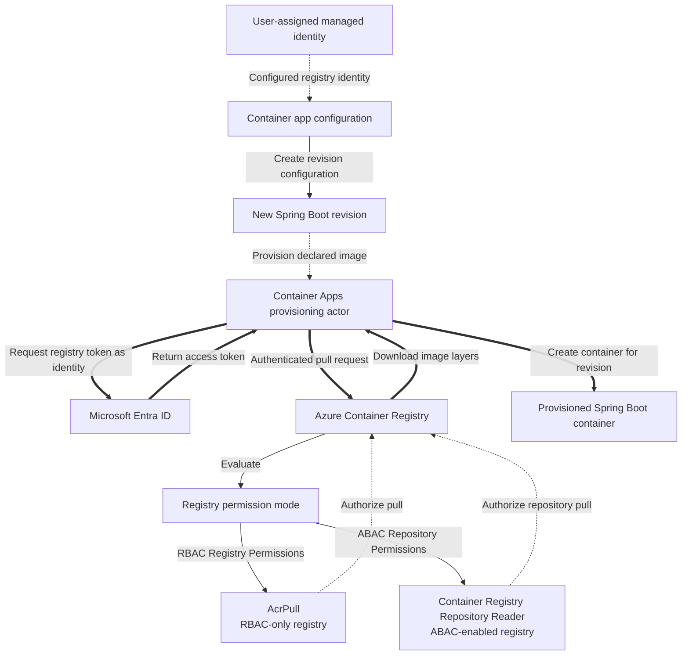

---
content_sources:
  diagrams:
    - id: pull-private-spring-boot-images-from
      type: flowchart
      source: mslearn-adapted
      based_on:
        - https://learn.microsoft.com/en-us/azure/container-apps/managed-identity-image-pull
        - https://learn.microsoft.com/en-us/azure/container-registry/container-registry-get-started-azure-cli
        - https://learn.microsoft.com/en-us/azure/container-registry/container-registry-rbac-abac-repository-permissions
---
# Recipe: Container Registry in Java Apps on Azure Container Apps

Pull private Spring Boot images from Azure Container Registry using managed identity in Azure Container Apps.

<!-- diagram-id: pull-private-spring-boot-images-from -->


*Figure: Identity selection, token acquisition, registry authorization, and image transport are distinct. `AcrPull` applies only to RBAC-only registries; ABAC-enabled registries require `Container Registry Repository Reader`, optionally with a repository condition.*

## Prerequisites

- Container Apps environment (`$ACA_ENV_NAME`) and app name (`$APP_NAME`)
- Resource group (`$RG`), region (`$LOCATION`), registry (`$ACR_NAME`)
- Azure CLI with Container Apps extension and Docker

## Create ACR and pull identity

```bash
az acr create \
  --name "$ACR_NAME" \
  --resource-group "$RG" \
  --location "$LOCATION" \
  --sku Standard

az identity create \
  --name "id-$APP_NAME" \
  --resource-group "$RG" \
  --location "$LOCATION"

export UAMI_ID=$(az identity show --name "id-$APP_NAME" --resource-group "$RG" --query id --output tsv)
export UAMI_PRINCIPAL_ID=$(az identity show --name "id-$APP_NAME" --resource-group "$RG" --query principalId --output tsv)
export ACR_ID=$(az acr show --name "$ACR_NAME" --resource-group "$RG" --query id --output tsv)
export ACR_ROLE_ASSIGNMENT_MODE=$(az acr show --name "$ACR_NAME" --resource-group "$RG" --query roleAssignmentMode --output tsv)

if [[ "$ACR_ROLE_ASSIGNMENT_MODE" == "AbacRepositoryPermissions" ]]; then
  az role assignment create \
    --assignee-object-id "$UAMI_PRINCIPAL_ID" \
    --assignee-principal-type ServicePrincipal \
    --role "Container Registry Repository Reader" \
    --scope "$ACR_ID"
else
  az role assignment create \
    --assignee-object-id "$UAMI_PRINCIPAL_ID" \
    --assignee-principal-type ServicePrincipal \
    --role "AcrPull" \
    --scope "$ACR_ID"
fi
```

| Command / Parameter | Purpose |
|---|---|
| `az acr create` | Creates the private registry that stores the Spring Boot image. |
| `az identity create` | Creates `id-$APP_NAME`, the user-assigned identity used for image pulls. |
| `az identity show` | Reads that identity's resource ID and principal ID for Container Apps and the role grant. |
| `az acr show` | Reads the registry resource ID and `roleAssignmentMode` used to choose the supported pull role. |
| `az role assignment create` | Grants the identity the pull role selected by the registry's RBAC or ABAC permission mode. |
| `--name` | Names `$ACR_NAME` or `id-$APP_NAME`, depending on the command that owns the flag. |
| `--resource-group` | Creates and locates the registry and identity in `$RG`. |
| `--location` | Places both newly created resources in `$LOCATION`. |
| `--sku` | Creates the registry at the `Standard` service tier. |
| `--query` | Extracts the identity `id`, identity `principalId`, registry `id`, or registry `roleAssignmentMode`. |
| `--output` | Emits each queried value as unquoted `tsv` for shell assignment. |
| `--assignee-object-id` | Assigns the selected pull role to `$UAMI_PRINCIPAL_ID`. |
| `--assignee-principal-type` | Declares the managed identity assignee as a `ServicePrincipal`. |
| `--role` | Uses `Container Registry Repository Reader` for ABAC mode or `AcrPull` for RBAC mode. |
| `--scope` | Restricts the pull permission to registry resource `$ACR_ID`. |

ABAC-enabled registries do not honor `AcrPull`. Add a repository condition when `Container Registry Repository Reader` should cover only selected repositories.

## Multi-stage Dockerfile for Spring Boot

```dockerfile
FROM maven:3.9-eclipse-temurin-21 AS build
WORKDIR /src
COPY pom.xml .
COPY src ./src
RUN mvn --batch-mode --no-transfer-progress clean package -DskipTests

FROM eclipse-temurin:21-jre
WORKDIR /app
COPY --from=build /src/target/*.jar app.jar
EXPOSE 8080
ENTRYPOINT ["java", "-jar", "/app/app.jar"]
```

```bash
az acr login --name "$ACR_NAME"
docker build --file Dockerfile --tag "$ACR_NAME.azurecr.io/java-api:latest" .
docker push "$ACR_NAME.azurecr.io/java-api:latest"
```

| Command | Why it is used |
|---|---|
| `az acr login --name ...` | Authenticates Docker or the CLI to Azure Container Registry. |

## Configure registry access for the app

```bash
az containerapp create \
  --name "$APP_NAME" \
  --resource-group "$RG" \
  --environment "$ACA_ENV_NAME" \
  --image "$ACR_NAME.azurecr.io/java-api:latest" \
  --registry-server "$ACR_NAME.azurecr.io" \
  --registry-identity "$UAMI_ID" \
  --user-assigned "$UAMI_ID" \
  --ingress external \
  --target-port 8080
```

| Command | Why it is used |
|---|---|
| `az containerapp create ...` | Creates the Container App with the documented image, ingress, scale, and environment settings. |

## Advanced Topics

- Cache Maven layers by copying `pom.xml` before source for faster incremental builds.
- Use immutable tags and staged revisions for safer rollouts.
- Add container image scanning before publishing to ACR.

## See Also

- [Managed Identity](managed-identity.md)
- [Operations: Image Pull and Registry](../../../operations/image-pull-and-registry/index.md)
- [Private Endpoints](../../../platform/networking/private-endpoints.md)

## Sources

- [Managed identity image pull for Azure Container Apps](https://learn.microsoft.com/en-us/azure/container-apps/managed-identity-image-pull)
- [Create and use Azure Container Registry with Azure CLI](https://learn.microsoft.com/en-us/azure/container-registry/container-registry-get-started-azure-cli)
- [Azure Container Registry roles and permission modes](https://learn.microsoft.com/en-us/azure/container-registry/container-registry-rbac-abac-repository-permissions)
