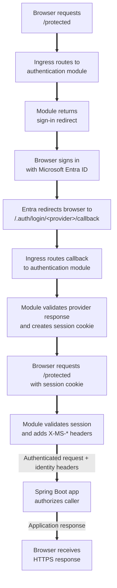

---
content_sources:
  diagrams:
    - id: enable-easy-auth-in-azure-container
      type: flowchart
      source: mslearn-adapted
      based_on:
        - https://learn.microsoft.com/en-us/azure/container-apps/authentication
        - https://learn.microsoft.com/en-us/azure/container-apps/authentication-entra
---
# Recipe: Easy Auth in Java Apps on Azure Container Apps

Configure Easy Auth behavior for an already-configured Microsoft identity provider and parse authenticated principal claims in a Spring Boot filter.

<!-- diagram-id: enable-easy-auth-in-azure-container -->


*Figure: With the Microsoft identity provider already configured, Easy Auth authenticates the caller before the request reaches Spring Boot and supplies identity headers. Application code still enforces role, tenant, and resource authorization.*

## Prerequisites

- Container App (`$APP_NAME`) with ingress enabled
- Resource group (`$RG`) and an app registration already configured as the Container App's Microsoft identity provider
- Azure CLI with Container Apps extension

The behavior command below does not configure the Microsoft identity provider. Before running it, configure the provider for `$APP_NAME` with the app registration's client ID, tenant ID, and credential as described in [Microsoft Entra authentication for Container Apps](https://learn.microsoft.com/en-us/azure/container-apps/authentication-entra).

## Configure Easy Auth behavior

```bash
az containerapp auth update \
  --name "$APP_NAME" \
  --resource-group "$RG" \
  --enabled true \
  --runtime-version "~1" \
  --unauthenticated-client-action RedirectToLoginPage \
  --redirect-provider azureactivedirectory \
  --require-https true
```

| Command / Parameter | Purpose |
|---|---|
| `az containerapp auth update` | Configures authentication behavior for the already-configured Microsoft provider, including the browser redirect, callback, and session before Spring Boot receives the request. |
| `--name` | Applies the Easy Auth policy to `$APP_NAME`. |
| `--resource-group` | Finds the Java Container App in `$RG`. |
| `--enabled` | Turns the built-in authentication feature on with value `true`. |
| `--runtime-version` | Selects authentication runtime version `~1`. |
| `--unauthenticated-client-action` | Redirects an unauthenticated browser to the configured sign-in provider. |
| `--redirect-provider` | Chooses `azureactivedirectory` for that server-directed sign-in. |
| `--require-https` | Requires HTTPS for the authentication flow and callback. |

## Spring Boot filter for principal headers

```java
import com.fasterxml.jackson.databind.JsonNode;
import com.fasterxml.jackson.databind.ObjectMapper;
import jakarta.servlet.FilterChain;
import jakarta.servlet.ServletException;
import jakarta.servlet.http.HttpServletRequest;
import jakarta.servlet.http.HttpServletResponse;
import org.springframework.stereotype.Component;
import org.springframework.web.filter.OncePerRequestFilter;

import java.io.IOException;
import java.nio.charset.StandardCharsets;
import java.util.Base64;

@Component
public class ClientPrincipalFilter extends OncePerRequestFilter {
    private static final ObjectMapper MAPPER = new ObjectMapper();

    @Override
    protected void doFilterInternal(HttpServletRequest request, HttpServletResponse response, FilterChain filterChain)
            throws ServletException, IOException {
        String header = request.getHeader("x-ms-client-principal");
        if (header != null && !header.isBlank()) {
            String decoded = new String(Base64.getDecoder().decode(header), StandardCharsets.UTF_8);
            JsonNode principal = MAPPER.readTree(decoded);
            request.setAttribute("userId", principal.path("userId").asText());
            request.setAttribute("identityProvider", principal.path("identityProvider").asText());
            request.setAttribute("claims", principal.path("claims"));
        }
        filterChain.doFilter(request, response);
    }
}
```

## Advanced Topics

- Keep identity enforcement in Easy Auth and authorization rules in Spring components.
- Validate expected claim types before mapping to internal roles.
- Use separate identity-provider app registrations per environment.

## See Also

- [Managed Identity](managed-identity.md)
- [Key Vault Reference](key-vault-reference.md)
- [Identity and Secrets](../../../platform/identity-and-secrets/managed-identity.md)

## Sources

- [Authentication in Azure Container Apps](https://learn.microsoft.com/en-us/azure/container-apps/authentication)
- [Microsoft Entra authentication for Container Apps](https://learn.microsoft.com/en-us/azure/container-apps/authentication-entra)
