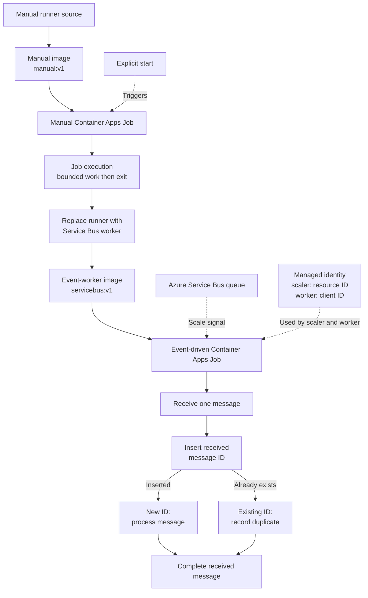

---
content_sources:
  diagrams:
    - id: java-jobs-recipe-flow
      type: flowchart
      source: self-generated
      justification: Language recipe flow synthesized from Microsoft Learn Jobs guidance and Java SDK usage patterns.
      based_on:
        - https://learn.microsoft.com/en-us/azure/container-apps/jobs
        - https://learn.microsoft.com/en-us/java/api/overview/azure/identity-readme
        - https://learn.microsoft.com/en-us/java/api/overview/azure/messaging-servicebus-readme
---
# Recipe: Jobs in Java on Azure Container Apps

Use this recipe to build a Spring Boot CLI runner for manual Jobs, adapt it to process one Service Bus message, and add a dedup-table pattern.

## Prerequisites

- Azure Container Apps environment and registry
- Azure Service Bus namespace and queue for the event-driven example
- Java 21, Maven, Docker, and Azure CLI

```bash
export RG="rg-aca-java-prod"
export ACA_ENV_NAME="aca-env-java-prod"
export ACR_NAME="acrjavaprod"
export JOB_NAME="job-java-manual"
export EVENT_JOB_NAME="job-java-servicebus"
export SERVICEBUS_NAMESPACE="sb-aca-prod"
export SERVICEBUS_QUEUE="orders"
export JOB_IDENTITY_ID="<user-assigned-identity-resource-id>"
```

Grant the user-assigned identity permission to pull from ACR and receive Service Bus messages. The registry role depends on its permission mode:

```bash
export JOB_IDENTITY_PRINCIPAL_ID=$(az identity show --ids "$JOB_IDENTITY_ID" --query principalId --output tsv)
export JOB_IDENTITY_CLIENT_ID=$(az identity show --ids "$JOB_IDENTITY_ID" --query clientId --output tsv)
export ACR_ID=$(az acr show --name "$ACR_NAME" --resource-group "$RG" --query id --output tsv)
export ACR_ROLE_ASSIGNMENT_MODE=$(az acr show --name "$ACR_NAME" --resource-group "$RG" --query roleAssignmentMode --output tsv)

if [[ "$ACR_ROLE_ASSIGNMENT_MODE" == "AbacRepositoryPermissions" ]]; then
  export ACR_PULL_ROLE="Container Registry Repository Reader"
else
  export ACR_PULL_ROLE="AcrPull"
fi

az role assignment create \
  --assignee-object-id "$JOB_IDENTITY_PRINCIPAL_ID" \
  --assignee-principal-type ServicePrincipal \
  --role "$ACR_PULL_ROLE" \
  --scope "$ACR_ID"

export SERVICEBUS_NAMESPACE_ID=$(az servicebus namespace show --name "$SERVICEBUS_NAMESPACE" --resource-group "$RG" --query id --output tsv)

az role assignment create \
  --assignee-object-id "$JOB_IDENTITY_PRINCIPAL_ID" \
  --assignee-principal-type ServicePrincipal \
  --role "Azure Service Bus Data Receiver" \
  --scope "$SERVICEBUS_NAMESPACE_ID"
```

| Command / Parameter | Purpose |
|---|---|
| `az identity show` | Reads the job identity principal ID for role grants and client ID for Java credential selection. |
| `--ids` | Selects the user-assigned identity by `$JOB_IDENTITY_ID`. |
| `--query` | Extracts identity IDs, ACR properties, or the Service Bus namespace resource ID needed by the next operation. |
| `--output` | Emits each queried value as unquoted `tsv` for shell assignment. |
| `az acr show` | Reads `$ACR_NAME` resource ID and `roleAssignmentMode` so the pull grant matches the registry permission model. |
| `--name` | Selects `$ACR_NAME` for registry lookups and `$SERVICEBUS_NAMESPACE` for its resource ID. |
| `--resource-group` | Locates the registry and Service Bus namespace in `$RG`. |
| `az role assignment create` | Grants the job identity the selected registry pull role and Service Bus receiver role. |
| `--assignee-object-id` | Assigns both permissions to `$JOB_IDENTITY_PRINCIPAL_ID`. |
| `--assignee-principal-type` | Declares the managed identity principal as `ServicePrincipal`. |
| `--role` | Uses `$ACR_PULL_ROLE` for image pulls and `Azure Service Bus Data Receiver` for worker access. |
| `--scope` | Restricts each role to `$ACR_ID` or `$SERVICEBUS_NAMESPACE_ID`. |
| `az servicebus namespace show` | Retrieves the Service Bus namespace resource ID used for the receiver grant. |

## What You'll Build

- a Spring Boot CommandLineRunner Job
- an event-driven Service Bus consumer that processes one message and exits
- a dedup-table example using an embedded table you can later move to a shared database

## Steps

<!-- diagram-id: java-jobs-recipe-flow -->


*Figure: The manual runner is built as `java-jobs/manual:v1`. Replacing that runner with the Service Bus worker changes the application, so the recipe rebuilds it as the separate `java-jobs/servicebus:v1` image for the event-driven job. The event scaler and Java worker must both authenticate. `--scale-rule-identity` selects the attached user-assigned identity for the scaler by resource ID, while `AZURE_CLIENT_ID` selects it for the worker's `DefaultAzureCredential` by client ID. Role assignments grant the identity access to Service Bus. The event path shows ordering-only duplicate suppression under at-least-once delivery. A crash after the ID insert but before the business operation causes a retry to take the duplicate branch and complete unprocessed work.*

### 1. Create a manual Spring Boot Job

`pom.xml`:

```xml
<project xmlns="http://maven.apache.org/POM/4.0.0" xmlns:xsi="http://www.w3.org/2001/XMLSchema-instance"
         xsi:schemaLocation="http://maven.apache.org/POM/4.0.0 https://maven.apache.org/xsd/maven-4.0.0.xsd">
  <modelVersion>4.0.0</modelVersion>
  <groupId>com.contoso.jobs</groupId>
  <artifactId>aca-java-job</artifactId>
  <version>1.0.0</version>
  <parent>
    <groupId>org.springframework.boot</groupId>
    <artifactId>spring-boot-starter-parent</artifactId>
    <version>3.3.2</version>
  </parent>
  <properties>
    <java.version>21</java.version>
  </properties>
  <dependencies>
    <dependency>
      <groupId>org.springframework.boot</groupId>
      <artifactId>spring-boot-starter</artifactId>
    </dependency>
    <dependency>
      <groupId>com.azure</groupId>
      <artifactId>azure-identity</artifactId>
      <version>1.13.2</version>
    </dependency>
    <dependency>
      <groupId>com.azure</groupId>
      <artifactId>azure-messaging-servicebus</artifactId>
      <version>7.17.7</version>
    </dependency>
    <dependency>
      <groupId>org.springframework.boot</groupId>
      <artifactId>spring-boot-starter-jdbc</artifactId>
    </dependency>
    <dependency>
      <groupId>com.h2database</groupId>
      <artifactId>h2</artifactId>
      <scope>runtime</scope>
    </dependency>
  </dependencies>
  <build>
    <plugins>
      <plugin>
        <groupId>org.springframework.boot</groupId>
        <artifactId>spring-boot-maven-plugin</artifactId>
      </plugin>
    </plugins>
  </build>
</project>
```

`src/main/java/com/contoso/jobs/JobApplication.java`:

```java
package com.contoso.jobs;

import org.springframework.boot.CommandLineRunner;
import org.springframework.boot.SpringApplication;
import org.springframework.boot.autoconfigure.SpringBootApplication;
import org.springframework.context.annotation.Bean;

@SpringBootApplication
public class JobApplication {
    public static void main(String[] args) {
        SpringApplication.run(JobApplication.class, args);
    }

    @Bean
    CommandLineRunner manualRunner() {
        return args -> {
            String execution = System.getenv().getOrDefault("CONTAINER_APP_JOB_EXECUTION_NAME", "local");
            System.out.println("{\"event\":\"job-start\",\"execution\":\"" + execution + "\"}");
            System.out.println("{\"event\":\"job-end\",\"status\":\"Succeeded\"}");
            System.exit(0);
        };
    }
}
```

`Dockerfile`:

```dockerfile
FROM maven:3.9-eclipse-temurin-21 AS build
WORKDIR /src
COPY pom.xml .
COPY src ./src
RUN mvn --batch-mode --quiet package -DskipTests

FROM eclipse-temurin:21-jre
WORKDIR /app
COPY --from=build /src/target/aca-java-job-1.0.0.jar app.jar
ENTRYPOINT ["java", "-jar", "/app/app.jar"]
```

Deploy the manual Job:

```bash
az acr build \
  --registry "$ACR_NAME" \
  --image "java-jobs/manual:v1" \
  --file "Dockerfile" \
  "."

az containerapp job create \
  --name "$JOB_NAME" \
  --resource-group "$RG" \
  --environment "$ACA_ENV_NAME" \
  --trigger-type "Manual" \
  --image "$ACR_NAME.azurecr.io/java-jobs/manual:v1" \
  --registry-server "$ACR_NAME.azurecr.io" \
  --registry-identity "$JOB_IDENTITY_ID" \
  --mi-user-assigned "$JOB_IDENTITY_ID" \
  --replica-timeout 600 \
  --replica-retry-limit 1
```

| Command / Parameter | Purpose |
|---|---|
| `az acr build` | Builds the manual Spring Boot job image in ACR. |
| `--registry` | Selects registry `$ACR_NAME` for the remote build. |
| `--image` | Tags the built image as `java-jobs/manual:v1`. |
| `--file` | Uses the recipe's `Dockerfile` for the ACR build. |
| `az containerapp job create` | Creates the manually triggered Java job from the private image. |
| `--name` | Names the manual job `$JOB_NAME`. |
| `--resource-group` | Creates the job in `$RG`. |
| `--environment` | Places the job in Container Apps environment `$ACA_ENV_NAME`. |
| `--trigger-type` | Configures explicit manual execution. |
| `--image` | Runs `$ACR_NAME.azurecr.io/java-jobs/manual:v1`. |
| `--registry-server` | Identifies `$ACR_NAME.azurecr.io` as the private image source. |
| `--registry-identity` | Uses `$JOB_IDENTITY_ID` to authenticate the ACR image pull. |
| `--mi-user-assigned` | Attaches `$JOB_IDENTITY_ID` to the job execution. |
| `--replica-timeout` | Allows each execution up to 600 seconds. |
| `--replica-retry-limit` | Retries a failed execution replica once. |

### 2. Receive one Service Bus message and exit

Replace the runner bean with:

```java
@Bean
CommandLineRunner serviceBusRunner() {
    return args -> {
        var namespace = System.getenv("SERVICEBUS_NAMESPACE") + ".servicebus.windows.net";
        var queueName = System.getenv("SERVICEBUS_QUEUE");

        var client = new com.azure.messaging.servicebus.ServiceBusClientBuilder()
            .credential(namespace, new com.azure.identity.DefaultAzureCredentialBuilder().build())
            .receiver()
            .queueName(queueName)
            .buildClient();

        var messages = client.receiveMessages(1, java.time.Duration.ofSeconds(15));
        for (var message : messages) {
            System.out.println("{\"event\":\"message-received\",\"messageId\":\"" + message.getMessageId() + "\"}");
            client.complete(message);
        }
        client.close();
        System.exit(0);
    };
}
```

This minimal event runner completes the message immediately after logging it. The deduplication code in Step 3 is a separate snippet: integrate its received-message-ID check and processing branch before `client.complete(message)` for ordering-only duplicate suppression under at-least-once delivery.

After replacing the manual runner, rebuild the application as a distinct event-worker image and create the event-driven Job:

```bash
az acr build \
  --registry "$ACR_NAME" \
  --image "java-jobs/servicebus:v1" \
  --file "Dockerfile" \
  "."

az containerapp job create \
  --name "$EVENT_JOB_NAME" \
  --resource-group "$RG" \
  --environment "$ACA_ENV_NAME" \
  --trigger-type "Event" \
  --image "$ACR_NAME.azurecr.io/java-jobs/servicebus:v1" \
  --registry-server "$ACR_NAME.azurecr.io" \
  --registry-identity "$JOB_IDENTITY_ID" \
  --mi-user-assigned "$JOB_IDENTITY_ID" \
  --scale-rule-name "orders-queue" \
  --scale-rule-type "azure-servicebus" \
  --scale-rule-metadata "queueName=$SERVICEBUS_QUEUE" "messageCount=1" "namespace=$SERVICEBUS_NAMESPACE" \
  --scale-rule-identity "$JOB_IDENTITY_ID" \
  --env-vars AZURE_CLIENT_ID="$JOB_IDENTITY_CLIENT_ID" SERVICEBUS_NAMESPACE="$SERVICEBUS_NAMESPACE" SERVICEBUS_QUEUE="$SERVICEBUS_QUEUE"
```

| Command / Parameter | Purpose |
|---|---|
| `az acr build` | Builds the Service Bus worker image in ACR. |
| `--registry` | Sends the event-worker build to `$ACR_NAME`. |
| `--image` | Tags that image as `java-jobs/servicebus:v1`. |
| `--file` | Builds the worker from the documented `Dockerfile`. |
| `az containerapp job create` | Creates the authenticated event-driven Java job. |
| `--name` | Names the event job `$EVENT_JOB_NAME`. |
| `--resource-group` | Creates the event job in `$RG`. |
| `--environment` | Runs the job in `$ACA_ENV_NAME`. |
| `--trigger-type` | Selects event-driven execution. |
| `--image` | Runs `$ACR_NAME.azurecr.io/java-jobs/servicebus:v1`. |
| `--registry-server` | Points the job at `$ACR_NAME.azurecr.io`. |
| `--registry-identity` | Authenticates the private image pull with `$JOB_IDENTITY_ID`. |
| `--mi-user-assigned` | Attaches the identity used by the scaler and Java worker. |
| `--scale-rule-name` | Names the Service Bus scaling rule `orders-queue`. |
| `--scale-rule-type` | Selects the `azure-servicebus` KEDA scaler. |
| `--scale-rule-metadata` | Polls queue `$SERVICEBUS_QUEUE` in namespace `$SERVICEBUS_NAMESPACE` and starts work at one message. |
| `--scale-rule-identity` | Authenticates scaler polling with `$JOB_IDENTITY_ID`. |
| `--env-vars` | Passes `AZURE_CLIENT_ID`, namespace, and queue values so `DefaultAzureCredential` selects the same identity for message processing. |

### 3. Add a dedup table

For a runnable demo, use an embedded H2 table. In production, move the same insert-if-absent logic to a shared durable database. This helper is separate from the event runner above; integrate it into that runner before `client.complete(message)` so a delivery is never completed before its received message ID is checked. This is ordering-only duplicate suppression under at-least-once delivery: if the worker crashes after inserting the ID but before completing the business operation, the retry sees an existing ID and can complete an unprocessed message. Commit the deduplication record and business result atomically, or use recoverable `pending` and `completed` states, to close that failure window.

```java
static boolean shouldProcess(
        org.springframework.jdbc.core.JdbcTemplate jdbcTemplate,
        String messageId) {
    jdbcTemplate.execute("create table if not exists processed_messages (message_id varchar(200) primary key)");
    try {
        jdbcTemplate.update("insert into processed_messages(message_id) values (?)", messageId);
        return true;
    } catch (org.springframework.dao.DuplicateKeyException duplicate) {
        return false;
    }
}
```

Replace the event runner's loop with this ordering so both new and duplicate deliveries are settled only after the dedup decision:

```java
for (var message : messages) {
    String messageId = message.getMessageId();
    if (shouldProcess(jdbcTemplate, messageId)) {
        System.out.println("{\"event\":\"process-message\",\"messageId\":\"" + messageId + "\"}");
    } else {
        System.out.println("{\"event\":\"duplicate-message\",\"messageId\":\"" + messageId + "\"}");
    }
    client.complete(message);
}
```

The runner bean must accept `org.springframework.jdbc.core.JdbcTemplate jdbcTemplate` as a parameter when you integrate this loop. In a production implementation, record the durable business result and deduplication key atomically where the chosen data store supports transactions, or persist recoverable `pending` and `completed` states; do not treat an ephemeral per-replica H2 file as cross-execution deduplication.

## Verification

```bash
az containerapp job execution list \
  --name "$JOB_NAME" \
  --resource-group "$RG" \
  --output table

az containerapp job execution list \
  --name "$EVENT_JOB_NAME" \
  --resource-group "$RG" \
  --output table
```

| Command | Why it is used |
|---|---|
| `az containerapp job execution ...` | Creates, updates, starts, or inspects a Container Apps job. |

## Next Steps / Clean Up

- Move the dedup table to Azure SQL or PostgreSQL.
- Add explicit execution IDs to every structured log line.
- Review [Jobs Operations](../../../operations/jobs/index.md) before production rollout.

## See Also

- [Java Recipes Index](index.md)
- [Container Apps Jobs Overview](../../../platform/jobs/index.md)
- [Job Design](../../../best-practices/job-design.md)

## Sources

- [Jobs in Azure Container Apps (Microsoft Learn)](https://learn.microsoft.com/en-us/azure/container-apps/jobs)
- [Azure Identity library for Java](https://learn.microsoft.com/en-us/java/api/overview/azure/identity-readme)
- [Azure Service Bus library for Java](https://learn.microsoft.com/en-us/java/api/overview/azure/messaging-servicebus-readme)
