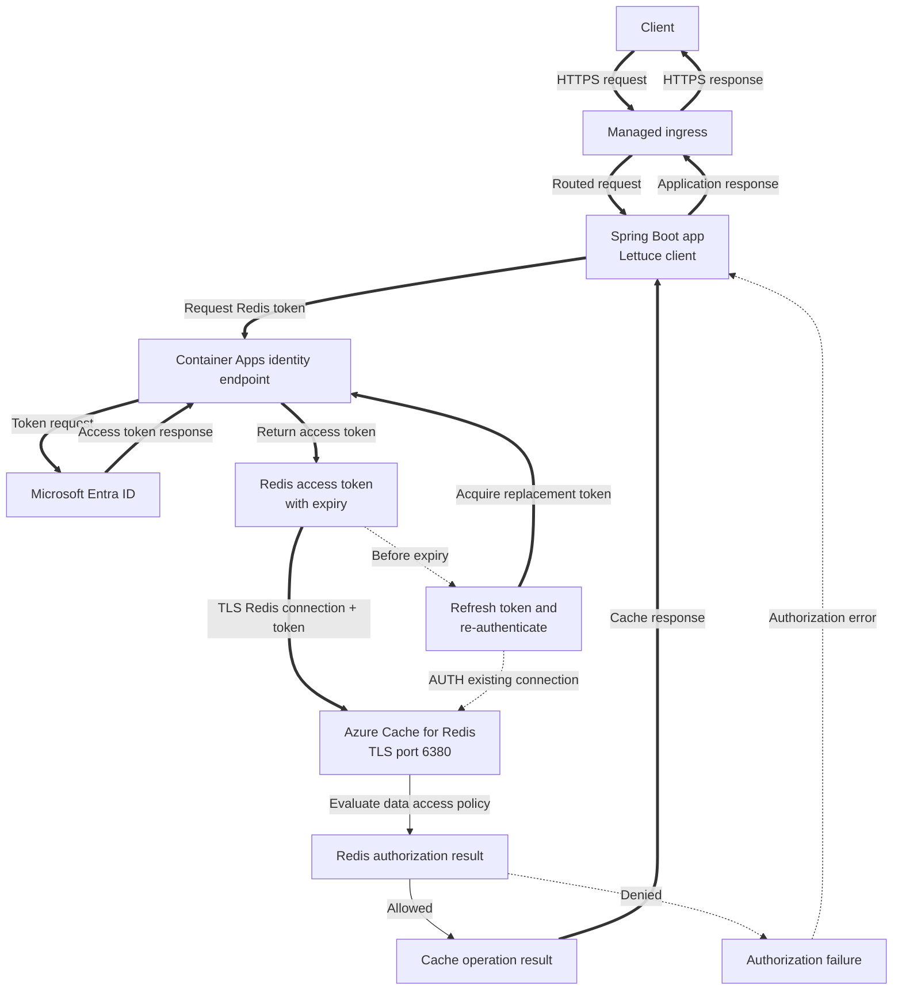

---
content_sources:
  diagrams:
    - id: architecture
      type: flowchart
      source: mslearn-adapted
      based_on:
        - https://learn.microsoft.com/en-us/azure/azure-cache-for-redis/cache-azure-active-directory-for-authentication
        - https://learn.microsoft.com/en-us/azure/redis/java-get-started
        - https://learn.microsoft.com/en-us/azure/container-apps/managed-identity
---
# Azure Cache for Redis Integration (Microsoft Entra Authentication)

Use this recipe to connect Azure Container Apps to Azure Cache for Redis with Microsoft Entra authentication first and access keys only as a fallback.

## Architecture

<!-- diagram-id: architecture -->


*Figure: The Lettuce client keeps token acquisition, TLS transport on port `6380`, cache authorization, and token refresh as separate concerns. Long-lived clients must refresh Microsoft Entra tokens before expiry and send `AUTH` on the existing connection. Reconnect only when the library cannot re-authenticate in place or the connection drops.*

## Prerequisites

- Existing Container App: `$APP_NAME` in `$RG`
- Existing Azure Cache for Redis instance with Microsoft Entra authentication enabled
- TLS access enabled on port `6380`

## Step 1: Enable managed identity on the Container App

```bash
az containerapp identity assign \
  --name "$APP_NAME" \
  --resource-group "$RG" \
  --system-assigned

export PRINCIPAL_ID=$(az containerapp show \
  --name "$APP_NAME" \
  --resource-group "$RG" \
  --query "identity.principalId" \
  --output tsv)
```

| Command | Why it is used |
|---|---|
| `az containerapp identity assign ...` | Assigns or inspects managed identity configuration for the Container App. |

## Step 2: Assign Redis data access

```bash
az redis access-policy-assignment create \
  --name "$REDIS_NAME" \
  --resource-group "$RG" \
  --access-policy-name "Data Owner" \
  --policy-assignment-name "$APP_NAME-data-owner" \
  --object-id "$PRINCIPAL_ID" \
  --object-id-alias "$APP_NAME"
```

| Command | Why it is used |
|---|---|
| `az redis access-policy-assignment ...` | Creates or inspects Azure Cache for Redis resources used by the sample app. |
| `--policy-assignment-name` | Names this app's Redis access-policy assignment `$APP_NAME-data-owner`. |

## Step 3: Configure non-secret Redis settings

```bash
az containerapp update \
  --name "$APP_NAME" \
  --resource-group "$RG" \
  --set-env-vars REDIS_HOST="$REDIS_NAME.redis.cache.windows.net" REDIS_PORT="6380" REDIS_USERNAME="$PRINCIPAL_ID"
```

| Command | Why it is used |
|---|---|
| `az containerapp update ...` | Updates the existing Container App configuration without recreating the app. |

## Step 4: Java code (Microsoft Entra token authentication)

Add dependencies:

```xml
<dependency>
  <groupId>com.azure</groupId>
  <artifactId>azure-identity</artifactId>
</dependency>
<dependency>
  <groupId>io.lettuce</groupId>
  <artifactId>lettuce-core</artifactId>
</dependency>
```

Use `DefaultAzureCredential` to fetch the Redis access token:

```java
import com.azure.core.credential.AccessToken;
import com.azure.core.credential.TokenRequestContext;
import com.azure.identity.DefaultAzureCredentialBuilder;
import io.lettuce.core.RedisClient;
import io.lettuce.core.RedisURI;
import io.lettuce.core.api.StatefulRedisConnection;

public class RedisRecipe {
    public static void main(String[] args) {
        String host = System.getenv("REDIS_HOST");
        int port = Integer.parseInt(System.getenv().getOrDefault("REDIS_PORT", "6380"));

        String password = System.getenv("REDIS_ACCESS_KEY");
        if (password == null || password.isBlank()) {
            AccessToken token = new DefaultAzureCredentialBuilder()
                .build()
                .getToken(new TokenRequestContext().addScopes("https://redis.azure.com/.default"))
                .block();
            password = token.getToken();
        }

        RedisURI redisUri = RedisURI.builder()
            .withHost(host)
            .withPort(port)
            .withSsl(true)
            .withAuthentication(System.getenv("REDIS_USERNAME"), password)
            .build();

        try (RedisClient client = RedisClient.create(redisUri);
             StatefulRedisConnection<String, String> connection = client.connect()) {
            connection.sync().setex("health", 60, "ok");
            System.out.println(connection.sync().get("health"));
        }
    }
}
```

!!! warning
    The Entra token used for Redis expires. For long-lived connections, refresh the token before expiry and send `AUTH` on the existing connection. Reconnect only when the client library cannot re-authenticate in place or the connection drops.

## Step 5: Access key fallback

```bash
az containerapp secret set \
  --name "$APP_NAME" \
  --resource-group "$RG" \
  --secrets redis-access-key="<redis-primary-key>"

az containerapp update \
  --name "$APP_NAME" \
  --resource-group "$RG" \
  --set-env-vars REDIS_HOST="$REDIS_NAME.redis.cache.windows.net" REDIS_PORT="6380" REDIS_ACCESS_KEY=secretref:redis-access-key REDIS_USERNAME="default"
```

| Command | Why it is used |
|---|---|
| `az containerapp secret set ...` | Manages Container Apps secrets without exposing secret values in plain configuration. |

## Verification

1. Confirm the access policy assignment exists.
2. Confirm application logs show successful Redis `SETEX` and `GET` operations.
3. Confirm clients are using TLS on port `6380`.

## See Also

- [Managed Identity](managed-identity.md)
- [Private Endpoints](../../../platform/networking/private-endpoints.md)
- [Networking](../../../platform/networking/vnet-integration.md)

## Sources

- [Use Microsoft Entra for cache authentication](https://learn.microsoft.com/en-us/azure/azure-cache-for-redis/cache-azure-active-directory-for-authentication)
- [Use Azure Cache for Redis with Java](https://learn.microsoft.com/en-us/azure/redis/java-get-started)
- [Managed identities in Azure Container Apps](https://learn.microsoft.com/en-us/azure/container-apps/managed-identity)
