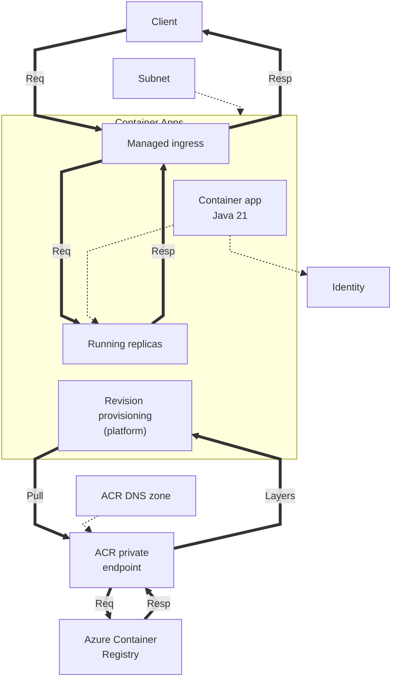
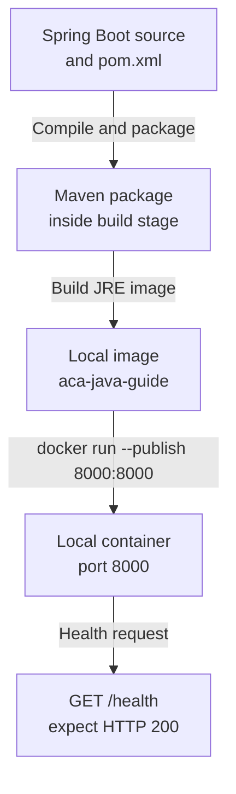

---
content_sources:
  diagrams:
    - id: this-tutorial-assumes-a-production-ready-container
      type: flowchart
      source: mslearn-adapted
      based_on:
        - https://learn.microsoft.com/en-us/azure/container-apps/networking
        - https://learn.microsoft.com/en-us/azure/container-apps/managed-identity-image-pull
        - https://learn.microsoft.com/en-us/azure/container-registry/container-registry-private-endpoints
    - id: local-development-workflow
      type: flowchart
      source: mslearn-adapted
      based_on:
        - https://learn.microsoft.com/en-us/azure/container-apps/containers#configuration
validation:
  az_cli:
    last_tested:
    cli_version:
    result: not_tested
  bicep:
    last_tested:
    result: not_tested
---
# 01 - Run Locally with Docker

Before deploying to Azure Container Apps, validate your Java app in a container locally. This catches image, dependency, and port issues early.

!!! info "Infrastructure Context"
    **Service**: Container Apps (Consumption) | **Network**: VNet integrated | **VNet**: ✅

    This tutorial assumes a production-ready Container Apps deployment with a custom VNet, managed identity image pull, and a private endpoint for ACR.

    <!-- diagram-id: this-tutorial-assumes-a-production-ready-container -->


*Figure: The infrastructure subnet integrates with the environment, the identity is assigned to the container app, and platform revision provisioning exchanges image requests and layer responses with ACR through its private endpoint.*

## Local Development Workflow

<!-- diagram-id: local-development-workflow -->


*Figure: Package Spring Boot with Maven in the Docker build, run the resulting Java image locally, and verify `/health` before continuing.*

## Prerequisites

- Docker Engine or Docker Desktop
- Source code with a `pom.xml` and `Dockerfile`
- JDK 21 and Maven (optional, if building without Docker)

!!! tip "Aim for local-cloud parity"
    Keep local container port mapping and environment variable names aligned with your Azure deployment settings. This reduces revision failures caused by mismatched runtime assumptions.

## Step-by-step

1. **Build the container image**

    The reference application uses a multi-stage Dockerfile that builds the application using Maven before creating the final JRE-based image.

    ```bash
    cd apps/java-springboot
    docker build --tag aca-java-guide .
    ```

    ???+ example "Expected output"
        ```text
        [+] Building 42.5s (12/12) FINISHED
         => [internal] load build definition from Dockerfile
         => [internal] load .dockerignore
         => [build 1/5] FROM docker.io/library/maven:3.9-eclipse-temurin-21@sha256:xxx
         => [build 2/5] WORKDIR /app
         => [build 3/5] COPY pom.xml .
         => [build 4/5] RUN mvn dependency:go-offline -B
         => [build 5/5] COPY src ./src
         => [build 6/6] RUN mvn package -DskipTests -B
         => [stage-1 1/3] FROM docker.io/library/eclipse-temurin:21-jre-alpine@sha256:xxx
         => [stage-1 2/3] WORKDIR /app
         => [stage-1 3/3] COPY --from=build /app/target/*.jar app.jar
         => exporting to image
         => naming to docker.io/library/aca-java-guide
        ```

2. **Run the container locally**

    ```bash
    docker run --publish 8000:8000 --name java-guide aca-java-guide
    ```

    ???+ example "Expected output"
        ```text
          .   ____          _            __ _ _
         /\\ / ___'_ __ _ _(_)_ __  __ _ \ \ \ \
        ( ( )\___ | '_ | '_| | '_ \/ _` | \ \ \ \
         \\/  ___)| |_)| | | | | || (_| |  ) ) ) )
          '  |____| .__|_| |_|_| |_\__, | / / / /
         =========|_|==============|___/=/_/_/_/
         :: Spring Boot ::                (v3.2.4)

        2026-04-04T16:12:50.123Z  INFO 1 --- [           main] com.example.demo.DemoApplication        : Starting DemoApplication v1.0.0 using Java 21.0.10
        2026-04-04T16:12:54.456Z  INFO 1 --- [           main] o.s.b.w.embedded.tomcat.TomcatWebServer  : Tomcat initialized with port 8000 (http)
        2026-04-04T16:12:58.789Z  INFO 1 --- [           main] com.example.demo.DemoApplication        : Started DemoApplication in 8.67 seconds (process running for 9.12)
        ```

3. **Verify health endpoint**

    Spring Boot applications typically use Actuator for health monitoring. In the reference app, a custom endpoint is provided at `/health`.

    ```bash
    curl http://localhost:8000/health
    ```

    ???+ example "Expected output"
        ```json
        {"status":"healthy","timestamp":"2026-04-04T16:12:58.973766483Z"}
        ```

    You can also verify runtime metadata:

    ```bash
    curl http://localhost:8000/info
    ```

    ???+ example "Expected output"
        ```json
        {"runtime":{"vendor":"Eclipse Adoptium","java":"21.0.10"},"app":"azure-container-apps-java-guide","version":"1.0.0"}
        ```

4. **Inspect application logs**

    ```bash
    docker logs java-guide
    ```

    To find all containers: `docker ps -a`

## Local parity checklist

- Application listens on port `8000` (matches `EXPOSE 8000` in Dockerfile)
- Required environment variables are present (if any)
- `/health` returns HTTP 200
- No startup exceptions (e.g., `BeanCreationException`, `ApplicationContextException`) in container logs

!!! warning "Do not commit local secret files"
    If you create a local `.env` file for testing, keep sensitive values out of source control and use placeholder values in shared examples.

## Advanced Topics

- **Actuator Health**: Configure `management.endpoint.health.show-details=always` for more detailed local health diagnostics.
- **Remote Debugging**: Attach your IDE to the local container using JVM debug flags (`-agentlib:jdwp=transport=dt_socket,server=y,suspend=n,address=*:5005`).
- **Memory Limits**: Test how the JVM responds to container memory limits by adding `--memory="512m"` to `docker run`.

## Review Matrix

| Review area | Page-specific check |
|---|---|
| Scope | Confirm the guidance applies to 01 - Run Locally with Docker. |
| Source basis | Validate the recommendation against the Microsoft Learn sources in this page. |
| Evidence | Capture command output, portal state, metrics, logs, or screenshots before treating the result as proven. |

## See Also
- [02 - First Deploy to Azure Container Apps](02-first-deploy.md)
- [03 - Configuration and Secrets](03-configuration.md)
- [Java Runtime Reference](../java-runtime.md)

## Sources

- [Azure Container Apps networking](https://learn.microsoft.com/en-us/azure/container-apps/networking)
- [Managed identity image pull](https://learn.microsoft.com/en-us/azure/container-apps/managed-identity-image-pull)
- [Private endpoints for Azure Container Registry](https://learn.microsoft.com/en-us/azure/container-registry/container-registry-private-endpoints)
- [Spring Boot with Docker](https://spring.io/guides/topicals/spring-boot-docker/)
- [Eclipse Temurin Documentation](https://adoptium.net/docs/)
- [Dockerfile requirements for Azure Container Apps (Microsoft Learn)](https://learn.microsoft.com/en-us/azure/container-apps/containers#configuration)
