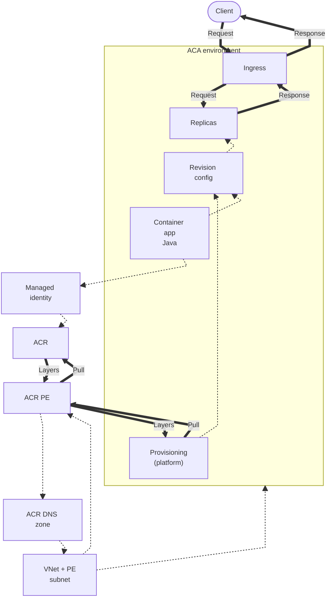
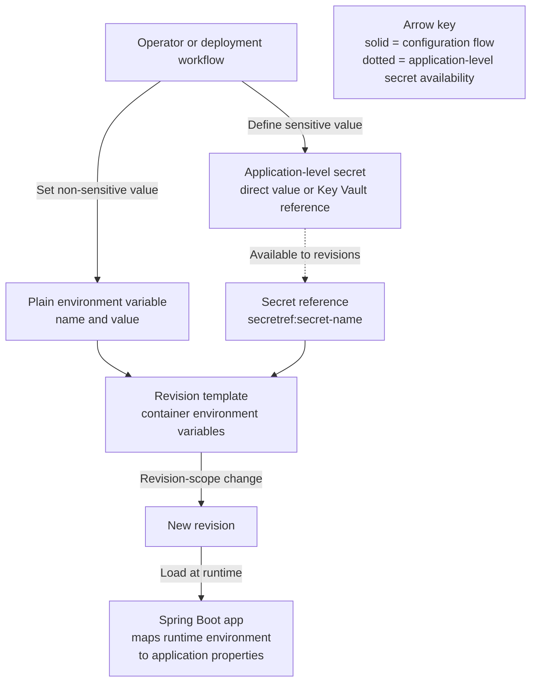

---
content_sources:
  diagrams:
    - id: this-tutorial-assumes-a-production-ready-container
      type: flowchart
      source: mslearn-adapted
      based_on:
        - https://learn.microsoft.com/en-us/azure/container-apps/networking
        - https://learn.microsoft.com/en-us/azure/container-apps/managed-identity-image-pull
        - https://learn.microsoft.com/en-us/azure/container-registry/container-registry-private-link
    - id: configuration-workflow
      type: flowchart
      source: mslearn-adapted
      based_on:
        - https://learn.microsoft.com/en-us/azure/container-apps/environment-variables
        - https://learn.microsoft.com/en-us/azure/container-apps/manage-secrets
validation:
  az_cli:
    last_tested:
    cli_version:
    result: not_tested
  bicep:
    last_tested:
    result: not_tested
---
# 03 - Configuration and Secrets

Spring Boot applications on Azure Container Apps use environment variables, secrets, and Azure Key Vault for flexible, secure configuration management. This guide covers the essential patterns for configuring your Java application in production.

!!! info "Infrastructure Context"
    **Service**: Container Apps (Consumption) | **Network**: VNet integrated | **VNet**: ✅

    This tutorial assumes a production-ready Container Apps deployment with a custom VNet and private ACR access using managed identity.

    <!-- diagram-id: this-tutorial-assumes-a-production-ready-container -->


*Figure: Client traffic crosses managed ingress to Java replicas. The customer VNet associates with the environment and ACR private endpoint and links the endpoint's private DNS zone. Managed identity is assigned to the app and authorizes registry pulls; platform provisioning sends pull requests and receives image layers through that endpoint.*

## Configuration Workflow

<!-- diagram-id: configuration-workflow -->


*Figure: Environment-variable changes are revision-scoped, while secrets are application-scoped. A secret becomes runtime configuration only when the revision template references it.*

## Prerequisites

- Existing Azure Container App (created in [02 - First Deploy](02-first-deploy.md))
- Azure CLI 2.57+

## Environment Variables

Spring Boot automatically maps environment variables to application properties using [relaxed binding](https://docs.spring.io/spring-boot/docs/current/reference/html/features.html#features.external-config.typesafe-configuration-properties.relaxed-binding).

### 1. Mapping Properties

| Application Property | Environment Variable |
| --- | --- |
| `spring.application.name` | `SPRING_APPLICATION_NAME` |
| `management.endpoint.health.show-details` | `MANAGEMENT_ENDPOINT_HEALTH_SHOW_DETAILS` |
| `logging.level.com.example` | `LOGGING_LEVEL_COM_EXAMPLE` |

### 2. Setting Environment Variables via CLI

Update your container app with new environment variables:

```bash
az containerapp update \
  --resource-group $RG \
  --name $APP_NAME \
  --set-env-vars "APP_VERSION=1.0.0" "RUNTIME_MODE=production"
```

| Command/Parameter | Purpose |
|---|---|
| `az containerapp update` | Creates a Java revision with version and production-mode variables. |
| `--resource-group` | Applies the runtime configuration inside the Java tutorial group. |
| `--name` | Selects the Spring Boot app receiving `APP_VERSION` and `RUNTIME_MODE`. |
| `--set-env-vars` | Sets version `1.0.0` and enables the `production` runtime mode. |

???+ example "Expected output"
    ```text
    Updating container app...
    (New revision created: <your-app-name>--xxxxxxx)
    ```

## Secrets Management

Container Apps Secrets are encrypted and stored at the application level. They are often mapped to environment variables or referenced from Azure Key Vault.

### 1. Add a Local Secret

```bash
az containerapp secret set \
  --resource-group $RG \
  --name $APP_NAME \
  --secrets "db-password=<secret-value>"
```

| Command/Parameter | Purpose |
|---|---|
| `az containerapp secret set` | Stores the datasource password with the Java Container App. |
| `--resource-group` | Finds the Spring Boot workload in `$RG`. |
| `--name` | Identifies the app that owns `db-password`. |
| `--secrets` | Writes the supplied password under the `db-password` key. |

### 2. Map Secret to Environment Variable

Once a secret is created, map it to an environment variable in your container:

```bash
az containerapp update \
  --resource-group $RG \
  --name $APP_NAME \
  --set-env-vars "SPRING_DATASOURCE_PASSWORD=secretref:db-password"
```

| Command/Parameter | Purpose |
|---|---|
| `az containerapp update` | Creates a revision that supplies the stored password to Spring Boot. |
| `--resource-group` | Scopes the datasource change to the resources in `$RG`. |
| `--name` | Chooses the Java app whose datasource property needs the secret. |
| `--set-env-vars` | Binds `SPRING_DATASOURCE_PASSWORD` to `secretref:db-password`. |

## Azure Key Vault Integration

For production, store your secrets in Azure Key Vault and reference them from Container Apps.

### 1. Create a Key Vault

```bash
KV_NAME="kv-java-$(date +%s)"
az keyvault create --resource-group $RG --name $KV_NAME --location $LOCATION
```

| Command/Parameter | Purpose |
|---|---|
| `az keyvault create` | Creates the Key Vault used for the Java application's external secret. |
| `--resource-group` | Creates the vault alongside the Java tutorial resources. |
| `--name` | Uses the timestamped `$KV_NAME` to avoid a global-name collision. |
| `--location` | Creates the Key Vault in the tutorial's selected Azure region. |

### 2. Configure Managed Identity

To access Key Vault securely, enable a System-Assigned Managed Identity for your Container App.

```bash
# Enable Managed Identity
az containerapp identity assign \
  --resource-group $RG \
  --name $APP_NAME \
  --system-assigned

# Grant Key Vault Secret User permissions
PRINCIPAL_ID=$(az containerapp identity show --resource-group $RG --name $APP_NAME --query "principalId" --output tsv)
az role assignment create \
  --role "Key Vault Secrets User" \
  --assignee $PRINCIPAL_ID \
  --scope /subscriptions/<subscription-id>/resourceGroups/$RG/providers/Microsoft.KeyVault/vaults/$KV_NAME
```

| Command/Parameter | Purpose |
|---|---|
| `az containerapp identity assign` | Enables a system-assigned managed identity on the Java Container App. |
| `az containerapp identity show` | Reads the app identity's principal ID for the Key Vault role assignment. |
| `az role assignment create` | Grants the app identity permission to read secrets from the tutorial Key Vault. |
| `--resource-group` | Locates the Spring Boot app whose identity needs Key Vault access. |
| `--name` | Selects `$APP_NAME` for both identity assignment and principal lookup. |
| `--system-assigned` | Enables the Container App's system-assigned managed identity. |
| `--query` | Extracts the identity's `principalId` for the following role assignment. |
| `--output` | Returns the principal ID as bare text for `PRINCIPAL_ID`. |
| `--role` | Grants the built-in `Key Vault Secrets User` role. |
| `--assignee` | Targets the Container App managed identity principal that receives access. |
| `--scope` | Limits the role assignment to the tutorial Key Vault resource. |

### 3. Reference Key Vault Secrets

```bash
# Add a secret to Key Vault
az keyvault secret set --vault-name $KV_NAME --name "db-password" --value "<secret-value>"

# Update ACA to reference Key Vault
az containerapp secret set \
  --resource-group $RG \
  --name $APP_NAME \
  --secrets "db-password=keyvaultref:https://$KV_NAME.vault.azure.net/secrets/db-password,identityref:system"
```

| Command/Parameter | Purpose |
|---|---|
| `az containerapp secret set` | Adds a Container Apps secret whose value is resolved from Key Vault. |
| `az keyvault secret set` | Stores the database password in the tutorial Key Vault. |
| `--vault-name` | Targets the Key Vault that stores the Java application's database password. |
| `--name` | Stores the Key Vault value under the secret name `db-password`. |
| `--value` | Supplies the database-password value to store in Key Vault. |
| `--resource-group` | Locates the Java app that will consume the vault-backed reference. |
| `--secrets` | Points the app-level `db-password` secret at the Key Vault secret URL and selects the system-assigned identity. |

## Best Practices for Java Apps

- **Spring Profiles**: Use `SPRING_PROFILES_ACTIVE` to switch between `dev`, `test`, and `prod` configurations.
- **Config Server**: Consider using Spring Cloud Config or Azure App Configuration for centralized configuration management in larger microservice architectures.
- **Property Precedence**: Spring Boot prioritizes environment variables over `application.properties` and `application.yml` files, which is ideal for cloud-native deployments.

!!! info "Relaxed Binding in Java"
    Spring Boot is very flexible with environment variable naming. Both `SPRING_DATASOURCE_URL` and `spring_datasource_url` will map to the `spring.datasource.url` property. Use ALL_CAPS with underscores for standard Docker and Azure compatibility.

## Verify configuration in Azure Portal

![ca-java-d38538 | Container App | Containers | Refresh | Send us your feedback | Container | Properties | Environment variables | Health probes | Volume mounts | Container details | Name | ca-java-d38538 | Image source | Azure Container Registry | Authentication | Managed identity | Subscription | Visual Studio Enterprise Subscription | Registry | acrbasicsd38538.azurecr.io | Image | java-sample | Image tag | v1 | Command override | Arguments override | Application | Revisions and replicas | Containers | Scale | Volumes | Settings | Networking | Ingress | Custom domains | CORS | Security | Monitoring | Log stream | Logs | Console | Alerts | Metrics](../../../assets/language-guides/java/tutorial/03-containers-blade.png)

**[Observed]** `ca-java-d38538`. `Container App`. `Containers`. `Refresh`. `Send us your feedback`. `Container`. `Properties`. `Environment variables`. `Health probes`. `Volume mounts`. `Container details`. `Name`. `ca-java-d38538`. `Image source`. `Azure Container Registry`. `Docker Hub or other registries`. `Authentication`. `Managed identity`. `Secrets`. `Identity`. `System assigned`. `Subscription`. `Visual Studio Enterprise Subscription`. `Registry`. `acrbasicsd38538.azurecr.io`. `Image`. `java-sample`. `Image tag`. `v1`. `Command override`. `Arguments override`. `Application`. `Revisions and replicas`. `Containers`. `Scale`. `Volumes`. `Settings`. `Networking`. `Ingress`. `Custom domains`. `CORS`. `Security`. `Monitoring`. `Log stream`. `Logs`. `Console`. `Alerts`. `Metrics`.

**[Inferred]** The `Environment variables` tab appears to map to the `--set-env-vars` lever exercised in [Setting Environment Variables via CLI](#2-setting-environment-variables-via-cli). The mapping between any rows on the `Environment variables` tab and Spring Boot property keys appears consistent with the relaxed-binding rules described in [Mapping Properties](#1-mapping-properties). The `Secrets` left-side entry appears related to the secret-to-environment-variable flow exercised in [Map Secret to Environment Variable](#2-map-secret-to-environment-variable). The `Authentication` value `Managed identity` appears consistent with the managed-identity configuration in [Configure Managed Identity](#2-configure-managed-identity).

**[Not Proven]** Additional configuration detail and runtime parameter detail are not visible on this view.

## See Also
- [Java Runtime Reference](../java-runtime.md)
- [02 - First Deploy to Azure](02-first-deploy.md)
- [Key Vault integration (Microsoft Learn)](https://learn.microsoft.com/en-us/azure/container-apps/manage-secrets?tabs=azure-cli#key-vault-references)

## Sources
- [Networking in an Azure Container Apps environment (Microsoft Learn)](https://learn.microsoft.com/en-us/azure/container-apps/networking)
- [Azure Container Apps image pull from ACR with managed identity (Microsoft Learn)](https://learn.microsoft.com/en-us/azure/container-apps/managed-identity-image-pull)
- [Azure Container Registry private link (Microsoft Learn)](https://learn.microsoft.com/en-us/azure/container-registry/container-registry-private-link)
- [Manage environment variables on Azure Container Apps (Microsoft Learn)](https://learn.microsoft.com/en-us/azure/container-apps/environment-variables)
- [Externalized Configuration (Spring Boot Documentation)](https://docs.spring.io/spring-boot/docs/current/reference/html/features.html#features.external-config)
- [Azure Container Apps Secrets (Microsoft Learn)](https://learn.microsoft.com/en-us/azure/container-apps/manage-secrets)
