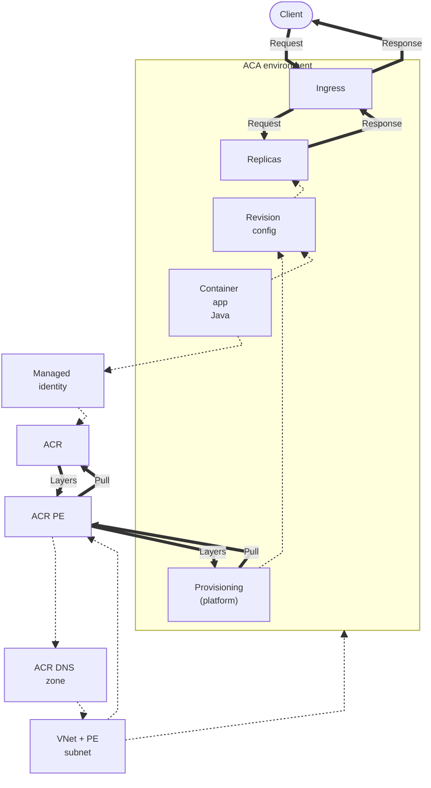
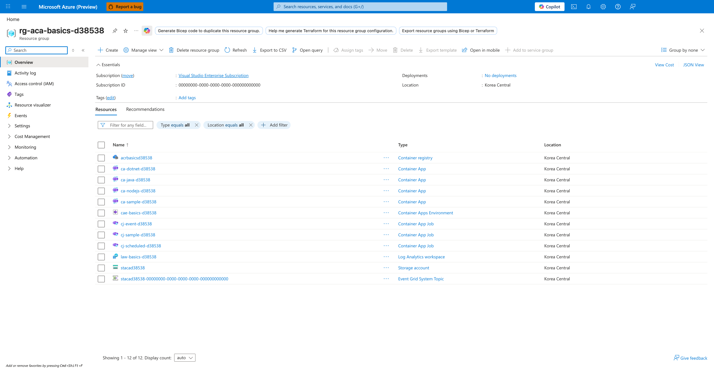

---
content_sources:
  diagrams:
    - id: this-tutorial-assumes-a-production-ready-container
      type: flowchart
      source: mslearn-adapted
      based_on:
        - https://learn.microsoft.com/en-us/azure/container-apps/networking
        - https://learn.microsoft.com/en-us/azure/container-apps/managed-identity-image-pull
        - https://learn.microsoft.com/en-us/azure/container-registry/container-registry-private-link
        - https://learn.microsoft.com/en-us/azure/container-apps/azure-resource-manager-api-spec
    - id: iac-workflow
      type: flowchart
      source: mslearn-adapted
      based_on:
        - https://learn.microsoft.com/en-us/azure/container-apps/azure-resource-manager-api-spec
        - https://learn.microsoft.com/en-us/azure/templates/microsoft.app/containerapps
validation:
  az_cli:
    last_tested:
    cli_version:
    result: not_tested
  bicep:
    last_tested:
    result: not_tested
---
# 05 - Infrastructure as Code

Azure Bicep provides a declarative way to define and manage your Azure Container Apps resources. This guide covers how to define your Spring Boot environment, registry, and application using Bicep templates.

!!! info "Infrastructure Context"
    **Service**: Container Apps (Consumption) | **Network**: VNet integrated | **VNet**: ✅

    This tutorial assumes a production-ready Container Apps deployment with a custom VNet and private ACR access using managed identity.

    <!-- diagram-id: this-tutorial-assumes-a-production-ready-container -->


*Figure: The customer VNet and private-endpoint subnet host the ACR private endpoint and link its DNS zone. Managed identity is assigned to the app and authorizes registry pulls through a role assignment; platform provisioning remains the image-pull actor, and both pull requests and layer responses pass through the private endpoint.*

## IaC Workflow

```mermaid
flowchart TD
    accTitle: Safe Bicep deployment lifecycle for the Java tutorial
    accDescr: Author the template, validate it, inspect the what-if result, deploy only after review, and verify deployment outputs. A failed check returns to template authoring.
    WRITE["Author Bicep template"]
    VALIDATE["Validate template"]
    VALID@{ shape: diam, label: "Validation succeeded?" }
    WHATIF["Review what-if changes"]
    APPROVE@{ shape: diam, label: "Changes expected?" }
    DEPLOY["Deploy resource-group template"]
    VERIFY["Verify deployment outputs"]
    WRITE --> VALIDATE --> VALID
    VALID -->|"Yes"| WHATIF --> APPROVE
    VALID -->|"No"| WRITE
    APPROVE -->|"Yes"| DEPLOY --> VERIFY
    APPROVE -->|"No"| WRITE
```

<!-- diagram-id: iac-workflow -->


*Figure: Validation and what-if are explicit gates before deployment; either failed validation or an unexpected change set returns the workflow to the template.*

## Prerequisites

- Existing Azure Subscription
- Azure CLI 2.57+
- Bicep CLI (included in Azure CLI)

## Defining the Container App Environment

The environment provides the networking and logging boundary for your container apps.

```bicep
// Container Apps Environment with Log Analytics
resource logAnalyticsWorkspace 'Microsoft.OperationalInsights/workspaces@2022-10-01' = {
  name: 'law-${baseName}'
  location: location
  properties: {
    sku: { name: 'PerGB2018' }
    retentionInDays: 30
  }
}

resource environment 'Microsoft.App/managedEnvironments@2023-05-01' = {
  name: 'cae-${baseName}'
  location: location
  properties: {
    appLogsConfiguration: {
      destination: 'log-analytics'
      logAnalyticsConfiguration: {
        customerId: logAnalyticsWorkspace.properties.customerId
        sharedKey: logAnalyticsWorkspace.listKeys().primarySharedKey
      }
    }
  }
}
```

## Defining the Spring Boot Container App

Configure the container app with appropriate CPU, memory, and port settings for a Java application.

```bicep
// Container App for Spring Boot
resource containerApp 'Microsoft.App/containerApps@2023-05-01' = {
  name: 'ca-${baseName}'
  location: location
  identity: {
    type: 'SystemAssigned'
  }
  properties: {
    managedEnvironmentId: environment.id
    configuration: {
      ingress: {
        external: true
        targetPort: 8000
      }
      secrets: [
        {
          name: 'db-password'
          value: dbPassword
        }
      ]
    }
    template: {
      containers: [
        {
          name: 'java-app'
          image: '${acrName}.azurecr.io/java-guide:latest'
          resources: {
            cpu: json('0.5')
            memory: '1.0Gi'
          }
          env: [
            {
              name: 'SPRING_PROFILES_ACTIVE'
              value: 'prod'
            }
            {
              name: 'DB_PASSWORD'
              secretRef: 'db-password'
            }
          ]
          probes: [
            {
              type: 'Liveness'
              httpGet: {
                path: '/health'
                port: 8000
              }
            }
            {
              type: 'Readiness'
              httpGet: {
                path: '/health'
                port: 8000
              }
            }
          ]
        }
      ]
    }
  }
}
```

## Deploying with the Azure CLI

1. **Create a Bicep template file**

    Create a `main.bicep` file with the environment and container app resources defined above, or use the shared `infra/main.bicep` template in this repository as a reference.

2. **Validate the deployment**

    ```bash
    az deployment group validate \
      --resource-group $RG \
      --template-file infra/main.bicep \
      --parameters baseName="java-guide"
    ```

    | Command | Why it is used |
    |---|---|
    | `az deployment group validate ...` | Runs the Azure CLI operation required by the documented step. |

3. **Deploy the infrastructure**

    ```bash
    az deployment group create \
      --resource-group $RG \
      --template-file infra/main.bicep \
      --parameters baseName="java-guide"
    ```

    | Command | Why it is used |
    |---|---|
    | `az deployment group create ...` | Deploys the Bicep or ARM template into the target resource group. |

???+ example "Expected output"
    ```text
    Starting deployment...
    (Resources being created: ACR, Workspace, Environment, Container App)
    Deployment Name: main-2026-04-05
    State: Succeeded
    ```

## Infrastructure Checklist

- [x] Azure Container Apps Environment is defined with Log Analytics
- [x] Container App specifies `targetPort: 8000`
- [x] Liveness and readiness probes point to `/health`
- [x] System-assigned managed identity is enabled for Key Vault or ACR access
- [x] Parameters are used for environment-specific values (e.g., SKU, region)

!!! tip "Use what-if to preview changes"
    Before deploying updates, use `az deployment group what-if` to see exactly what resources will be created, modified, or deleted without actually making the changes.

## CLI Alternative (No Bicep)

Use these commands when you need an imperative deployment path without Bicep.

### Step 1: Set variables

```bash
RG="rg-springboot-containerapp"
LOCATION="koreacentral"
APP_NAME="ca-springboot-demo"
BASE_NAME="springboot-app"
ACA_ENV_NAME="cae-springboot-demo"
ACR_NAME="crspringbootdemo"
LOG_NAME="log-springboot-demo"
```

???+ example "Expected output"
    ```text
    Variables exported for resource group, workspace, registry, environment, and app.
    ```

### Step 2: Create resource group and Log Analytics workspace

```bash
az group create --name $RG --location $LOCATION
az monitor log-analytics workspace create --resource-group $RG --workspace-name $LOG_NAME --location $LOCATION
```

| Command | Why it is used |
|---|---|
| `az group create ...` | Creates the isolated resource group used by the example. |

???+ example "Expected output"
    ```text
    {
      "name": "rg-springboot-containerapp",
      "properties": {
        "provisioningState": "Succeeded"
      }
    }
    {
      "name": "log-springboot-demo",
      "customerId": "a1b2c3d4-e5f6-7890-abcd-ef1234567890",
      "id": "/subscriptions/<subscription-id>/resourceGroups/rg-springboot-containerapp/providers/Microsoft.OperationalInsights/workspaces/log-springboot-demo"
    }
    ```

### Step 3: Create ACR and Container Apps environment

```bash
az acr create --resource-group $RG --name $ACR_NAME --sku Basic
LOG_ID=$(az monitor log-analytics workspace show --resource-group $RG --workspace-name $LOG_NAME --query customerId --output tsv)
LOG_KEY=$(az monitor log-analytics workspace get-shared-keys --resource-group $RG --workspace-name $LOG_NAME --query primarySharedKey --output tsv)
az containerapp env create --resource-group $RG --name $ACA_ENV_NAME --location $LOCATION --logs-workspace-id $LOG_ID --logs-workspace-key $LOG_KEY
```

| Command | Why it is used |
|---|---|
| `az acr create --resource-group ...` | Creates Azure Container Registry for container image storage. |

???+ example "Expected output"
    ```text
    {
      "name": "crspringbootdemo",
      "loginServer": "crspringbootdemo.azurecr.io",
      "provisioningState": "Succeeded"
    }
    {
      "name": "cae-springboot-demo",
      "id": "/subscriptions/<subscription-id>/resourceGroups/rg-springboot-containerapp/providers/Microsoft.App/managedEnvironments/cae-springboot-demo",
      "provisioningState": "Succeeded"
    }
    ```

### Step 4: Create Container App with environment variables

```bash
az containerapp create --resource-group $RG --name $APP_NAME --environment $ACA_ENV_NAME --image $ACR_NAME.azurecr.io/$BASE_NAME:v1 --target-port 8000 --ingress external --env-vars SPRING_PROFILES_ACTIVE=prod --query "properties.configuration.ingress.fqdn"
```

| Command | Why it is used |
|---|---|
| `az containerapp create --resource-group ...` | Creates the Container App with the documented image, ingress, scale, and environment settings. |

???+ example "Expected output"
    ```text
    "<container-app-fqdn>"
    ```

### Step 5: Validate configuration

```bash
az containerapp show --resource-group $RG --name $APP_NAME --query "{fqdn:properties.configuration.ingress.fqdn,targetPort:properties.configuration.ingress.targetPort,environmentVariables:properties.template.containers[0].env}"
```

| Command | Why it is used |
|---|---|
| `az containerapp show --resource-group ...` | Reads the Container App configuration so the documented setting can be verified. |

???+ example "Expected output"
    ```json
    {
      "environmentVariables": [
        {
          "name": "SPRING_PROFILES_ACTIVE",
          "value": "prod"
        }
      ],
      "fqdn": "<container-app-fqdn>",
      "targetPort": 8000
    }
    ```

### Verify resource group in Azure Portal



**[Observed]** `Microsoft Azure (Preview)`. `Report a bug`. `Search resources, services, and docs (G+/)`. `Copilot`. `Home`. `rg-aca-basics-d38538`. `Resource group`. `Generate Bicep code to duplicate this resource group.`. `Help me generate Terraform for this resource group configuration.`. `Export resource groups using Bicep or Terraform`. `Create`. `Manage view`. `Delete resource group`. `Refresh`. `Export to CSV`. `Open query`. `Assign tags`. `Move`. `Delete`. `Export template`. `Open in mobile`. `Add to service group`. `Group by none`. `Essentials`. `Subscription (move)`. `Visual Studio Enterprise Subscription`. `Subscription ID`. `00000000-0000-0000-0000-000000000000`. `Tags (edit)`. `Add tags`. `Deployments`. `No deployments`. `Location`. `Korea Central`. `View Cost`. `JSON View`. `Resources`. `Recommendations`. `Filter for any field...`. `Type equals all`. `Location equals all`. `Add filter`. `Name`. `Type`. `acrbasicsd38538`. `Container registry`. `ca-dotnet-d38538`. `Container App`. `ca-java-d38538`. `ca-nodejs-d38538`. `ca-sample-d38538`. `cae-basics-d38538`. `Container Apps Environment`. `cj-event-d38538`. `Container App Job`. `cj-sample-d38538`. `cj-scheduled-d38538`. `law-basics-d38538`. `Log Analytics workspace`. `stacad38538`. `Storage account`. `stacad38538-00000000-0000-0000-0000-000000000000`. `Event Grid System Topic`. `Overview`. `Activity log`. `Access control (IAM)`. `Tags`. `Resource visualizer`. `Events`. `Settings`. `Cost Management`. `Monitoring`. `Automation`. `Help`. `Showing 1 - 12 of 12`.

**[Inferred]** The `Container App` row `ca-java-d38538` appears consistent with the Spring Boot Container App resource declared in [Defining the Spring Boot Container App](#defining-the-spring-boot-container-app) and deployed by `az deployment group create` in [Deploying with the Azure CLI](#deploying-with-the-azure-cli). The `Container Apps Environment` row `cae-basics-d38538` appears consistent with the environment resource declared in [Defining the Container App Environment](#defining-the-container-app-environment). The `Container registry` row `acrbasicsd38538` appears consistent with the ACR resource provisioned by `az acr create` in [Step 3: Create ACR and Container Apps environment](#step-3-create-acr-and-container-apps-environment). The `Log Analytics workspace` row `law-basics-d38538` appears consistent with the workspace resource provisioned by `az monitor log-analytics workspace create` in [Step 2: Create resource group and Log Analytics workspace](#step-2-create-resource-group-and-log-analytics-workspace).

**[Not Proven]** Additional template body, deployment command, and deployment history detail are not visible on this view.

## See Also

- [06 - CI/CD with GitHub Actions](06-ci-cd.md)
- [Bicep Documentation (Microsoft Learn)](https://learn.microsoft.com/en-us/azure/azure-resource-manager/bicep/)

## Sources
- [Container Apps networking (Microsoft Learn)](https://learn.microsoft.com/en-us/azure/container-apps/networking)
- [Managed identity image pull (Microsoft Learn)](https://learn.microsoft.com/en-us/azure/container-apps/managed-identity-image-pull)
- [Azure Container Registry private link (Microsoft Learn)](https://learn.microsoft.com/en-us/azure/container-registry/container-registry-private-link)
- [Bicep template for Azure Container Apps (Microsoft Learn)](https://learn.microsoft.com/en-us/azure/container-apps/azure-resource-manager-api-spec)
- [Bicep resource reference (Microsoft Learn)](https://learn.microsoft.com/en-us/azure/templates/microsoft.app/containerapps)
