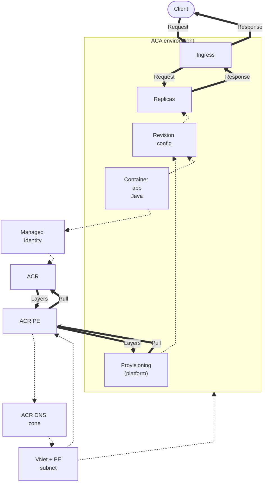
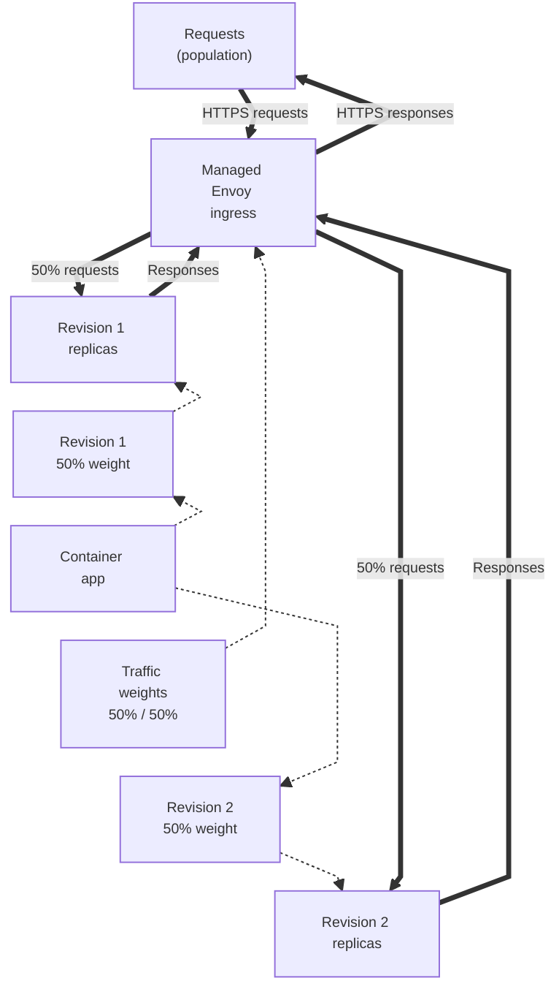

---
content_sources:
  diagrams:
    - id: this-tutorial-assumes-a-production-ready-container
      type: flowchart
      source: mslearn-adapted
      based_on:
        - https://learn.microsoft.com/en-us/azure/container-apps/networking
        - https://learn.microsoft.com/en-us/azure/container-apps/managed-identity-image-pull
        - https://learn.microsoft.com/en-us/azure/container-registry/container-registry-private-link
    - id: revision-workflow
      type: flowchart
      source: mslearn-adapted
      based_on:
        - https://learn.microsoft.com/en-us/azure/container-apps/traffic-splitting
        - https://learn.microsoft.com/en-us/azure/container-apps/revisions
validation:
  az_cli:
    last_tested:
    cli_version:
    result: not_tested
  bicep:
    last_tested:
    result: not_tested
---
# 07 - Revisions and Traffic

Azure Container Apps supports multiple revisions, allowing you to run multiple versions of your Spring Boot application simultaneously. This guide covers how to manage revisions and split traffic between them for zero-downtime releases and safe rollouts.

!!! info "Infrastructure Context"
    **Service**: Container Apps (Consumption) | **Network**: VNet integrated | **VNet**: ✅

    This tutorial assumes a production-ready Container Apps deployment with a custom VNet and private ACR access using managed identity.

    <!-- diagram-id: this-tutorial-assumes-a-production-ready-container -->


*Figure: The customer VNet and private-endpoint subnet host the ACR private endpoint and link its DNS zone. Managed identity is assigned to the app and authorizes registry pulls through a role assignment; platform provisioning remains the image-pull actor, and both pull requests and layer responses pass through the private endpoint.*

## Revision Workflow

<!-- diagram-id: revision-workflow -->


*Figure: Traffic weights configure managed ingress; ingress sends the population of requests directly to the two revision replica groups at 50% each, and each group returns responses through ingress.*

## Prerequisites

- Existing Azure Container App (created in [02 - First Deploy](02-first-deploy.md))
- Azure CLI 2.57+

## Revision Modes

By default, Container Apps are in `Single` revision mode, where only one revision is active at a time. To enable multiple revisions, switch to `Multiple` mode.

```bash
az containerapp revision set-mode \
  --resource-group $RG \
  --name $APP_NAME \
  --mode multiple
```

| Command | Why it is used |
|---|---|
| `az containerapp revision set-mode ...` | Runs the Azure CLI operation required by the documented step. |

???+ example "Expected output"
    ```text
    Setting multiple revision mode...
    Revision mode set successfully.
    ```

## Creating New Revisions

Every time you update the container image or configuration, a new revision is created.

```bash
az containerapp update \
  --resource-group $RG \
  --name $APP_NAME \
  --image $ACR_NAME.azurecr.io/java-guide:v2
```

| Command | Why it is used |
|---|---|
| `az containerapp update ...` | Updates the existing Container App configuration without recreating the app. |

???+ example "Expected output"
    ```text
    (New revision created: <your-app-name>--xxxxxxx)
    (New revision is now ACTIVE)
    ```

## Managing Traffic Splitting

When multiple revisions are active, you can split traffic between them by percentage or name.

### 1. Simple 50/50 Split

```bash
az containerapp ingress traffic set \
  --resource-group $RG \
  --name $APP_NAME \
  --revision-weight "$APP_NAME--0000001=50" "$APP_NAME--0000002=50"
```

| Command | Why it is used |
|---|---|
| `az containerapp ingress traffic set` | Applies the equal traffic distribution to the two named Java revisions. |
| `--resource-group` | Selects the resource group stored in `$RG`, where the tutorial app is deployed. |
| `--name` | Targets the Java container app stored in `$APP_NAME`. |
| `--revision-weight` | Assigns 50 percent of ingress traffic to each explicit revision name. |

???+ example "Expected output"
    ```text
    Traffic weight updated.
    Revision 1: 50%
    Revision 2: 50%
    ```

### 2. Full Rollout (100% to Latest)

```bash
az containerapp ingress traffic set \
  --resource-group $RG \
  --name $APP_NAME \
  --revision-weight "latest=100"
```

| Command | Why it is used |
|---|---|
| `az containerapp ingress traffic set` | Promotes the latest Java revision by replacing the current traffic weights. |
| `--resource-group` | Identifies the resource group containing the app being promoted. |
| `--name` | Chooses `$APP_NAME` as the container app whose ingress rule is updated. |
| `--revision-weight` | Sends 100 percent of traffic to the `latest` revision selector. |

### 3. Canary Deployment (10% to New)

```bash
az containerapp ingress traffic set \
  --resource-group $RG \
  --name $APP_NAME \
  --revision-weight "$APP_NAME--0000001=90" "$APP_NAME--0000002=10"
```

| Command | Why it is used |
|---|---|
| `az containerapp ingress traffic set` | Establishes the Java canary route used for the 90/10 rollout exercise. |
| `--resource-group` | Resolves the resource group in `$RG` for this canary update. |
| `--name` | Applies the split to the tutorial app named by `$APP_NAME`. |
| `--revision-weight` | Routes 90 percent to revision `0000001` and 10 percent to revision `0000002`. |

## Cleaning Up Old Revisions

Deactivate old revisions to save resources and keep your environment clean.

```bash
az containerapp revision deactivate \
  --resource-group $RG \
  --name $APP_NAME \
  --revision $APP_NAME--0000001
```

| Command | Why it is used |
|---|---|
| `az containerapp revision deactivate ...` | Runs the Azure CLI operation required by the documented step. |

## Revision Checklist

- [x] Revision mode is set to `Multiple`
- [x] Every deployment creates a unique revision name
- [x] Traffic weight sums up to 100%
- [x] New revisions are verified via their unique URL before receiving production traffic
- [x] Old revisions are deactivated after a successful rollout

!!! tip "Use unique labels for testing"
    Assign a label to a specific revision to test it independently of production traffic. Use `az containerapp ingress traffic set --label testing=$APP_NAME--xxxxxxx` and visit `https://testing---$APP_NAME.<random-suffix>.<region>.azurecontainerapps.io`.

## Verify revisions and traffic in Azure Portal


**[Observed]** `ca-java-d38538`. `Container App`. `Revisions and replicas`. `Create new revision`. `Save`. `Refresh`. `Deployment mode`. `Send us your feedback`. `Learn more`. `Active revisions`. `Inactive revisions`. `Replicas`. `Name`. `Date created`. `Running status`. `View Logs`. `Label`. `Traffic`. `ca-java-d38538--0000001`. `Running`. `View details`. `Show Logs`. `100`. `%`. `1`. `Show replicas`. `Application`. `Revisions and replicas`. `Containers`. `Scale`. `Volumes`. `Settings`. `Networking`. `Ingress`. `Custom domains`. `CORS`. `Security`. `Monitoring`. `Log stream`. `Logs`. `Console`. `Alerts`. `Metrics`.

**[Inferred]** The `Deployment mode` toolbar action appears to map to the same lever discussed in [Revision Modes](#revision-modes). The `Create new revision` toolbar action is consistent with the new-revision effect of `az containerapp update --image` documented in [Creating New Revisions](#creating-new-revisions). The `Active revisions` and `Inactive revisions` tabs are consistent with the `revision list` and `revision deactivate` operations in [Cleaning Up Old Revisions](#cleaning-up-old-revisions). The `Traffic` column value `100 %` for `ca-java-d38538--0000001` appears to map to the per-revision weight set by `az containerapp ingress traffic set --revision-weight` in [Managing Traffic Splitting](#managing-traffic-splitting).

**[Not Proven]** Additional revision detail and traffic-split detail are not visible on this view.

## See Also
- [06 - CI/CD with GitHub Actions](06-ci-cd.md)
- [02 - First Deploy to Azure](02-first-deploy.md)
- [Revision management (Microsoft Learn)](https://learn.microsoft.com/en-us/azure/container-apps/revisions)

## Sources
- [Container Apps networking (Microsoft Learn)](https://learn.microsoft.com/en-us/azure/container-apps/networking)
- [Managed identity image pull (Microsoft Learn)](https://learn.microsoft.com/en-us/azure/container-apps/managed-identity-image-pull)
- [Azure Container Registry private link (Microsoft Learn)](https://learn.microsoft.com/en-us/azure/container-registry/container-registry-private-link)
- [Traffic splitting in Azure Container Apps (Microsoft Learn)](https://learn.microsoft.com/en-us/azure/container-apps/traffic-splitting)
- [Revisions in Azure Container Apps (Microsoft Learn)](https://learn.microsoft.com/en-us/azure/container-apps/revisions)
