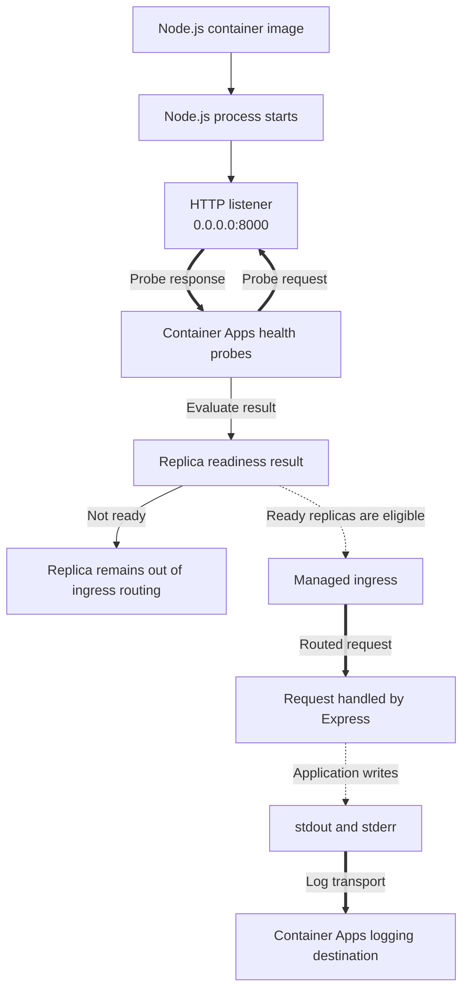

---
content_sources:
  diagrams:
    - id: runtime-execution-model
      type: flowchart
      source: mslearn-adapted
      based_on:
        - https://learn.microsoft.com/en-us/azure/container-apps/containers
        - https://learn.microsoft.com/en-us/azure/container-apps/connect-apps
---
# Node.js Runtime

This reference summarizes practical runtime defaults for Node.js workloads on Azure Container Apps so you can keep startup behavior, probe health, and logging predictable across revisions.

## Runtime Execution Model

<!-- diagram-id: runtime-execution-model -->


*Figure: Runtime startup, the probe request and listener response, readiness evaluation, request routing, and console-log collection are separate paths. The port and application process are repository defaults; configure ingress `targetPort` and probes to match them.*

!!! tip "Treat runtime settings as deployment contracts"
    Keep port binding, process model, and logging behavior stable between revisions. Changing all three at once makes incident triage much harder.

## Runtime Baseline (This Repo)

| Item | Value |
| --- | --- |
| Base image | `node:20-slim` |
| Web framework | Express |
| Process manager | Node.js (native) |
| Exposed/listen port | `8000` |
| Start command | `node src/app.js` |

## Node.js Memory Management

When running Node.js in containers, it's important to align the V8 heap size with the container memory limit.

| Setting | Example | When to change |
| --- | --- | --- |
| Max Heap Size | `--max-old-space-size=1536` | Set to ~75% of container memory (e.g., 1.5GB for 2GB container) |
| HTTP Keep-Alive | `server.keepAliveTimeout = 65000` | Increase to match or exceed Azure Ingress timeouts (60s) |
| Graceful Shutdown | `server.close()` | Ensure `SIGTERM` is handled to finish in-flight requests |

## Recommended Start Command Pattern

```bash
# In Dockerfile
CMD ["node", "--max-old-space-size=1536", "src/app.js"]
```

## Container Apps Alignment Checklist

| Check | Expected |
| --- | --- |
| Azure Container Apps `targetPort` | `8000` |
| Express bind | `0.0.0.0:8000` |
| Health endpoint | `GET /health` returns 200 |
| Logs | stdout/stderr JSON format |
| Secrets/config | Read from `process.env` |

## Quick Diagnostics

```bash
RG="rg-nodejs-guide"

# For CLI-deployed apps, set directly:
# APP_NAME="ca-nodejs-guide"

# For Bicep-deployed apps, capture from outputs:
DEPLOYMENT_NAME="main"
APP_NAME=$(az deployment group show \
  --name "$DEPLOYMENT_NAME" \
  --resource-group "$RG" \
  --query "properties.outputs.containerAppName.value" \
  --output tsv)

az containerapp logs show \
  --name "$APP_NAME" \
  --resource-group "$RG" \
  --type console --follow

az containerapp exec \
  --name "$APP_NAME" \
  --resource-group "$RG" \
  --command "/bin/sh"

# Inside container
node --version
npm list --depth=0
ps aux
```

| Command / Parameter | Purpose |
|---|---|
| `az deployment group show` | For Node.js runtime diagnostics, reads the resource-group deployment output used to locate the deployed Container App. |
| `--name` | For Node.js runtime diagnostics, selects `$DEPLOYMENT_NAME`, `$APP_NAME` as the named resource or extension operated on in this block. |
| `--output` | For Node.js runtime diagnostics, formats the requested values as `tsv` for shell assignment or readable verification. |
| `--query` | For Node.js runtime diagnostics, extracts `properties.outputs.containerAppName.value` from the command response for the next operation. |
| `--resource-group` | For Node.js runtime diagnostics, limits the operations in this block to resource group `$RG`. |
| `az containerapp logs show` | For Node.js runtime diagnostics, streams the Container App logs used to verify runtime behavior. |
| `--follow` | For Node.js runtime diagnostics, keeps the log stream open so new application messages appear during verification. |
| `--type` | For Node.js runtime diagnostics, selects the `console` Container Apps log stream. |
| `az containerapp exec` | For Node.js runtime diagnostics, opens a shell in the running Container App replica for in-container checks. |
| `--command` | For Node.js runtime diagnostics, runs `/bin/sh` inside the selected Container App replica. |

## Frequent Runtime Failures

| Symptom | Root cause | Action |
| --- | --- | --- |
| Container healthy locally, failing in Container Apps | Port/ingress mismatch | Align Express bind and Container Apps `targetPort` |
| Memory leaks or OOM kills | V8 heap exceeds container limit | Set `--max-old-space-size` and check for leaks |
| Requests dropped during rollout | Missing `SIGTERM` handler | Implement graceful shutdown in `src/app.js` |
| Missing logs in Log Analytics | Console output not captured | Ensure logs are written to stdout/stderr, not files |

!!! warning "Avoid hardcoding runtime assumptions"
    If your app assumes a fixed port, writable local filesystem, or shell-only startup dependencies, revisions may pass locally but fail in Container Apps. Validate behavior with environment-driven configuration and health probes.

## See Also

- [Node.js Language Guide Index](./index.md)
- [01 - Run Locally with Docker](./tutorial/01-local-development.md)
- [03 - Configuration, Secrets, and Dapr](./tutorial/03-configuration.md)
- [Container Design Best Practices](../../best-practices/container-design.md)

## Sources
- [Azure Container Apps containers reference (Microsoft Learn)](https://learn.microsoft.com/en-us/azure/container-apps/containers)
- [Connect to services in Azure Container Apps (Microsoft Learn)](https://learn.microsoft.com/en-us/azure/container-apps/connect-apps)
