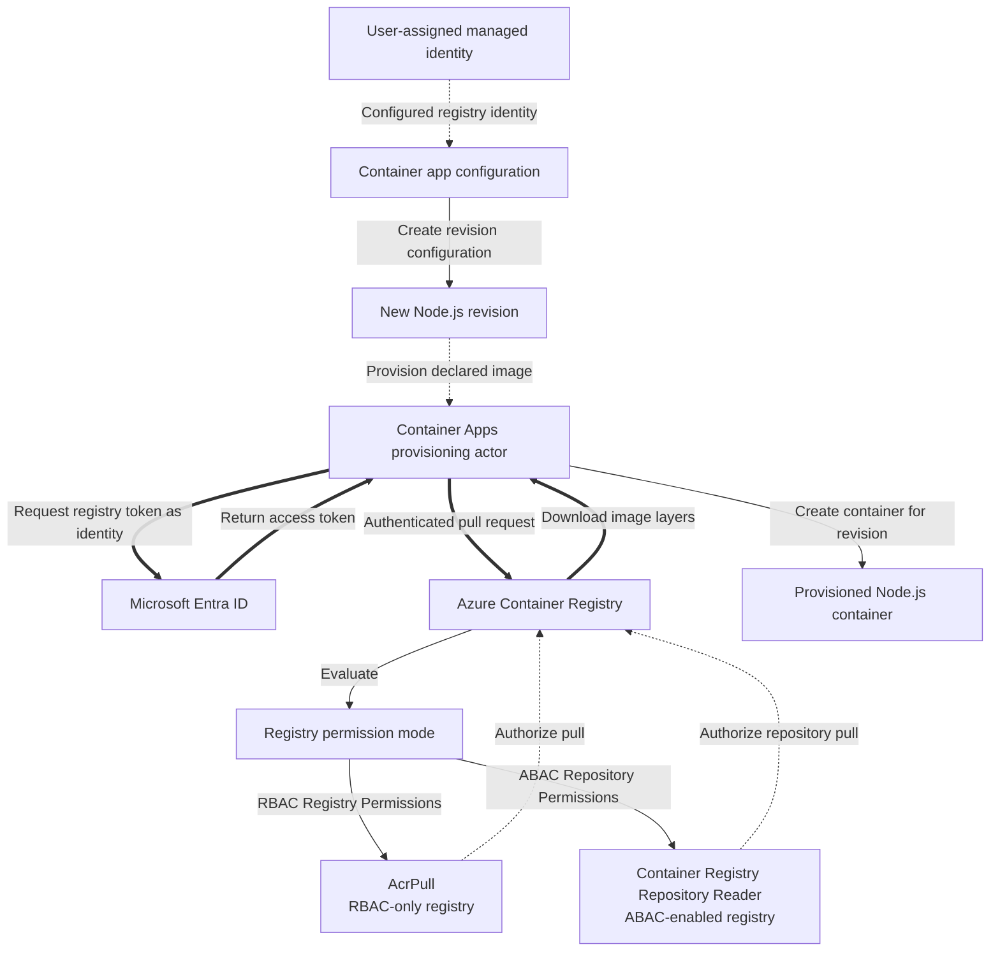

---
content_sources:
  diagrams:
    - id: use-azure-container-registry-acr-with
      type: flowchart
      source: mslearn-adapted
      based_on:
        - https://learn.microsoft.com/en-us/azure/container-apps/managed-identity-image-pull
        - https://learn.microsoft.com/en-us/azure/container-registry/container-registry-get-started-azure-cli
        - https://learn.microsoft.com/en-us/azure/container-registry/container-registry-rbac-abac-repository-permissions
---
# Recipe: Container Registry in Node.js Apps on Azure Container Apps

Use Azure Container Registry (ACR) with managed identity to pull private Node.js images securely into Azure Container Apps.

<!-- diagram-id: use-azure-container-registry-acr-with -->


*Figure: Identity selection, token acquisition, registry authorization, and image transport are distinct. `AcrPull` applies only to RBAC-only registries; ABAC-enabled registries require `Container Registry Repository Reader`, optionally with a repository condition.*

## Prerequisites

- Container Apps environment (`$ACA_ENV_NAME`) and app name (`$APP_NAME`)
- Resource group (`$RG`) and region (`$LOCATION`)
- ACR name (`$ACR_NAME`) and image tag (`$IMAGE_TAG`)
- Azure CLI with Container Apps extension and Docker

## Create registry and pull identity

```bash
az acr create \
  --name "$ACR_NAME" \
  --resource-group "$RG" \
  --location "$LOCATION" \
  --sku Standard

az identity create \
  --name "id-$APP_NAME" \
  --resource-group "$RG" \
  --location "$LOCATION"

export UAMI_ID=$(az identity show --name "id-$APP_NAME" --resource-group "$RG" --query id --output tsv)
export UAMI_PRINCIPAL_ID=$(az identity show --name "id-$APP_NAME" --resource-group "$RG" --query principalId --output tsv)
export ACR_ID=$(az acr show --name "$ACR_NAME" --resource-group "$RG" --query id --output tsv)
export ACR_ROLE_ASSIGNMENT_MODE=$(az acr show --name "$ACR_NAME" --resource-group "$RG" --query roleAssignmentMode --output tsv)

if [[ "$ACR_ROLE_ASSIGNMENT_MODE" == "AbacRepositoryPermissions" ]]; then
  az role assignment create \
    --assignee-object-id "$UAMI_PRINCIPAL_ID" \
    --assignee-principal-type ServicePrincipal \
    --role "Container Registry Repository Reader" \
    --scope "$ACR_ID"
else
  az role assignment create \
    --assignee-object-id "$UAMI_PRINCIPAL_ID" \
    --assignee-principal-type ServicePrincipal \
    --role "AcrPull" \
    --scope "$ACR_ID"
fi
```

| Command | Why it is used |
|---|---|
| `az acr create` | Creates registry `$ACR_NAME` for the Node.js image. |
| `az identity create` | Creates user-assigned identity `id-$APP_NAME` for image pulls. |
| `az identity show` | Reads that identity's resource ID and principal ID. |
| `az acr show` | Reads the registry resource ID and `roleAssignmentMode`. |
| `az role assignment create` | Grants the pull role selected by the registry permission mode. |
| `--name` | Names or selects `$ACR_NAME` and `id-$APP_NAME` in their owning commands. |
| `--resource-group` | Locates the registry and identity in `$RG`. |
| `--location` | Creates both resources in `$LOCATION`. |
| `--sku` | Uses the `Standard` registry tier. |
| `--query` | Extracts `id`, `principalId`, or `roleAssignmentMode` for later steps. |
| `--output` | Returns queried values as unquoted `tsv`. |
| `--assignee-object-id` | Assigns the registry role to `$UAMI_PRINCIPAL_ID`. |
| `--assignee-principal-type` | Declares the managed identity as a `ServicePrincipal`. |
| `--role` | Uses `AcrPull` for RBAC-only mode or `Container Registry Repository Reader` for ABAC mode. |
| `--scope` | Restricts the assignment to registry resource ID `$ACR_ID`. |

ABAC-enabled registries do not honor `AcrPull`. Add a repository condition when the ABAC assignment must be limited to a specific repository.

## Build and push Node.js image

```dockerfile
FROM node:20-alpine AS build
WORKDIR /app
COPY package*.json ./
RUN npm ci
COPY . .

FROM node:20-alpine
WORKDIR /app
COPY --from=build /app /app
ENV PORT=8000
EXPOSE 8000
CMD ["npm", "start"]
```

```bash
az acr login --name "$ACR_NAME"
docker build --file Dockerfile --tag "$ACR_NAME.azurecr.io/node-api:$IMAGE_TAG" .
docker push "$ACR_NAME.azurecr.io/node-api:$IMAGE_TAG"
```

| Command | Why it is used |
|---|---|
| `az acr login` | Authenticates the local Docker client to registry `$ACR_NAME`. |
| `--name` | Selects `$ACR_NAME` for the registry login. |
| `docker build --file` | Tells `docker build` to use the repository's `Dockerfile`. |
| `docker build --tag` | Tags the local image as `$ACR_NAME.azurecr.io/node-api:$IMAGE_TAG`. |

## Configure Container Apps registry access

```bash
az containerapp create \
  --name "$APP_NAME" \
  --resource-group "$RG" \
  --environment "$ACA_ENV_NAME" \
  --image "$ACR_NAME.azurecr.io/node-api:$IMAGE_TAG" \
  --registry-server "$ACR_NAME.azurecr.io" \
  --registry-identity "$UAMI_ID" \
  --user-assigned "$UAMI_ID" \
  --ingress external \
  --target-port 8000
```

| Command | Why it is used |
|---|---|
| `az containerapp create` | Creates the Node.js app from the private ACR image with managed-identity pull configured. |
| `--name` | Names the new Container App `$APP_NAME`. |
| `--resource-group` | Creates the app in `$RG`. |
| `--environment` | Places the app in Container Apps environment `$ACA_ENV_NAME`. |
| `--image` | Selects immutable deployment input `$ACR_NAME.azurecr.io/node-api:$IMAGE_TAG`. |
| `--registry-server` | Identifies `$ACR_NAME.azurecr.io` as the private image registry. |
| `--registry-identity` | Uses `$UAMI_ID` to authenticate the image pull. |
| `--user-assigned` | Attaches `$UAMI_ID` to the Container App. |
| `--ingress` | Exposes the Express API through external managed ingress. |
| `--target-port` | Routes ingress traffic to the Node.js listener on port `8000`. |

## Advanced Topics

- Use immutable tags and revision labels to simplify rollbacks.
- Add image scanning and signature validation in CI before push.
- Prefer `az acr build` for centralized builds when local Docker is restricted.

## See Also

- [Managed Identity](managed-identity.md)
- [Revision Validation](../../python/recipes/revision-validation.md)
- [Image Pull and Registry Operations](../../../operations/image-pull-and-registry/index.md)

## Sources

- [Authenticate with managed identity for image pull](https://learn.microsoft.com/en-us/azure/container-apps/managed-identity-image-pull)
- [Create an Azure Container Registry with Azure CLI](https://learn.microsoft.com/en-us/azure/container-registry/container-registry-get-started-azure-cli)
- [ACR RBAC and ABAC repository permissions](https://learn.microsoft.com/en-us/azure/container-registry/container-registry-rbac-abac-repository-permissions)
