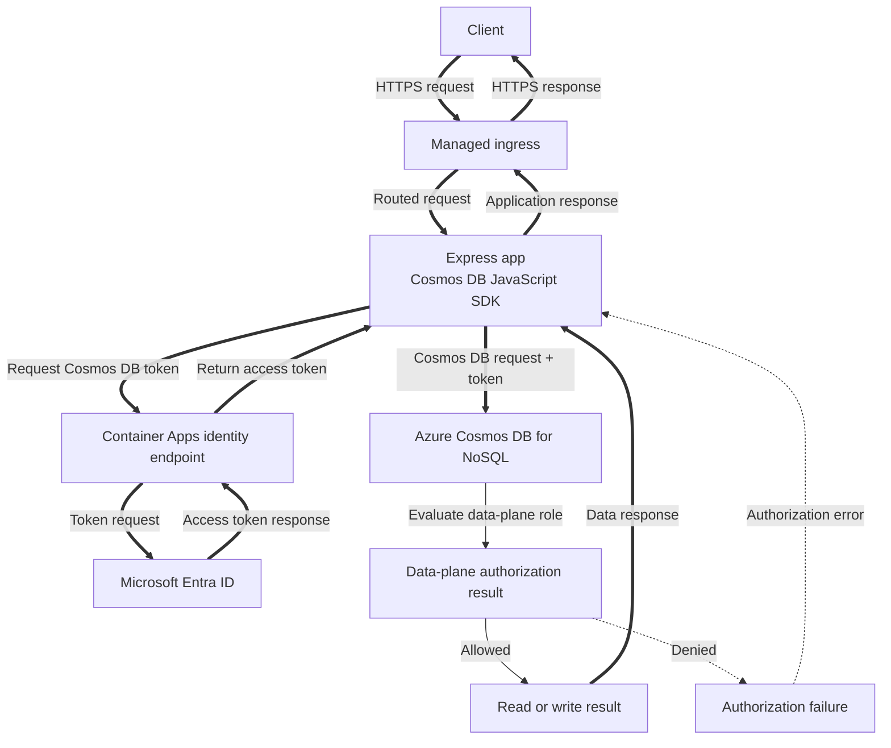

---
content_sources:
  diagrams:
    - id: architecture
      type: flowchart
      source: mslearn-adapted
      based_on:
        - https://learn.microsoft.com/en-us/azure/cosmos-db/nosql/how-to-connect-role-based-access-control
        - https://learn.microsoft.com/en-us/azure/cosmos-db/nosql/quickstart-nodejs
        - https://learn.microsoft.com/en-us/azure/container-apps/managed-identity
---
# Cosmos DB Integration (Managed Identity)

Use this recipe to connect a Node.js Container App to Azure Cosmos DB for NoSQL with managed identity first and a connection string fallback only when you cannot use RBAC yet.

## Architecture

<!-- diagram-id: architecture -->


*Figure: Token acquisition, service transport, and Cosmos DB data-plane authorization are separate steps. A management-plane role alone does not grant document access.*

## Prerequisites

- Existing Container App: `$APP_NAME` in resource group `$RG`
- Existing Azure Cosmos DB account, SQL database, and container
- Azure CLI with Container Apps and Cosmos extensions

```bash
az extension add --name containerapp --upgrade
az extension add --name cosmosdb-preview --upgrade
```

| Command | Why it is used |
|---|---|
| `az extension add ...` | Installs or updates the Container Apps Azure CLI extension. |

## Step 1: Enable managed identity on the Container App

```bash
az containerapp identity assign \
  --name "$APP_NAME" \
  --resource-group "$RG" \
  --system-assigned

export PRINCIPAL_ID=$(az containerapp show \
  --name "$APP_NAME" \
  --resource-group "$RG" \
  --query "identity.principalId" \
  --output tsv)
```

| Command | Why it is used |
|---|---|
| `az containerapp identity assign ...` | Assigns or inspects managed identity configuration for the Container App. |

## Step 2: Grant Cosmos DB data-plane access

```bash
export COSMOS_ACCOUNT_ID=$(az cosmosdb show \
  --name "$COSMOS_ACCOUNT" \
  --resource-group "$RG" \
  --query "id" \
  --output tsv)

az role assignment create \
  --assignee-object-id "$PRINCIPAL_ID" \
  --assignee-principal-type ServicePrincipal \
  --role "Cosmos DB Built-in Data Contributor" \
  --scope "$COSMOS_ACCOUNT_ID"
```

| Command | Why it is used |
|---|---|
| `az cosmosdb show ...` | Creates or inspects Cosmos DB resources used by the sample app. |

## Step 3: Configure non-secret settings in Container Apps

Azure Container Apps does **not** inject Cosmos DB connection settings automatically. Store non-secret values as environment variables, and store fallback secrets in `secrets[]` with `secretref:`.

```bash
az containerapp update \
  --name "$APP_NAME" \
  --resource-group "$RG" \
  --set-env-vars COSMOS_ENDPOINT="https://$COSMOS_ACCOUNT.documents.azure.com:443/" COSMOS_DATABASE="$COSMOS_DATABASE" COSMOS_CONTAINER="$COSMOS_CONTAINER"
```

| Command | Why it is used |
|---|---|
| `az containerapp update ...` | Updates the existing Container App configuration without recreating the app. |

## Step 4: Node.js code (managed identity)

Install dependencies:

```bash
npm install @azure/cosmos @azure/identity
```

Use `DefaultAzureCredential` when `COSMOS_CONNECTION_STRING` is not present:

```javascript
const { CosmosClient } = require("@azure/cosmos");
const { DefaultAzureCredential } = require("@azure/identity");

function createCosmosClient() {
  const connectionString = process.env.COSMOS_CONNECTION_STRING;
  if (connectionString) {
    return new CosmosClient(connectionString);
  }

  return new CosmosClient({
    endpoint: process.env.COSMOS_ENDPOINT,
    aadCredentials: new DefaultAzureCredential(),
  });
}

async function run() {
  const client = createCosmosClient();
  const database = client.database(process.env.COSMOS_DATABASE);
  const container = database.container(process.env.COSMOS_CONTAINER);

  const item = {
    id: "order-1001",
    partitionKey: "order-1001",
    type: "order",
    status: "created",
  };

  await container.items.upsert(item, { partitionKey: item.partitionKey });
  const { resource } = await container.item(item.id, item.partitionKey).read();

  console.log(resource);
}

run().catch((error) => {
  console.error(error);
  process.exitCode = 1;
});
```

## Step 5: Connection string fallback

Only use this pattern when you cannot enable RBAC yet.

```bash
az containerapp secret set \
  --name "$APP_NAME" \
  --resource-group "$RG" \
  --secrets cosmos-connection-string="AccountEndpoint=https://$COSMOS_ACCOUNT.documents.azure.com:443/;AccountKey=<cosmos-account-key>;"

az containerapp update \
  --name "$APP_NAME" \
  --resource-group "$RG" \
  --set-env-vars COSMOS_CONNECTION_STRING=secretref:cosmos-connection-string COSMOS_DATABASE="$COSMOS_DATABASE" COSMOS_CONTAINER="$COSMOS_CONTAINER"
```

| Command | Why it is used |
|---|---|
| `az containerapp secret set ...` | Manages Container Apps secrets without exposing secret values in plain configuration. |

## Verification

1. Confirm identity assignment:

```bash
az containerapp show \
  --name "$APP_NAME" \
  --resource-group "$RG" \
  --query "identity" \
  --output json
```

| Command | Why it is used |
|---|---|
| `az containerapp show ...` | Reads the Container App configuration so the documented setting can be verified. |

2. Confirm role assignment exists:

```bash
az role assignment list \
  --assignee "$PRINCIPAL_ID" \
  --scope "$COSMOS_ACCOUNT_ID" \
  --output table
```

| Command | Why it is used |
|---|---|
| `az role assignment list ...` | Lists Azure RBAC assignments to verify access or diagnose conflicts. |

3. Check app logs for successful upsert and read operations:

```bash
az containerapp logs show \
  --name "$APP_NAME" \
  --resource-group "$RG" \
  --follow false
```

| Command | Why it is used |
|---|---|
| `az containerapp logs show ...` | Runs the Azure CLI operation required by the documented step. |

## See Also

- [Managed Identity](managed-identity.md)
- [Key Vault Reference](key-vault-reference.md)
- [Private Endpoints](../../../platform/networking/private-endpoints.md)

## Sources

- [Azure Cosmos DB for NoSQL RBAC](https://learn.microsoft.com/en-us/azure/cosmos-db/nosql/how-to-connect-role-based-access-control)
- [Azure Cosmos DB for NoSQL Node.js quickstart](https://learn.microsoft.com/en-us/azure/cosmos-db/nosql/quickstart-nodejs)
- [Managed identities in Azure Container Apps](https://learn.microsoft.com/en-us/azure/container-apps/managed-identity)
