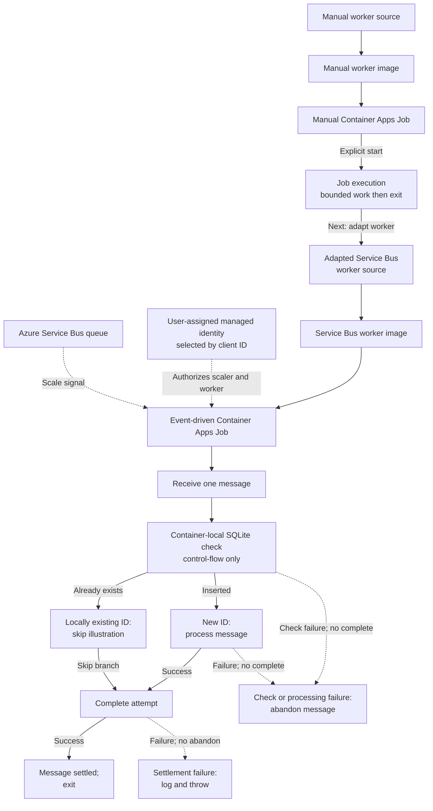

---
content_sources:
  diagrams:
    - id: nodejs-jobs-recipe-flow
      type: flowchart
      source: self-generated
      justification: Language recipe flow synthesized from Microsoft Learn Jobs guidance plus Azure SDK usage patterns.
      based_on:
        - https://learn.microsoft.com/en-us/azure/container-apps/jobs
        - https://learn.microsoft.com/en-us/javascript/api/overview/azure/identity-readme
        - https://learn.microsoft.com/en-us/javascript/api/overview/azure/service-bus-readme
---
# Recipe: Jobs in Node.js on Azure Container Apps

Use this recipe to build a Node.js console Job, turn it into a one-message Service Bus consumer, and illustrate the control flow needed around at-least-once delivery.

## Prerequisites

- Azure Container Apps environment and registry
- Azure Service Bus namespace and queue for the event-driven example
- Node.js 20+, Docker, and Azure CLI

```bash
export RG="rg-aca-node-prod"
export ACA_ENV_NAME="aca-env-node-prod"
export ACR_NAME="acrnodeprod"
export JOB_NAME="job-node-manual"
export EVENT_JOB_NAME="job-node-servicebus"
export SERVICEBUS_NAMESPACE="sb-aca-prod"
export SERVICEBUS_QUEUE="orders"
export JOB_IDENTITY_ID="<user-assigned-identity-resource-id>"
```

Grant the user-assigned identity permission to pull from the existing registry. The branch selects the role supported by the registry's permission mode. Then grant `Azure Service Bus Data Receiver` on the namespace and capture the client ID for `DefaultAzureCredential`:

```bash
export JOB_IDENTITY_PRINCIPAL_ID=$(az identity show \
  --ids "$JOB_IDENTITY_ID" \
  --query principalId \
  --output tsv)
export JOB_IDENTITY_CLIENT_ID=$(az identity show \
  --ids "$JOB_IDENTITY_ID" \
  --query clientId \
  --output tsv)
export ACR_ID=$(az acr show \
  --name "$ACR_NAME" \
  --resource-group "$RG" \
  --query id \
  --output tsv)
export ACR_ROLE_ASSIGNMENT_MODE=$(az acr show \
  --name "$ACR_NAME" \
  --resource-group "$RG" \
  --query roleAssignmentMode \
  --output tsv)

if [[ "$ACR_ROLE_ASSIGNMENT_MODE" == "AbacRepositoryPermissions" ]]; then
  export ACR_PULL_ROLE="Container Registry Repository Reader"
else
  export ACR_PULL_ROLE="AcrPull"
fi

az role assignment create \
  --assignee-object-id "$JOB_IDENTITY_PRINCIPAL_ID" \
  --assignee-principal-type ServicePrincipal \
  --role "$ACR_PULL_ROLE" \
  --scope "$ACR_ID"

export SERVICEBUS_NAMESPACE_ID=$(az servicebus namespace show \
  --name "$SERVICEBUS_NAMESPACE" \
  --resource-group "$RG" \
  --query id \
  --output tsv)

az role assignment create \
  --assignee-object-id "$JOB_IDENTITY_PRINCIPAL_ID" \
  --assignee-principal-type ServicePrincipal \
  --role "Azure Service Bus Data Receiver" \
  --scope "$SERVICEBUS_NAMESPACE_ID"
```

| Command / Parameter | Purpose |
|---|---|
| `az identity show` | Reads the job identity's principal ID for role assignments and client ID for runtime identity selection. |
| `--ids` | Identifies the user-assigned identity by the full resource ID in `$JOB_IDENTITY_ID`. |
| `--query` | Selects `principalId` and `clientId` from the identity, `id` and `roleAssignmentMode` from ACR, or `id` from the Service Bus namespace. |
| `--output` | Emits each queried identifier or permission mode as unquoted `tsv` for assignment to a shell variable. |
| `az acr show` | Reads the ACR resource ID used as the pull-role scope and its permission mode used to choose the compatible role. |
| `--name` | Selects registry `$ACR_NAME` for ACR lookups and namespace `$SERVICEBUS_NAMESPACE` for the Service Bus lookup. |
| `--resource-group` | Finds the existing registry and Service Bus namespace in `$RG`. |
| `az role assignment create` | Creates the registry pull assignment and Service Bus receiver assignment for the job identity. |
| `--assignee-object-id` | Grants both permissions to managed-identity principal `$JOB_IDENTITY_PRINCIPAL_ID`. |
| `--assignee-principal-type` | Declares the assignee as a `ServicePrincipal`, avoiding an unnecessary Microsoft Graph lookup. |
| `--role` | Uses permission-mode-compatible `$ACR_PULL_ROLE` for ACR and `Azure Service Bus Data Receiver` for message access. |
| `--scope` | Limits the assignments to `$ACR_ID` and `$SERVICEBUS_NAMESPACE_ID`, respectively. |
| `az servicebus namespace show` | Retrieves the namespace resource ID used to scope the Service Bus receiver assignment. |

## What You'll Build

- a manual Node.js Job with a console entrypoint
- an event-driven Service Bus consumer that receives, checks, processes or skips, and settles one message before exiting
- a container-local SQLite check that illustrates control flow but does not suppress duplicates across job executions

## Steps

<!-- diagram-id: nodejs-jobs-recipe-flow -->


*Figure: The manual worker and adapted Service Bus worker are built as separate images for jobs with different triggers. The event worker demonstrates at-least-once delivery control flow: it attempts completion only after processing or the illustrative local skip branch, abandons the message when the local check or processing fails, and logs and rethrows a completion failure without attempting abandon. The container-local SQLite check does not suppress duplicates across job executions.*

### 1. Create a manual Node.js Job

`package.json`:

```json
{
  "name": "aca-node-job",
  "version": "1.0.0",
  "type": "module",
  "scripts": {
    "start": "node index.js"
  },
  "dependencies": {
    "@azure/identity": "^4.4.1",
    "@azure/service-bus": "^7.9.4",
    "sqlite3": "^5.1.7"
  }
}
```

`index.js`:

```javascript
const execution = process.env.CONTAINER_APP_JOB_EXECUTION_NAME || "local";
const task = process.env.TASK_NAME || "reconcile-orders";

console.log(JSON.stringify({ event: "job-start", execution, task }));
console.log(JSON.stringify({ event: "job-work", message: "processing batch" }));
console.log(JSON.stringify({ event: "job-end", status: "Succeeded" }));
```

`Dockerfile`:

```dockerfile
FROM node:20-alpine

WORKDIR /app
COPY package.json package-lock.json* ./
RUN npm install
COPY index.js .

CMD ["npm", "start"]
```

Deploy and trigger the Job:

```bash
az acr build \
  --registry "$ACR_NAME" \
  --image "node-jobs/manual:v1" \
  --file "Dockerfile" \
  "."

az containerapp job create \
  --name "$JOB_NAME" \
  --resource-group "$RG" \
  --environment "$ACA_ENV_NAME" \
  --trigger-type "Manual" \
  --image "$ACR_NAME.azurecr.io/node-jobs/manual:v1" \
  --registry-server "$ACR_NAME.azurecr.io" \
  --registry-identity "$JOB_IDENTITY_ID" \
  --mi-user-assigned "$JOB_IDENTITY_ID" \
  --replica-timeout 600 \
  --replica-retry-limit 1

az containerapp job start \
  --name "$JOB_NAME" \
  --resource-group "$RG"
```

| Command | Why it is used |
|---|---|
| `az acr build` | Builds and pushes the manual Node.js job image to `$ACR_NAME`. |
| `az containerapp job create` | Creates the manually triggered job with managed-identity ACR pull. |
| `az containerapp job start` | Starts an on-demand execution of `$JOB_NAME`. |
| `--registry` | Selects `$ACR_NAME` for the remote image build. |
| `--image` | Tags the build and configures the manual job image. |
| `--file` | Uses `Dockerfile` for the ACR build. |
| `--name` | Selects `$JOB_NAME` for creation and start. |
| `--resource-group` | Locates the job in `$RG`. |
| `--environment` | Places the job in `$ACA_ENV_NAME`. |
| `--trigger-type` | Configures a `Manual` trigger. |
| `--registry-server` | Identifies the private ACR login server. |
| `--registry-identity` | Uses `$JOB_IDENTITY_ID` for image pull authentication. |
| `--mi-user-assigned` | Attaches `$JOB_IDENTITY_ID` to the job. |
| `--replica-timeout` | Stops an execution that exceeds `600` seconds. |
| `--replica-retry-limit` | Allows one retry after a failed replica. |

### 2. Turn it into a one-message Service Bus consumer

Replace `index.js` with:

```javascript
import { DefaultAzureCredential } from "@azure/identity";
import { ServiceBusClient } from "@azure/service-bus";
import sqlite3 from "sqlite3";

const fullyQualifiedNamespace = `${process.env.SERVICEBUS_NAMESPACE}.servicebus.windows.net`;
const queueName = process.env.SERVICEBUS_QUEUE;

const credential = new DefaultAzureCredential({ managedIdentityClientId: process.env.AZURE_CLIENT_ID });
const client = new ServiceBusClient(fullyQualifiedNamespace, credential);
const receiver = client.createReceiver(queueName);
// Control-flow-only illustration: /tmp is local to this job execution. Use a
// shared durable store with pending/completed state or an atomic business-result
// commit to coordinate retries and concurrent executions in production.
const db = new sqlite3.Database("/tmp/dedup.db");

function runSql(sql, params = []) {
  return new Promise((resolve, reject) => {
    db.run(sql, params, function (error) {
      if (error) reject(error);
      else resolve(this);
    });
  });
}

function closeDb() {
  return new Promise((resolve, reject) => {
    db.close((error) => (error ? reject(error) : resolve()));
  });
}

async function claimMessage(messageId) {
  await runSql("create table if not exists processed_messages (message_id text primary key)");
  const result = await runSql(
    "insert or ignore into processed_messages(message_id) values (?)",
    [messageId],
  );
  return result.changes === 1;
}

async function processMessage(message) {
  console.log(JSON.stringify({ event: "process-message", messageId: message.messageId }));
  // Perform the business operation here.
}

try {
  const messages = await receiver.receiveMessages(1, { maxWaitTimeInMs: 15000 });
  if (messages.length === 0) {
    console.log(JSON.stringify({ event: "empty-queue" }));
  } else {
    const message = messages[0];
    console.log(JSON.stringify({ event: "message-received", messageId: message.messageId }));
    try {
      if (await claimMessage(message.messageId)) {
        await processMessage(message);
      } else {
        console.log(JSON.stringify({ event: "duplicate-message", messageId: message.messageId }));
      }
    } catch (error) {
      console.error(JSON.stringify({ event: "message-check-or-processing-failed", messageId: message.messageId }));
      await receiver.abandonMessage(message);
      throw error;
    }

    try {
      await receiver.completeMessage(message);
      console.log(JSON.stringify({ event: "message-completed", messageId: message.messageId }));
    } catch (error) {
      console.error(JSON.stringify({ event: "message-settlement-failed", messageId: message.messageId }));
      throw error;
    }
  }
} finally {
  await closeDb();
  await receiver.close();
  await client.close();
}
```

Create the event-driven Job:

```bash
az acr build \
  --registry "$ACR_NAME" \
  --image "node-jobs/servicebus:v1" \
  --file "Dockerfile" \
  "."

az containerapp job create \
  --name "$EVENT_JOB_NAME" \
  --resource-group "$RG" \
  --environment "$ACA_ENV_NAME" \
  --trigger-type "Event" \
  --image "$ACR_NAME.azurecr.io/node-jobs/servicebus:v1" \
  --registry-server "$ACR_NAME.azurecr.io" \
  --registry-identity "$JOB_IDENTITY_ID" \
  --mi-user-assigned "$JOB_IDENTITY_ID" \
  --scale-rule-name "orders-queue" \
  --scale-rule-type "azure-servicebus" \
  --scale-rule-metadata "queueName=$SERVICEBUS_QUEUE" "messageCount=1" "namespace=$SERVICEBUS_NAMESPACE" \
  --scale-rule-identity "$JOB_IDENTITY_ID" \
  --env-vars AZURE_CLIENT_ID="$JOB_IDENTITY_CLIENT_ID" SERVICEBUS_NAMESPACE="$SERVICEBUS_NAMESPACE" SERVICEBUS_QUEUE="$SERVICEBUS_QUEUE"
```

| Command | Why it is used |
|---|---|
| `az acr build` | Builds and pushes the Service Bus worker image to `$ACR_NAME`. |
| `az containerapp job create` | Creates the event-driven job and its managed-identity Service Bus scaler. |
| `--registry` | Selects `$ACR_NAME` for this worker build. |
| `--image` | Tags the build and configures the event job image. |
| `--file` | Builds the worker from `Dockerfile`. |
| `--name` | Names the event job `$EVENT_JOB_NAME`. |
| `--resource-group` | Creates the event job in `$RG`. |
| `--environment` | Places the event job in `$ACA_ENV_NAME`. |
| `--trigger-type` | Configures an `Event` trigger. |
| `--registry-server` | Identifies the ACR login server for the private image. |
| `--registry-identity` | Authenticates the image pull with `$JOB_IDENTITY_ID`. |
| `--mi-user-assigned` | Attaches the user-assigned identity to the job. |
| `--scale-rule-name` | Names the Service Bus scale rule `orders-queue`. |
| `--scale-rule-type` | Selects the `azure-servicebus` scaler. |
| `--scale-rule-metadata` | Polls queue `$SERVICEBUS_QUEUE` in namespace `$SERVICEBUS_NAMESPACE` at a one-message threshold. |
| `--scale-rule-identity` | Uses `$JOB_IDENTITY_ID` when the scaler polls Service Bus. |
| `--env-vars` | Passes the identity client ID, namespace, and queue to the Node.js worker. |

### 3. Understand the control-flow-only ID check

The worker receives one message and exits, and `/tmp/dedup.db` exists only in that execution's container filesystem. The SQLite branch is therefore a control-flow-only illustration: it does not suppress a later retry or a duplicate handled by a concurrent execution.

This sample demonstrates **at-least-once delivery**, not duplicate suppression or exactly-once processing. For production, use a shared durable store such as Azure SQL, Azure Cosmos DB, or Azure Table Storage. Track recoverable `pending` and `completed` states, or atomically commit the durable ID record with the business result, so retries and concurrent executions cannot mistake recorded-but-unfinished work for a completed result.

## Verification

```bash
az containerapp job execution list \
  --name "$JOB_NAME" \
  --resource-group "$RG" \
  --output table

az containerapp job execution list \
  --name "$EVENT_JOB_NAME" \
  --resource-group "$RG" \
  --output table
```

| Command | Why it is used |
|---|---|
| `az containerapp job execution ...` | Creates, updates, starts, or inspects a Container Apps job. |

## Next Steps / Clean Up

- Replace the control-flow-only SQLite check with a shared durable store and close the record-before-processing failure window.
- Add Application Insights correlation IDs to log payloads.
- Review [Jobs Operations](../../../operations/jobs/index.md) before production rollout.

## See Also

- [Node.js Recipes Index](index.md)
- [Container Apps Jobs Overview](../../../platform/jobs/index.md)
- [Job Design](../../../best-practices/job-design.md)

## Sources

- [Jobs in Azure Container Apps (Microsoft Learn)](https://learn.microsoft.com/en-us/azure/container-apps/jobs)
- [Azure Identity client library for JavaScript](https://learn.microsoft.com/en-us/javascript/api/overview/azure/identity-readme)
- [Azure Service Bus client library for JavaScript](https://learn.microsoft.com/en-us/javascript/api/overview/azure/service-bus-readme)
