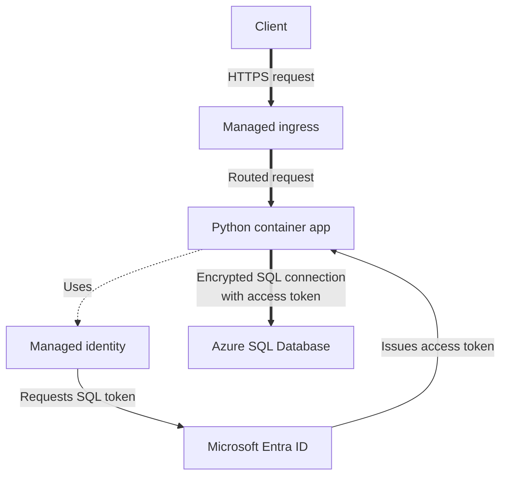

---
content_sources:
  diagrams:
    - id: architecture
      type: flowchart
      source: mslearn-adapted
      based_on:
        - https://learn.microsoft.com/en-us/azure/azure-sql/database/authentication-aad-overview
        - https://learn.microsoft.com/en-us/azure/azure-sql/database/connect-query-python
---
# Azure SQL Integration (Managed Identity)

Use this recipe to connect Azure Container Apps to Azure SQL Database with Microsoft Entra authentication and no SQL passwords.

## Architecture

<!-- diagram-id: architecture -->


Thick arrows show request or database transport. Thin arrows show token exchange, and the dotted arrow shows the identity association.

## Prerequisites

- Existing Container App: `$APP_NAME` in `$RG`
- Existing Azure SQL server and database
- SQL server configured with a Microsoft Entra admin
- ODBC Driver 18 available in your container image

## Step 1: Enable managed identity on the Container App

```bash
az containerapp identity assign \
  --name "$APP_NAME" \
  --resource-group "$RG" \
  --system-assigned

export PRINCIPAL_ID=$(az containerapp show \
  --name "$APP_NAME" \
  --resource-group "$RG" \
  --query "identity.principalId" \
  --output tsv)
```

| Command | Why it is used |
|---|---|
| `az containerapp identity assign` | Enables the system-assigned identity that the Python app uses to request an Azure SQL access token. |
| `az containerapp show` | Reads that identity's principal ID so an Azure SQL contained user can be created for the app. |
| `--name` | Targets `$APP_NAME`, whose identity will authenticate to the Azure SQL database. |
| `--resource-group` | Locates `$APP_NAME` in `$RG` for both identity commands. |
| `az containerapp identity assign --system-assigned` | Attaches a platform-managed identity to the app for passwordless Azure SQL authentication. |
| `az containerapp show --query` | Selects `identity.principalId`, the identifier associated with the database user grant. |
| `az containerapp show --output` | Emits only the principal ID as tab-separated text for `PRINCIPAL_ID`. |


## Step 2: Grant SQL database access to the app identity

From a Microsoft Entra-authenticated SQL session, create a contained user for the app identity.

```sql
CREATE USER [<container-app-name>] FROM EXTERNAL PROVIDER;
ALTER ROLE db_datareader ADD MEMBER [<container-app-name>];
ALTER ROLE db_datawriter ADD MEMBER [<container-app-name>];
```

## Step 3: Configure non-secret app settings

```bash
az containerapp update \
  --name "$APP_NAME" \
  --resource-group "$RG" \
  --set-env-vars SQL_SERVER="$SQL_SERVER.database.windows.net" SQL_DATABASE="$SQL_DATABASE"
```

| Command | Why it is used |
|---|---|
| `az containerapp update` | Writes the Azure SQL server and database names into the revision used by the passwordless Python client. |
| `--name` | Targets `$APP_NAME`, which receives the Azure SQL server and database settings. |
| `--resource-group` | Scopes the SQL configuration update to `$RG`, where `$APP_NAME` is deployed. |
| `--set-env-vars` | Configures the environment variables written to the workload as `SQL_SERVER=$SQL_SERVER.database.windows.net`, `SQL_DATABASE=$SQL_DATABASE` on `az containerapp update`. |


## Step 4: Python code (token-based SQL connection)

Install dependencies:

```bash
pip install azure-identity pyodbc
```

Use managed identity token with ODBC Driver 18:

```python
import os
import struct
import pyodbc
from azure.identity import DefaultAzureCredential

SQL_COPT_SS_ACCESS_TOKEN = 1256

server = os.environ["SQL_SERVER"]
database = os.environ["SQL_DATABASE"]

credential = DefaultAzureCredential()
token = credential.get_token("https://database.windows.net/.default").token
token_bytes = token.encode("utf-16-le")
token_struct = struct.pack("<I", len(token_bytes)) + token_bytes

connection_string = (
    "Driver={ODBC Driver 18 for SQL Server};"
    f"Server=tcp:{server},1433;"
    f"Database={database};"
    "Encrypt=yes;TrustServerCertificate=no;"
)

with pyodbc.connect(connection_string, attrs_before={SQL_COPT_SS_ACCESS_TOKEN: token_struct}) as conn:
    with conn.cursor() as cursor:
        cursor.execute("SELECT TOP 1 name FROM sys.tables")
        row = cursor.fetchone()
        print(row[0] if row else "No tables found")
```

## Container Apps specifics

- Keep server/database names as environment variables.
- Do not store SQL passwords in Container App secrets.
- If using private connectivity, combine with VNet integration and private endpoint DNS.

## Verification steps

1. Validate identity is present on the app:

```bash
az containerapp show \
  --name "$APP_NAME" \
  --resource-group "$RG" \
  --query "identity" \
  --output json
```

| Command | Why it is used |
|---|---|
| `az containerapp show` | Returns `$APP_NAME` identity configuration to confirm the system-assigned principal remains enabled for Azure SQL authentication. |
| `--name` | Targets `$APP_NAME`, whose managed identity must match the Azure SQL user. |
| `--resource-group` | Scopes the identity lookup to `$RG`, where the SQL-enabled app is deployed. |
| `--query` | Narrows the response to the identity that Azure SQL maps to the contained database user. |
| `--output` | Shows the identity type and principal identifiers as JSON for comparison with the SQL user. |


2. Verify runtime connectivity by checking application logs:

```bash
az containerapp logs show \
  --name "$APP_NAME" \
  --resource-group "$RG" \
  --follow false
```

| Command | Why it is used |
|---|---|
| `az containerapp logs show` | Retrieves `$APP_NAME` runtime logs to check for successful SQL connections or token and ODBC errors. |
| `--name` | Targets `$APP_NAME`, whose logs reveal Azure SQL connection attempts. |
| `--resource-group` | Scopes log retrieval to `$RG`, where the SQL-enabled app is deployed. |
| `--follow` | Uses `false` to inspect Azure SQL connection activity. |


3. Confirm SQL sign-ins in Azure SQL auditing/logs.

## See Also
- [Managed Identity](../../../platform/identity-and-secrets/managed-identity.md)
- [VNet Integration](../../../platform/networking/vnet-integration.md)
- [Private Endpoints](../../../platform/networking/private-endpoints.md)

## Sources
- [Azure SQL + Microsoft Entra authentication](https://learn.microsoft.com/en-us/azure/azure-sql/database/authentication-aad-overview)
- [Connect to Azure SQL with Python (Microsoft Learn)](https://learn.microsoft.com/en-us/azure/azure-sql/database/connect-query-python)
