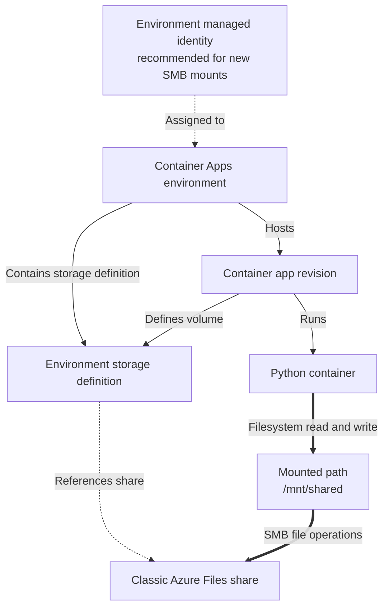

---
content_sources:
  diagrams:
    - id: mount-azure-files-into-your-python
      type: flowchart
      source: mslearn-adapted
      based_on:
        - https://learn.microsoft.com/en-us/azure/container-apps/storage-mounts
        - https://learn.microsoft.com/en-us/azure/container-apps/containers
---
# Recipe: Bring Your Own Storage with Azure Files Mounts

Mount Azure Files into your Python Container App when you need shared, persistent filesystem access across replicas.

<!-- diagram-id: mount-azure-files-into-your-python -->


Thick arrows show file transport. Thin and dotted arrows show configuration and identity associations; the mount identity belongs to the environment, not the app.

## Prerequisites

- Existing Storage account (`$STORAGE_ACCOUNT`) in `$RG`
- Existing Container Apps environment (`$ACA_ENV_NAME`)
- Existing app (`$APP_NAME`) in the same environment
- Azure CLI with Container Apps extension

```bash
az extension add --name containerapp --upgrade
```

| Command | Why it is used |
|---|---|
| `az extension add` | Adds the Container Apps environment storage and volume-mount commands required later in the procedure. |
| `--name` | Selects `containerapp`, which provides the storage-management command group. |
| `--upgrade` | Replaces an older `containerapp` extension so the environment-storage and volume options used below are available. |


## Create an Azure Files share

```bash
az storage share-rm create \
  --resource-group "$RG" \
  --storage-account "$STORAGE_ACCOUNT" \
  --name "aca-shared"

export STORAGE_KEY=$(az storage account keys list \
  --account-name "$STORAGE_ACCOUNT" \
  --resource-group "$RG" \
  --query "[0].value" \
  --output tsv)
```

| Command | Why it is used |
|---|---|
| `az storage share-rm create` | Provisions `aca-shared` as the persistent file share mounted by the Container App. |
| `az storage account keys list` | Extracts the first key from `$STORAGE_ACCOUNT` for authenticating the Azure Files share creation step. |
| `--resource-group` | Scopes storage access-key retrieval and Azure Files share creation to `$RG`. |
| `az storage share-rm create --storage-account` | Places the persistent `aca-shared` file share inside `$STORAGE_ACCOUNT`. |
| `az storage share-rm create --name` | Names the new Azure Files share `aca-shared` for later environment registration. |
| `az storage account keys list --account-name` | Selects `$STORAGE_ACCOUNT` as the source of the key used to authenticate the mount. |
| `az storage account keys list --query` | Extracts the first storage account key used to authenticate the environment-level file mount. |
| `az storage account keys list --output` | Captures only the key value as text in `STORAGE_KEY`, without the surrounding key object. |


## Configure the storage mount in Container Apps

Register the Azure Files share at the environment level.

```bash
az containerapp env storage set \
  --name "$ACA_ENV_NAME" \
  --resource-group "$RG" \
  --storage-name "sharedfiles" \
  --azure-file-account-name "$STORAGE_ACCOUNT" \
  --azure-file-account-key "$STORAGE_KEY" \
  --azure-file-share-name "aca-shared" \
  --access-mode ReadWrite
```

| Command | Why it is used |
|---|---|
| `az containerapp env storage set` | Registers `aca-shared` as `sharedfiles` on `$ACA_ENV_NAME` using the retrieved account key. |
| `--name` | Targets `$ACA_ENV_NAME` for environment storage definition. |
| `--resource-group` | Finds `$ACA_ENV_NAME` in `$RG` before registering its `sharedfiles` storage definition. |
| `--storage-name` | Configures the environment storage definition as `sharedfiles` on `az containerapp env storage set`. |
| `--azure-file-account-name` | Configures the azure file account name as `$STORAGE_ACCOUNT` on `az containerapp env storage set`. |
| `--azure-file-account-key` | Configures the azure file account key as `$STORAGE_KEY` on `az containerapp env storage set`. |
| `--azure-file-share-name` | Configures the azure file share name as `aca-shared` on `az containerapp env storage set`. |
| `--access-mode` | Configures the access mode as `ReadWrite` on `az containerapp env storage set`. |


Attach it to the app.

```bash
az containerapp update \
  --name "$APP_NAME" \
  --resource-group "$RG" \
  --yaml "containerapp-with-volume.yaml"
```

| Command | Why it is used |
|---|---|
| `az containerapp update` | Applies `containerapp-with-volume.yaml` to create a revision with the Azure Files volume attached. |
| `--name` | Targets `$APP_NAME`, which receives the Azure Files volume definition. |
| `--resource-group` | Scopes the Azure Files volume update to `$RG`. |
| `--yaml` | Configures the declarative Container Apps configuration file as `containerapp-with-volume.yaml` on `az containerapp update`. |


Example YAML fragment:

```yaml
properties:
  template:
    volumes:
      - name: shared-files
        storageType: AzureFile
        storageName: sharedfiles
    containers:
      - name: app
        image: <image>
        volumeMounts:
          - volumeName: shared-files
            mountPath: /mnt/shared
```

## Read and write mounted files in Python

```python
from pathlib import Path
from flask import Flask, jsonify

app = Flask(__name__)
MOUNT_PATH = Path("/mnt/shared")

@app.post("/write")
def write_file():
    MOUNT_PATH.mkdir(parents=True, exist_ok=True)
    target = MOUNT_PATH / "status.txt"
    target.write_text("written from container app", encoding="utf-8")
    return jsonify(file=str(target), written=True), 200

@app.get("/read")
def read_file():
    target = MOUNT_PATH / "status.txt"
    return jsonify(content=target.read_text(encoding="utf-8")), 200
```

## Bicep example for storage mount

```bicep
resource environment 'Microsoft.App/managedEnvironments@2023-05-01' existing = {
  name: environmentName
}

resource storage 'Microsoft.App/managedEnvironments/storages@2023-05-01' = {
  name: 'sharedfiles'
  parent: environment
  properties: {
    azureFile: {
      accountName: storageAccountName
      accountKey: storageAccountKey
      shareName: 'aca-shared'
      accessMode: 'ReadWrite'
    }
  }
}
```

## Performance considerations

- Azure Files adds network latency versus local ephemeral storage.
- Many small file operations can be slower than blob/object access patterns.
- Use mounted shares for coordination/state handoff, not high-throughput analytics pipelines.

## Typical use cases

- Shared config rendered at runtime
- Upload staging before async processing
- Temporary exported artifacts that must survive restarts

## Limitations

- Container Apps supports **Azure Files mounts**, not Blob filesystem mounts.
- Throughput depends on storage account/file share limits.
- Mount configuration changes create a new app revision.

## Advanced Topics

- Combine mount access with queue-based processing for resilient workflows.
- Prefer environment managed identity for new SMB mounts. If you use the storage-key alternative, protect and rotate the key.
- For high-scale binary workloads, prefer Blob SDK over filesystem semantics.

## See Also

- [Storage](storage.md)
- [Key Vault Reference](key-vault-reference.md)
- [Environments](../../../platform/environments/index.md)
- [Microsoft Learn: Use Azure Files in Container Apps](https://learn.microsoft.com/en-us/azure/container-apps/storage-mounts)

## Sources

- [Microsoft Learn source 1](https://learn.microsoft.com/en-us/azure/container-apps/storage-mounts)
- [Microsoft Learn source 2](https://learn.microsoft.com/en-us/azure/container-apps/containers)
