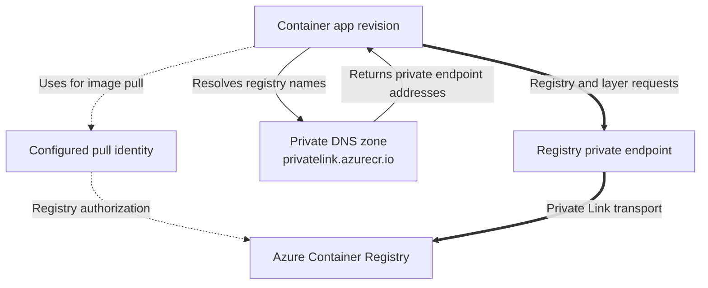
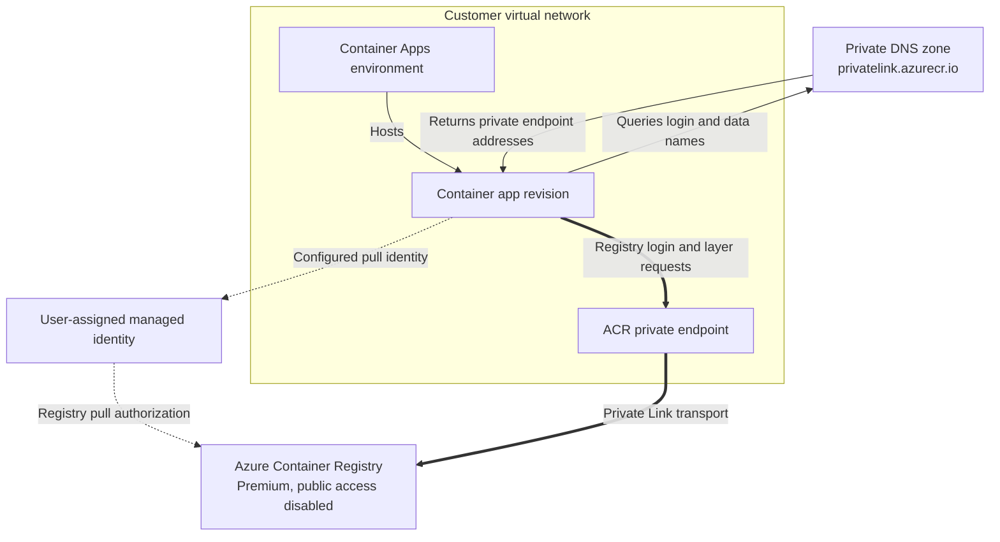

---
content_sources:
  diagrams:
    - id: architecture
      type: flowchart
      source: mslearn-adapted
      based_on:
        - https://learn.microsoft.com/en-us/azure/container-registry/container-registry-private-link
        - https://learn.microsoft.com/en-us/azure/container-registry/container-registry-dedicated-data-endpoints
        - https://learn.microsoft.com/en-us/azure/container-apps/managed-identity-image-pull
        - https://learn.microsoft.com/en-us/azure/container-registry/container-registry-authentication-managed-identity
        - https://learn.microsoft.com/en-us/azure/container-registry/container-registry-rbac-built-in-roles-overview
    - id: configure-the-container-app-to-reference
      type: flowchart
      source: mslearn-adapted
      based_on:
        - https://learn.microsoft.com/en-us/azure/container-registry/container-registry-private-link
        - https://learn.microsoft.com/en-us/azure/container-registry/container-registry-dedicated-data-endpoints
        - https://learn.microsoft.com/en-us/azure/container-apps/managed-identity-image-pull
        - https://learn.microsoft.com/en-us/azure/container-registry/container-registry-authentication-managed-identity
        - https://learn.microsoft.com/en-us/azure/container-registry/container-registry-rbac-built-in-roles-overview
---
# Private Container Registry (ACR with Private Endpoint)

Pull container images from Azure Container Registry over a private network path — no public registry exposure, no admin credentials.

## Architecture

<!-- diagram-id: architecture -->


Thick arrows show image transport. Thin arrows show DNS exchange, and dotted arrows show identity and authorization associations.

!!! note "Private Endpoint requires ACR Premium SKU"
    Private Endpoints for ACR are only available on the **Premium** tier. Basic and Standard ACR cannot use Private Endpoints.

## Overview

By default, Container Apps pulls images from a public ACR endpoint. In a private deployment, you:

1. Deploy ACR with public access disabled and a Private Endpoint in your VNet
2. Configure a **user-assigned managed identity** on your Container App as the pull identity
3. Grant the identity the pull role for the registry's permission mode: `AcrPull` for **RBAC Registry Permissions**, or `Container Registry Repository Reader` for **RBAC Registry + ABAC Repository Permissions**
4. Configure the Container App to reference that identity for the registry

<!-- diagram-id: configure-the-container-app-to-reference -->


Thick arrows show image transport. Thin arrows show hosting and DNS exchange; dotted arrows show identity and authorization associations.

!!! warning "Two DNS records are required"
    ACR image pulls use **two endpoints**: the login server (`myregistry.azurecr.io`) for authentication and the regional data endpoint (`myregistry.<region>.data.azurecr.io`) for layer downloads. Both must resolve to private IPs through the Private DNS Zone. Missing the data endpoint causes pull failures that are not obvious from the error message.

### Why user-assigned managed identity?

| Approach | Recommended | Notes |
|----------|-------------|-------|
| **User-assigned MI** | ✅ Yes | Created before the app — clean IaC, no two-phase deployment |
| System-assigned MI | ⚠️ Possible | Exists only after app creation — requires two-phase deployment in IaC |
| Admin credentials (username/password) | ❌ No | Weaker operationally, manual rotation, avoid in production |

## Prerequisites

- Container Apps environment deployed **in a VNet** (see [VNet Integration](../../../platform/networking/vnet-integration.md))
- Azure CLI with Container Apps extension: `az extension add --name containerapp`
- Docker (for building and pushing images)
- Variables set:

```bash
export RG="rg-myapp"
export LOCATION="koreacentral"
export ACA_ENV_NAME="cae-myapp"
export APP_NAME="ca-myapp"
export ACR_NAME="acrmyapp"          # Globally unique, alphanumeric only
export VNET_NAME="vnet-myapp"
export PE_SUBNET_ID="<private-endpoints-subnet-id>"
export UAMI_NAME="id-myapp"
```

## Step 1: Create ACR (Premium SKU)

Private Endpoints require the **Premium** SKU. Creating the registry's `registry` private endpoint automatically enables dedicated data endpoints and adds their regional IP configurations to that private endpoint.

```bash
az acr create \
  --name "$ACR_NAME" \
  --resource-group "$RG" \
  --location "$LOCATION" \
  --sku Premium \
  --public-network-enabled false
```

| Command | Why it is used |
|---|---|
| `az acr create` | Provisions the Premium registry that will host the private application image without a public endpoint. |
| `--name` | Names the new private registry `$ACR_NAME` for later build and pull commands. |
| `--resource-group` | Places the registry in `$RG` alongside the networking resources used by this recipe. |
| `--location` | Configures the Azure deployment region as `$LOCATION` on `az acr create`. |
| `--sku` | Configures the registry service tier as `Premium` on `az acr create`. |
| `--public-network-enabled` | Configures the registry public network access as `false` on `az acr create`. |


!!! important "Enable ARM audience token authentication"
    Managed identity pulls require ACR to accept ARM audience tokens. Enable this explicitly — it is not on by default in all tenants:

    ```bash
    az acr config authentication-as-arm update \
      --registry "$ACR_NAME" \
      --status enabled
    ```

    | Command | Why it is used |
    | --- | --- |
    | `az acr config authentication-as-arm update` | Enables ARM-audience token authentication on `$ACR_NAME` so its managed identity can authorize image pulls. |
    | `--registry` | Enables ARM-audience token authentication specifically on `$ACR_NAME` for managed-identity image pulls. |
    | `--status` | Configures the ARM-audience authentication state as `enabled` on `az acr config authentication-as-arm update`. |

    Without this, managed identity pull attempts fail with `401 Unauthorized` even when RBAC looks correct.

## Step 2: Create a user-assigned managed identity

```bash
az identity create \
  --name "$UAMI_NAME" \
  --resource-group "$RG"

export UAMI_ID=$(az identity show \
  --name "$UAMI_NAME" \
  --resource-group "$RG" \
  --query "id" \
  --output tsv)

export UAMI_PRINCIPAL_ID=$(az identity show \
  --name "$UAMI_NAME" \
  --resource-group "$RG" \
  --query "principalId" \
  --output tsv)

export UAMI_CLIENT_ID=$(az identity show \
  --name "$UAMI_NAME" \
  --resource-group "$RG" \
  --query "clientId" \
  --output tsv)
```

| Command | Why it is used |
|---|---|
| `az identity create` | Provisions `$UAMI_NAME` as the dedicated identity used for private-registry image pulls. |
| `az identity show` | Returns the new identity's resource, principal, and client IDs for app attachment and registry authorization. |
| `--name` | Targets `$UAMI_NAME` for user-assigned identity creation and managed-identity property lookup. |
| `--resource-group` | Scopes user-assigned identity creation and managed-identity property lookup to `$RG`. |
| `az identity show --query` | Extracts `id`, `principalId`, `clientId` from `az identity show` output. |
| `az identity show --output` | Emits each identity property as plain text for the three exported shell variables. |


## Step 3: Grant the mode-appropriate pull role

Check `roleAssignmentMode` before creating the role assignment. ABAC-enabled registries do not honor the legacy `AcrPull` role.

```bash
export ACR_ID=$(az acr show \
  --name "$ACR_NAME" \
  --resource-group "$RG" \
  --query "id" \
  --output tsv)

export ACR_ROLE_ASSIGNMENT_MODE=$(az acr show \
  --name "$ACR_NAME" \
  --resource-group "$RG" \
  --query "roleAssignmentMode" \
  --output tsv)

if [ "$ACR_ROLE_ASSIGNMENT_MODE" = "AbacRepositoryPermissions" ]; then
  export ACR_PULL_ROLE="Container Registry Repository Reader"
else
  export ACR_PULL_ROLE="AcrPull"
fi

az role assignment create \
  --assignee-object-id "$UAMI_PRINCIPAL_ID" \
  --assignee-principal-type ServicePrincipal \
  --role "$ACR_PULL_ROLE" \
  --scope "$ACR_ID"
```

| Command | Why it is used |
|---|---|
| `az acr show` | Retrieves `$ACR_NAME`'s resource ID and authorization mode so the script can choose the correct pull role and scope. |
| `az role assignment create` | Grants the user-assigned identity the pull role selected for the registry's RBAC or ABAC mode. |
| `az acr show --name` | Identifies `$ACR_NAME` as the registry whose ID and role-assignment mode are inspected. |
| `az acr show --resource-group` | Locates `$ACR_NAME` in `$RG` before deriving the role-assignment scope. |
| `az acr show --query` | Extracts `id`, `roleAssignmentMode` from `az acr show` output. |
| `az acr show --output` | Captures the registry ID and authorization mode as scalar shell values for role selection. |
| `az role assignment create --assignee-object-id` | Identifies the user-assigned identity principal that must pull private images. |
| `az role assignment create --assignee-principal-type` | Configures the role-assignment principal type as `ServicePrincipal` on `az role assignment create`. |
| `az role assignment create --role` | Applies the pull role selected for the registry's RBAC-only or ABAC authorization mode. |
| `az role assignment create --scope` | Constrains image-pull permission to `$ACR_NAME` rather than the resource group or subscription. |


!!! tip "Role assignment propagation"
    RBAC changes take 1–5 minutes to propagate. If a container pull fails immediately after assigning the role, wait and retry the revision.

## Step 4: Create the Private Endpoint for ACR

Create one private endpoint for the registry's `registry` group. ACR automatically enables the dedicated data endpoints and allocates their regional addresses as additional IP configurations on this private endpoint. The subnet therefore needs one IP for the global registry endpoint plus one IP for each geo-replica's data endpoint.

```bash
# Private Endpoint for login server
az network private-endpoint create \
  --name "pe-acr-${ACR_NAME}" \
  --resource-group "$RG" \
  --subnet "$PE_SUBNET_ID" \
  --private-connection-resource-id "$ACR_ID" \
  --group-id "registry" \
  --connection-name "conn-acr-registry"
```

| Command | Why it is used |
|---|---|
| `az network private-endpoint create` | Connects `$ACR_NAME`'s `registry` subresource to `$PE_SUBNET_ID` through `pe-acr-${ACR_NAME}`. |
| `--name` | Targets `pe-acr-${ACR_NAME}` for registry private-endpoint creation. |
| `--resource-group` | Creates the registry private endpoint in `$RG` alongside its networking dependencies. |
| `--subnet` | Configures the subnet hosting the private endpoint as `$PE_SUBNET_ID` on `az network private-endpoint create`. |
| `--private-connection-resource-id` | Configures the registry resource reached through Private Link as `$ACR_ID` on `az network private-endpoint create`. |
| `--group-id` | Configures the Private Link subresource as `registry` on `az network private-endpoint create`. |
| `--connection-name` | Configures the private-link connection name as `conn-acr-registry` on `az network private-endpoint create`. |


!!! note "Dedicated data endpoints share the registry private endpoint"
    Do not create a second private endpoint for `registry_data_<region>`. ACR exposes each regional data endpoint through an additional IP configuration on the private endpoint created with `--group-id registry`. Private DNS integration creates the corresponding data-endpoint records; if you manage DNS records manually, create one record for every geo-replica's data endpoint.

## Step 5: Configure Private DNS Zone

```bash
export VNET_ID=$(az network vnet show \
  --name "$VNET_NAME" \
  --resource-group "$RG" \
  --query "id" \
  --output tsv)

# Create Private DNS Zone
az network private-dns zone create \
  --resource-group "$RG" \
  --name "privatelink.azurecr.io"

# Link DNS Zone to VNet
az network private-dns link vnet create \
  --resource-group "$RG" \
  --zone-name "privatelink.azurecr.io" \
  --name "link-acr-${VNET_NAME}" \
  --virtual-network "$VNET_ID" \
  --registration-enabled false

# Create DNS Zone Group — automatically registers A record for login server
az network private-endpoint dns-zone-group create \
  --resource-group "$RG" \
  --endpoint-name "pe-acr-${ACR_NAME}" \
  --name "default" \
  --private-dns-zone "privatelink.azurecr.io" \
  --zone-name "registry"
```

| Command | Why it is used |
|---|---|
| `az network vnet show` | Retrieves `$VNET_NAME`'s resource ID for linking the ACR private DNS zone to the app network. |
| `az network private-dns zone create` | Creates `privatelink.azurecr.io` to hold private ACR login and data endpoint records. |
| `az network private-dns link vnet create` | Links `privatelink.azurecr.io` to `$VNET_NAME` so Container Apps can resolve the registry privately. |
| `az network private-endpoint dns-zone-group create` | Attaches the ACR private DNS zone to `pe-acr-${ACR_NAME}` for automatic record registration. |
| `--name` | Targets `$VNET_NAME`, `privatelink.azurecr.io`, `link-acr-${VNET_NAME}`, `default` for private-endpoint DNS integration, private DNS virtual-network linking and private DNS zone creation. |
| `--resource-group` | Scopes private-endpoint DNS integration, private DNS virtual-network linking and private DNS zone creation to `$RG`. |
| `az network vnet show --query` | Extracts `$VNET_NAME`'s resource ID for the private DNS virtual-network link. |
| `az network vnet show --output` | Stores the VNet ID as unquoted text in `VNET_ID`. |
| `--zone-name` | Configures the private DNS zone or zone-group label as `privatelink.azurecr.io`, `registry` on `az network private-dns link vnet create` and `az network private-endpoint dns-zone-group create`. |
| `az network private-dns link vnet create --virtual-network` | Configures the virtual network linked to private DNS as `$VNET_ID` on `az network private-dns link vnet create`. |
| `az network private-dns link vnet create --registration-enabled` | Configures the automatic VM record registration as `false` on `az network private-dns link vnet create`. |
| `az network private-endpoint dns-zone-group create --endpoint-name` | Configures the private endpoint receiving DNS integration as `pe-acr-${ACR_NAME}` on `az network private-endpoint dns-zone-group create`. |
| `az network private-endpoint dns-zone-group create --private-dns-zone` | Configures the private DNS zone attached to the endpoint as `privatelink.azurecr.io` on `az network private-endpoint dns-zone-group create`. |


Verify A records were registered:

```bash
az network private-dns record-set a list \
  --resource-group "$RG" \
  --zone-name "privatelink.azurecr.io" \
  --output table
```

| Command | Why it is used |
|---|---|
| `az network private-dns record-set a list` | Lists A records in `privatelink.azurecr.io` to confirm both the registry login server and regional data endpoint resolve privately. |
| `--resource-group` | Searches `$RG` for the ACR private DNS records created by the endpoint integration. |
| `--zone-name` | Configures the private DNS zone or zone-group label as `privatelink.azurecr.io` on `az network private-dns record-set a list`. |
| `--output` | Displays login-server and regional data-endpoint A records in a readable verification table. |


Expected output:

```
Name                            TTL    Type    AutoRegistered    Records
------------------------------  -----  ------  ----------------  ----------
myregistry                      10     A       False             10.0.2.10
myregistry.koreacentral.data    10     A       False             10.0.2.11
```

!!! note "Data endpoint DNS record is registered automatically"
    When you create the `registry` group private endpoint and attach a DNS zone group, Azure registers the login server record (`myregistry`) and each regional data endpoint record (`myregistry.<region>.data`) in the same `privatelink.azurecr.io` zone. Each geo-replica adds a data-endpoint IP configuration to that private endpoint; do not create a separate private endpoint for it.

## Step 6: Build and push the image

Pushing to a private ACR requires network line-of-sight. Use one of:
- A VM or jumpbox inside the VNet
- GitHub Actions self-hosted runner in the VNet
- ACR Tasks (runs inside Azure)

```bash
# Option A: ACR Tasks (builds and pushes inside Azure, no local Docker needed)
az acr build \
  --registry "$ACR_NAME" \
  --image "myapp:latest" \
  --file Dockerfile \
  ../app

# Option B: Local push (only if running inside VNet or ACR public access temporarily enabled)
az acr login --name "$ACR_NAME"
docker build -t "${ACR_NAME}.azurecr.io/myapp:latest" ../app
docker push "${ACR_NAME}.azurecr.io/myapp:latest"
```

| Command | Why it is used |
|---|---|
| `az acr build` | Runs the Dockerfile build in ACR and publishes `myapp:latest` without a local Docker daemon. |
| `az acr login` | Authenticates Docker to `$ACR_NAME` before the local image push. |
| `az acr build --registry` | Sends the remote Docker build to `$ACR_NAME`, where `myapp:latest` will be stored. |
| `az acr build --image` | Names `myapp:latest` as the repository tag produced by the remote build. |
| `az acr build --file` | Selects `Dockerfile` as the build instructions applied to the `../app` context. |
| `az acr login --name` | Targets `$ACR_NAME` for local registry authentication and local Azure authentication. |


!!! warning "CI/CD runners must have network line-of-sight"
    When ACR public access is disabled, GitHub-hosted runners **cannot push images** to the registry. Use **ACR Tasks** or a **self-hosted runner inside the VNet**.

!!! note "ACR Tasks and public network access"
    `az acr build` (ACR Tasks) queues the build on Azure-managed agents with **dynamic public IPs**. These agents cannot reach the registry when `publicNetworkAccess: Disabled`. To use ACR Tasks with a fully private registry, temporarily enable public network access during the build:

    ```bash
    # Enable public access for the build
    az acr update --name "$ACR_NAME" --public-network-enabled true
    az acr build --registry "$ACR_NAME" --image "myapp:latest" --file Dockerfile ../app
    # Re-disable immediately after
    az acr update --name "$ACR_NAME" --public-network-enabled false
    ```

    | Command | Why it is used |
    | --- | --- |
    | `az acr update` | Temporarily enables and then disables `$ACR_NAME`'s public endpoint around the remote build. |
    | `az acr build` | Queues the temporary-public-access build that publishes `myapp:latest` into the registry. |
    | `az acr update --name` | Selects `$ACR_NAME` for the temporary public-access window surrounding the remote build. |
    | `az acr update --public-network-enabled` | Configures the registry public network access as `true`, `false` on `az acr update`. |
    | `az acr build --registry` | Queues the temporary-public-access build in `$ACR_NAME` rather than another registry. |
    | `az acr build --image` | Tags the build result as `myapp:latest` before public access is disabled again. |
    | `az acr build --file` | Uses `Dockerfile` from the `../app` context during the temporary access window. |

    For production pipelines, prefer a **self-hosted runner or build agent inside the VNet** to avoid toggling public access.

## Step 7: Configure the Container App to use the private registry

Attach the user-assigned MI to the app and configure it as the registry pull identity:

```bash
# Create or update the Container App with UAMI registry auth
az containerapp create \
  --name "$APP_NAME" \
  --resource-group "$RG" \
  --environment "$ACA_ENV_NAME" \
  --image "${ACR_NAME}.azurecr.io/myapp:latest" \
  --registry-server "${ACR_NAME}.azurecr.io" \
  --registry-identity "$UAMI_ID" \
  --user-assigned "$UAMI_ID" \
  --env-vars AZURE_CLIENT_ID="$UAMI_CLIENT_ID" \
  --ingress external \
  --target-port 8000
```

| Command | Why it is used |
|---|---|
| `az containerapp create` | Deploys `$APP_NAME` from the private ACR image with the pull identity attached at creation time. |
| `--name` | Names the private-image Container App `$APP_NAME` for subsequent DNS and revision checks. |
| `--resource-group` | Creates `$APP_NAME` in `$RG`, which contains the environment and identity dependencies. |
| `--environment` | Deploys the private-image app into `$ACA_ENV_NAME`. |
| `--image` | Starts the new app from the fully qualified private-registry image. |
| `--registry-server` | Configures the registry login server as `${ACR_NAME}.azurecr.io` on `az containerapp create`. |
| `--registry-identity` | Configures the identity used to pull from the registry as `$UAMI_ID` on `az containerapp create`. |
| `--user-assigned` | Enables the user-assigned identity on the resource modified by `az containerapp create`. |
| `--env-vars` | Configures the env vars as `AZURE_CLIENT_ID=$UAMI_CLIENT_ID` on `az containerapp create`. |
| `--ingress` | Configures the ingress exposure mode as `external` on `az containerapp create`. |
| `--target-port` | Configures the application port receiving ingress traffic as `8000` on `az containerapp create`. |


For an **existing** app, update registry config:

```bash
az containerapp registry set \
  --name "$APP_NAME" \
  --resource-group "$RG" \
  --server "${ACR_NAME}.azurecr.io" \
  --identity "$UAMI_ID"
```

| Command | Why it is used |
|---|---|
| `az containerapp registry set` | Associates the ACR login server and user-assigned identity with `$APP_NAME` for authenticated pulls. |
| `--name` | Selects `$APP_NAME` as the app receiving the managed-identity registry credential. |
| `--resource-group` | Locates `$APP_NAME` in `$RG` before changing its registry authentication settings. |
| `--server` | Configures the server as `${ACR_NAME}.azurecr.io` on `az containerapp registry set`. |
| `--identity` | Configures the managed identity used by the operation as `$UAMI_ID` on `az containerapp registry set`. |


Then update the image:

```bash
az containerapp update \
  --name "$APP_NAME" \
  --resource-group "$RG" \
  --image "${ACR_NAME}.azurecr.io/myapp:latest"
```

| Command | Why it is used |
|---|---|
| `az containerapp update` | Creates a new `$APP_NAME` revision from `myapp:latest` after registry authentication is configured. |
| `--name` | Targets `$APP_NAME`, which receives the image from the private registry. |
| `--resource-group` | Finds `$APP_NAME` in `$RG` before replacing its image with the ACR build. |
| `--image` | Creates a revision that pulls `myapp:latest` through the managed-identity registry configuration. |


!!! important "Control-plane success ≠ runtime success"
    `az containerapp update --image` updates the **app spec** successfully even when the registry is unreachable. The **revision** will fail to start if DNS resolution or RBAC is wrong. Always check revision status and logs after an image update.

## Step 8: Verify

### Check DNS resolution from inside the container

```bash
az containerapp exec \
  --name "$APP_NAME" \
  --resource-group "$RG" \
  --command "nslookup ${ACR_NAME}.azurecr.io"
```

| Command | Why it is used |
|---|---|
| `az containerapp exec` | Opens a process in `$APP_NAME` to test registry login-server DNS resolution. |
| `--name` | Targets `$APP_NAME`, where login-server DNS is tested. |
| `--resource-group` | Scopes the login-server DNS test to the app in `$RG`. |
| `--command` | Resolves `${ACR_NAME}.azurecr.io` from the app to verify the private login-server path. |


Expected — private IP, not public:

```
Server:    168.63.129.16
Address:   168.63.129.16#53

Non-authoritative answer:
myregistry.azurecr.io  canonical name = myregistry.privatelink.azurecr.io.
Name:    myregistry.privatelink.azurecr.io
Address: 10.0.2.10
```

Also verify the data endpoint:

```bash
az containerapp exec \
  --name "$APP_NAME" \
  --resource-group "$RG" \
  --command "nslookup ${ACR_NAME}.${LOCATION}.data.azurecr.io"
```

| Command | Why it is used |
|---|---|
| `az containerapp exec` | Opens a process in `$APP_NAME` to test the regional registry data endpoint. |
| `--name` | Targets `$APP_NAME`, where regional data-endpoint DNS is tested. |
| `--resource-group` | Scopes the data-endpoint DNS test to the app in `$RG`. |
| `--command` | Resolves the regional data endpoint from the app to verify private layer-download DNS. |


### Check revision status

```bash
az containerapp revision list \
  --name "$APP_NAME" \
  --resource-group "$RG" \
  --output table
```

| Command | Why it is used |
|---|---|
| `az containerapp revision list` | Lists `$APP_NAME` revisions to verify the private image produced a healthy, running revision. |
| `--name` | Selects `$APP_NAME` whose private-image revision state is being verified. |
| `--resource-group` | Finds the deployed app in `$RG` for the post-pull revision check. |
| `--output` | Shows revision health, replica count, and traffic columns after the private image deployment. |


Expected:

```
Name                             Active    Traffic    Replicas    HealthState
-------------------------------  --------  ---------  ----------  -----------
<your-app-name>--<revision>      True      100        1           Healthy
```

### Check app logs

```bash
az containerapp logs show \
  --name "$APP_NAME" \
  --resource-group "$RG" \
  --follow false \
  --tail 50
```

| Command | Why it is used |
|---|---|
| `az containerapp logs show` | Collects the latest `$APP_NAME` log lines to diagnose private-registry pull or startup failures. |
| `--name` | Targets `$APP_NAME`, whose logs reveal private-registry pull failures. |
| `--resource-group` | Locates `$APP_NAME` in `$RG` for private-registry failure log collection. |
| `--follow` | Returns the current diagnostic snapshot instead of waiting for additional log entries. |
| `--tail` | Configures the tail as `50` on `az containerapp logs show`. |


---

## Using Bicep

See [`infra/modules/acr-private.bicep`](https://github.com/yeongseon/azure-container-apps-practical-guide/blob/main/infra/modules/acr-private.bicep) for the full module.

Integration into your environment:

```bicep
// User-assigned managed identity (created before app — clean IaC)
resource managedIdentity 'Microsoft.ManagedIdentity/userAssignedIdentities@2023-01-31' = {
  name: 'id-${baseName}'
  location: location
}

// ACR with Private Endpoint
module acr 'modules/acr-private.bicep' = {
  name: 'acr-deployment'
  params: {
    baseName: baseName
    location: location
    privateEndpointSubnetId: network.outputs.privateEndpointsSubnetId
    vnetId: network.outputs.vnetId
    pullIdentityPrincipalId: managedIdentity.properties.principalId
  }
}

// Container App references UAMI for registry pull
resource containerApp 'Microsoft.App/containerApps@2023-05-01' = {
  name: 'ca-${baseName}'
  location: location
  identity: {
    type: 'UserAssigned'
    userAssignedIdentities: {
      '${managedIdentity.id}': {}
    }
  }
  properties: {
    // ...
    configuration: {
      registries: [
        {
          server: acr.outputs.loginServer
          identity: managedIdentity.id   // UAMI reference — no password
        }
      ]
    }
    template: {
      containers: [
        {
          name: 'app'
          image: '${acr.outputs.loginServer}/${baseName}:${imageTag}'
          env: [
            {
              name: 'AZURE_CLIENT_ID'
              value: managedIdentity.properties.clientId
            }
          ]
        }
      ]
    }
  }
}
```

---

## Operational Considerations

### Scale-out and restarts

Container Apps uses an **always pull** policy — every new replica and every restart triggers an image pull. This means:

- Private DNS must always resolve correctly inside the VNet
- RBAC role assignment must be active at all times
- Network path (NSG, private endpoint) must remain healthy

A DNS or auth issue that surfaces on scale-out may not have been visible at initial deployment.

### Rotating credentials

With managed identity, there are **no credentials to rotate**. The identity token is refreshed automatically by the platform. This is one of the main reasons to prefer MI over admin credentials.

### Geo-replicated ACR

If ACR is geo-replicated, each replica region has its own data endpoint:

```
myregistry.koreacentral.data.azurecr.io
myregistry.japaneast.data.azurecr.io
```

Each geo-replica adds a regional data-endpoint IP configuration to the existing `registry` private endpoint. Private DNS integration adds the corresponding A record in `privatelink.azurecr.io`; if DNS is managed manually, add one record per replica data endpoint. The login server endpoint (`myregistry.azurecr.io`) remains a single endpoint.

---

## Troubleshooting

| Symptom | Cause | Fix |
|---------|-------|-----|
| Revision stuck in `Provisioning` | Image pull failing — check auth or DNS | `az containerapp revision show` → check `RunningState`; check logs |
| `401 Unauthorized` on pull | ARM audience token not enabled, or RBAC not propagated | Run `az acr config authentication-as-arm update --status enabled`; wait 5 min for RBAC propagation |
| `nslookup` returns public IP | Private DNS Zone not linked to VNet, or zone group not created | Verify DNS zone link and `az network private-endpoint dns-zone-group` exists |
| Pull succeeds but container crashes | App config issue, not registry issue | Check container logs; registry auth was fine |
| `az containerapp update --image` succeeds, revision fails | Control-plane change succeeded but runtime pull failed | Check revision logs; confirm DNS resolves to private IP |
| CI/CD push fails with `connection refused` | Runner cannot reach private ACR | Use ACR Tasks (`az acr build`) or self-hosted runner in VNet |
| Data endpoint DNS not resolving | DNS zone group not attached to `registry` PE | Verify `az network private-endpoint dns-zone-group` exists for the registry PE — both A records should auto-register |
| `az acr build` fails with `denied: client with IP ... is not allowed access` | ACR public network access is disabled; ACR Tasks agents use dynamic public IPs | Temporarily enable public access for the build, or use a self-hosted runner in the VNet |
| After ACR key rotation, pull fails | Not applicable for MI auth | N/A — MI tokens are auto-refreshed |

---

## See Also
- [VNet Integration](../../../platform/networking/vnet-integration.md)
- [Private Endpoints](../../../platform/networking/private-endpoints.md)
- [Managed Identity](../../../platform/identity-and-secrets/managed-identity.md)

## Sources
- [ACR Private Link (Microsoft Learn)](https://learn.microsoft.com/en-us/azure/container-registry/container-registry-private-link)
- [ACR dedicated data endpoints (Microsoft Learn)](https://learn.microsoft.com/en-us/azure/container-registry/container-registry-dedicated-data-endpoints)
- [Managed identity for Container Apps registry auth (Microsoft Learn)](https://learn.microsoft.com/en-us/azure/container-apps/managed-identity-image-pull)
- [ACR authentication as ARM (Microsoft Learn)](https://learn.microsoft.com/en-us/azure/container-registry/container-registry-authentication-managed-identity)
- [ACR permissions and role assignments (Microsoft Learn)](https://learn.microsoft.com/en-us/azure/container-registry/container-registry-rbac-built-in-roles-overview)
