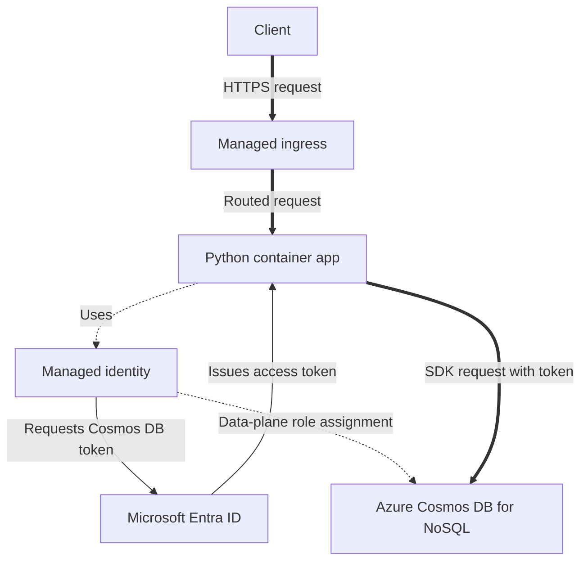

---
content_sources:
  diagrams:
    - id: architecture
      type: flowchart
      source: mslearn-adapted
      based_on:
        - https://learn.microsoft.com/en-us/azure/cosmos-db/nosql/how-to-connect-role-based-access-control
        - https://learn.microsoft.com/en-us/azure/cosmos-db/nosql/quickstart-python
---
# Cosmos DB Integration (Managed Identity)

Use this recipe to connect a Python Container App to Azure Cosmos DB (NoSQL) without account keys or connection strings.

## Architecture

<!-- diagram-id: architecture -->


Thick arrows show request or SDK transport. Thin arrows show token exchange, and dotted arrows show identity and authorization associations.

## Prerequisites

- Existing Container App: `$APP_NAME` in resource group `$RG`
- Existing Cosmos DB account and SQL database/container
- Azure CLI with Container Apps and Cosmos extensions

```bash
az extension add --name containerapp --upgrade
az extension add --name cosmosdb-preview --upgrade
```

| Command | Why it is used |
|---|---|
| `az extension add` | Installs or upgrades the Azure CLI extension required by this procedure. |
| `--name` | Selects the named resource operated on in this recipe step. |
| `--upgrade` | Updates an existing extension so current command flags are available. |


## Step 1: Enable managed identity on the Container App

```bash
az containerapp identity assign \
  --name "$APP_NAME" \
  --resource-group "$RG" \
  --system-assigned
```

| Command | Why it is used |
|---|---|
| `az containerapp identity assign` | Assigns the managed identity required by this recipe. |
| `--name` | Selects the named resource operated on in this recipe step. |
| `--resource-group` | Selects the resource group that contains this step's target resource. |
| `--system-assigned` | Enables the system identity used by the app, job, or scaler. |


Get the managed identity principal ID:

```bash
export PRINCIPAL_ID=$(az containerapp show \
  --name "$APP_NAME" \
  --resource-group "$RG" \
  --query "identity.principalId" \
  --output tsv)
```

| Command | Why it is used |
|---|---|
| `az containerapp show` | Reads the Container App property needed by the next recipe step. |
| `--name` | Selects the named resource operated on in this recipe step. |
| `--resource-group` | Selects the resource group that contains this step's target resource. |
| `--query` | Extracts the exact resource property consumed by the next command. |
| `--output` | Returns the result in the format consumed by the shell or verification table. |


## Step 2: Grant Cosmos DB data-plane access

```bash
export COSMOS_ACCOUNT_ID=$(az cosmosdb show \
  --name "$COSMOS_ACCOUNT" \
  --resource-group "$RG" \
  --query "id" \
  --output tsv)

az role assignment create \
  --assignee-object-id "$PRINCIPAL_ID" \
  --assignee-principal-type ServicePrincipal \
  --role "Cosmos DB Built-in Data Contributor" \
  --scope "$COSMOS_ACCOUNT_ID"
```

| Command | Why it is used |
|---|---|
| `az cosmosdb show` | Reads the Cosmos DB account resource ID used as the role-assignment scope. |
| `az role assignment create` | Grants the managed identity the data-plane role required by this step. |
| `--name` | Selects the named resource operated on in this recipe step. |
| `--resource-group` | Selects the resource group that contains this step's target resource. |
| `--query` | Extracts the exact resource property consumed by the next command. |
| `--output` | Returns the result in the format consumed by the shell or verification table. |
| `--assignee-object-id` | Targets the managed identity principal without a Microsoft Graph lookup. |
| `--assignee-principal-type` | Declares the managed identity as a service principal. |
| `--role` | Selects the least-privilege data-plane role required by this identity. |
| `--scope` | Limits the role or policy assignment to the resource used by this recipe. |


## Step 3: Configure endpoint in Container Apps settings

Only store non-secret values as plain environment variables.

```bash
az containerapp update \
  --name "$APP_NAME" \
  --resource-group "$RG" \
  --set-env-vars COSMOS_ENDPOINT="https://$COSMOS_ACCOUNT.documents.azure.com:443/" COSMOS_DATABASE="$COSMOS_DATABASE" COSMOS_CONTAINER="$COSMOS_CONTAINER"
```

| Command | Why it is used |
|---|---|
| `az containerapp update` | Updates the selected Container App with this step's image or configuration. |
| `--name` | Selects the named resource operated on in this recipe step. |
| `--resource-group` | Selects the resource group that contains this step's target resource. |
| `--set-env-vars` | Adds the recipe's runtime settings to the new app revision. |


## Step 4: Python code (passwordless access)

Install dependencies:

```bash
pip install azure-identity azure-cosmos
```

Use `DefaultAzureCredential` in your app:

```python
import os
from azure.identity import DefaultAzureCredential
from azure.cosmos import CosmosClient

credential = DefaultAzureCredential()
endpoint = os.environ["COSMOS_ENDPOINT"]
database_name = os.environ["COSMOS_DATABASE"]
container_name = os.environ["COSMOS_CONTAINER"]

client = CosmosClient(url=endpoint, credential=credential)
database = client.get_database_client(database_name)
container = database.get_container_client(container_name)

item = {"id": "order-1001", "type": "order", "status": "created"}
container.upsert_item(item)

stored = container.read_item(item="order-1001", partition_key="order-1001")
print(stored)
```

## Verification steps

1. Confirm identity assignment:

```bash
az containerapp show \
  --name "$APP_NAME" \
  --resource-group "$RG" \
  --query "identity" \
  --output json
```

| Command | Why it is used |
|---|---|
| `az containerapp show` | Reads the Container App property needed by the next recipe step. |
| `--name` | Selects the named resource operated on in this recipe step. |
| `--resource-group` | Selects the resource group that contains this step's target resource. |
| `--query` | Extracts the exact resource property consumed by the next command. |
| `--output` | Returns the result in the format consumed by the shell or verification table. |


2. Confirm role assignment exists:

```bash
az role assignment list \
  --assignee "$PRINCIPAL_ID" \
  --scope "$COSMOS_ACCOUNT_ID" \
  --output table
```

| Command | Why it is used |
|---|---|
| `az role assignment list` | Lists matching Azure role assignments for verification. |
| `--assignee` | Filters assignments to the identity being verified. |
| `--scope` | Limits the role or policy assignment to the resource used by this recipe. |
| `--output` | Returns the result in the format consumed by the shell or verification table. |


3. Check app logs for successful read/write operations.

```bash
az containerapp logs show \
  --name "$APP_NAME" \
  --resource-group "$RG" \
  --follow false
```

| Command | Why it is used |
|---|---|
| `az containerapp logs show` | Streams or retrieves logs from the selected app or revision for verification. |
| `--name` | Selects the named resource operated on in this recipe step. |
| `--resource-group` | Selects the resource group that contains this step's target resource. |
| `--follow` | Continues streaming new log records during verification. |


## See Also
- [Managed Identity](../../../platform/identity-and-secrets/managed-identity.md)
- [Private Endpoints](../../../platform/networking/private-endpoints.md)

## Sources
- [Azure Cosmos DB for NoSQL RBAC](https://learn.microsoft.com/en-us/azure/cosmos-db/nosql/how-to-connect-role-based-access-control)
- [Azure Cosmos DB for NoSQL Python quickstart (Microsoft Learn)](https://learn.microsoft.com/en-us/azure/cosmos-db/nosql/quickstart-python)
