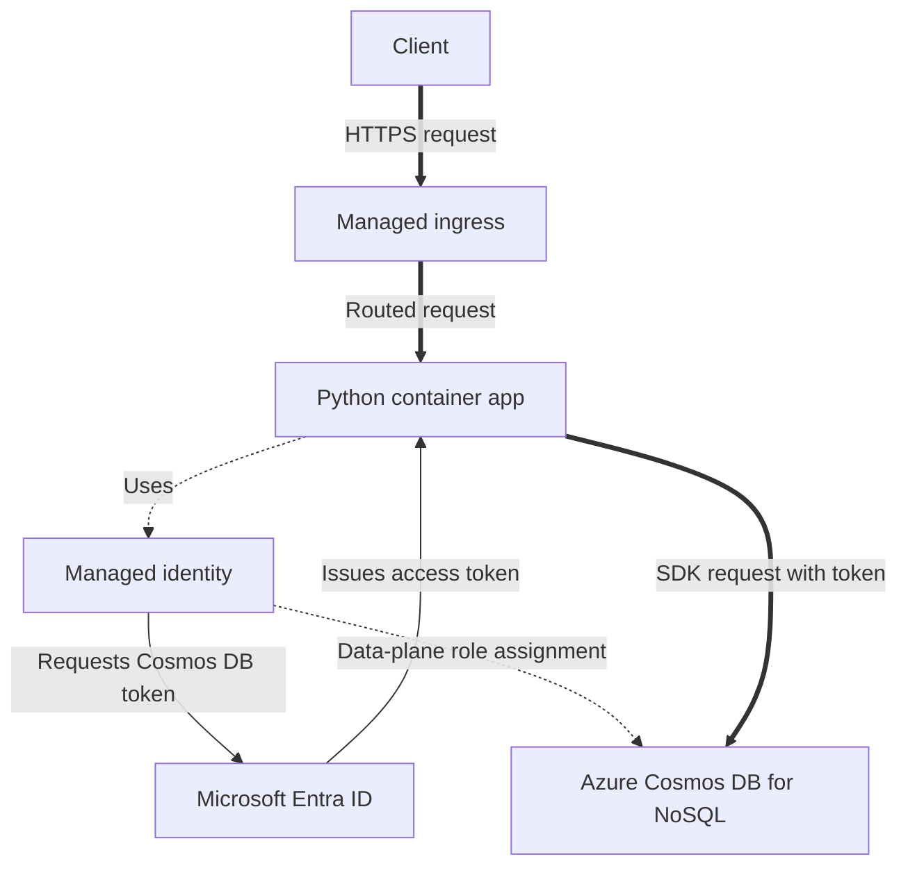

---
content_sources:
  diagrams:
    - id: architecture
      type: flowchart
      source: mslearn-adapted
      based_on:
        - https://learn.microsoft.com/en-us/azure/cosmos-db/nosql/how-to-connect-role-based-access-control
        - https://learn.microsoft.com/en-us/azure/cosmos-db/nosql/quickstart-python
---
# Cosmos DB Integration (Managed Identity)

Use this recipe to connect a Python Container App to Azure Cosmos DB (NoSQL) without account keys or connection strings.

## Architecture

<!-- diagram-id: architecture -->


Thick arrows show request or SDK transport. Thin arrows show token exchange, and dotted arrows show identity and authorization associations.

## Prerequisites

- Existing Container App: `$APP_NAME` in resource group `$RG`
- Existing Cosmos DB account and SQL database/container
- Azure CLI with Container Apps and Cosmos extensions

```bash
az extension add --name containerapp --upgrade
az extension add --name cosmosdb-preview --upgrade
```

| Command | Why it is used |
|---|---|
| `az extension add` | Installs the Container Apps and Cosmos DB command groups used by this integration workflow. |
| `--name` | Selects `containerapp` for app management and `cosmosdb-preview` for the Cosmos DB commands used in this workflow. |
| `--upgrade` | Refreshes both installed extensions so the identity and Cosmos DB command options used in this recipe are current. |


## Step 1: Enable managed identity on the Container App

```bash
az containerapp identity assign \
  --name "$APP_NAME" \
  --resource-group "$RG" \
  --system-assigned
```

| Command | Why it is used |
|---|---|
| `az containerapp identity assign` | Enables the system identity that `$APP_NAME` will use for keyless Cosmos DB data access. |
| `--name` | Selects `$APP_NAME` as the workload receiving the Cosmos DB identity. |
| `--resource-group` | Finds `$APP_NAME` in `$RG` before enabling its system identity. |
| `--system-assigned` | Enables the system-assigned identity on the resource modified by `az containerapp identity assign`. |


Get the managed identity principal ID:

```bash
export PRINCIPAL_ID=$(az containerapp show \
  --name "$APP_NAME" \
  --resource-group "$RG" \
  --query "identity.principalId" \
  --output tsv)
```

| Command | Why it is used |
|---|---|
| `az containerapp show` | Retrieves the system identity principal that will receive Cosmos DB data-plane access. |
| `--name` | Targets `$APP_NAME`, whose principal ID receives Cosmos DB access. |
| `--resource-group` | Scopes the Cosmos DB identity lookup to `$RG`. |
| `--query` | Selects the app identity's `principalId` for the following role assignment. |
| `--output` | Emits the principal ID without JSON quoting so it can be stored in `PRINCIPAL_ID`. |


## Step 2: Grant Cosmos DB data-plane access

```bash
export COSMOS_ACCOUNT_ID=$(az cosmosdb show \
  --name "$COSMOS_ACCOUNT" \
  --resource-group "$RG" \
  --query "id" \
  --output tsv)

az role assignment create \
  --assignee-object-id "$PRINCIPAL_ID" \
  --assignee-principal-type ServicePrincipal \
  --role "Cosmos DB Built-in Data Contributor" \
  --scope "$COSMOS_ACCOUNT_ID"
```

| Command | Why it is used |
|---|---|
| `az cosmosdb show` | Retrieves `$COSMOS_ACCOUNT`'s resource ID to define the boundary of the data-plane permission grant. |
| `az role assignment create` | Grants the app principal Cosmos DB data contributor access at the selected account scope. |
| `az cosmosdb show --name` | Targets `$COSMOS_ACCOUNT` for Cosmos DB account scope lookup. |
| `az cosmosdb show --resource-group` | Scopes Cosmos DB account scope lookup to `$RG`. |
| `az cosmosdb show --query` | Extracts the Cosmos DB account resource ID that becomes the data-contributor assignment scope. |
| `az cosmosdb show --output` | Writes the account ID as unquoted text for reuse in `COSMOS_ACCOUNT_ID`. |
| `az role assignment create --assignee-object-id` | Assigns Cosmos DB data access to the Container App's system principal. |
| `az role assignment create --assignee-principal-type` | Configures the role-assignment principal type as `ServicePrincipal` on `az role assignment create`. |
| `az role assignment create --role` | Grants the app permission to read and write Cosmos DB items without account keys. |
| `az role assignment create --scope` | Restricts the data-contributor grant to the selected Cosmos DB account. |


## Step 3: Configure endpoint in Container Apps settings

Only store non-secret values as plain environment variables.

```bash
az containerapp update \
  --name "$APP_NAME" \
  --resource-group "$RG" \
  --set-env-vars COSMOS_ENDPOINT="https://$COSMOS_ACCOUNT.documents.azure.com:443/" COSMOS_DATABASE="$COSMOS_DATABASE" COSMOS_CONTAINER="$COSMOS_CONTAINER"
```

| Command | Why it is used |
|---|---|
| `az containerapp update` | Writes the Cosmos DB endpoint, database, and container names into a new `$APP_NAME` revision. |
| `--name` | Targets `$APP_NAME`, which receives the Cosmos DB endpoint settings. |
| `--resource-group` | Scopes the Cosmos DB configuration update to `$RG`. |
| `--set-env-vars` | Configures the environment variables written to the workload as `COSMOS_ENDPOINT=https://$COSMOS_ACCOUNT.documents.azure.com:443/`, `COSMOS_DATABASE=$COSMOS_DATABASE`, `COSMOS_CONTAINER=$COSMOS_CONTAINER` on `az containerapp update`. |


## Step 4: Python code (passwordless access)

Install dependencies:

```bash
pip install azure-identity azure-cosmos
```

Use `DefaultAzureCredential` in your app:

```python
import os
from azure.identity import DefaultAzureCredential
from azure.cosmos import CosmosClient

credential = DefaultAzureCredential()
endpoint = os.environ["COSMOS_ENDPOINT"]
database_name = os.environ["COSMOS_DATABASE"]
container_name = os.environ["COSMOS_CONTAINER"]

client = CosmosClient(url=endpoint, credential=credential)
database = client.get_database_client(database_name)
container = database.get_container_client(container_name)

item = {"id": "order-1001", "type": "order", "status": "created"}
container.upsert_item(item)

stored = container.read_item(item="order-1001", partition_key="order-1001")
print(stored)
```

## Verification steps

1. Confirm identity assignment:

```bash
az containerapp show \
  --name "$APP_NAME" \
  --resource-group "$RG" \
  --query "identity" \
  --output json
```

| Command | Why it is used |
|---|---|
| `az containerapp show` | Returns `$APP_NAME` identity configuration to confirm the principal used for Cosmos DB data-plane access is enabled. |
| `--name` | Targets `$APP_NAME`, whose Cosmos DB environment settings are verified. |
| `--resource-group` | Scopes the Cosmos DB settings check to `$RG`. |
| `--query` | Isolates the complete identity block so the enabled principal can be checked. |
| `--output` | Preserves the identity type and principal fields in structured JSON for verification. |


2. Confirm role assignment exists:

```bash
az role assignment list \
  --assignee "$PRINCIPAL_ID" \
  --scope "$COSMOS_ACCOUNT_ID" \
  --output table
```

| Command | Why it is used |
|---|---|
| `az role assignment list` | Lists assignments for `$PRINCIPAL_ID` at `$COSMOS_ACCOUNT_ID` to confirm the expected Cosmos DB access grant exists. |
| `--assignee` | Configures the principal whose assignments are listed as `$PRINCIPAL_ID` on `az role assignment list`. |
| `--scope` | Filters assignments to the Cosmos DB account rather than unrelated grants for the same principal. |
| `--output` | Renders matching assignments as a table for a quick role-and-scope check. |


3. Check app logs for successful read/write operations.

```bash
az containerapp logs show \
  --name "$APP_NAME" \
  --resource-group "$RG" \
  --follow false
```

| Command | Why it is used |
|---|---|
| `az containerapp logs show` | Retrieves `$APP_NAME` runtime logs to confirm the sample item write and read complete without authorization errors. |
| `--name` | Targets `$APP_NAME`, whose logs reveal Cosmos DB authorization results. |
| `--resource-group` | Locates `$APP_NAME` in `$RG` for the Cosmos DB authorization log check. |
| `--follow` | Returns existing Cosmos DB test logs without holding the terminal open for new entries. |


## See Also
- [Managed Identity](../../../platform/identity-and-secrets/managed-identity.md)
- [Private Endpoints](../../../platform/networking/private-endpoints.md)

## Sources
- [Azure Cosmos DB for NoSQL RBAC](https://learn.microsoft.com/en-us/azure/cosmos-db/nosql/how-to-connect-role-based-access-control)
- [Azure Cosmos DB for NoSQL Python quickstart (Microsoft Learn)](https://learn.microsoft.com/en-us/azure/cosmos-db/nosql/quickstart-python)
