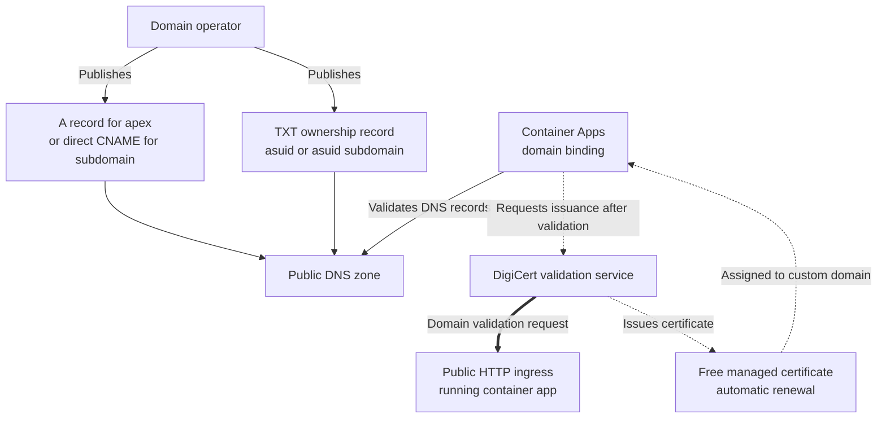
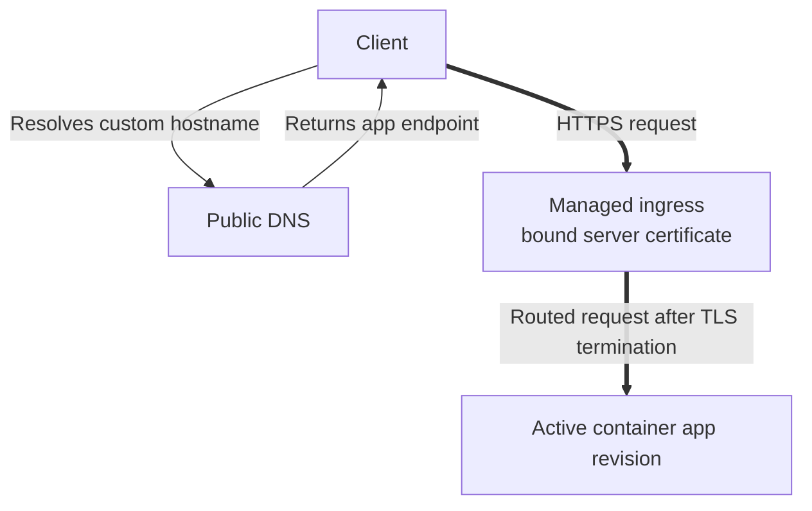

---
content_sources:
  diagrams:
    - id: architecture
      type: flowchart
      source: mslearn-adapted
      based_on:
        - https://learn.microsoft.com/en-us/azure/container-apps/custom-domains-managed-certificates
        - https://learn.microsoft.com/en-us/azure/container-apps/private-endpoints-with-dns
    - id: digi-cert-managed-certificate-issued
      type: flowchart
      source: mslearn-adapted
      based_on:
        - https://learn.microsoft.com/en-us/azure/container-apps/custom-domains-managed-certificates
        - https://learn.microsoft.com/en-us/azure/container-apps/private-endpoints-with-dns
---
# Custom Domains and Certificates

Azure Container Apps supports custom hostnames and TLS certificates so you can serve production traffic on your own domain instead of the default `azurecontainerapps.io` endpoint. Managed certificates are validated through DigiCert and require public DNS reachability during issuance.

## Architecture

<!-- diagram-id: architecture -->


Thick arrows show the validation request path. Thin and dotted arrows show DNS, issuance, and binding relationships.

<!-- diagram-id: digi-cert-managed-certificate-issued -->


Thick arrows show request transport; thin arrows show DNS resolution.

## Prerequisites

- Existing Container App: `$APP_NAME` in `$RG`
- Existing Container Apps environment: `$ACA_ENV_NAME`
- A public DNS zone you control for your domain
- Azure CLI with Container Apps extension

```bash
az extension add --name containerapp --upgrade
```

| Command | Why it is used |
|---|---|
| `az extension add` | Installs the Container Apps hostname and certificate commands used to bind the custom domain. |
| `--name` | Selects `containerapp` as the extension that provides domain-management commands. |
| `--upgrade` | Refreshes the Container Apps extension before running its hostname and managed-certificate commands. |


## Configure Custom Domain

1. Get environment static IP (used for apex A record) and app default FQDN (used for subdomain CNAME):

```bash
export ENV_STATIC_IP=$(az containerapp env show \
  --name "$ACA_ENV_NAME" \
  --resource-group "$RG" \
  --query "properties.staticIp" \
  --output tsv)

export APP_FQDN=$(az containerapp show \
  --name "$APP_NAME" \
  --resource-group "$RG" \
  --query "properties.configuration.ingress.fqdn" \
  --output tsv)
```

| Command | Why it is used |
|---|---|
| `az containerapp env show` | Returns the environment static IP required for the apex-domain A record. |
| `az containerapp show` | Retrieves the default app hostname used as the subdomain CNAME target. |
| `--name` | Targets `$ACA_ENV_NAME`, `$APP_NAME` for Container App property inspection. |
| `--resource-group` | Scopes the environment IP and app FQDN lookups to `$RG`. |
| `--query` | Extracts the environment IP and app FQDN that become the apex A record and `www` CNAME targets. |
| `--output` | Captures both DNS targets as shell-ready scalar values. |


2. Get the domain verification value (`asuid`) from the app:

```bash
export CUSTOM_DOMAIN_VERIFICATION_ID=$(az containerapp show \
  --name "$APP_NAME" \
  --resource-group "$RG" \
  --query "properties.customDomainVerificationId" \
  --output tsv)
```

| Command | Why it is used |
|---|---|
| `az containerapp show` | Retrieves the ownership token that must be published in the `asuid` TXT record. |
| `--name` | Targets `$APP_NAME`, whose domain-verification token is required by DNS. |
| `--resource-group` | Finds `$APP_NAME` in `$RG` before reading its custom-domain ownership token. |
| `--query` | Isolates the app's custom-domain verification ID from the broader resource document. |
| `--output` | Stores the token without JSON quotes in `CUSTOM_DOMAIN_VERIFICATION_ID`. |


3. Create DNS records (example with Azure DNS):

```bash
# Apex domain example: contoso.com -> environment static IP
az network dns record-set a add-record \
  --resource-group "$DNS_RG" \
  --zone-name "contoso.com" \
  --record-set-name "@" \
  --ipv4-address "$ENV_STATIC_IP"

# Subdomain example: www.contoso.com -> app FQDN
az network dns record-set cname set-record \
  --resource-group "$DNS_RG" \
  --zone-name "contoso.com" \
  --record-set-name "www" \
  --cname "$APP_FQDN"

# TXT verification record required by Container Apps
az network dns record-set txt add-record \
  --resource-group "$DNS_RG" \
  --zone-name "contoso.com" \
  --record-set-name "asuid.www" \
  --value "$CUSTOM_DOMAIN_VERIFICATION_ID"
```

| Command | Why it is used |
|---|---|
| `az network dns record-set a add-record` | Points the `contoso.com` apex record to the Container Apps environment static IP. |
| `az network dns record-set cname set-record` | Points `www.contoso.com` to the Container App default FQDN. |
| `az network dns record-set txt add-record` | Publishes the `asuid.www` token that proves ownership of `www.contoso.com`. |
| `--resource-group` | Publishes the A, CNAME, and ownership TXT records in the DNS zone hosted by `$DNS_RG`. |
| `--zone-name` | Configures the private DNS zone or zone-group label as `contoso.com` on `az network dns record-set a add-record`, `az network dns record-set cname set-record` and `az network dns record-set txt add-record`. |
| `--record-set-name` | Configures the record set name as `@`, `www`, `asuid.www` on `az network dns record-set a add-record`, `az network dns record-set cname set-record` and `az network dns record-set txt add-record`. |
| `az network dns record-set a add-record --ipv4-address` | Configures the ipv4 address as `$ENV_STATIC_IP` on `az network dns record-set a add-record`. |
| `az network dns record-set cname set-record --cname` | Configures the cname as `$APP_FQDN` on `az network dns record-set cname set-record`. |
| `az network dns record-set txt add-record --value` | Configures the secret value as `$CUSTOM_DOMAIN_VERIFICATION_ID` on `az network dns record-set txt add-record`. |


4. Add hostname to the Container App:

```bash
az containerapp hostname add \
  --name "$APP_NAME" \
  --resource-group "$RG" \
  --hostname "www.contoso.com"
```

| Command | Why it is used |
|---|---|
| `az containerapp hostname add` | Registers `www.contoso.com` on `$APP_NAME` after DNS ownership is published. |
| `--name` | Selects `$APP_NAME` as the Container App accepting `www.contoso.com`. |
| `--resource-group` | Finds the target app in `$RG` before adding the custom hostname. |
| `--hostname` | Configures the hostname as `www.contoso.com` on `az containerapp hostname add`. |


## Create Managed Certificate

Bind the hostname with a managed certificate. The certificate is automatically provisioned and validated using DNS.

```bash
az containerapp hostname bind \
  --name "$APP_NAME" \
  --resource-group "$RG" \
  --hostname "www.contoso.com" \
  --environment "$ACA_ENV_NAME" \
  --validation-method CNAME
```

| Command | Why it is used |
|---|---|
| `az containerapp hostname bind` | Requests and binds a managed certificate for `www.contoso.com` on `$APP_NAME`. |
| `--name` | Selects `$APP_NAME` as the app receiving the managed certificate binding. |
| `--resource-group` | Locates the custom-domain app in `$RG` before requesting its certificate. |
| `--hostname` | Configures the hostname as `www.contoso.com` on `az containerapp hostname bind`. |
| `--environment` | Resolves the managed environment that owns the hostname binding. |
| `--validation-method` | Configures the validation method as `CNAME` on `az containerapp hostname bind`. |


If you bring your own certificate instead of managed issuance, upload it to the environment with `az containerapp env certificate upload` and then bind it with `az containerapp hostname bind --certificate <cert-name>`.

## Enforce HTTPS

Set ingress transport to HTTPS-only:

```bash
az containerapp ingress update \
  --name "$APP_NAME" \
  --resource-group "$RG" \
  --transport auto \
  --allow-insecure false
```

| Command | Why it is used |
|---|---|
| `az containerapp ingress update` | Enforces HTTPS-only ingress while retaining automatic HTTP transport selection. |
| `--name` | Selects `$APP_NAME` as the app whose custom-domain ingress will reject plain HTTP. |
| `--resource-group` | Finds `$APP_NAME` in `$RG` before enforcing HTTPS-only ingress. |
| `--transport` | Configures the ingress transport protocol as `auto` on `az containerapp ingress update`. |
| `--allow-insecure` | Configures the unencrypted ingress allowance as `false` on `az containerapp ingress update`. |

## Verification

```bash
az containerapp hostname list \
  --name "$APP_NAME" \
  --resource-group "$RG" \
  --output table

az containerapp env certificate list \
  --name "$ACA_ENV_NAME" \
  --resource-group "$RG" \
  --output table
```

| Command | Why it is used |
|---|---|
| `az containerapp env certificate list` | Lists environment certificates to confirm the managed certificate is provisioned. |
| `az containerapp hostname list` | Lists app hostnames to confirm `www.contoso.com` is bound and secured. |
| `--name` | Targets `$APP_NAME`, `$ACA_ENV_NAME` for custom-hostname verification and managed-certificate verification. |
| `--resource-group` | Scopes custom-hostname verification and managed-certificate verification to `$RG`. |
| `--output` | Places hostname binding and certificate provisioning states in comparable table columns. |


Then verify HTTPS from a client:

```bash
curl --verbose https://www.contoso.com/
```

## Troubleshooting

- **Managed certificate remains pending/failed**: confirm the app hostname is publicly reachable and DNS records have propagated.
- **DigiCert validation fails**: verify `asuid.<host>` TXT record value exactly matches the app verification ID.
- **CAA record blocks issuance**: ensure your CAA policy allows DigiCert certificate issuance for your domain.
- **HTTPS still not active**: confirm hostname is bound to the expected certificate and certificate status is `Ready`.

## Advanced Topics

- Use apex + subdomain patterns together (A record for apex, CNAME for subdomain).
- Standardize DNS TTL strategy to reduce cutover delays during migration.
- Pair custom domains with WAF/CDN when you need global edge security and acceleration.

## See Also
- [Networking](../../../platform/networking/vnet-integration.md)

## Sources
- [Container Apps custom domains and managed certificates (Microsoft Learn)](https://learn.microsoft.com/en-us/azure/container-apps/custom-domains-managed-certificates)
- [Container Apps environment custom DNS (Microsoft Learn)](https://learn.microsoft.com/en-us/azure/container-apps/private-endpoints-with-dns)
