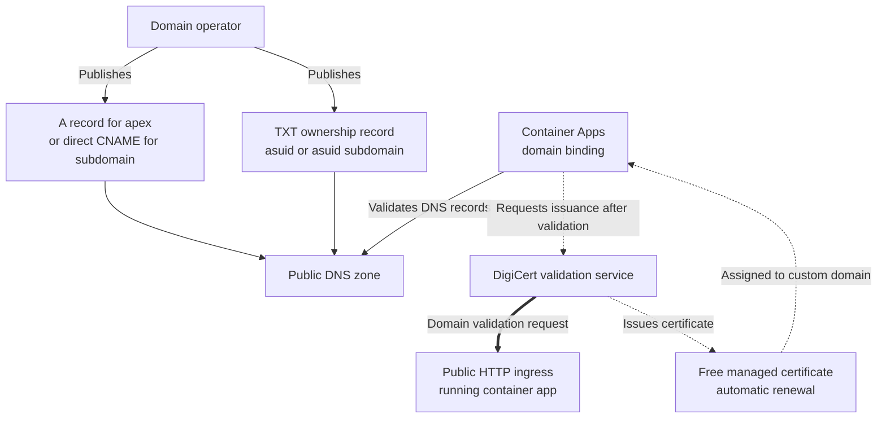
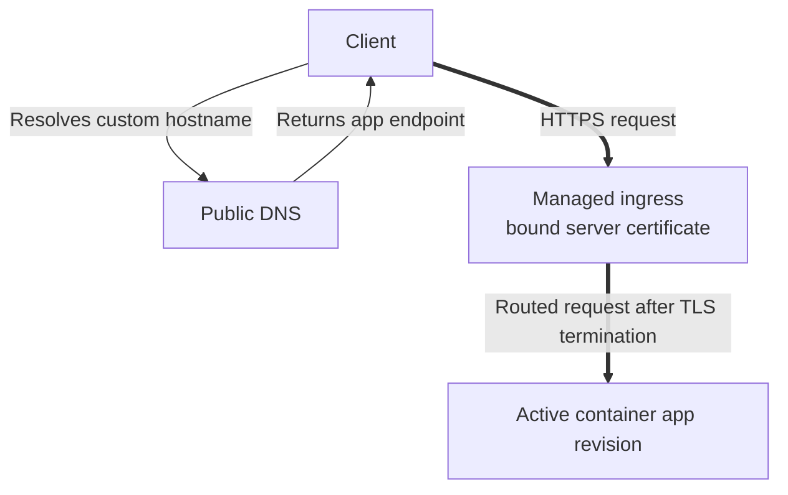

---
content_sources:
  diagrams:
    - id: architecture
      type: flowchart
      source: mslearn-adapted
      based_on:
        - https://learn.microsoft.com/en-us/azure/container-apps/custom-domains-managed-certificates
        - https://learn.microsoft.com/en-us/azure/container-apps/private-endpoints-with-dns
    - id: digi-cert-managed-certificate-issued
      type: flowchart
      source: mslearn-adapted
      based_on:
        - https://learn.microsoft.com/en-us/azure/container-apps/custom-domains-managed-certificates
        - https://learn.microsoft.com/en-us/azure/container-apps/private-endpoints-with-dns
---
# Custom Domains and Certificates

Azure Container Apps supports custom hostnames and TLS certificates so you can serve production traffic on your own domain instead of the default `azurecontainerapps.io` endpoint. Managed certificates are validated through DigiCert and require public DNS reachability during issuance.

## Architecture

<!-- diagram-id: architecture -->


Thick arrows show the validation request path. Thin and dotted arrows show DNS, issuance, and binding relationships.

<!-- diagram-id: digi-cert-managed-certificate-issued -->


Thick arrows show request transport; thin arrows show DNS resolution.

## Prerequisites

- Existing Container App: `$APP_NAME` in `$RG`
- Existing Container Apps environment: `$ACA_ENV_NAME`
- A public DNS zone you control for your domain
- Azure CLI with Container Apps extension

```bash
az extension add --name containerapp --upgrade
```

| Command | Why it is used |
|---|---|
| `az extension add` | Installs or upgrades the Azure CLI extension required by this procedure. |
| `--name` | Selects the named resource operated on in this recipe step. |
| `--upgrade` | Updates an existing extension so current command flags are available. |


## Configure Custom Domain

1. Get environment static IP (used for apex A record) and app default FQDN (used for subdomain CNAME):

```bash
export ENV_STATIC_IP=$(az containerapp env show \
  --name "$ACA_ENV_NAME" \
  --resource-group "$RG" \
  --query "properties.staticIp" \
  --output tsv)

export APP_FQDN=$(az containerapp show \
  --name "$APP_NAME" \
  --resource-group "$RG" \
  --query "properties.configuration.ingress.fqdn" \
  --output tsv)
```

| Command | Why it is used |
|---|---|
| `az containerapp env show` | Reads the Container Apps environment property needed for DNS configuration. |
| `az containerapp show` | Reads the Container App property needed by the next recipe step. |
| `--name` | Selects the named resource operated on in this recipe step. |
| `--resource-group` | Selects the resource group that contains this step's target resource. |
| `--query` | Extracts the exact resource property consumed by the next command. |
| `--output` | Returns the result in the format consumed by the shell or verification table. |


2. Get the domain verification value (`asuid`) from the app:

```bash
export CUSTOM_DOMAIN_VERIFICATION_ID=$(az containerapp show \
  --name "$APP_NAME" \
  --resource-group "$RG" \
  --query "properties.customDomainVerificationId" \
  --output tsv)
```

| Command | Why it is used |
|---|---|
| `az containerapp show` | Reads the Container App property needed by the next recipe step. |
| `--name` | Selects the named resource operated on in this recipe step. |
| `--resource-group` | Selects the resource group that contains this step's target resource. |
| `--query` | Extracts the exact resource property consumed by the next command. |
| `--output` | Returns the result in the format consumed by the shell or verification table. |


3. Create DNS records (example with Azure DNS):

```bash
# Apex domain example: contoso.com -> environment static IP
az network dns record-set a add-record \
  --resource-group "$DNS_RG" \
  --zone-name "contoso.com" \
  --record-set-name "@" \
  --ipv4-address "$ENV_STATIC_IP"

# Subdomain example: www.contoso.com -> app FQDN
az network dns record-set cname set-record \
  --resource-group "$DNS_RG" \
  --zone-name "contoso.com" \
  --record-set-name "www" \
  --cname "$APP_FQDN"

# TXT verification record required by Container Apps
az network dns record-set txt add-record \
  --resource-group "$DNS_RG" \
  --zone-name "contoso.com" \
  --record-set-name "asuid.www" \
  --value "$CUSTOM_DOMAIN_VERIFICATION_ID"
```

| Command | Why it is used |
|---|---|
| `az network dns record-set a add-record` | Adds the apex-domain address record required for the custom domain. |
| `az network dns record-set cname set-record` | Sets the subdomain alias that targets the Container App hostname. |
| `az network dns record-set txt add-record` | Adds the domain-ownership verification record. |
| `--resource-group` | Selects the resource group that contains this step's target resource. |
| `--zone-name` | Selects or names the DNS zone association used by the endpoint. |
| `--record-set-name` | Selects the DNS record set updated for this hostname. |
| `--ipv4-address` | Sets the apex-domain record to the environment's ingress address. |
| `--cname` | Points the custom subdomain at the Container App hostname. |
| `--value` | Sets the recipe's named secret or DNS verification value. |


4. Add hostname to the Container App:

```bash
az containerapp hostname add \
  --name "$APP_NAME" \
  --resource-group "$RG" \
  --hostname "www.contoso.com"
```

| Command | Why it is used |
|---|---|
| `az containerapp hostname add` | Adds the custom hostname to the selected Container App. |
| `--name` | Selects the named resource operated on in this recipe step. |
| `--resource-group` | Selects the resource group that contains this step's target resource. |
| `--hostname` | Selects the custom hostname being added or bound. |


## Create Managed Certificate

Bind the hostname with a managed certificate. The certificate is automatically provisioned and validated using DNS.

```bash
az containerapp hostname bind \
  --name "$APP_NAME" \
  --resource-group "$RG" \
  --hostname "www.contoso.com" \
  --environment "$ACA_ENV_NAME" \
  --validation-method CNAME
```

| Command | Why it is used |
|---|---|
| `az containerapp hostname bind` | Binds the custom hostname and managed certificate to the app. |
| `--name` | Selects the named resource operated on in this recipe step. |
| `--resource-group` | Selects the resource group that contains this step's target resource. |
| `--hostname` | Selects the custom hostname being added or bound. |
| `--environment` | Places the app or job in the specified Container Apps environment. |
| `--validation-method` | Uses the documented certificate validation method for the hostname. |


If you bring your own certificate instead of managed issuance, upload it to the environment with `az containerapp env certificate upload` and then bind it with `az containerapp hostname bind --certificate <cert-name>`.

## Enforce HTTPS

Set ingress transport to HTTPS-only:

```bash
az containerapp ingress update \
  --name "$APP_NAME" \
  --resource-group "$RG" \
  --transport auto \
  --allow-insecure false
```

| Command | Why it is used |
|---|---|
| `az containerapp ingress update` | Enforces secure HTTP ingress settings on the existing Container App. |
| `--name` | Selects the Container App that serves the custom domain. |
| `--resource-group` | Selects the resource group containing the app. |
| `--transport` | Uses automatic HTTP transport negotiation for the ingress endpoint. |
| `--allow-insecure` | Disables insecure HTTP access to the custom domain. |

## Verification

```bash
az containerapp hostname list \
  --name "$APP_NAME" \
  --resource-group "$RG" \
  --output table

az containerapp env certificate list \
  --name "$ACA_ENV_NAME" \
  --resource-group "$RG" \
  --output table
```

| Command | Why it is used |
|---|---|
| `az containerapp env certificate list` | Lists managed certificates for the selected Container Apps environment. |
| `az containerapp hostname list` | Lists the custom hostnames configured on the Container App. |
| `--name` | Selects the named resource operated on in this recipe step. |
| `--resource-group` | Selects the resource group that contains this step's target resource. |
| `--output` | Returns the result in the format consumed by the shell or verification table. |


Then verify HTTPS from a client:

```bash
curl --verbose https://www.contoso.com/
```

## Troubleshooting

- **Managed certificate remains pending/failed**: confirm the app hostname is publicly reachable and DNS records have propagated.
- **DigiCert validation fails**: verify `asuid.<host>` TXT record value exactly matches the app verification ID.
- **CAA record blocks issuance**: ensure your CAA policy allows DigiCert certificate issuance for your domain.
- **HTTPS still not active**: confirm hostname is bound to the expected certificate and certificate status is `Ready`.

## Advanced Topics

- Use apex + subdomain patterns together (A record for apex, CNAME for subdomain).
- Standardize DNS TTL strategy to reduce cutover delays during migration.
- Pair custom domains with WAF/CDN when you need global edge security and acceleration.

## See Also
- [Networking](../../../platform/networking/vnet-integration.md)

## Sources
- [Container Apps custom domains and managed certificates (Microsoft Learn)](https://learn.microsoft.com/en-us/azure/container-apps/custom-domains-managed-certificates)
- [Container Apps environment custom DNS (Microsoft Learn)](https://learn.microsoft.com/en-us/azure/container-apps/private-endpoints-with-dns)
