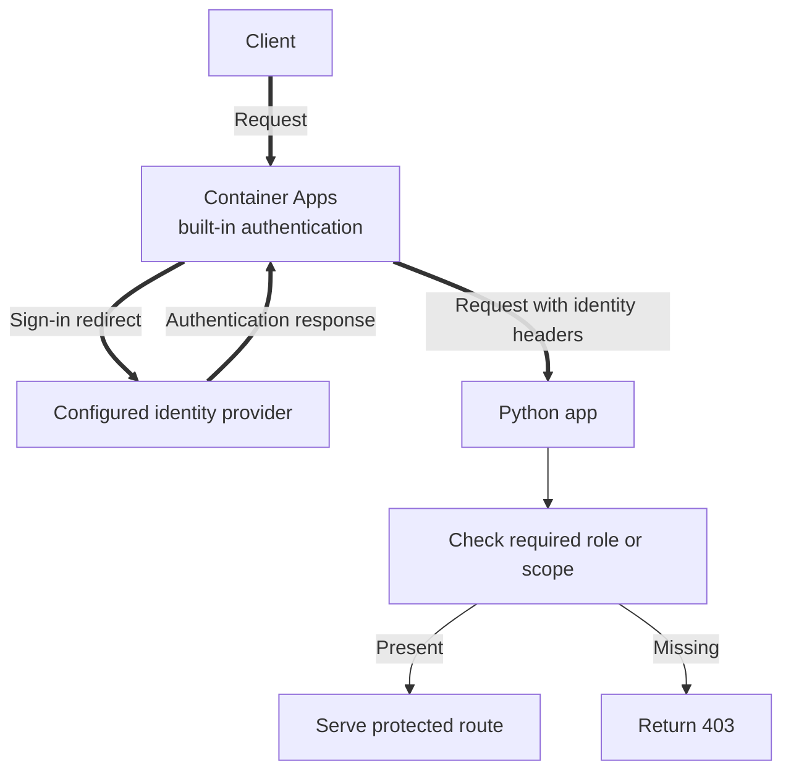

---
content_sources:
  diagrams:
    - id: use-container-apps-authentication-easy-auth
      type: flowchart
      source: mslearn-adapted
      based_on:
        - https://learn.microsoft.com/en-us/azure/container-apps/authentication
        - https://learn.microsoft.com/en-us/azure/container-apps/authentication
---
# Recipe: Easy Auth (Built-in Authentication) for Python Apps

Use Container Apps authentication (Easy Auth) to offload sign-in and token handling, then apply app-level authorization in Flask.

<!-- diagram-id: use-container-apps-authentication-easy-auth -->


Thick arrows show browser and application requests. The decision remains in Flask because built-in authentication establishes identity but does not replace app-specific authorization.

## Prerequisites

- Container App with ingress enabled
- An identity provider app registration (for example Microsoft Entra ID)
- Azure CLI with Container Apps extension

```bash
az extension add --name containerapp --upgrade
```

| Command | Why it is used |
|---|---|
| `az extension add` | Installs the Container Apps extension that provides the authentication configuration commands used below. |
| `--name` | Chooses the `containerapp` extension rather than another Azure CLI extension. |
| `--upgrade` | Refreshes an installed extension so the Easy Auth command surface is current. |


## Supported identity providers

Container Apps authentication supports providers such as:

- Microsoft Entra ID
- Google
- GitHub
- X (Twitter)
- Apple
- OpenID Connect-compatible providers

## Enable Easy Auth via CLI

```bash
az containerapp auth update \
  --name "$APP_NAME" \
  --resource-group "$RG" \
  --enabled true \
  --runtime-version "~1" \
  --unauthenticated-client-action RedirectToLoginPage
```

| Command | Why it is used |
|---|---|
| `az containerapp auth update` | Enables Easy Auth on `$APP_NAME` and redirects unauthenticated callers to the sign-in flow. |
| `--name` | Targets `$APP_NAME`, whose built-in authentication runtime is being enabled. |
| `--resource-group` | Scopes the authentication update to `$RG`, where `$APP_NAME` is deployed. |
| `--enabled` | Turns on the platform authentication middleware for `$APP_NAME`. |
| `--runtime-version` | Configures the runtime version as `~1` on `az containerapp auth update`. |
| `--unauthenticated-client-action` | Configures the unauthenticated client action as `RedirectToLoginPage` on `az containerapp auth update`. |


Provider configuration can then be added with provider-specific settings:

```bash
az containerapp auth microsoft update \
  --name "$APP_NAME" \
  --resource-group "$RG" \
  --client-id "$ENTRA_CLIENT_ID" \
  --client-secret-name "MICROSOFT_PROVIDER_AUTHENTICATION_SECRET" \
  --tenant-id "$TENANT_ID"
```

| Command | Why it is used |
|---|---|
| `az containerapp auth microsoft update` | Connects `$APP_NAME`'s Easy Auth configuration to the specified Microsoft Entra application and tenant. |
| `--name` | Targets `$APP_NAME`, whose Microsoft identity provider is being configured. |
| `--resource-group` | Scopes the provider update to `$RG`, where `$APP_NAME` is deployed. |
| `--client-id` | Configures the Microsoft provider client application as `$ENTRA_CLIENT_ID` on `az containerapp auth microsoft update`. |
| `--client-secret-name` | Configures the secret containing the provider credential as `MICROSOFT_PROVIDER_AUTHENTICATION_SECRET` on `az containerapp auth microsoft update`. |
| `--tenant-id` | Restricts Microsoft provider sign-in to accounts from `$ENTRA_TENANT_ID`. |


## Enable Easy Auth via Bicep

```bicep
resource app 'Microsoft.App/containerApps@2023-05-01' = {
  name: appName
  location: location
  properties: {
    configuration: {
      ingress: {
        external: true
        targetPort: 8000
      }
    }
  }
}

resource authConfig 'Microsoft.App/containerApps/authConfigs@2023-05-01' = {
  name: 'current'
  parent: app
  properties: {
    platform: {
      enabled: true
      runtimeVersion: '~1'
    }
    globalValidation: {
      unauthenticatedClientAction: 'RedirectToLoginPage'
    }
  }
}
```

## Access auth claims in Python (`X-MS-CLIENT-PRINCIPAL`)

```python
import base64
import json
from flask import Flask, request, g, jsonify

app = Flask(__name__)

def decode_client_principal(header_value: str) -> dict:
    decoded = base64.b64decode(header_value)
    return json.loads(decoded)

@app.before_request
def load_user_context():
    principal_header = request.headers.get("X-MS-CLIENT-PRINCIPAL")
    if principal_header:
        principal = decode_client_principal(principal_header)
        g.user_id = principal.get("userId")
        g.identity_provider = principal.get("identityProvider")
        g.claims = {claim["typ"]: claim["val"] for claim in principal.get("claims", [])}
    else:
        g.user_id = None
        g.identity_provider = None
        g.claims = {}

@app.get("/me")
def me():
    if not g.user_id:
        return jsonify(error="unauthenticated"), 401
    return jsonify(userId=g.user_id, identityProvider=g.identity_provider, claims=g.claims), 200
```

## Token validation patterns

- Rely on Easy Auth for primary token validation and session management.
- Enforce fine-grained authorization in app code (roles, groups, scopes).
- Restrict privileged routes with explicit checks on claim values.

```python
from functools import wraps
from flask import g, jsonify

def require_role(required_role: str):
    def decorator(fn):
        @wraps(fn)
        def wrapper(*args, **kwargs):
            roles = g.claims.get("roles", "")
            role_values = roles.split(",") if roles else []
            if required_role not in role_values:
                return jsonify(error="forbidden"), 403
            return fn(*args, **kwargs)
        return wrapper
    return decorator
```

## Combining Easy Auth with app-level authorization

1. Easy Auth verifies identity and injects principal headers.
2. Flask middleware extracts identity and claims.
3. Route decorators enforce domain authorization (for example, `admin`, `reader`, tenant boundary checks).

## Advanced Topics

- Use separate app registrations for production and non-production environments.
- Add custom claims transformation in an API gateway when needed.
- For service-to-service calls, use managed identity and OAuth client credential flows instead of user sessions.

## See Also

- [Managed Identity](managed-identity.md)
- [Key Vault Reference](key-vault-reference.md)
- [Identity and Secrets](../../../platform/identity-and-secrets/managed-identity.md)
- [Microsoft Learn: Authentication in Container Apps](https://learn.microsoft.com/en-us/azure/container-apps/authentication)

## Sources

- [Microsoft Learn source 1](https://learn.microsoft.com/en-us/azure/container-apps/authentication)
- [Microsoft Learn source 2](https://learn.microsoft.com/en-us/azure/container-apps/authentication)
