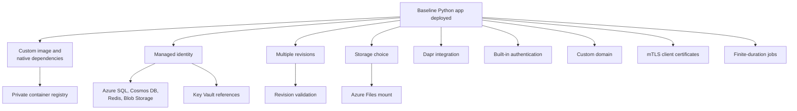

# Recipes: Integration Patterns for Azure Container Apps (Python)

Use these practical recipes to implement common production patterns for Python apps running on Azure Container Apps.

## Prerequisites

- Azure CLI 2.57+ with the Container Apps extension
- Existing Azure Container Apps environment (`$ACA_ENV_NAME`) and app (`$APP_NAME`)
- Resource group (`$RG`) and region (`$LOCATION`) variables set

```bash
az extension add --name containerapp --upgrade
az login
```

| Command | Why it is used |
|---|---|
| `az extension add` | Installs or updates the Container Apps extension before any recipe commands are run. |
| `az login` | Opens an interactive Azure sign-in so subsequent recipe commands use the intended subscription context. |
| `az extension add --name` | Selects the `containerapp` extension that supplies commands used throughout these recipes. |
| `az extension add --upgrade` | Updates an existing `containerapp` installation instead of leaving an older version in place. |


## Recipe Catalog

These recipes are intentionally task-oriented: each page solves a specific production integration problem without changing the core tutorial sequence.

## Recipe Selection Guide

| Recipe | Complexity | Key Concept | Prerequisites |
|---|---|---|---|
| Custom Container | Medium | Docker hardening, non-root runtime | Docker build basics, Step 01 |
| Native Dependencies | Medium | System libraries in Python images | Dockerfile familiarity |
| Container Registry | Low | ACR auth and pull flow | `$ACR_NAME`, `$RG`, `$APP_NAME` |
| Revision Validation | Medium | 0% traffic validation and promotion | Step 07 revisions concepts |
| Cosmos DB | Medium | Managed identity + RBAC for NoSQL | Identity basics, role assignment rights |
| Azure SQL | Medium | Entra-based auth for relational access | SQL server/database provisioned |
| Redis | Low | Cache integration and connection configuration | Redis instance available |
| Storage | Medium | Blob SDK + Azure Files mounts | Storage account and share |
| Bring Your Own Storage | Medium | Persistent volume mounting patterns | Azure Files share + mount path plan |
| Managed Identity | Low | Secretless auth with `DefaultAzureCredential` | User/system-assigned identity enabled |
| Key Vault Reference | Medium | `secretref` and externalized secret management | Key Vault access policy / RBAC |
| Easy Auth | Medium | Built-in auth and claims consumption | Identity provider configuration |
| Dapr Integration | High | Sidecar-based service invocation/state/pubsub | Dapr concepts and component config |
| Custom Domains | Medium | DNS + certificate binding for ingress | Domain ownership and DNS control |

!!! tip "Choose by operational bottleneck"
    If your immediate issue is deployment safety, start with **Revision Validation**. If your issue is security posture, start with **Managed Identity** and **Key Vault Reference**. If your issue is integration velocity, start with data recipes (Cosmos DB, Azure SQL, Redis, Storage).

## Integration Dependency Map

<!-- diagram-id: integration-dependency-map -->


Arrows show prerequisite order, not runtime request flow.

!!! warning "Apply prerequisites before recipe commands"
    Most recipe failures come from missing baseline resources or missing role assignments. Confirm `$RG`, `$APP_NAME`, `$ACA_ENV_NAME`, and (when needed) `$ACR_NAME` are already set and valid in your current subscription context before you run recipe commands.

### Container & Runtime

- [Custom Container](custom-container.md): Build optimized Python images with non-root runtime and probe-ready configuration.
- [Native Dependencies](native-dependencies.md): Package and run Python dependencies that require system libraries or compilation.

### Deployment & Revisions

- [Container Registry](container-registry.md): Pull private images from Azure Container Registry with managed identity.
- [Revision Validation](revision-validation.md): Validate new revisions at 0% traffic and promote safely with canary routing.

### Data & Storage

- [Cosmos DB](cosmosdb.md): Connect to Azure Cosmos DB with managed identity and RBAC.
- [Azure SQL](azure-sql.md): Access Azure SQL using Microsoft Entra authentication.
- [Redis](redis.md): Integrate Azure Cache for Redis from Python apps.
- [Storage](storage.md): Use Blob SDK patterns and Azure Files mounts.
- [Bring Your Own Storage](bring-your-own-storage.md): Mount Azure Files shares as persistent volumes.

### Security & Identity

- [Managed Identity](managed-identity.md): Use `DefaultAzureCredential` and RBAC to access Azure services.
- [Key Vault Reference](key-vault-reference.md): Reference Key Vault secrets in Container Apps configuration.
- [Easy Auth](easy-auth.md): Enable built-in authentication and consume identity claims in Flask.

### Integration

- [Dapr Integration](dapr-integration.md): Add pub/sub, service invocation, and state API patterns.
- [Custom Domains](custom-domains.md): Configure custom domains and certificates for ingress.

## Verification Steps

Confirm your app is healthy before applying any recipe:

```bash
az containerapp show \
  --name "$APP_NAME" \
  --resource-group "$RG" \
  --query "{name:name,provisioningState:properties.provisioningState,runningStatus:properties.runningStatus}" \
  --output json
```

| Command | Why it is used |
|---|---|
| `az containerapp show` | Returns `$APP_NAME`, its provisioning state, and running status for the recipe-level health check. |
| `--name` | Targets `$APP_NAME`, whose provisioning and revision health are being checked. |
| `--resource-group` | Scopes the health lookup to `$RG`, where the selected app is deployed. |
| `--query` | Limits the pre-recipe health snapshot to the app name, provisioning state, and running status. |
| `--output` | Emits the three health fields as JSON so their names and values remain visible. |


## See Also

- [Python Tutorials](../index.md)
- [Operations](../../../operations/index.md)
- [Platform Architecture](../../../platform/architecture/resource-relationships.md)

## Sources

- [Azure Container Apps documentation (Microsoft Learn)](https://learn.microsoft.com/en-us/azure/container-apps/)
- [Azure Identity client library for Python](https://learn.microsoft.com/en-us/python/api/overview/azure/identity-readme)
- [Dapr documentation](https://docs.dapr.io/)
