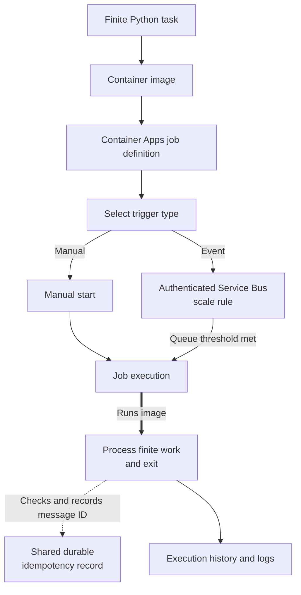

---
content_sources:
  diagrams:
    - id: python-jobs-recipe-flow
      type: flowchart
      source: self-generated
      justification: Language recipe flow synthesized from repository Python job example and Microsoft Learn Jobs guidance.
      based_on:
        - https://learn.microsoft.com/en-us/azure/container-apps/jobs
        - https://learn.microsoft.com/en-us/python/api/overview/azure/identity-readme
        - https://learn.microsoft.com/en-us/python/api/overview/azure/servicebus-readme
---
# Recipe: Jobs in Python on Azure Container Apps

Use this recipe to package a Python script as a manual Job, adapt it to a one-message Service Bus consumer, and add a dedup table pattern for safe replay.

## Prerequisites

- Azure Container Apps environment (`$ACA_ENV_NAME`)
- Azure Container Registry (`$ACR_NAME`)
- A user-assigned identity (`$JOB_PULL_IDENTITY_ID`) attached to each job and granted the registry pull role appropriate to the registry permission mode
- Azure Service Bus namespace and queue for the event-driven example
- Python 3.11+, Docker, and Azure CLI

```bash
export RG="rg-aca-python-prod"
export ACA_ENV_NAME="aca-env-python-prod"
export ACR_NAME="acrpythonprod"
export JOB_NAME="job-python-manual"
export EVENT_JOB_NAME="job-python-servicebus"
export SERVICEBUS_NAMESPACE="sb-aca-prod"
export SERVICEBUS_QUEUE="orders"
```

## What You'll Build

- a manual Python Job with a script entrypoint
- an event-driven Service Bus consumer that processes one message and exits
- a dedup-table pattern you can move to a durable database in production

## Steps

<!-- diagram-id: python-jobs-recipe-flow -->


Thick arrows show job execution. Thin and dotted arrows show trigger, evidence, and idempotency relationships.

### 1. Package a manual Python job

`job.py`:

```python
import json
import os
import sys
from datetime import datetime, timezone


def main() -> int:
    payload = {
        "event": "job-start",
        "execution": os.getenv("CONTAINER_APP_JOB_EXECUTION_NAME", "local"),
        "task": os.getenv("TASK_NAME", "reconcile-orders"),
        "started_at": datetime.now(timezone.utc).isoformat(),
    }
    print(json.dumps(payload))

    print(json.dumps({"event": "job-work", "message": "processing batch"}))
    print(json.dumps({"event": "job-end", "status": "Succeeded"}))
    return 0


if __name__ == "__main__":
    sys.exit(main())
```

`requirements.txt`:

```text
azure-identity==1.17.1
azure-servicebus==7.13.0
```

`Dockerfile`:

```dockerfile
FROM python:3.11-slim

WORKDIR /app
COPY requirements.txt .
RUN pip install --no-cache-dir -r requirements.txt
COPY job.py .

CMD ["python", "job.py"]
```

Build and deploy the manual Job:

```bash
az acr build \
  --registry "$ACR_NAME" \
  --image "python-jobs/manual:v1" \
  --file "Dockerfile" \
  "."

az containerapp job create \
  --name "$JOB_NAME" \
  --resource-group "$RG" \
  --environment "$ACA_ENV_NAME" \
  --trigger-type "Manual" \
  --image "$ACR_NAME.azurecr.io/python-jobs/manual:v1" \
  --mi-user-assigned "$JOB_PULL_IDENTITY_ID" \
  --registry-server "$ACR_NAME.azurecr.io" \
  --registry-identity "$JOB_PULL_IDENTITY_ID" \
  --parallelism 1 \
  --replica-completion-count 1 \
  --replica-retry-limit 1 \
  --replica-timeout 600

az containerapp job start \
  --name "$JOB_NAME" \
  --resource-group "$RG"
```

| Command | Why it is used |
|---|---|
| `az acr build` | Packages the manual-job worker in ACR and publishes `python-jobs/manual:v1`. |
| `az containerapp job create` | Defines `$JOB_NAME` as an on-demand job that runs the newly built manual-worker image once per start. |
| `az containerapp job start` | Starts the manual job execution for `$JOB_NAME`. |
| `az acr build --registry` | Configures the registry used for the remote build as `$ACR_NAME` on `az acr build`. |
| `--image` | Tags the remote build, then selects its fully qualified image for the manual job. |
| `az acr build --file` | Selects `Dockerfile` as the instructions for building the manual worker from the current directory. |
| `--name` | Targets `$JOB_NAME` for Container Apps job creation and manual job execution. |
| `--resource-group` | Scopes Container Apps job creation and manual job execution to `$RG`. |
| `az containerapp job create --environment` | Places the manual job in `$ACA_ENV_NAME`. |
| `az containerapp job create --trigger-type` | Configures the job activation model as `Manual` on `az containerapp job create`. |
| `az containerapp job create --mi-user-assigned` | Configures the user-assigned identity attached to the workload as `$JOB_PULL_IDENTITY_ID` on `az containerapp job create`. |
| `az containerapp job create --registry-server` | Configures the registry login server as `$ACR_NAME.azurecr.io` on `az containerapp job create`. |
| `az containerapp job create --registry-identity` | Configures the identity used to pull from the registry as `$JOB_PULL_IDENTITY_ID` on `az containerapp job create`. |
| `az containerapp job create --parallelism` | Configures the simultaneous job replica count as `1` on `az containerapp job create`. |
| `az containerapp job create --replica-completion-count` | Configures the successful replicas required per execution as `1` on `az containerapp job create`. |
| `az containerapp job create --replica-retry-limit` | Configures the failed replica retry limit as `1` on `az containerapp job create`. |
| `az containerapp job create --replica-timeout` | Configures the maximum replica run time in seconds as `600` on `az containerapp job create`. |


### 2. Adapt the container to an event-driven Service Bus consumer

Replace `job.py` with:

```python
import json
import os
from azure.identity import DefaultAzureCredential
from azure.servicebus import ServiceBusClient


fully_qualified_namespace = f"{os.environ['SERVICEBUS_NAMESPACE']}.servicebus.windows.net"
queue_name = os.environ["SERVICEBUS_QUEUE"]

credential = DefaultAzureCredential()
client = ServiceBusClient(fully_qualified_namespace=fully_qualified_namespace, credential=credential)

with client:
    receiver = client.get_queue_receiver(queue_name=queue_name, max_wait_time=15)
    with receiver:
        messages = receiver.receive_messages(max_message_count=1, max_wait_time=15)
        if not messages:
            print(json.dumps({"event": "empty-queue"}))
        else:
            message = messages[0]
            print(json.dumps({"event": "message-received", "message_id": message.message_id}))
            receiver.complete_message(message)
            print(json.dumps({"event": "message-completed", "message_id": message.message_id}))
```

Create the event-driven Job, assign its system identity, grant that identity the required Service Bus data roles on the queue or namespace, and then configure the scaler to use the same identity:

```bash
az acr build \
  --registry "$ACR_NAME" \
  --image "python-jobs/servicebus:v1" \
  --file "Dockerfile" \
  "."

az containerapp job create \
  --name "$EVENT_JOB_NAME" \
  --resource-group "$RG" \
  --environment "$ACA_ENV_NAME" \
  --trigger-type "Event" \
  --image "$ACR_NAME.azurecr.io/python-jobs/servicebus:v1" \
  --mi-user-assigned "$JOB_PULL_IDENTITY_ID" \
  --registry-server "$ACR_NAME.azurecr.io" \
  --registry-identity "$JOB_PULL_IDENTITY_ID" \
  --scale-rule-name "orders-queue" \
  --scale-rule-type "azure-servicebus" \
  --scale-rule-metadata "queueName=$SERVICEBUS_QUEUE" "messageCount=1" "namespace=$SERVICEBUS_NAMESPACE" \
  --replica-timeout 300 \
  --replica-retry-limit 1 \
  --env-vars SERVICEBUS_NAMESPACE="$SERVICEBUS_NAMESPACE" SERVICEBUS_QUEUE="$SERVICEBUS_QUEUE"

az containerapp job identity assign \
  --name "$EVENT_JOB_NAME" \
  --resource-group "$RG" \
  --system-assigned

# Grant this identity the least-privilege Service Bus data roles required by
# both the scaler and the message receiver before enabling identity auth.
export EVENT_JOB_PRINCIPAL_ID=$(az containerapp job show \
  --name "$EVENT_JOB_NAME" \
  --resource-group "$RG" \
  --query "identity.principalId" \
  --output tsv)

export SERVICEBUS_NAMESPACE_ID=$(az servicebus namespace show \
  --name "$SERVICEBUS_NAMESPACE" \
  --resource-group "$RG" \
  --query "id" \
  --output tsv)

az role assignment create \
  --assignee-object-id "$EVENT_JOB_PRINCIPAL_ID" \
  --assignee-principal-type ServicePrincipal \
  --role "Azure Service Bus Data Receiver" \
  --scope "$SERVICEBUS_NAMESPACE_ID"

az containerapp job update \
  --name "$EVENT_JOB_NAME" \
  --resource-group "$RG" \
  --scale-rule-name "orders-queue" \
  --scale-rule-type "azure-servicebus" \
  --scale-rule-metadata "queueName=$SERVICEBUS_QUEUE" "messageCount=1" "namespace=$SERVICEBUS_NAMESPACE" \
  --scale-rule-identity "system"
```

| Command | Why it is used |
|---|---|
| `az acr build` | Builds the Service Bus consumer remotely and publishes `python-jobs/servicebus:v1`. |
| `az containerapp job create` | Defines `$EVENT_JOB_NAME` as a Service Bus-scaled job using the event-worker image and queue rule. |
| `az containerapp job identity assign` | Enables a system-assigned identity on `$EVENT_JOB_NAME` for Service Bus authentication. |
| `az containerapp job show` | Returns the event job's principal ID for the Service Bus role assignment. |
| `az servicebus namespace show` | Returns the namespace resource ID used as the Service Bus role scope. |
| `az role assignment create` | Grants the job identity permission to receive messages from the selected Service Bus queue. |
| `az containerapp job update` | Configures `$EVENT_JOB_NAME` to authenticate its Service Bus scale rule with the system identity. |
| `az acr build --registry` | Configures the registry used for the remote build as `$ACR_NAME` on `az acr build`. |
| `--image` | Gives the ACR build its tag and points the event-driven job at the resulting image. |
| `az acr build --file` | Packages the event consumer from the current directory's `Dockerfile`. |
| `--name` | Targets `$EVENT_JOB_NAME`, `$SERVICEBUS_NAMESPACE` for workload identity assignment, Service Bus namespace scope lookup, event-job identity assignment, event-job principal lookup, event-driven scaler identity configuration and Container Apps job creation. |
| `--resource-group` | Scopes workload identity assignment, Service Bus namespace scope lookup, event-job identity assignment, event-job principal lookup, event-driven scaler identity configuration and Container Apps job creation to `$RG`. |
| `az containerapp job create --environment` | Runs the Service Bus-triggered job in `$ACA_ENV_NAME`. |
| `az containerapp job create --trigger-type` | Configures the job activation model as `Event` on `az containerapp job create`. |
| `az containerapp job create --mi-user-assigned` | Configures the user-assigned identity attached to the workload as `$JOB_PULL_IDENTITY_ID` on `az containerapp job create`. |
| `az containerapp job create --registry-server` | Configures the registry login server as `$ACR_NAME.azurecr.io` on `az containerapp job create`. |
| `az containerapp job create --registry-identity` | Configures the identity used to pull from the registry as `$JOB_PULL_IDENTITY_ID` on `az containerapp job create`. |
| `--scale-rule-name` | Configures the event-driven scale rule as `orders-queue` on `az containerapp job create` and `az containerapp job update`. |
| `--scale-rule-type` | Configures the KEDA scaler type as `azure-servicebus` on `az containerapp job create` and `az containerapp job update`. |
| `--scale-rule-metadata` | Configures the event source and threshold metadata as `queueName=$SERVICEBUS_QUEUE`, `messageCount=1`, `namespace=$SERVICEBUS_NAMESPACE` on `az containerapp job create` and `az containerapp job update`. |
| `az containerapp job create --replica-timeout` | Configures the maximum replica run time in seconds as `300` on `az containerapp job create`. |
| `az containerapp job create --replica-retry-limit` | Configures the failed replica retry limit as `1` on `az containerapp job create`. |
| `az containerapp job create --env-vars` | Configures the env vars as `SERVICEBUS_NAMESPACE=$SERVICEBUS_NAMESPACE`, `SERVICEBUS_QUEUE=$SERVICEBUS_QUEUE` on `az containerapp job create`. |
| `az containerapp job identity assign --system-assigned` | Enables the system-assigned identity on the resource modified by `az containerapp job identity assign`. |
| `--query` | Extracts `identity.principalId`, `id` from `az containerapp job show` and `az servicebus namespace show` output. |
| `--output` | Captures both resource identifiers as unquoted shell values for the role assignment. |
| `az role assignment create --assignee-object-id` | Selects the event job's system principal as the Service Bus permission recipient. |
| `az role assignment create --assignee-principal-type` | Configures the role-assignment principal type as `ServicePrincipal` on `az role assignment create` to configure the Service Bus-driven job. |
| `az role assignment create --role` | Authorizes both the job's receiver code and identity-backed scaler to consume Service Bus messages. |
| `az role assignment create --scope` | Bounds message-receiver access to the selected Service Bus namespace. |
| `az containerapp job update --scale-rule-identity` | Configures the managed identity used by the scale rule as `system` on `az containerapp job update`. |


### 3. Add an idempotency guard with a dedup table

For a runnable local example, add a SQLite-backed dedup table. In production, move the same pattern to Azure SQL, PostgreSQL, or another shared durable store.

```python
import sqlite3


def should_process(message_id: str) -> bool:
    conn = sqlite3.connect("/tmp/dedup.db")
    conn.execute("create table if not exists processed_messages (message_id text primary key)")
    cursor = conn.execute(
        "insert or ignore into processed_messages(message_id) values (?)",
        (message_id,),
    )
    conn.commit()
    conn.close()
    return cursor.rowcount == 1
```

Call it before completing the message:

```python
if should_process(str(message.message_id)):
    print(json.dumps({"event": "process-message", "message_id": message.message_id}))
    receiver.complete_message(message)
else:
    print(json.dumps({"event": "duplicate-message", "message_id": message.message_id}))
    receiver.complete_message(message)
```

## Verification

```bash
az containerapp job execution list \
  --name "$JOB_NAME" \
  --resource-group "$RG" \
  --output table

az containerapp job execution list \
  --name "$EVENT_JOB_NAME" \
  --resource-group "$RG" \
  --output table
```

| Command | Why it is used |
|---|---|
| `az containerapp job execution list` | Lists manual and Service Bus job executions so their completion states can be compared. |
| `--name` | Targets `$JOB_NAME`, `$EVENT_JOB_NAME` for job execution verification. |
| `--resource-group` | Searches `$RG` for execution history from both jobs created by this recipe. |
| `--output` | Places execution names, start times, and statuses in columns for comparing both jobs. |


### Verify job in Azure Portal


**[Observed]** `cj-sample-d38538`. `Container App Job`. `Run now`. `Suspend`. `Refresh`. `Delete`. `Resource group`. `rg-aca-basics-d38538`. `Location`. `Korea Central`. `Subscription`. `Visual Studio Enterprise Subscription`. `Subscription ID`. `00000000-0000-0000-0000-000000000000`. `Container Apps Environme...`. `cae-basics-d38538`. `Log Analytics`. `law-basics-d38538`. `Workload profile`. `Consumption`. `Properties`. `Job`. `Provisioning status`. `Succeeded`. `Trigger Type`. `Manual`. `Execution history`. `View`. `Configuration`. `Replica timeout`. `300`. `Replica retry limit`. `1`. `Advanced`. `Parallelism`. `1`. `Completion count`. `1`.

**[Inferred]** The `Trigger Type` field reading `Manual` appears to map to the `--trigger-type "Manual"` lever passed to `az containerapp job create` in [Steps](#steps) Step 1. The `Replica timeout` value `300` appears to map to the `--replica-timeout 300` lever passed to `az containerapp job create` in [Steps](#steps) Step 2. The `Replica retry limit` value `1` appears to map to the `--replica-retry-limit 1` lever passed in [Steps](#steps) Steps 1 and 2. The `Parallelism` value `1` and `Completion count` value `1` appear to map to `--parallelism 1` and `--replica-completion-count 1` passed in [Steps](#steps) Step 1. The `Run now` toolbar action is consistent with the `az containerapp job start` invocation in [Steps](#steps) Step 1.

**[Not Proven]** Additional job trigger configuration, runtime parameter, and execution detail are not visible on this view.

## Next Steps / Clean Up

- Move the dedup table from SQLite to a shared durable database.
- Add Application Insights correlation fields to every log line.
- Revisit [Jobs Operations](../../../operations/jobs/index.md) before production rollout.

## See Also

- [Python Recipes Index](index.md)
- [Container Apps Jobs Overview](../../../platform/jobs/index.md)
- [Job Design](../../../best-practices/job-design.md)

## Sources

- [Jobs in Azure Container Apps (Microsoft Learn)](https://learn.microsoft.com/en-us/azure/container-apps/jobs)
- [Azure Identity client library for Python](https://learn.microsoft.com/en-us/python/api/overview/azure/identity-readme)
- [Azure Service Bus client library for Python](https://learn.microsoft.com/en-us/python/api/overview/azure/servicebus-readme)
