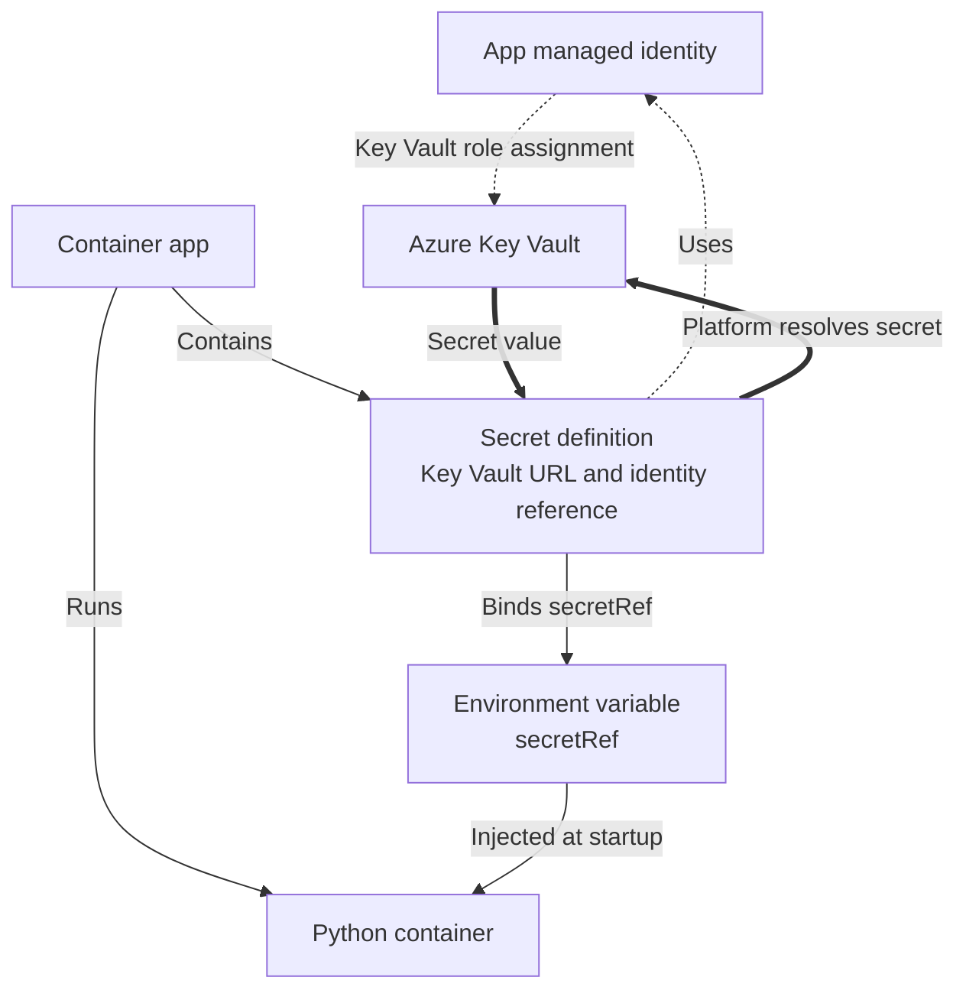

---
content_sources:
  diagrams:
    - id: use-managed-identity-and-key-vault
      type: flowchart
      source: mslearn-adapted
      based_on:
        - https://learn.microsoft.com/en-us/azure/container-apps/manage-secrets#reference-secret-from-key-vault
        - https://learn.microsoft.com/en-us/azure/container-apps/managed-identity
---
# Recipe: Key Vault Secret References in Azure Container Apps

Use managed identity and Key Vault references so your Python app receives secrets as environment variables without embedding secret values in deployment manifests.

<!-- diagram-id: use-managed-identity-and-key-vault -->


Thick arrows show secret resolution. Thin and dotted arrows show configuration, identity, and authorization associations.

## Prerequisites

- Existing Key Vault name (`$KEYVAULT_NAME`)
- Existing Container App (`$APP_NAME`) and resource group (`$RG`)
- Azure CLI with Container Apps extension

```bash
az extension add --name containerapp --upgrade
```

| Command | Why it is used |
|---|---|
| `az extension add` | Installs the Container Apps commands used to bind a Key Vault reference to an app secret. |
| `--name` | Chooses the `containerapp` extension that supplies secret-reference management. |
| `--upgrade` | Refreshes that extension so Key Vault reference parameters are available. |


## Create Key Vault and add secrets

```bash
az keyvault create \
  --name "$KEYVAULT_NAME" \
  --resource-group "$RG" \
  --location "$LOCATION"

az keyvault secret set \
  --vault-name "$KEYVAULT_NAME" \
  --name "db-password" \
  --value "replace-with-real-value"
```

| Command | Why it is used |
|---|---|
| `az keyvault create` | Creates `$KEYVAULT_NAME` with RBAC authorization as the source for the referenced application secret. |
| `az keyvault secret set` | Creates the `db-password` value that the Container App secret reference will resolve at runtime. |
| `--name` | Targets `$KEYVAULT_NAME`, `db-password` for Key Vault secret creation, Key Vault creation and application secret binding. |
| `az keyvault create --resource-group` | Creates `$KEYVAULT_NAME` in `$RG` with the app and its identity dependencies. |
| `az keyvault create --location` | Configures the Azure deployment region as `$LOCATION` on `az keyvault create`. |
| `az keyvault secret set --vault-name` | Configures the vault name as `$KEYVAULT_NAME` on `az keyvault secret set`. |
| `az keyvault secret set --value` | Configures the secret value as `replace-with-real-value` on `az keyvault secret set`. |


## Configure managed identity for Key Vault access

```bash
az containerapp identity assign \
  --name "$APP_NAME" \
  --resource-group "$RG" \
  --system-assigned

export PRINCIPAL_ID=$(az containerapp show \
  --name "$APP_NAME" \
  --resource-group "$RG" \
  --query "identity.principalId" \
  --output tsv)

az role assignment create \
  --assignee-object-id "$PRINCIPAL_ID" \
  --assignee-principal-type ServicePrincipal \
  --role "Key Vault Secrets User" \
  --scope "$(az keyvault show --name "$KEYVAULT_NAME" --query id --output tsv)"
```

| Command | Why it is used |
|---|---|
| `az containerapp identity assign` | Enables the system identity used by `$APP_NAME` to resolve the Key Vault reference. |
| `az containerapp show` | Retrieves the app principal that will be authorized to resolve Key Vault secret references. |
| `az role assignment create` | Grants `$APP_NAME`'s principal permission to read secret values from the selected vault. |
| `az keyvault show` | Extracts the resource ID of `$KEYVAULT_NAME` for use as the `Key Vault Secrets User` role-assignment scope. |
| `--name` | Targets `$APP_NAME`, `$KEYVAULT_NAME` for workload identity assignment, Key Vault scope lookup and Container App property inspection. |
| `--resource-group` | Scopes workload identity assignment and Container App property inspection to `$RG`. |
| `az containerapp identity assign --system-assigned` | Enables the system-assigned identity on the resource modified by `az containerapp identity assign`. |
| `--query` | Extracts `identity.principalId`, `id` from `az containerapp show` and `az keyvault show` output. |
| `--output` | Produces shell-ready principal and vault IDs for constructing the permission grant. |
| `az role assignment create --assignee-object-id` | Names the app's system principal as the recipient of secret-reading access. |
| `az role assignment create --assignee-principal-type` | Configures the role-assignment principal type as `ServicePrincipal` on `az role assignment create`. |
| `az role assignment create --role` | Permits the Container App identity to read secret values without granting vault administration rights. |
| `az role assignment create --scope` | Binds secret-reading permission to the vault ID returned by the nested lookup. |


## Add a Container Apps secret with Key Vault reference

Key Vault reference syntax:

```text
keyvaultref:https://<key-vault-name>.vault.azure.net/secrets/<secret-name>
```

CLI example:

```bash
az containerapp secret set \
  --name "$APP_NAME" \
  --resource-group "$RG" \
  --secrets "db-password=keyvaultref:https://$KEYVAULT_NAME.vault.azure.net/secrets/db-password,identityref:system"

az containerapp update \
  --name "$APP_NAME" \
  --resource-group "$RG" \
  --set-env-vars "DB_PASSWORD=secretref:db-password"
```

| Command | Why it is used |
|---|---|
| `az containerapp secret set` | Stores a Key Vault-backed `db-password` reference that resolves through the app's system identity. |
| `az containerapp update` | Maps `DB_PASSWORD` to the new Container Apps secret reference in the workload revision. |
| `--name` | Targets `$APP_NAME` for application secret binding and workload configuration update. |
| `--resource-group` | Scopes application secret binding and workload configuration update to `$RG`. |
| `az containerapp secret set --secrets` | Configures the secret values stored on the workload as `db-password=keyvaultref:https://$KEYVAULT_NAME.vault.azure.net/secrets/db-password,identityref:system` on `az containerapp secret set`. |
| `az containerapp update --set-env-vars` | Configures the environment variables written to the workload as `DB_PASSWORD=secretref:db-password` on `az containerapp update`. |


## Access referenced secrets in Python

```python
import os
from flask import Flask, jsonify

app = Flask(__name__)

@app.get("/config-check")
def config_check():
    password = os.getenv("DB_PASSWORD", "")
    return jsonify(dbPasswordConfigured=bool(password)), 200
```

## Secret rotation patterns

- Rotate the Key Vault secret value (`az keyvault secret set` with same name).
- Restart or revise app workloads to pick up updated secret values.
- For controlled rotation, deploy a new revision and shift traffic after validation.

## Bicep example for Key Vault reference

```bicep
resource app 'Microsoft.App/containerApps@2023-05-01' existing = {
  name: appName
}

resource appSecrets 'Microsoft.App/containerApps@2023-05-01' = {
  name: app.name
  properties: {
    configuration: {
      secrets: [
        {
          name: 'db-password'
          keyVaultUrl: 'https://${keyVaultName}.vault.azure.net/secrets/db-password'
          identity: 'system'
        }
      ]
    }
    template: {
      containers: [
        {
          name: 'app'
          image: imageName
          env: [
            {
              name: 'DB_PASSWORD'
              secretRef: 'db-password'
            }
          ]
        }
      ]
    }
  }
}
```

## Troubleshooting common 403 errors

1. Confirm app identity is enabled and principal ID exists.
2. Verify role assignment is on the Key Vault scope and propagated.
3. Check Key Vault firewall/private endpoint settings.
4. Ensure secret URL path and version are correct.

```bash
az containerapp logs show \
  --name "$APP_NAME" \
  --resource-group "$RG" \
  --follow false
```

| Command | Why it is used |
|---|---|
| `az containerapp logs show` | Collects `$APP_NAME` logs that show whether the Key Vault-backed password resolved successfully. |
| `--name` | Targets `$APP_NAME`, whose logs reveal Key Vault reference resolution. |
| `--resource-group` | Scopes Key Vault reference log retrieval to `$RG`. |
| `--follow` | Returns the current secret-resolution evidence without streaming future log entries. |


## Advanced Topics

- Use user-assigned identities for shared access policies across multiple apps.
- Separate secret vaults per environment to reduce blast radius.
- Pair Key Vault reference with revision validation for zero-downtime rotations.

## See Also

- [Managed Identity](managed-identity.md)
- [Revision Validation](revision-validation.md)
- [Key Vault](../../../platform/identity-and-secrets/key-vault.md)
- [Microsoft Learn: Manage secrets in Container Apps](https://learn.microsoft.com/en-us/azure/container-apps/manage-secrets)

## Sources

- [Microsoft Learn source 1](https://learn.microsoft.com/en-us/azure/container-apps/manage-secrets#reference-secret-from-key-vault)
- [Microsoft Learn source 2](https://learn.microsoft.com/en-us/azure/container-apps/managed-identity)
