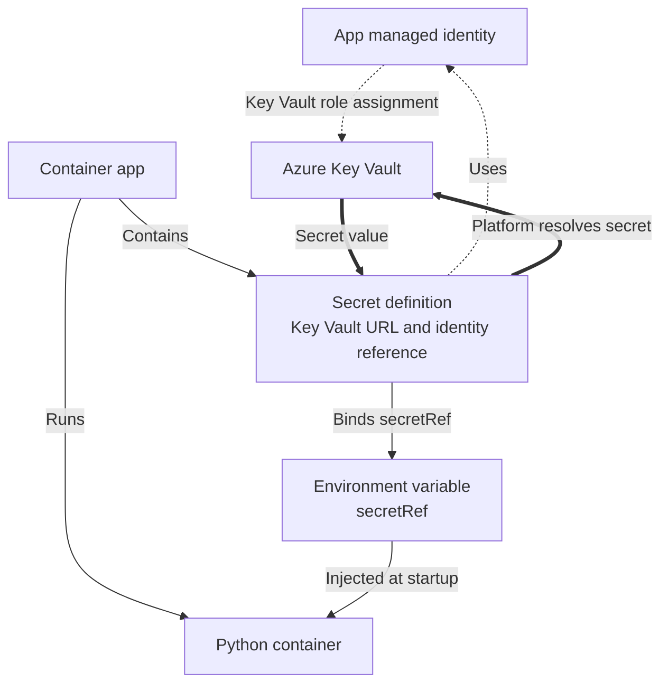

---
content_sources:
  diagrams:
    - id: use-managed-identity-and-key-vault
      type: flowchart
      source: mslearn-adapted
      based_on:
        - https://learn.microsoft.com/en-us/azure/container-apps/manage-secrets#reference-secret-from-key-vault
        - https://learn.microsoft.com/en-us/azure/container-apps/managed-identity
---
# Recipe: Key Vault Secret References in Azure Container Apps

Use managed identity and Key Vault references so your Python app receives secrets as environment variables without embedding secret values in deployment manifests.

<!-- diagram-id: use-managed-identity-and-key-vault -->


Thick arrows show secret resolution. Thin and dotted arrows show configuration, identity, and authorization associations.

## Prerequisites

- Existing Key Vault name (`$KEYVAULT_NAME`)
- Existing Container App (`$APP_NAME`) and resource group (`$RG`)
- Azure CLI with Container Apps extension

```bash
az extension add --name containerapp --upgrade
```

| Command | Why it is used |
|---|---|
| `az extension add` | Installs or upgrades the Azure CLI extension required by this procedure. |
| `--name` | Selects the named resource operated on in this recipe step. |
| `--upgrade` | Updates an existing extension so current command flags are available. |


## Create Key Vault and add secrets

```bash
az keyvault create \
  --name "$KEYVAULT_NAME" \
  --resource-group "$RG" \
  --location "$LOCATION"

az keyvault secret set \
  --vault-name "$KEYVAULT_NAME" \
  --name "db-password" \
  --value "replace-with-real-value"
```

| Command | Why it is used |
|---|---|
| `az keyvault create` | Creates the Key Vault used for the recipe's secret. |
| `az keyvault secret set` | Creates or updates the named Key Vault secret. |
| `--name` | Selects the named resource operated on in this recipe step. |
| `--resource-group` | Selects the resource group that contains this step's target resource. |
| `--location` | Creates the resource in the recipe's selected Azure region. |
| `--vault-name` | Selects the Key Vault that stores the recipe secret. |
| `--value` | Sets the recipe's named secret or DNS verification value. |


## Configure managed identity for Key Vault access

```bash
az containerapp identity assign \
  --name "$APP_NAME" \
  --resource-group "$RG" \
  --system-assigned

export PRINCIPAL_ID=$(az containerapp show \
  --name "$APP_NAME" \
  --resource-group "$RG" \
  --query "identity.principalId" \
  --output tsv)

az role assignment create \
  --assignee-object-id "$PRINCIPAL_ID" \
  --assignee-principal-type ServicePrincipal \
  --role "Key Vault Secrets User" \
  --scope "$(az keyvault show --name "$KEYVAULT_NAME" --query id --output tsv)"
```

| Command | Why it is used |
|---|---|
| `az containerapp identity assign` | Assigns the managed identity required by this recipe. |
| `az containerapp show` | Reads the Container App property needed by the next recipe step. |
| `az role assignment create` | Grants the managed identity the data-plane role required by this step. |
| `az keyvault show` | Reads the Key Vault resource ID used as the role-assignment scope. |
| `--name` | Selects the named resource operated on in this recipe step. |
| `--resource-group` | Selects the resource group that contains this step's target resource. |
| `--system-assigned` | Enables the system identity used by the app, job, or scaler. |
| `--query` | Extracts the exact resource property consumed by the next command. |
| `--output` | Returns the result in the format consumed by the shell or verification table. |
| `--assignee-object-id` | Targets the managed identity principal without a Microsoft Graph lookup. |
| `--assignee-principal-type` | Declares the managed identity as a service principal. |
| `--role` | Selects the least-privilege data-plane role required by this identity. |
| `--scope` | Limits the role or policy assignment to the resource used by this recipe. |


## Add a Container Apps secret with Key Vault reference

Key Vault reference syntax:

```text
keyvaultref:https://<key-vault-name>.vault.azure.net/secrets/<secret-name>
```

CLI example:

```bash
az containerapp secret set \
  --name "$APP_NAME" \
  --resource-group "$RG" \
  --secrets "db-password=keyvaultref:https://$KEYVAULT_NAME.vault.azure.net/secrets/db-password,identityref:system"

az containerapp update \
  --name "$APP_NAME" \
  --resource-group "$RG" \
  --set-env-vars "DB_PASSWORD=secretref:db-password"
```

| Command | Why it is used |
|---|---|
| `az containerapp secret set` | Creates the Key Vault-backed Container Apps secret reference. |
| `az containerapp update` | Updates the selected Container App with this step's image or configuration. |
| `--name` | Selects the named resource operated on in this recipe step. |
| `--resource-group` | Selects the resource group that contains this step's target resource. |
| `--secrets` | Creates or updates the named Container Apps secret reference. |
| `--set-env-vars` | Adds the recipe's runtime settings to the new app revision. |


## Access referenced secrets in Python

```python
import os
from flask import Flask, jsonify

app = Flask(__name__)

@app.get("/config-check")
def config_check():
    password = os.getenv("DB_PASSWORD", "")
    return jsonify(dbPasswordConfigured=bool(password)), 200
```

## Secret rotation patterns

- Rotate the Key Vault secret value (`az keyvault secret set` with same name).
- Restart or revise app workloads to pick up updated secret values.
- For controlled rotation, deploy a new revision and shift traffic after validation.

## Bicep example for Key Vault reference

```bicep
resource app 'Microsoft.App/containerApps@2023-05-01' existing = {
  name: appName
}

resource appSecrets 'Microsoft.App/containerApps@2023-05-01' = {
  name: app.name
  properties: {
    configuration: {
      secrets: [
        {
          name: 'db-password'
          keyVaultUrl: 'https://${keyVaultName}.vault.azure.net/secrets/db-password'
          identity: 'system'
        }
      ]
    }
    template: {
      containers: [
        {
          name: 'app'
          image: imageName
          env: [
            {
              name: 'DB_PASSWORD'
              secretRef: 'db-password'
            }
          ]
        }
      ]
    }
  }
}
```

## Troubleshooting common 403 errors

1. Confirm app identity is enabled and principal ID exists.
2. Verify role assignment is on the Key Vault scope and propagated.
3. Check Key Vault firewall/private endpoint settings.
4. Ensure secret URL path and version are correct.

```bash
az containerapp logs show \
  --name "$APP_NAME" \
  --resource-group "$RG" \
  --follow false
```

| Command | Why it is used |
|---|---|
| `az containerapp logs show` | Streams or retrieves logs from the selected app or revision for verification. |
| `--name` | Selects the named resource operated on in this recipe step. |
| `--resource-group` | Selects the resource group that contains this step's target resource. |
| `--follow` | Continues streaming new log records during verification. |


## Advanced Topics

- Use user-assigned identities for shared access policies across multiple apps.
- Separate secret vaults per environment to reduce blast radius.
- Pair Key Vault reference with revision validation for zero-downtime rotations.

## See Also

- [Managed Identity](managed-identity.md)
- [Revision Validation](revision-validation.md)
- [Key Vault](../../../platform/identity-and-secrets/key-vault.md)
- [Microsoft Learn: Manage secrets in Container Apps](https://learn.microsoft.com/en-us/azure/container-apps/manage-secrets)

## Sources

- [Microsoft Learn source 1](https://learn.microsoft.com/en-us/azure/container-apps/manage-secrets#reference-secret-from-key-vault)
- [Microsoft Learn source 2](https://learn.microsoft.com/en-us/azure/container-apps/managed-identity)
