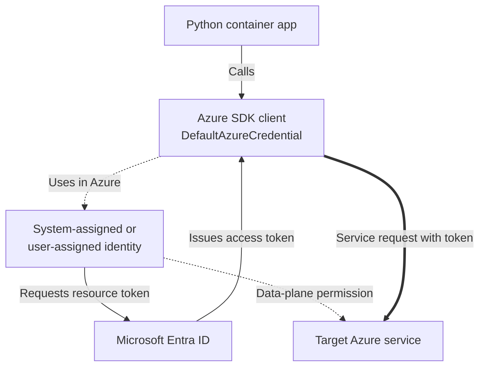

---
content_sources:
  diagrams:
    - id: use-managed-identity-and-defaultazurecredential-to
      type: flowchart
      source: mslearn-adapted
      based_on:
        - https://learn.microsoft.com/en-us/azure/container-apps/managed-identity
        - https://learn.microsoft.com/en-us/azure/container-apps/managed-identity-image-pull
---
# Recipe: Managed Identity in Python Apps on Azure Container Apps

Use managed identity and `DefaultAzureCredential` to access Azure services from Python without storing credentials in code or configuration.

<!-- diagram-id: use-managed-identity-and-defaultazurecredential-to -->


Thick arrows show service transport. Thin arrows show token exchange, and dotted arrows show credential and authorization associations.

## Prerequisites

- Existing Container App (`$APP_NAME`) in resource group (`$RG`)
- Azure services to access (Storage, SQL, Cosmos DB, Key Vault)
- Azure CLI 2.57+ and Container Apps extension

```bash
az extension add --name containerapp --upgrade
```

| Command | Why it is used |
|---|---|
| `az extension add` | Adds the Container Apps identity commands used to attach managed identities to the app. |
| `--name` | Requests the `containerapp` extension that owns those identity commands. |
| `--upgrade` | Ensures an existing installation includes the latest managed-identity options. |


## System-assigned vs user-assigned identity

| Identity type | Scope | Lifecycle | Typical use |
|---|---|---|---|
| System-assigned | One app | Deleted with app | Simple single-app workloads |
| User-assigned | Reusable | Independent resource | Shared identity across apps/jobs |

## Enable identity via CLI

System-assigned:

```bash
az containerapp identity assign \
  --name "$APP_NAME" \
  --resource-group "$RG" \
  --system-assigned
```

| Command | Why it is used |
|---|---|
| `az containerapp identity assign` | Assigns the Container App identity to enable a system-assigned identity. |
| `--name` | Selects `$APP_NAME` as the workload receiving the system-managed principal. |
| `--resource-group` | Finds `$APP_NAME` in `$RG` before enabling its system identity. |
| `--system-assigned` | Enables the system-assigned identity on the resource modified by `az containerapp identity assign` to enable a system-assigned identity. |


User-assigned:

```bash
az identity create \
  --name "id-$APP_NAME" \
  --resource-group "$RG" \
  --location "$LOCATION"

export UAMI_ID=$(az identity show \
  --name "id-$APP_NAME" \
  --resource-group "$RG" \
  --query "id" \
  --output tsv)

az containerapp identity assign \
  --name "$APP_NAME" \
  --resource-group "$RG" \
  --user-assigned "$UAMI_ID"
```

| Command | Why it is used |
|---|---|
| `az identity create` | Provisions `id-$APP_NAME` as a reusable identity that can be attached to the Container App. |
| `az identity show` | Returns `id-$APP_NAME`'s resource ID so that exact identity can be attached to the app. |
| `az containerapp identity assign` | Assigns the Container App identity to attach a user-assigned identity. |
| `--name` | Targets `id-$APP_NAME`, `$APP_NAME` for user-assigned identity creation, managed-identity property lookup and workload identity assignment. |
| `--resource-group` | Scopes user-assigned identity creation, managed-identity property lookup and workload identity assignment to `$RG`. |
| `az identity create --location` | Configures the Azure deployment region as `$LOCATION` on `az identity create`. |
| `az identity show --query` | Extracts `id-$APP_NAME`'s full resource ID for the subsequent `--user-assigned` attachment. |
| `az identity show --output` | Stores that resource ID as plain text in `UAMI_ID`. |
| `az containerapp identity assign --user-assigned` | Enables the user-assigned identity on the resource modified by `az containerapp identity assign`. |


## Enable identity via Bicep

```bicep
resource app 'Microsoft.App/containerApps@2023-05-01' = {
  name: appName
  location: location
  identity: {
    type: 'SystemAssigned'
  }
  properties: {
    managedEnvironmentId: environmentId
    template: {
      containers: [
        {
          name: 'app'
          image: imageName
        }
      ]
    }
  }
}
```

## RBAC role assignments

Grant least privilege on each target resource.

```bash
export PRINCIPAL_ID=$(az containerapp show \
  --name "$APP_NAME" \
  --resource-group "$RG" \
  --query "identity.principalId" \
  --output tsv)

az role assignment create \
  --assignee-object-id "$PRINCIPAL_ID" \
  --assignee-principal-type ServicePrincipal \
  --role "Storage Blob Data Reader" \
  --scope "$(az storage account show --name "$STORAGE_ACCOUNT" --resource-group "$RG" --query id --output tsv)"
```

| Command | Why it is used |
|---|---|
| `az containerapp show` | Obtains the app's system identity principal for the Blob reader grant. |
| `az role assignment create` | Grants `$PRINCIPAL_ID` read-only Blob data access at the nested storage-account scope. |
| `az storage account show` | Retrieves `$STORAGE_ACCOUNT`'s resource ID to scope the Blob reader assignment. |
| `--name` | Targets `$APP_NAME`, `$STORAGE_ACCOUNT` for storage account scope lookup and Container App property inspection. |
| `--resource-group` | Scopes storage account scope lookup and Container App property inspection to `$RG`. |
| `--query` | Extracts `identity.principalId`, `id` from `az containerapp show` and `az storage account show` output. |
| `--output` | Converts both IDs to scalar text suitable for shell substitution. |
| `az role assignment create --assignee-object-id` | Configures the principal receiving the role as `$PRINCIPAL_ID` on `az role assignment create` to grant the identity access to Blob Storage. |
| `az role assignment create --assignee-principal-type` | Configures the role-assignment principal type as `ServicePrincipal` on `az role assignment create` to grant the identity access to Blob Storage. |
| `az role assignment create --role` | Gives the app read-only access to blob data while excluding write and account-management permissions. |
| `az role assignment create --scope` | Uses the nested storage-account lookup to confine the reader grant to `$STORAGE_ACCOUNT`. |


## Use `DefaultAzureCredential` in Python

`DefaultAzureCredential` uses managed identity in Container Apps, and falls back to Azure CLI credentials in local development.

```python
from azure.identity import DefaultAzureCredential

credential = DefaultAzureCredential()
```

## Example: Flask app reading Blob Storage with managed identity

```python
import os
from flask import Flask, jsonify
from azure.identity import DefaultAzureCredential
from azure.storage.blob import BlobServiceClient

app = Flask(__name__)
credential = DefaultAzureCredential()

account_url = os.environ["STORAGE_ACCOUNT_URL"]
container_name = os.getenv("STORAGE_CONTAINER", "app-data")

@app.get("/blobs")
def list_blobs():
    service = BlobServiceClient(account_url=account_url, credential=credential)
    container = service.get_container_client(container_name)
    names = [blob.name for blob in container.list_blobs()]
    return jsonify(blobs=names), 200
```

Set environment variables:

```bash
az containerapp update \
  --name "$APP_NAME" \
  --resource-group "$RG" \
  --set-env-vars \
    STORAGE_ACCOUNT_URL="https://$STORAGE_ACCOUNT.blob.core.windows.net" \
    STORAGE_CONTAINER="app-data"
```

| Command | Why it is used |
|---|---|
| `az containerapp update` | Supplies the Blob account URL and container name to the managed-identity sample workload. |
| `--name` | Targets `$APP_NAME`, which receives the Blob endpoint settings. |
| `--resource-group` | Scopes the managed-identity Blob sample update to `$RG`. |
| `--set-env-vars` | Configures the environment variables written to the workload as `STORAGE_ACCOUNT_URL=https://$STORAGE_ACCOUNT.blob.core.windows.net`, `STORAGE_CONTAINER=app-data` on `az containerapp update`. |


## Common service patterns

- **Storage**: `Storage Blob Data Reader/Contributor`
- **Azure SQL**: database user mapped to Entra principal
- **Cosmos DB**: `Cosmos DB Built-in Data Reader/Contributor`
- **Key Vault**: `Key Vault Secrets User`

## Local development with identity fallback

```bash
az login
az account set --subscription "<subscription-id>"
python -m flask --app src.app run --port 8000
```

| Command | Why it is used |
|---|---|
| `az login` | Authenticates the local developer before `DefaultAzureCredential` requests an Azure CLI token. |
| `az account set` | Selects `<subscription-id>` as the subscription whose Azure CLI credential `DefaultAzureCredential` uses during local development. |
| `az account set --subscription` | Configures the subscription as `<subscription-id>` on `az account set`. |


`DefaultAzureCredential` will use Azure CLI token locally and managed identity in Container Apps.

## Advanced Topics

- Use user-assigned identities for blast-radius control and explicit reuse.
- Split read/write privileges into separate identities for zero-trust boundaries.
- Add startup checks that verify token acquisition and downstream authorization.

## See Also

- [Key Vault Reference](key-vault-reference.md)
- [Storage](storage.md)
- [Managed Identity Platform Guide](../../../platform/identity-and-secrets/managed-identity.md)
- [Microsoft Learn: Managed identities in Container Apps](https://learn.microsoft.com/en-us/azure/container-apps/managed-identity)

## Sources

- [Microsoft Learn source 1](https://learn.microsoft.com/en-us/azure/container-apps/managed-identity)
- [Microsoft Learn source 2](https://learn.microsoft.com/en-us/azure/container-apps/managed-identity-image-pull)
