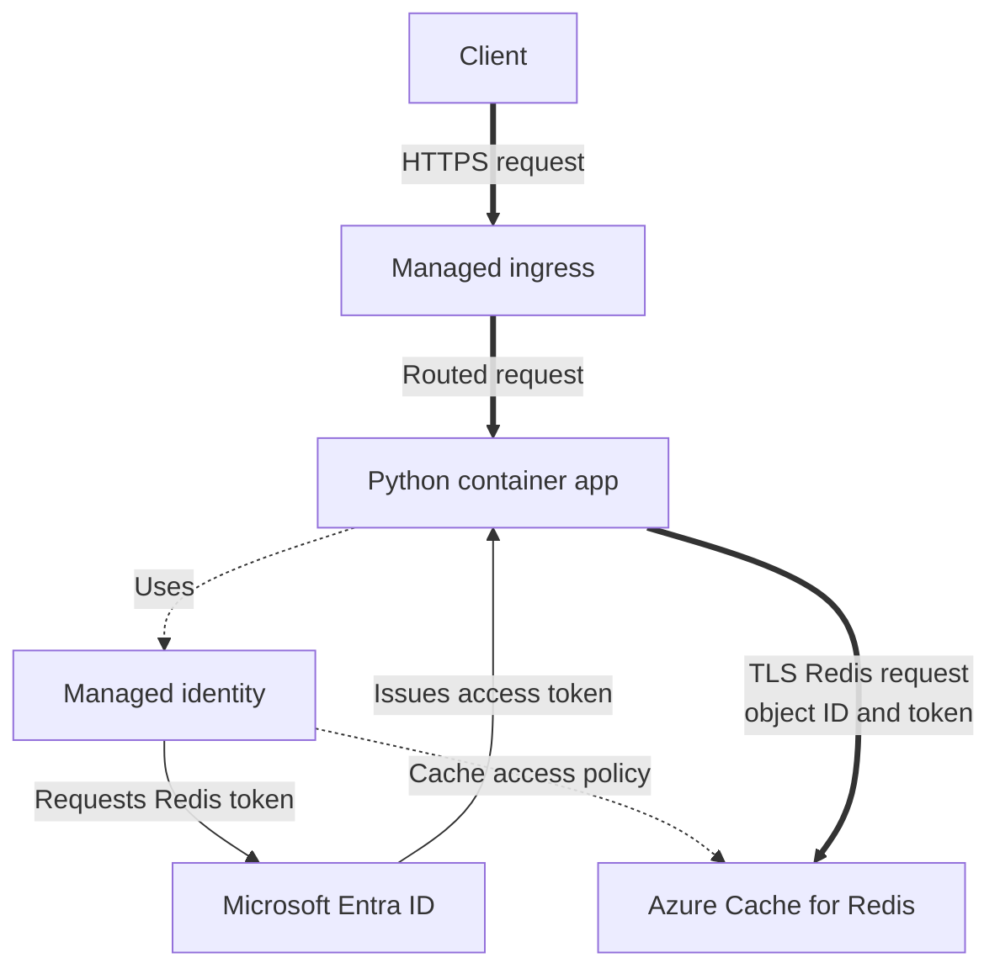

---
content_sources:
  diagrams:
    - id: architecture
      type: flowchart
      source: mslearn-adapted
      based_on:
        - https://learn.microsoft.com/en-us/azure/azure-cache-for-redis/cache-azure-active-directory-for-authentication
        - https://learn.microsoft.com/en-us/azure/redis/python-get-started
---
# Azure Cache for Redis Integration (Managed Identity)

Use this recipe to connect Azure Container Apps to Azure Cache for Redis with Microsoft Entra authentication and managed identity.

## Architecture

<!-- diagram-id: architecture -->


Thick arrows show request or Redis transport. Thin arrows show token exchange, and dotted arrows show identity and authorization associations.

## Prerequisites

- Existing Container App: `$APP_NAME` in `$RG`
- Existing Azure Cache for Redis instance
- TLS-enabled Redis access (default)

## Step 1: Enable managed identity on the Container App

```bash
az containerapp identity assign \
  --name "$APP_NAME" \
  --resource-group "$RG" \
  --system-assigned

export PRINCIPAL_ID=$(az containerapp show \
  --name "$APP_NAME" \
  --resource-group "$RG" \
  --query "identity.principalId" \
  --output tsv)
```

| Command | Why it is used |
|---|---|
| `az containerapp identity assign` | Enables the system-assigned identity that the Python app uses for token-based Redis authentication. |
| `az containerapp show` | Reads that identity's principal ID before resolving the Redis username object ID. |
| `--name` | Targets `$APP_NAME`, whose identity will receive the Redis data access policy. |
| `--resource-group` | Locates `$APP_NAME` in `$RG` for both identity commands. |
| `az containerapp identity assign --system-assigned` | Attaches a platform-managed identity to the app for passwordless cache access. |
| `az containerapp show --query` | Selects `identity.principalId`, which is resolved to the object ID used by Redis authentication. |
| `az containerapp show --output` | Emits only the principal ID as tab-separated text for `PRINCIPAL_ID`. |


## Step 2: Assign Redis data access policy

Get the object ID used as Redis username:

```bash
export OBJECT_ID=$(az ad sp show \
  --id "$PRINCIPAL_ID" \
  --query "id" \
  --output tsv)
```

| Command | Why it is used |
|---|---|
| `az ad sp show` | Resolves `$PRINCIPAL_ID` to the service-principal object ID used as the Redis token-authentication username. |
| `--id` | Configures the id as `$PRINCIPAL_ID` on `az ad sp show`. |
| `--query` | Extracts the service-principal object ID that Redis expects as the token-authentication username. |
| `--output` | Assigns the object ID as plain text to `OBJECT_ID` for the access-policy command. |


Create an access policy assignment (for example, Data Owner):

```bash
az redis access-policy-assignment create \
  --name "$REDIS_NAME" \
  --resource-group "$RG" \
  --access-policy-name "Data Owner" \
  --object-id "$OBJECT_ID" \
  --object-id-alias "$APP_NAME"
```

| Command | Why it is used |
|---|---|
| `az redis access-policy-assignment create` | Grants the app's Entra object the Redis `Data Owner` policy under the `$APP_NAME` alias. |
| `--name` | Selects `$REDIS_NAME` as the cache receiving the app identity's `Data Owner` assignment. |
| `--resource-group` | Finds `$REDIS_NAME` in `$RG` before creating its data access policy assignment. |
| `--access-policy-name` | Configures the Redis data access policy as `Data Owner` on `az redis access-policy-assignment create`. |
| `--object-id` | Configures the Microsoft Entra object receiving access as `$OBJECT_ID` on `az redis access-policy-assignment create`. |
| `--object-id-alias` | Labels the Redis assignment with `$APP_NAME` so operators can identify the app identity. |


## Step 3: Configure Redis endpoint for the app

```bash
az containerapp update \
  --name "$APP_NAME" \
  --resource-group "$RG" \
  --set-env-vars REDIS_HOST="$REDIS_NAME.redis.cache.windows.net" REDIS_PORT="6380"
```

| Command | Why it is used |
|---|---|
| `az containerapp update` | Writes the Redis TLS hostname and port into the Container App revision used by the Python client. |
| `--name` | Targets `$APP_NAME`, which receives the Redis endpoint settings. |
| `--resource-group` | Locates `$APP_NAME` in `$RG` before adding the Redis connection settings. |
| `--set-env-vars` | Writes the classic cache TLS endpoint and its port as `REDIS_HOST=$REDIS_NAME.redis.cache.windows.net` and `REDIS_PORT=6380`. |


## Step 4: Python code (Entra token auth)

Install the Redis client and its Microsoft Entra credential provider:

```bash
pip install redis redis-entraid
```

Use the credential provider to acquire and renew managed identity tokens in the background. The provider passes refreshed credentials to redis-py, which reissues `AUTH` before the current token expires:

```python
import os
from redis import Redis
from redis_entraid.cred_provider import (
    ManagedIdentityType,
    create_from_managed_identity,
)

host = os.environ["REDIS_HOST"]
port = int(os.environ.get("REDIS_PORT", "6380"))

credential_provider = create_from_managed_identity(
    identity_type=ManagedIdentityType.SYSTEM_ASSIGNED,
    resource="https://redis.azure.com/",
)

client = Redis(
    host=host,
    port=port,
    credential_provider=credential_provider,
    ssl=True,
    decode_responses=True,
)

client.set("health", "ok", ex=60)
print(client.get("health"))
```

The system-assigned identity already determines the Redis username through the access-policy assignment, so the app does not need a separate `REDIS_OBJECT_ID` setting. Microsoft Entra authentication is available on Basic, Standard, and Premium Azure Cache for Redis tiers, but not Enterprise or Enterprise Flash. Those Enterprise tiers use port `10000` and do not support this authentication flow.

## Container Apps specifics

- Keep the Redis host and TLS port in environment variables; let the credential provider derive the identity and refresh its token.
- Avoid access keys and connection strings when using managed identity.
- If using private networking, pair this setup with private endpoints and VNet integration.

## Verification steps

1. Confirm access policy assignment:

```bash
az redis access-policy-assignment list \
  --name "$REDIS_NAME" \
  --resource-group "$RG" \
  --output table
```

| Command | Why it is used |
|---|---|
| `az redis access-policy-assignment list` | Lists `$REDIS_NAME` access-policy assignments to confirm the app identity received the `Data Owner` policy. |
| `--name` | Selects `$REDIS_NAME` whose assignments are inspected for the app identity. |
| `--resource-group` | Locates the cache in `$RG` for the post-grant policy check. |
| `--output` | Displays policy names, object IDs, and aliases in columns so the app assignment is easy to confirm. |


2. Confirm app logs show successful Redis `SET`/`GET`:

```bash
az containerapp logs show \
  --name "$APP_NAME" \
  --resource-group "$RG" \
  --follow false
```

| Command | Why it is used |
|---|---|
| `az containerapp logs show` | Retrieves `$APP_NAME` runtime logs to confirm the Redis `SET` and `GET` calls succeed with an Entra token. |
| `--name` | Targets `$APP_NAME`, whose logs reveal Redis authentication results. |
| `--resource-group` | Finds `$APP_NAME` in `$RG` for Redis authentication log collection. |
| `--follow` | Returns the completed Redis test entries instead of streaming future logs. |


## See Also
- [Managed Identity](../../../platform/identity-and-secrets/managed-identity.md)
- [Private Endpoints](../../../platform/networking/private-endpoints.md)

## Sources
- [Azure Cache for Redis + Microsoft Entra auth](https://learn.microsoft.com/en-us/azure/azure-cache-for-redis/cache-azure-active-directory-for-authentication)
- [Python quickstart for Azure Redis (Microsoft Learn)](https://learn.microsoft.com/en-us/azure/redis/python-get-started)
- [redis-py Microsoft Entra credential provider](https://github.com/redis/redis-py-entraid)
