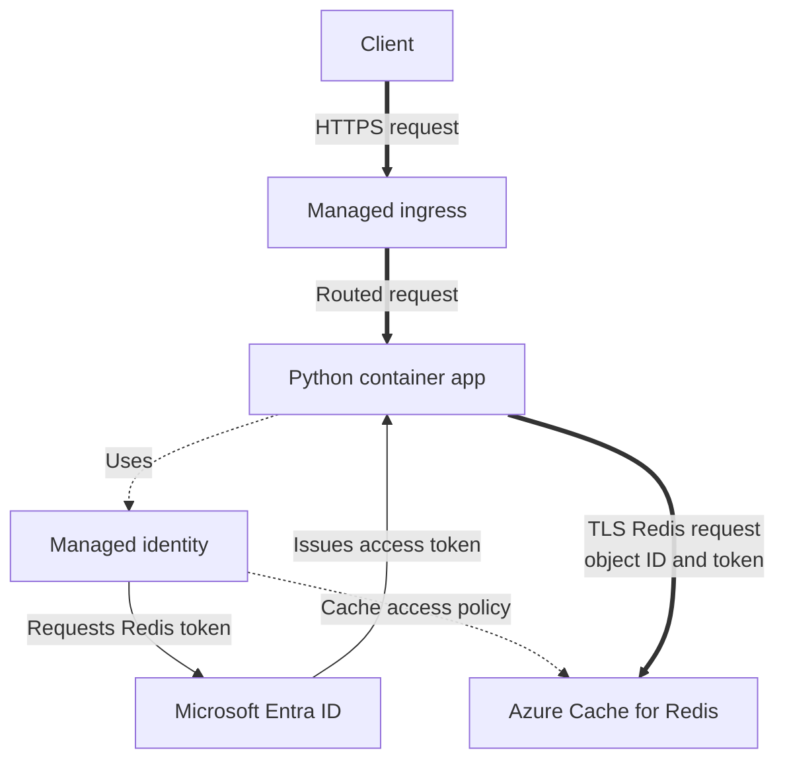

---
content_sources:
  diagrams:
    - id: architecture
      type: flowchart
      source: mslearn-adapted
      based_on:
        - https://learn.microsoft.com/en-us/azure/azure-cache-for-redis/cache-azure-active-directory-for-authentication
        - https://learn.microsoft.com/en-us/azure/azure-cache-for-redis/cache-python-get-started
---
# Azure Cache for Redis Integration (Managed Identity)

Use this recipe to connect Azure Container Apps to Azure Cache for Redis with Microsoft Entra authentication and managed identity.

## Architecture

<!-- diagram-id: architecture -->


Thick arrows show request or Redis transport. Thin arrows show token exchange, and dotted arrows show identity and authorization associations.

## Prerequisites

- Existing Container App: `$APP_NAME` in `$RG`
- Existing Azure Cache for Redis instance
- TLS-enabled Redis access (default)

## Step 1: Enable managed identity on the Container App

```bash
az containerapp identity assign \
  --name "$APP_NAME" \
  --resource-group "$RG" \
  --system-assigned

export PRINCIPAL_ID=$(az containerapp show \
  --name "$APP_NAME" \
  --resource-group "$RG" \
  --query "identity.principalId" \
  --output tsv)
```

| Command | Why it is used |
|---|---|
| `az containerapp identity assign` | Assigns the managed identity required by this recipe. |
| `az containerapp show` | Reads the Container App property needed by the next recipe step. |
| `--name` | Selects the named resource operated on in this recipe step. |
| `--resource-group` | Selects the resource group that contains this step's target resource. |
| `--system-assigned` | Enables the system identity used by the app, job, or scaler. |
| `--query` | Extracts the exact resource property consumed by the next command. |
| `--output` | Returns the result in the format consumed by the shell or verification table. |


## Step 2: Assign Redis data access policy

Get the object ID used as Redis username:

```bash
export OBJECT_ID=$(az ad sp show \
  --id "$PRINCIPAL_ID" \
  --query "id" \
  --output tsv)
```

| Command | Why it is used |
|---|---|
| `az ad sp show` | Reads the enterprise application's object ID for the Redis assignment. |
| `--id` | Selects the resource or application by its full identifier. |
| `--query` | Extracts the exact resource property consumed by the next command. |
| `--output` | Returns the result in the format consumed by the shell or verification table. |


Create an access policy assignment (for example, Data Owner):

```bash
az redis access-policy-assignment create \
  --name "$REDIS_NAME" \
  --resource-group "$RG" \
  --access-policy-name "Data Owner" \
  --object-id "$OBJECT_ID" \
  --object-id-alias "$APP_NAME"
```

| Command | Why it is used |
|---|---|
| `az redis access-policy-assignment create` | Grants the app identity the selected Redis data access policy. |
| `--name` | Selects the named resource operated on in this recipe step. |
| `--resource-group` | Selects the resource group that contains this step's target resource. |
| `--access-policy-name` | Selects the Redis data access policy granted to the app identity. |
| `--object-id` | Targets the enterprise application's object ID for Redis access. |
| `--object-id-alias` | Provides the readable identity label shown in the Redis assignment. |


## Step 3: Configure Redis endpoint for the app

```bash
az containerapp update \
  --name "$APP_NAME" \
  --resource-group "$RG" \
  --set-env-vars REDIS_HOST="$REDIS_NAME.redis.cache.windows.net" REDIS_PORT="10000"
```

| Command | Why it is used |
|---|---|
| `az containerapp update` | Updates the selected Container App with this step's image or configuration. |
| `--name` | Selects the named resource operated on in this recipe step. |
| `--resource-group` | Selects the resource group that contains this step's target resource. |
| `--set-env-vars` | Adds the recipe's runtime settings to the new app revision. |


## Step 4: Python code (Entra token auth)

Install dependencies:

```bash
pip install azure-identity redis
```

Use managed identity token as Redis password:

```python
import os
import redis
from azure.identity import DefaultAzureCredential

credential = DefaultAzureCredential()
access_token = credential.get_token("https://redis.azure.com/.default").token

host = os.environ["REDIS_HOST"]
port = int(os.environ.get("REDIS_PORT", "10000"))

# Username is the Entra object ID of the managed identity
username = os.environ["REDIS_OBJECT_ID"]

client = redis.Redis(
    host=host,
    port=port,
    username=username,
    password=access_token,
    ssl=True,
    decode_responses=True,
)

client.set("health", "ok", ex=60)
print(client.get("health"))
```

Store `REDIS_OBJECT_ID` as a non-secret environment variable:

```bash
az containerapp update \
  --name "$APP_NAME" \
  --resource-group "$RG" \
  --set-env-vars REDIS_OBJECT_ID="$OBJECT_ID"
```

| Command | Why it is used |
|---|---|
| `az containerapp update` | Updates the selected Container App with this step's image or configuration. |
| `--name` | Selects the named resource operated on in this recipe step. |
| `--resource-group` | Selects the resource group that contains this step's target resource. |
| `--set-env-vars` | Adds the recipe's runtime settings to the new app revision. |


## Container Apps specifics

- Keep Redis host, port, and object ID in environment variables.
- Avoid access keys and connection strings when using managed identity.
- If using private networking, pair this setup with private endpoints and VNet integration.

## Verification steps

1. Confirm access policy assignment:

```bash
az redis access-policy-assignment list \
  --name "$REDIS_NAME" \
  --resource-group "$RG" \
  --output table
```

| Command | Why it is used |
|---|---|
| `az redis access-policy-assignment list` | Lists Redis access-policy assignments for verification. |
| `--name` | Selects the named resource operated on in this recipe step. |
| `--resource-group` | Selects the resource group that contains this step's target resource. |
| `--output` | Returns the result in the format consumed by the shell or verification table. |


2. Confirm app logs show successful Redis `SET`/`GET`:

```bash
az containerapp logs show \
  --name "$APP_NAME" \
  --resource-group "$RG" \
  --follow false
```

| Command | Why it is used |
|---|---|
| `az containerapp logs show` | Streams or retrieves logs from the selected app or revision for verification. |
| `--name` | Selects the named resource operated on in this recipe step. |
| `--resource-group` | Selects the resource group that contains this step's target resource. |
| `--follow` | Continues streaming new log records during verification. |


## See Also
- [Managed Identity](../../../platform/identity-and-secrets/managed-identity.md)
- [Private Endpoints](../../../platform/networking/private-endpoints.md)

## Sources
- [Azure Cache for Redis + Microsoft Entra auth](https://learn.microsoft.com/en-us/azure/azure-cache-for-redis/cache-azure-active-directory-for-authentication)
- [Python quickstart for Azure Cache for Redis (Microsoft Learn)](https://learn.microsoft.com/en-us/azure/azure-cache-for-redis/cache-python-get-started)
