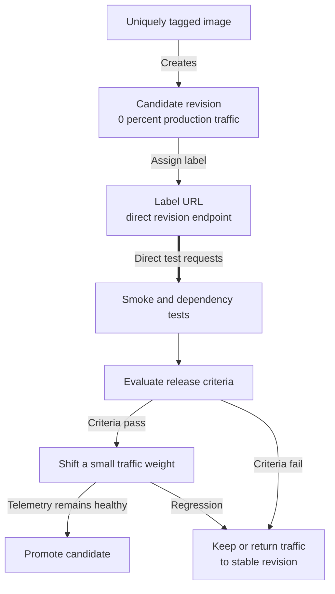

---
content_sources:
  diagrams:
    - id: validate-new-revisions-with-direct-testing
      type: flowchart
      source: mslearn-adapted
      based_on:
        - https://learn.microsoft.com/en-us/azure/container-apps/revisions
        - https://learn.microsoft.com/en-us/azure/container-apps/traffic-splitting
        - https://learn.microsoft.com/en-us/azure/container-apps/health-probes
---
# Recipe: Revision Validation Before Production Traffic

Validate new revisions with direct testing and controlled traffic movement so you can release safely without impacting all users at once.

<!-- diagram-id: validate-new-revisions-with-direct-testing -->


Thick arrows show direct test traffic. Thin arrows show release-control decisions; a zero traffic weight does not deactivate the labeled candidate revision.

## Prerequisites

- Existing Container App with multiple revision mode enabled
- Azure CLI 2.57+ with Container Apps extension
- Smoke tests for your key endpoints

```bash
az containerapp revision set-mode \
  --name "$APP_NAME" \
  --resource-group "$RG" \
  --mode multiple
```

| Command | Why it is used |
|---|---|
| `az containerapp revision set-mode` | Enables simultaneous revisions so the candidate can be validated before receiving production traffic. |
| `--name` | Targets `$APP_NAME`, whose candidate and stable revisions will coexist during validation. |
| `--resource-group` | Locates that app in `$RG` before changing its revision mode. |
| `--mode` | Sets `multiple`, allowing the new revision to remain active alongside the current production revision. |


## Deploy a new revision at 0% traffic

```bash
az containerapp update \
  --name "$APP_NAME" \
  --resource-group "$RG" \
  --image "$ACR_NAME.azurecr.io/$APP_NAME:$IMAGE_TAG" \
  --revision-suffix "canary"

export NEW_REVISION=$(az containerapp revision list \
  --name "$APP_NAME" \
  --resource-group "$RG" \
  --query "[?contains(name, 'canary')].name | [0]" \
  --output tsv)

az containerapp ingress traffic set \
  --name "$APP_NAME" \
  --resource-group "$RG" \
  --revision-weight "$NEW_REVISION=0"
```

| Command | Why it is used |
|---|---|
| `az containerapp update` | Deploys the candidate image as a `canary` revision while existing traffic remains on the stable revision. |
| `az containerapp revision list` | Reads the Container App revisions for `$APP_NAME` and extracts `[?contains(name, 'canary')].name | [0]`. |
| `az containerapp ingress traffic set` | Keeps the new canary revision active at zero traffic during validation. |
| `--name` | Targets `$APP_NAME` for revision traffic allocation, revision-state inspection and workload configuration update. |
| `--resource-group` | Scopes revision traffic allocation, revision-state inspection and workload configuration update to `$RG`. |
| `az containerapp update --image` | Deploys the candidate build identified by `$IMAGE_TAG` to a new revision. |
| `az containerapp update --revision-suffix` | Configures the revision suffix as `canary` on `az containerapp update`. |
| `az containerapp revision list --query` | Finds the first revision whose generated name contains the `canary` suffix. |
| `az containerapp revision list --output` | Captures that revision name as plain text in `NEW_REVISION` for labeling and traffic control. |
| `az containerapp ingress traffic set --revision-weight` | Configures the revision weight as `$NEW_REVISION=0` on `az containerapp ingress traffic set`. |


## Revision labels and direct URL testing

Assign a label so testers can call the candidate revision directly.

```bash
az containerapp revision label add \
  --name "$APP_NAME" \
  --resource-group "$RG" \
  --label "canary" \
  --revision "$NEW_REVISION"

export LABEL_URL=$(az containerapp show \
  --name "$APP_NAME" \
  --resource-group "$RG" \
  --query "properties.configuration.ingress.fqdn" \
  --output tsv)

curl --fail "https://canary---$LABEL_URL/health"
```

| Command | Why it is used |
|---|---|
| `az containerapp revision label add` | Adds the `canary` label so the candidate revision has a stable test URL. |
| `az containerapp show` | Retrieves the app ingress host used to construct the canary label URL. |
| `--name` | Targets `$APP_NAME` for candidate-revision labeling and Container App property inspection. |
| `--resource-group` | Scopes candidate-revision labeling and Container App property inspection to `$RG`. |
| `az containerapp revision label add --label` | Configures the label as `canary` on `az containerapp revision label add`. |
| `az containerapp revision label add --revision` | Configures the specific revision under inspection as `$NEW_REVISION` on `az containerapp revision label add`. |
| `az containerapp show --query` | Selects the base ingress FQDN that follows the `canary---` label prefix. |
| `az containerapp show --output` | Stores the hostname without JSON quotes so `curl` can use it in `LABEL_URL`. |


## Health check validation before traffic shift

Confirm:

1. `/health` returns 200.
2. Dependency checks (database/cache/API) pass.
3. Error rate and latency are within baseline.

```bash
az containerapp logs show \
  --name "$APP_NAME" \
  --resource-group "$RG" \
  --revision "$NEW_REVISION" \
  --follow false
```

| Command | Why it is used |
|---|---|
| `az containerapp logs show` | Retrieves `$APP_NAME` runtime logs to inspect candidate health before traffic. |
| `--name` | Targets `$APP_NAME`, whose candidate revision logs are inspected before traffic. |
| `--resource-group` | Finds `$APP_NAME` in `$RG` for the candidate's pre-traffic log inspection. |
| `--revision` | Configures the specific revision under inspection as `$NEW_REVISION` on `az containerapp logs show`. |
| `--follow` | Uses `false` to inspect candidate health before traffic. |


## Weighted traffic splitting (canary)

Shift traffic gradually while watching telemetry.

```bash
export STABLE_REVISION=$(az containerapp revision list \
  --name "$APP_NAME" \
  --resource-group "$RG" \
  --query "[?properties.active==\`true\` && name!=\`$NEW_REVISION\`].name | [0]" \
  --output tsv)

# 10% canary
az containerapp ingress traffic set \
  --name "$APP_NAME" \
  --resource-group "$RG" \
  --revision-weight "$STABLE_REVISION=90" "$NEW_REVISION=10"

# Promote to 100% after validation window
az containerapp ingress traffic set \
  --name "$APP_NAME" \
  --resource-group "$RG" \
  --revision-weight "$NEW_REVISION=100"
```

| Command | Why it is used |
|---|---|
| `az containerapp revision list` | Reads the Container App revisions for `$APP_NAME` and extracts `[?properties.active==\`true\` && name!=\`$NEW_REVISION\`].name | [0]`. |
| `az containerapp ingress traffic set` | Shifts 10 percent, then all traffic, to the validated canary revision. |
| `--name` | Targets `$APP_NAME` for revision traffic allocation and revision-state inspection. |
| `--resource-group` | Scopes revision traffic allocation and revision-state inspection to `$RG`. |
| `az containerapp revision list --query` | Identifies an active revision other than the candidate to serve as the stable baseline. |
| `az containerapp revision list --output` | Assigns the selected baseline name directly to `STABLE_REVISION`. |
| `az containerapp ingress traffic set --revision-weight` | Configures the revision weight as `$STABLE_REVISION=90`, `$NEW_REVISION=10`, `$NEW_REVISION=100` on `az containerapp ingress traffic set`. |


## Automated revision validation script

```bash
#!/usr/bin/env bash
set -euo pipefail

APP_NAME="$1"
RG="$2"
LABEL="canary"

FQDN=$(az containerapp show \
  --name "$APP_NAME" \
  --resource-group "$RG" \
  --query "properties.configuration.ingress.fqdn" \
  --output tsv)

for path in /health /ready /version; do
  echo "Testing ${path}"
  curl --silent --show-error --fail "https://${LABEL}---${FQDN}${path}" > /dev/null
done

echo "Revision validation passed"
```

| Command | Why it is used |
|---|---|
| `az containerapp show` | Supplies the ingress hostname used by the automated health, readiness, and version probes. |
| `--name` | Targets `$APP_NAME`, whose ingress state is collected for automated validation. |
| `--resource-group` | Locates `$APP_NAME` in `$RG` before the script resolves its ingress hostname. |
| `--query` | Restricts the script input to the externally resolvable ingress FQDN. |
| `--output` | Writes the hostname as shell-ready text for concatenation with each probe path. |


## Rollback patterns

- **Fast rollback**: route 100% back to last stable revision.
- **Safe rollback**: keep canary alive at 0% for postmortem testing.
- **Operational rollback**: disable bad revision if it causes repeated probe failures.

```bash
az containerapp ingress traffic set \
  --name "$APP_NAME" \
  --resource-group "$RG" \
  --revision-weight "$STABLE_REVISION=100" "$NEW_REVISION=0"
```

| Command | Why it is used |
|---|---|
| `az containerapp ingress traffic set` | Restores all traffic to the stable revision during rollback. |
| `--name` | Selects `$APP_NAME` as the app whose traffic is rolled back to the stable revision. |
| `--resource-group` | Finds the canary deployment in `$RG` before restoring the stable traffic split. |
| `--revision-weight` | Configures the revision weight as `$STABLE_REVISION=100`, `$NEW_REVISION=0` on `az containerapp ingress traffic set`. |


## Advanced Topics

- Integrate validation into CI/CD gates before promotion.
- Use synthetic transactions instead of health-only checks.
- Add automatic rollback triggers from error-budget policies.

## See Also

- [Container Registry](container-registry.md)
- [Custom Container](custom-container.md)
- [Revisions](../../../platform/revisions/index.md)
- [Microsoft Learn: Revisions in Container Apps](https://learn.microsoft.com/en-us/azure/container-apps/revisions)

## Sources

- [Microsoft Learn source 1](https://learn.microsoft.com/en-us/azure/container-apps/revisions)
- [Microsoft Learn source 2](https://learn.microsoft.com/en-us/azure/container-apps/traffic-splitting)
- [Microsoft Learn source 3](https://learn.microsoft.com/en-us/azure/container-apps/health-probes)
